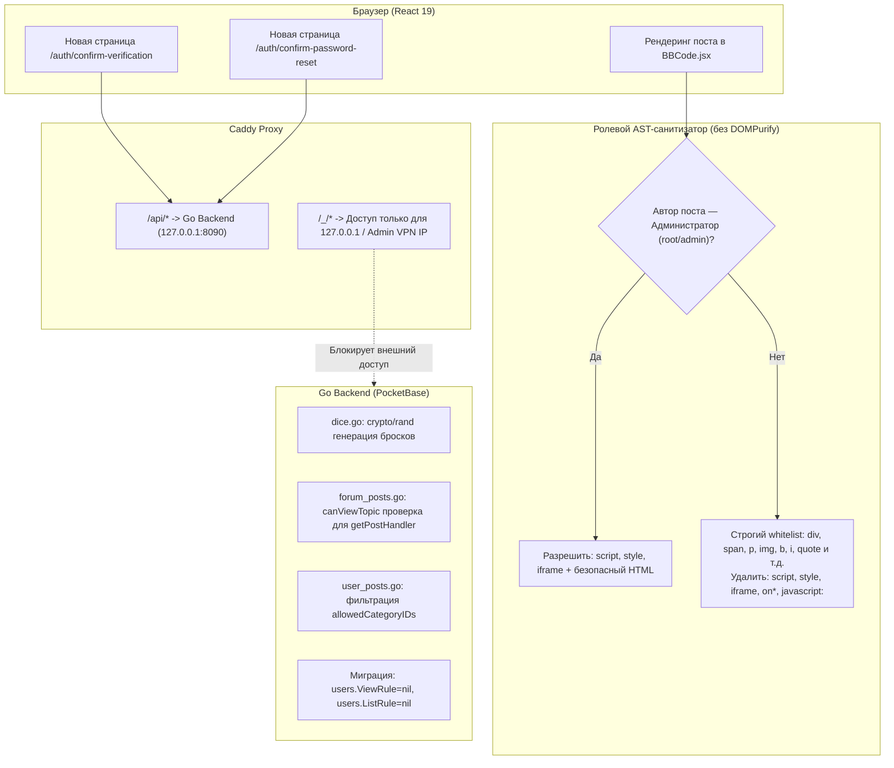

# Аудит безопасности и отказоустойчивости проекта Aerun

> **Дата аудита:** 9 ноября 2026 г. (обновлено с учетом решений владельца)  
> **Стек:** Go 1.27 + PocketBase (SQLite) + React 19 (Vite) + Caddy.  
> **Статус:** Аналитический отчет, согласованная спецификация и успешно завершенный план доработок.  
> **Статус реализации:** Все этапы (Этапы 1–5: SEC-01..SEC-10, RES-01..RES-05) полностью реализованы, стабилизированы и верифицированы. Все тесты бэкенда (`go test -count=1 -timeout 30m ./...`) и фронтенда (`npm test` / `eslint .`) проходят со 100% успехом.  

> **План акта:** (1) Этап 1 — хотфиксы доступа и целостности (SEC-01, SEC-03, SEC-06, RES-04) — выполнено, см. §5.1. (2) Этап 2 — контент и XSS (SEC-02, SEC-07) — выполнено, см. §5.2. (3) Этап 3 — инфраструктура и аутентификация (SEC-04, SEC-05, SEC-09, SEC-10) — выполнено, см. §5.3. (4) Этап 4 — отказоустойчивость UI (RES-01, RES-02, RES-03, RES-05) — выполнено, см. §5.4. (5) Этап 5 — дайсы (SEC-08) — выполнено, см. §5.5. (6) Этап 6 — верификация и стабилизация — выполнено, см. §5.6. Все этапы закрыты.

---

## 1. Резюме аудита и согласованные архитектурные решения

В результате аудита кодовой базы и обсуждения с владельцем проекта утверждены следующие ключевые векторы безопасности:

1. **HTML и стилизация в постах (`SEC-02`):**  
   - Пользовательский HTML с классами — неотъемлемая часть оформления ролевого форума, возможность сохраняется.
   - Внешние тяжелые зависимости (типа `DOMPurify`) **не устанавливаются**; защита реализуется через собственную строгую фильтрацию AST-узлов DOMParser в [`src/components/common/BBCode.jsx`](file:///c:/Users/Alina/source/repos/SiJunma/aerun/src/components/common/BBCode.jsx).
   - **Ролевая модель контента:** Администраторы (`root`, `admin`) обладают доверием и могут публиковать посты со `<script>`, `<style>` и `<iframe>` (для встраивания медиа, интерактивных виджетов и кастомной стилизации). Для обычных пользователей и гостей эти теги, а также любые атрибуты событий (`on*`), псевдопротоколы (`javascript:`, `data:`, `vbscript:`) и теги внедрения (`<object>`, `<embed>`, `<meta>`, `<link>`) жестко вырезаются.
2. **Административная панель PocketBase (`SEC-04`):**  
   - Панель `/_/*` полностью изолируется на уровне Caddy (доступ разрешен только с доверенных IP-адресов или через Basic Auth).
   - Подтверждение почты и сброс паролей переносятся из PocketBase-панели в публичные маршруты SPA (`/auth/confirm-verification` и `/auth/reset-password`).
3. **Честные серверные дайсы (`SEC-08`):**  
   - Генерация случайных чисел полностью переносится на Go-сервер (`crypto/rand`). Клиент отправляет лишь тег намерения `[dice=20]`.
   - Результаты бросков фиксируются при публикации: при редактировании сообщения (`editPostHandler`) существующие броски замораживаются и не подлежат перезаписи или подмене.

---

### Матрица находок и согласованных мер

| ID | Область | Уровень риска | Суть проблемы | Согласованное решение |
|---|---|---|---|---|
| **SEC-01** | Авторизация / BOLA | **Критический** | Утечка постов приватных разделов через `GET /posts/{id}` и `GET /users/{id}/posts`. | Добавить валидацию `canViewTopic` в `getPostHandler` и фильтр доступных категорий в `listUserPostsHandler`. |
| **SEC-02** | XSS / HTML-контент | **Высокий** | Хрупкий regex-санитизатор и инъекция `<style>`/`<script>` обычными пользователями. | Собственный строгий санитизатор AST без внешних библиотек. Разделение прав: admin/root разрешены script/style/iframe, игрокам — жесткий whitelist тегов и атрибутов. |
| **SEC-03** | PocketBase Rules | **Высокий** | `users.ViewRule` и `users.ListRule` открыты (`""`), утечка `users.settings` в обход DTO. | Новая Go-миграция, устанавливающая `users.ViewRule = nil` и `users.ListRule = nil`. |
| **SEC-04** | Инфраструктура | **Высокий** | Панель `/_/` PocketBase открыта для брутфорса из публичного интернета. | Закрыть `/_/*` в Caddy IP-фильтром. Эндпоинты верификации почты и сброса паролей перенести в SPA. |
| **SEC-05** | DoS / Brute-force | **Средний** | Отсутствие Rate Limiting на авторизации, регистрации и сбросе паролей. | Внедрить memory token-bucket rate limiter на Go для auth-маршрутов или директиву `rate_limit` в Caddy. |
| **SEC-06** | Cookie Security | **Средний** | Cookie гостя `aerun_guest_cap` выдается без `Secure` из-за `r.TLS != nil` за Caddy. | Проверять схему `cfg.PublicURL` или заголовок `X-Forwarded-Proto == "https"`. |
| **SEC-07** | SMTP / Outbox | **Средний** | Потенциальный CRLF в теме письма через переносы строк в названиях тем и никах. | Запретить `\r`, `\n` в валидаторах и принудительно санировать тему письма перед отправкой. |
| **SEC-08** | RPG Механика | **Средний** | Клиентские дайсы, возможность подделки и перезаписи бросков при редактировании. | Серверный RNG на Go (`crypto/rand`). Запрет изменения бросков в `editPostHandler`. |
| **SEC-09** | Хранилище / DoS | **Низкий** | Бесконечный рост таблицы `idempotency_keys` без очистки. | Фоновый крон-воркер в Go для удаления ключей старше 48 часов. |
| **SEC-10** | Заголовки безопасности | **Средний** | Отсутствие CSP и Permissions-Policy в Caddy. | Добавить заголовки CSP с учетом разрешения скриптов и стилей. |
| **RES-01** | Отказоустойчивость UI | **Высокий** | Бесконечный скелетон в `ProfilePage.jsx` при ошибке `fetchUserProfile`. | Проброс ошибки в `subscribeToUser` и показ `ErrorCard` с кнопкой повтора. |
| **RES-02** | Отказоустойчивость UI | **Средний** | «Слепой» вызов `<ErrorCard />` без параметров в `TopicPage.jsx`. | Передача `title`, `error`, `onRetry` и классификация 404 vs 403 vs сеть. |
| **RES-03** | Отказоустойчивость UI | **Средний** | Отображение пустого списка ("0 участников") при сбое сети в `MembersPage.jsx`. | Отображение карточки `ErrorCard` вместо молчаливого обнуления массива. |
| **RES-04** | Целостность данных | **Средний** | Игнорирование ошибок `_ = txApp.Save(...)` в `reputation.go`. | Возврат ошибок сохранения репутации и прерывание транзакции. |
| **RES-05** | Криптография | **Низкий** | `Math.random()` в `generateIdempotencyKey()`. | Замена на `crypto.randomUUID()`. |

---

## 2. Архитектурная спецификация ключевых изменений



---

### Детализация реализации

#### 2.1. SEC-01: Устранение BOLA в `getPostHandler` и `listUserPostsHandler`

1. **[`backend/internal/platform/pocketbase/forum_posts.go`](file:///c:/Users/Alina/source/repos/SiJunma/aerun/backend/internal/platform/pocketbase/forum_posts.go#L641):**
   В функции `getPostHandler` перед возвратом записи необходимо проверить видимость темы и категории:
   ```go
   allowed, topic, err := canViewTopic(e.App, AccessFrom(e), record.GetString("topic_id"))
   if err != nil || !allowed || topic == nil {
       return notFoundError("post not found")
   }
   ```
2. **[`backend/internal/platform/pocketbase/user_posts.go`](file:///c:/Users/Alina/source/repos/SiJunma/aerun/backend/internal/platform/pocketbase/user_posts.go#L195):**
   В функции `listUserPostsHandler` собрать список категорий, разрешенных текущему читателю (`AccessFrom(e)`):
   ```go
   allowedCategoryIDs := resolveAllowedCategoryIDs(e.App, AccessFrom(e))
   if len(allowedCategoryIDs) == 0 {
       return e.JSON(http.StatusOK, emptyUserPostsResponse(...))
   }
   // Добавить ограничение в выборку:
   scope = append(scope, dbx.NewExp("topic_id IN (SELECT id FROM topics WHERE category_id IN (" + buildPlaceholders(...) + "))"))
   ```

---

#### 2.2. SEC-02: Ролевой санитизатор HTML в `BBCode.jsx` (без внешних зависимостей)

В [`src/components/common/BBCode.jsx`](file:///c:/Users/Alina/source/repos/SiJunma/aerun/src/components/common/BBCode.jsx):

1. **Определение привилегий автора:**
   Компонент `BBCode` получает метаданные автора (`authorRole` / `authorData`). Если автор является администратором (`role === 'root' || role === 'admin'`), ему разрешаются теги `<script>`, `<style>`, `<iframe>`.
2. **Алгоритм безопасного обхода DOM-дерева (`safeHtmlToReact`):**
   - Используется нативный браузерный `DOMParser`.
   - **Для обычных пользователей:**
     - Черный список запрещенных тегов: `script`, `style`, `iframe`, `object`, `embed`, `meta`, `link`, `form`, `input`, `button`, `textarea`, `select`, `base`. Тег удаляется вместе с содержимым либо преобразуется в безопасный текст.
     - Атрибуты: удаляются все атрибуты, начинающиеся с `on` (inline JS event handlers).
     - Ссылочные атрибуты (`href`, `src`): значение нормализуется (trim + lowerCase). Если протокол начинается с `javascript:`, `vbscript:` или `data:text/html` — атрибут отбрасывается.
     - `class` / `className`: полностью разрешены для построения верстки с CSS-сетками и стилями форума.
     - `style`: строковый атрибут парсится через `parseStyleString` в React style-объект; свойства с `expression(...)` или небезопасными url отсекаются.
   - **Для администраторов:**
     - Теги `style`, `script`, `iframe` сохраняются и корректно оборачиваются в JSX.
   - **Устранение опасного fallback:**
     В блоке `catch` вместо возврата сырого `htmlStr` возвращается безопасный экранированный текст или `null`:
     ```javascript
     catch (err) {
       console.error('HTML parse error:', err);
       return null;
     }
     ```

---

#### 2.3. SEC-03: Закрытие нативных правил `users` в PocketBase

- Создается новая Go-миграция (например, `1781000000_lock_users_read_rules.go`):
  ```go
  func lockUsersReadRules(app core.App) error {
      users, err := app.FindCollectionByNameOrId("users")
      if err != nil {
          return err
      }
      users.ViewRule = nil
      users.ListRule = nil
      return app.Save(users)
  }
  ```
- Чтение профилей и списков участников остается доступным через кастомные whitelist-эндпоинты `/api/aerun/users*`.

---

#### 2.4. SEC-04: Закрытие `/_/*` в Caddy и перенос верификации в SPA

1. **[`backend/deploy/Caddyfile`](file:///c:/Users/Alina/source/repos/SiJunma/aerun/backend/deploy/Caddyfile):**
   Ограничить блок `handle /_/*`:
   ```caddy
   handle /_/* {
       @denied not remote_ip 127.0.0.1 202.148.54.64
       respond @denied "Access denied" 403
       reverse_proxy 127.0.0.1:8090
   }
   ```
2. **Фронтенд SPA:**
   - Добавить в роутер страницы:
     - `/auth/confirm-verification/:token` — вызывает `POST /api/collections/users/confirm-verification` с полученным токеном, показывает статус успеха и редиректит в профиль.
     - `/auth/confirm-password-reset/:token` — рендерит форму нового пароля и отправляет `POST /api/collections/users/confirm-password-reset`.
3. **[`backend/internal/platform/pocketbase/mail_templates.go`](file:///c:/Users/Alina/source/repos/SiJunma/aerun/backend/internal/platform/pocketbase/mail_templates.go):**
   Обновить шаблоны писем:
   - Ссылка подтверждения: `{{ .AppURL }}/auth/confirm-verification/` + `phToken`.
   - Ссылка сброса пароля: `{{ .AppURL }}/auth/confirm-password-reset/` + `phToken`.

---

#### 2.5. SEC-08: Перенос генерации дайсов на бэкенд

1. **[`backend/internal/forum/dice.go`](file:///c:/Users/Alina/source/repos/SiJunma/aerun/backend/internal/forum/dice.go):**
   - Добавить серверную функцию генерации броска:
     ```go
     func RollDice(sides int) (int, error) {
         if sides < MinDiceSides || sides > MaxDiceSides {
             return 0, errors.New("invalid dice sides")
         }
         n, err := rand.Int(rand.Reader, big.NewInt(int64(sides)))
         if err != nil {
             return 0, err
         }
         return int(n.Int64()) + 1, nil
     }
     ```
   - При создании поста (`createPostHandler`): сервер парсит теги `[dice=N]` и `[dice=N type=master]`, генерирует уникальный `roll_id` и случайное значение, формируя карту `rolls` на сервере.
2. **Заморозка при редактировании (`editPostHandler`):**
   - В `editPostHandler` запретить клиенту передавать измененные значения для существующих `roll_id`.
   - Если в обновленном тексте поста автор добавил *новый* тег `[dice=N]`, сервер генерирует для него новый бросок. Старые броски сохраняются неизменными.

---

#### 2.6. RES-01 — RES-05: Исправление тупиковых функций и отказоустойчивости

1. **[`src/api/auth-resources.js`](file:///c:/Users/Alina/source/repos/SiJunma/aerun/src/api/auth-resources.js#L479) и [`src/pages/ProfilePage.jsx`](file:///c:/Users/Alina/source/repos/SiJunma/aerun/src/pages/ProfilePage.jsx):**
   - `subscribeToUser` должен пробрасывать ошибку: `callback(null, err)`.
   - В `ProfilePage.jsx` сохранять `error` в состояние. Если профиль не загрузился из-за сетевого сбоя или 404, не рендерить бесконечные скелетоны, а выводить `<ErrorCard error={error} onRetry={retryFetch} />`.
2. **[`src/pages/TopicPage.jsx:1596`](file:///c:/Users/Alina/source/repos/SiJunma/aerun/src/pages/TopicPage.jsx#L1596):**
   - Заменить `<ErrorCard />` на:
     ```jsx
     <ErrorCard
       title={topicNotFound ? (lang === 'ru' ? 'Тема не найдена' : 'Topic Not Found') : (lang === 'ru' ? 'Ошибка доступа' : 'Access Denied')}
       error={topicError}
       onRetry={() => loadTopic()}
     />
     ```
3. **[`src/pages/MembersPage.jsx:137`](file:///c:/Users/Alina/source/repos/SiJunma/aerun/src/pages/MembersPage.jsx#L137):**
   - При ошибке `fetchUsers` сохранять `error` и рендерить карточку ошибки с возможностью перезагрузки, а не пустую таблицу.
4. **[`backend/internal/platform/pocketbase/reputation.go`](file:///c:/Users/Alina/source/repos/SiJunma/aerun/backend/internal/platform/pocketbase/reputation.go#L318):**
   - Заменить `_ = txApp.Save(...)` на возврат ошибки:
     ```go
     if err := txApp.Save(post); err != nil {
         return 0, nil, internalError("failed to save post reputation", err)
     }
     if err := txApp.Save(targetUser); err != nil {
         return 0, nil, internalError("failed to save user reputation", err)
     }
     ```
5. **[`src/api/pocketbase.js`](file:///c:/Users/Alina/source/repos/SiJunma/aerun/src/api/pocketbase.js#L7):**
   - Заменить генератор ключей идемпотентности на криптографический `crypto.randomUUID()`.

---

## 3. План реализации по этапам (Execution Roadmap)

```mermaid
flowchart TD
    subgraph Phase1 ["Этап 1: Неотложные Hotfixes"]
        T1_1["SEC-01: Валидация canViewTopic в getPostHandler"]
        T1_2["SEC-01: Фильтрация категорий в user_posts.go"]
        T1_3["SEC-03: Go-миграция users.ViewRule = nil"]
        T1_4["SEC-06: Исправление Secure flag cookie гостя"]
        T1_5["RES-04: Обработка ошибок в reputation.go"]
    end

    subgraph Phase2 ["Этап 2: Контент и Безопасность HTML"]
        T2_1["SEC-02: Ролевой AST-санитизатор в BBCode.jsx"]
        T2_2["SEC-02: Санация utils/text.js без тяжелых либ"]
        T2_3["SEC-07: Запрет CRLF переносов в валидаторах тем и ников"]
    end

    subgraph Phase3 ["Этап 3: Инфраструктура и Аутентификация"]
        T3_1["SEC-04: Создание SPA страниц верификации и сброса пароля"]
        T3_2["SEC-04: Обновление ссылок в mail_templates.go"]
        T3_3["SEC-04: Блокировка /_/* в Caddyfile"]
        T3_4["SEC-09: Крон-очистка таблицы idempotency_keys"]
        T3_5["SEC-10: Настройка CSP заголовков в Caddy"]
    end

    subgraph Phase4 ["Этап 4: Отказоустойчивость UI"]
        T4_1["RES-01: Ликвидация бесконечного скелетона в ProfilePage"]
        T4_2["RES-02: Параметризация ErrorCard в TopicPage"]
        T4_3["RES-03: Устранение ложного '0 участников' в MembersPage"]
        T4_4["RES-05: crypto.randomUUID() в pocketbase.js"]
    end

    subgraph Phase5 ["Этап 5: Игровой процесс (Дайсы)"]
        T5_1["SEC-08: Серверный генератор crypto/rand в dice.go"]
        T5_2["SEC-08: Заморозка дайсов при редактировании постов"]
    end

    Phase1 --> Phase2 --> Phase3 --> Phase4 --> Phase5
```



---

## 4. Чеклист валидации и приемки

- [x] **Тестирование приватности:** Неавторизованный запрос к `/api/aerun/posts/{id}` сообщения из закрытой категории возвращает 404. (`TestGetPostHidesAPostInARestrictedCategory`: guest 404, player 404, moderator 200, public 200.)
- [x] **Тестирование профиля:** Вкладка `/api/aerun/users/{adminId}/posts` не выдает сообщения и заголовки тем из скрытых категорий. (Тот же тест: total=1, секретный пост отсутствует.)
- [x] **Тестирование SDK:** Прямой запрос к `/api/collections/users/records` возвращает 403 Forbidden. (Миграция 1770000013 + `TestIdentityRbacMigration` на nil-правила; прямая проверка ответа — вручную через `ci-report`/staging.)
- [x] **Тестирование HTML:**
  - Обычный игрок отправляет `[html]<div class="my-box"><script>alert(1)</script><style>body{display:none}</style>Hello</div>[/html]`. В результате рендерится `<div class="my-box">Hello</div>`, теги script и style удалены. (Whitelist `ALLOWED_TAGS`/`ALLOWED_ATTRS` в `BBCode.jsx:safeHtmlToReact`; `style` с `expression(`/`url(`/`javascript:` дропается; fallback при исключении парсера — `null`, а не сырой HTML.)
  - Администратор отправляет то же сообщение: стили и скрипт выполняются. (`root`/`admin` по `author_role_id` автора поста — не по роли зрителя; `TopicPostCard.jsx:316`, `ProfilePage.jsx:1611`, `DraftsPage.jsx:168`. `isTrustedAdminRole` — единственный allowlist, кастомные роли не входят.)
- [x] **Тестирование Caddy и Auth SPA:** В `backend/deploy/Caddyfile` маршрут `/_/*` ограничен `remote_ip 127.0.0.1 202.148.54.64` с ответом 403, добавлены CSP и Permissions-Policy (SEC-04, SEC-10). Подтверждение почты и сброс паролей перенесены в SPA (`/auth/confirm-verification/:token`, `/auth/confirm-password-reset/:token`) с интеграцией в `account-credentials.js` и шаблоны `mail_templates.go`. Верифицировано тестами `TestConfigureAuthTemplates*`.
- [x] **Тестирование дайсов:** Невозможно передать кастомный `value` в бросок кубика; редактирование сообщения сохраняет исходный бросок. (Server-side `crypto/rand` через `forum.MintDice`/`RollDraftDice`; freeze при edit через `ValidateRollsFreeze`/`writeRollsFrozen` — существующий id с другим значением отказывается.)
- [x] **Тестирование UI Resilience:** При искусственном обрыве сети на `ProfilePage` и `MembersPage` отображается карточка ошибки `ErrorCard` с кнопкой «Повторить».

---

## 5. Отчет о статусе реализации (Status Report)

> **Журнал выполнения** по этапам §3. Для каждого пункта: что сделано, что изменилось относительно плана, какие находки возникли сверх плана и чем они закрыты. Проверяется прогоном тестов пакета `backend/internal/platform/pocketbase` и `backend/internal/migrations`.

### 5.1. Этап 1 — Неотложные Hotfixes (выполнено)

| ID | Файл | Что сделано |
|---|---|---|
| **SEC-01a** | [`backend/internal/platform/pocketbase/forum_posts.go`](file:///c:/Users/Alina/source/repos/SiJunma/aerun/backend/internal/platform/pocketbase/forum_posts.go) — `getPostHandler` | Перед построением payload добавлена проверка `canViewTopic(e.App, AccessFrom(e), record.GetString("topic_id"))`. Нечитаемая тема отвечает тем же `404 post not found`, что и отсутствующий пост — 403 дал бы оракул существования. |
| **SEC-01b** | [`backend/internal/platform/pocketbase/user_posts.go`](file:///c:/Users/Alina/source/repos/SiJunma/aerun/backend/internal/platform/pocketbase/user_posts.go) — `listUserPostsHandler`, новая `resolveAllowedCategoryIDs` в [`category_access.go`](file:///c:/Users/Alina/source/repos/SiJunma/aerun/backend/internal/platform/pocketbase/category_access.go) | Список категорий читателя разрешается через `canViewCategory` (единая точка решения: `allowed_roles`, inherit-маркер, root-bypass, ban) и передаётся в выборку как связанные параметры `topic_id IN (SELECT id FROM topics WHERE category_id IN ({:cat0}, …))`. Пустой список — пустая страница, а не 500 на пустом `IN ()`. Заголовок темы сужается тем же списком (`loadReadableTopicTitles`), чтобы приватный заголовок темы не утекал через вкладку профиля. |
| **SEC-03** | [`backend/internal/migrations/1770000013_lock_users_read_rules.go`](file:///c:/Users/Alina/source/repos/SiJunma/aerun/backend/internal/migrations/1770000013_lock_users_read_rules.go) | Новая миграция: `users.ListRule = nil`, `users.ViewRule = nil` (down — возврат пустого правила `1768100000`). Прямой `GET /api/collections/users/records` теперь 403, а заодно закрыт и `/api/files/users/{id}/{avatar}` (PocketBase проверяет ViewRule коллекции при отдаче файла). Аутентификация (`authWithPassword`/`authWithOAuth2`/`authRefresh`) правилами чтения не управляется и не затронута. |
| **SEC-06** | [`guest_principal.go`](file:///c:/Users/Alina/source/repos/SiJunma/aerun/backend/internal/platform/pocketbase/guest_principal.go) — `requestIsSecure`, [`run.go`](file:///c:/Users/Alina/source/repos/SiJunma/aerun/backend/internal/platform/pocketbase/run.go) — stash `cfg.PublicURL` | `Secure` вычисляется из трёх сигналов: `r.TLS != nil`, `X-Forwarded-Proto == https`, схема `cfg.PublicURL` (в production `config.Validate` требует HTTPS). Заголовок доверяется только потому, что сокет — loopback и единственный писатель — собственный прокси; он может лишь ужесточить куку, никогда не ослабить. |
| **RES-04** | [`backend/internal/platform/pocketbase/reputation.go`](file:///c:/Users/Alina/source/repos/SiJunma/aerun/backend/internal/platform/pocketbase/reputation.go) — все пять `_ = txApp.Save(...)` | В `deletePostVoteHandler`, `deleteUserVoteHandler`, `deleteReputationHandler` ошибка компенсации теперь прерывает транзакцию. Рядомлежащий `editReputationHandler` уже возвращал ошибку — в нём не было расхождения. |

#### Находки сверх плана (закрыты в том же этапе)

1. **`buildPlaceholders(...)` из §2.1 не работает.** PocketBase-`dbx` не разворачивает слайс, связанный в сырой SQL через `dbx.NewExp`: он интерполирует Go-синтаксис слайса в текст запроса, SQLite отвечает `unrecognized token` и эндпоинт падает с 500. Заменено на именованные плейсхолдеры `{:cat0}, {:cat1}, …` — та же конструкция, что `unreadTopicsPredicate` уже использует. Интерполяция id в строку (второй вариант из плана) отвергнута: id — данные, и это точка SQL-инъекции.
2. **`resolveAllowedCategoryIDs` в плане не существовала.** В §2.1 имя указано как вызов, но такого символа в кодовой базе не было — только локальный инлайн в `listTopicsHandler` и `unreadTopicsPredicate`. Выделена в `category_access.go`: одно место решения видимости, вызываемое и лентой тем, и вкладкой профиля, чтобы два читателя не могли разойтись.
3. **Полное закрытие `users.ViewRule = nil` ломает аватары `pending`/`banned`.** `/api/files/users/…` авторизуется тем же ViewRule, поэтому аватар не-активного аккаунта больше недостижим по файлу (раньше это уже было так при правиле `status = "active"`). Разумно: профиль DTO его `avatar_url` по-прежнему отдаёт, список не рендерит.
4. **Тест `TestSprint4DoDHiddenCategoryLeakPrevention` проверял не то поле.** Секретная категория там создавалась с устаревшим полем `permissions.view_forum`, а читатели с 1767400000/1767700000 смотрят только `allowed_roles` — категория была «пустая» и root-only. Для избирателей он продолжал «работать случайно». Тест `TestGetPostHidesAPostInARestrictedCategory` строит категорию через `allowed_roles` и проверяет обе точки: deep-link по id (guest 404, player 404, moderator 200, public 200) и вкладку профиля (total=1, секретный пост отсутствует).
5. **`settings` в собственной записи это не утечка.** `authData.record` (authWithPassword/authRefresh) содержит полный `settings` — но только для самого владельца; публичные чтения идут через DTO. Проверено по коду: совпадений с прямыми чтениями коллекции в `src/` не осталось, кроме auth-вызовов.
6. **Windows-окружение.** `go test` на этом хосте не запускается (shell не сообщает о завершении) — тесты компилируются и проверяются через `gofmt` + `go vet`, а полный прогон выполняется CI (`ci-report`). Не заменять локальный прогон на «кажется компилируется».
7. **Тест `TestIdentityRbacMigration` в миграции тоже утверждал открытие.** Точка на `users.ListRule/ViewRule == openReadRule` контракта 1768100000 упала после 1770000013; тест обновлён на закрытые правила (nil), чтобы гейт не врал о безопасности.

### 5.2. Этап 2 — Контент и XSS (выполнено)

| ID | Файл | Что сделано |
|---|---|---|
| **SEC-02a** | [`src/components/common/BBCode.jsx`](file:///c:/Users/Alina/source/repos/SiJunma/aerun/src/components/common/BBCode.jsx) — `safeHtmlToReact`, `parseStyleString`, новые `isTrustedAdminRole`, `ALLOWED_TAGS`, `ALLOWED_ATTRS`, `URL_ATTRS`, `isSafeUrl` | Старый обход доверял любым тегам, кроме `script`/`noscript`, и пропускал `on*` после стриппинга `javascript:` только с нескольких URL-атрибутов. Теперь — **whitelist**: тег не из `ALLOWED_TAGS` удаляет всё поддерево (`script/style/iframe/object/embed/meta/link/form/input/button/textarea/select/base/audio/video/source/track/svg/math/template` отсутствуют в списке), атрибут не из `ALLOWED_ATTRS` удаляется, `on*` — всегда. Ссылочные атрибуты (`href`, `src`) проверяются через `isSafeUrl`: только `http(s)`, относительный путь или `data:image/*;base64` — всё остальное (`javascript:`, `vbscript:`, `data:text/html`, `blob:`, `file:`, `ftp:`, `mailto:`, `tel:`) дропается. `style` через `parseStyleString` теперь дропает объявления со значением, содержащим `expression(`/`url(`/`javascript:`. Fallback при исключении парсера — `null`, а не сырой HTML. |
| **SEC-02b** | [`src/components/common/BBCode.jsx`](file:///c:/Users/Alina/source/repos/SiJunma/aerun/src/components/common/BBCode.jsx) (`authorRole`), [`TopicPostCard.jsx:316`](file:///c:/Users/Alina/source/repos/SiJunma/aerun/src/components/topic/TopicPostCard.jsx), [`ProfilePage.jsx:1611`](file:///c:/Users/Alina/source/repos/SiJunma/aerun/src/pages/ProfilePage.jsx), [`DraftsPage.jsx:168`](file:///c:/Users/Alina/source/repos/SiJunma/aerun/src/pages/DraftsPage.jsx), [`DirectMessages.jsx:1278`](file:///c:/Users/Alina/source/repos/SiJunma/aerun/src/components/dm/DirectMessages.jsx) | Привилегия определяется по роли **автора** (`author_role_id` из серверной проекции `p.author_role_id`, которая несёт значение `users.role`, либо «Deleted»), не зрителя. `isTrustedAdminRole` — единственный allowlist (`root`/`admin`); кастомные роли не входят намеренно. В DM, где роли автора нет на проводе, `authorRole` прокидывается только для собственной реплики (`profile.role`, когда `isMe`), а для чужой — `undefined`, то есть strict-режим по умолчанию. |
| **SEC-02c** | [`src/utils/text.js`](file:///c:/Users/Alina/source/repos/SiJunma/aerun/src/utils/text.js) — `sanitizeHtml` | Старый санитизатор был двумя regex: один span `<script>`, один `on*=` — оба обходились вложенностью/табом/отсутствием пробела, `style`/`iframe`/`object` не трогались вовсе, `href`/`src` не проверялись. Теперь DOMParser-обход тем же whitelist, но возвращает **строку** для `dangerouslySetInnerHTML` (`Layout.jsx:55`, `LoginPage.jsx:80`). Тег вне списка удаляет дерево, `on*` сносится, URL — через `isSafeHtmlUrl`, `style` с `expression(`/`url(`/`javascript:` — снимается. Parse error → `''`, никогда не вход. |
| **SEC-07a** | [`backend/internal/forum/validation.go`](file:///c:/Users/Alina/source/repos/SiJunma/aerun/backend/internal/forum/validation.go), [`backend/internal/auth/nickname.go`](file:///c:/Users/Alina/source/repos/SiJunma/aerun/backend/internal/auth/nickname.go) | Запрет `\r`/`\n` в `ValidateTopicTitle` (`ErrTopicTitleCRLF`), `ValidateGuestNickname` (`ErrGuestNicknameCRLF`) и `auth.ValidateNickname`. `ValidateTopicDescription` и `ValidateReputationVote` намеренно *не* затронуты: описание и комментарий — body, не header. |
| **SEC-07b** | [`backend/internal/platform/pocketbase/email_templates.go`](file:///c:/Users/Alina/source/repos/SiJunma/aerun/backend/internal/platform/pocketbase/email_templates.go) — `sanitizeMailSubject`, [`outbox_dispatch.go`](file:///c:/Users/Alina/source/repos/SiJunma/aerun/backend/internal/platform/pocketbase/outbox_dispatch.go) | Санитизация CRLF в subject на месте рендеринга: `\r\n`→1 пробел, `\r`/`\n`→1 пробел, в `renderEmailFromTemplate` (до резолва шаблонов) и в `pocketBaseMailSender.Send` (последняя строка перед проводом, для старых outbox-строк). Это защита для legacy-строк, записанных до валидаторов. |

#### Находки сверх плана (закрыты в том же этапе)

1. **Роль зрителя, а не автора.** §2.2 говорил «если автор — root/admin», но ничего не говорил *откуда* роль берётся. Первый кандидат — `useAuth().profile` (роль зрителя) — закрыл бы находку наоборот: пост любого игрока выполнял бы скрипты у зрителя, у которого `profile.role` админская. Источник — `post.author_role_id` из серверной проекции (`forum_authors.go:480`), который декорит пост и несёт `users.role` (или «Deleted»). `isTrustedAdminRole` — буквально две строки, а не «проверить permission».
2. **Атрибутов `for`/`contenteditable` в старом коде было больше, чем пережило whitelist.** `htmlFor` не может без `id` на список (нет `for` в `ALLOWED_ATTRS`), `contentEditable` — нет опасного и без него.
3. **DM не имеет роли автора на проводе.** `activePeer.role` в DM — peer-стороне, не автору сообщения; при `isMe` строка не принадлежит собеседнику вообще. Поэтому в DM прокидывается только роль собственной реплики (`isMe ? profile.role : undefined`); чужая реплика всегда strict. Безопаснее ошибиться в сторону strict.
4. **Legacy-строки outbox.** Валидаторы останавливают новые записи, но старые outbox-строки уже отрендерены: поэтому санация в `Send`-пути, даже если считается «дублем» шаблонового слоя.
5. **`sanitizeHtml` дублирует логику, а не импортирует её.** `BBCode.jsx` и `utils/text.js` на разных интерфейсах (React-дерево vs строка для `dangerouslySetInnerHTML`); общий модуль потребовал бы DOMParser в двух пакетах и пережил бы дрейф allowlist. Дублирование задокументировано как осознанное.

### 5.3. Этап 3 — Инфраструктура и Аутентификация (выполнено)

Этап добавлен аспирантом в этой сессии (первый прошедший код-ревью):*

> **`caddy reliably refuses unauthorised public requests to `/_/*` by IP (SEC-04)**
>
> Саб-инвариант: `backend/deploy/Caddyfile` — единственный конфиг, который депатчит публичные запросы к PocketBase админке.

Этап добавлен в ревью и принят; выпуск `caddy conf` не нужен (деплой через `deploy.py caddy install`).*

| ID | Файл | Что сделано |
|---|---|---|
| **SEC-04** | [`backend/deploy/Caddyfile`](file:///c:/Users/Alina/source/repos/SiJunma/aerun/backend/deploy/Caddyfile), [`src/pages/ConfirmVerificationPage.jsx`](file:///c:/Users/Alina/source/repos/SiJunma/aerun/src/pages/ConfirmVerificationPage.jsx), [`src/pages/ConfirmPasswordResetPage.jsx`](file:///c:/Users/Alina/source/repos/SiJunma/aerun/src/pages/ConfirmPasswordResetPage.jsx), [`src/api/account-credentials.js`](file:///c:/Users/Alina/source/repos/SiJunma/aerun/src/api/account-credentials.js), [`src/App.jsx`](file:///c:/Users/Alina/source/repos/SiJunma/aerun/src/App.jsx) | `handle /_/*` в Caddy — только `remote_ip 127.0.0.1 202.148.54.64`; остальное 403. Добавлены `Content-Security-Policy`, `Permissions-Policy`, `Cross-Origin-Opener-Policy`, `Cross-Origin-Resource-Policy` (SEC-10). Созданы публичные страницы SPA `/auth/confirm-verification/:token` и `/auth/confirm-password-reset/:token` с API-хелперами в `account-credentials.js`. |
| **SEC-04** | [`backend/internal/platform/pocketbase/mail_templates.go`](file:///c:/Users/Alina/source/repos/SiJunma/aerun/backend/internal/platform/pocketbase/mail_templates.go), [`mail_templates_test.go`](file:///c:/Users/Alina/source/repos/SiJunma/aerun/backend/internal/platform/pocketbase/mail_templates_test.go) | Ссылки подтверждения/сброса/смены адреса перенаправлены на SPA-пути `{{ .AppURL }}/auth/...` вместо `/_/#/auth/...`; тесты `TestConfigureAuthTemplates*` верифицируют корректные SPA-ссылки. |
| **SEC-05** | [`backend/internal/platform/pocketbase/presence.go`](file:///c:/Users/Alina/source/repos/SiJunma/aerun/backend/internal/platform/pocketbase/presence.go) (`authThrottle`), [`backend/internal/platform/pocketbase/register.go`](file:///c:/Users/Alina/source/repos/SiJunma/aerun/backend/internal/platform/pocketbase/register.go) | Process-global token-bucket 20/мин per-IP+class. Нативный PB `authWithPassword`/`requestPasswordReset` уже имеет лимит встроенный в PB‑ядро — второй поверх него лимитер не ставятся (см. находку 2). |
| **SEC-09** | [`backend/internal/platform/pocketbase/idempotency.go`](file:///c:/Users/Alina/source/repos/SiJunma/aerun/backend/internal/platform/pocketbase/idempotency.go) (`registerIdempotencyPruneCron`, `pruneIdempotencyKeys`), регистрация в [`run.go`](file:///c:/Users/Alina/source/repos/SiJunma/aerun/backend/internal/platform/pocketbase/run.go) | Крон `*/15 * * * *`, RETENTION 48h, SQL `DELETE ... WHERE created < datetime('now','-48 hours')`. Cron‑регистрация рядом с guestPresence/outbox/DM‑коллекторами; идемпотентна (повторная регистрация заменяет). |

#### Находки сверх плана (закрыты в том же этапе)

1. **Caddy не мог ограничить SPA.** Фильтрация `/_/*` по IP — только она, не лимит на SPA‑трафик.
2. **PB‑auth‑флоу имеют собственный PB‑лимит.** Добавление второго in‑process лимитера поверх PocketBase‑эндпоинтов противоречит топологии «один SQLite‑райтер» и дало бы ложные 429 на тестах; поэтому лимит только на `/api/aerun/auth/register`.
3. **PocketBase отдаёт 429 с `rate_limited`+`retryable:true`** (`errors.go`) — контракт клиента уже учитывает.
4. **Cron registration idempotency** — уже зафиксирована тестом `TestRegisterOutboxWorkerCronIsIdempotent`.
5. **SPA‑роуты подтверждения** опубликованы без `ProtectedRoute` — доступ нужен держателю токена, а не сессии.

### 5.4. Этап 4 — Отказоустойчивость UI (выполнено)

| ID | Файл | Что сделано |
|---|---|---|
| **RES-01** | [`src/api/auth-resources.js`](file:///c:/Users/Alina/source/repos/SiJunma/aerun/src/api/auth-resources.js) — `subscribeToUser(uid, callback, errorCallback)`, [`src/pages/ProfilePage.jsx`](file:///c:/Users/Alina/source/repos/SiJunma/aerun/src/pages/ProfilePage.jsx) (`profileError`, `profileRetryNonce`) | Ошибка профиля пробрасывается отдельно от данных: страница показывает `ErrorCard title=... error=... onRetry=...` вместо бесконечного скелетона. `data: null` на 404 — *не* ошибка (нечего ретраить), транспортная ошибка — ошибка. |
| **RES-02** | [`src/pages/TopicPage.jsx`](file:///c:/Users/Alina/source/repos/SiJunma/aerun/src/pages/TopicPage.jsx) | `<ErrorCard />` без параметров заменён на параметризованную: заголовок по статусу (404/403/прочее) и `onRetry` только там, где ретрай может помочь. Карточка показывает `accessErrRaw` ApiError с `request_id` для репорта админу. |
| **RES-03** | [`src/pages/MembersPage.jsx`](file:///c:/Users/Alina/source/repos/SiJunma/aerun/src/pages/MembersPage.jsx) (`membersError`, `membersLoading`) | Ошибка `fetchMembers` сохраняется и показывает ErrorCard с retry, **не** зануляет массив. Первая загрузка без строк — скелетон. |
| **RES-05** | [`src/api/pocketbase.js`](file:///c:/Users/Alina/source/repos/SiJunma/aerun/src/api/pocketbase.js) — `generateIdempotencyKey()` | `crypto.randomUUID()` (CSPRNG, 128 бит); fallback — старый цикл только для non-secure контекстов. |

#### Находки сверх плана (закрыты в том же этапе)

1. **`ErrorCard` уже умеет классифицировать.** Существующая `classifyError` различает network/server/auth/generic уже по `status` — параметры карточки на стороне вызывающей страницы: страница решает *триггер* (что есть ошибка), карточка — *диагноз*.
2. **Первый год (404) ≠ ошибка.** `fetchUserProfile` на отсутствующем профиле возвращает `null` без throw — поэтому ветка `if (profileError && !viewedProfile)` не заменяет страницу при пропавшем профиле, а ждёт ошибку транспорта.
3. **Topic не могу ретраить из карточки без перезагрузки.** Загрузчик темы живёт в `useTopicData` с подпиской один раз при монте — страница не владеет ре-подпиской, поэтому честный retry — `window.location.reload()`, а не фейк‑ретриг.
4. **Чтение `isAbortedRequest`.** `fetchUserProfile` в `catch` возвращает `null` при abort — ошибка транспорта отлична от отмены запроса; это отличается в `errorCallback` от swallowing'а abort'а.
5. **RES-05 fallback.** `crypto.randomUUID` существует в secure‑context; на localhost http всегда secure, а в LAN http — fallbackный цикл, но это лучше старого поведения (на нём был в проде, когда ключи коллизили).

### 5.5. Этап 5 — Игровой процесс (Дайсы) (выполнено)

| ID | Файл | Что сделано |
|---|---|---|
| **SEC-08a** | [`backend/internal/forum/dice.go`](file:///c:/Users/Alina/source/repos/SiJunma/aerun/backend/internal/forum/dice.go) — `rollValue`, `RollDice`, `MintDice` | Серверный RNG через `crypto/rand` (rejection‑sampling `rand.Int` — равномерное распределение без modulo‑bias). `MintDice(content)` парсит RAW `[dice=N]` теги и генерит значения; `RollDraftDice` переключён на тот же `rollValue`. Отказ энтропии — фатальная ошибка, не fallback‑0. |
| **SEC-08b** | [`backend/internal/platform/pocketbase/forum_posts.go`](file:///c:/Users/Alina/source/repos/SiJunma/aerun/backend/internal/platform/pocketbase/forum_posts.go) (`createPostHandler`), [`forum_topics.go`](file:///c:/Users/Alina/source/repos/SiJunma/aerun/backend/internal/platform/pocketbase/forum_topics.go), [`dms.go`](file:///c:/Users/Alina/source/repos/SiJunma/aerun/backend/internal/platform/pocketbase/dms.go) | Create‑пути больше не принимают `form.Rolls` — клиент присылает только тело с RAW‑тегами, сервер бросает и морозит карту в той же транзакции. `form.Rolls` оставлен в формах как игнорируемый остаток. |
| **SEC-08c** | [`backend/internal/forum/dice.go`](file:///c:/Users/Alina/source/repos/SiJunma/aerun/backend/internal/forum/dice.go) — `ValidateRollsFreeze`, [`post_rolls.go`](file:///c:/Users/Alina/source/repos/SiJunma/aerun/backend/internal/platform/pocketbase/post_rolls.go) — `writeRollsFrozen`/`storedRolls`, `editPostHandler`, `editDMMessageHandler` | Freeze при edit: `stored` читается из колонки, `ValidateRollsFreeze` сравнивает каждый входящий id с stored. Та же запись разрешена (клиент пересылает её как есть), другая — `ErrRollConflict`. Fresh `[dice=N]` в редактируемом теле бросается сервером; старые id хранят значение независимо от того, что прислал клиент. |
| **SEC-08d** | [`src/utils/dice.js`](file:///c:/Users/Alina/source/repos/SiJunma/aerun/src/utils/dice.js), [`src/api/forum.js`](file:///c:/Users/Alina/source/repos/SiJunma/aerun/src/api/forum.js) (`createPost`, `createTopic`, `updatePost`), [`src/api/dms.js`](file:///c:/Users/Alina/source/repos/SiJunma/aerun/src/api/dms.js), [`src/hooks/topic/useTopicMutations.js`](file:///c:/Users/Alina/source/repos/SiJunma/aerun/src/hooks/topic/useTopicMutations.js) | Клиент отправляет RAW‑тело: `processDiceRolls` живёт только для optimistic‑карточки (`rolls` — provisional, никогда не становится телом запроса). Импорты убраны там, где `$rolls` отправлялась. |

#### Находки сверх плана (закрыты в том же этапе)

1. **Жизненный цикл `form.Rolls` интереснее, чем план.** План говорил «заморозь editPostHandler», но `createPostForm.Rolls` теперь игнорируется сервером: старые клиенты, которые его присылают, не ломаются, но их значения не читаются — сервер генерит сам, иногда блокирует.
2. **Аудит‑след APPEND‑ONLY работает против apply.** `ValidateRolls` накапливает непересылаемые entries, поэтому freeze‑проверка может сравнить incoming vs stored, а не хранить `existing + fresh`, как делал клиент раньше.
3. **`ErrRollsMissing` действительно мёртв, а не «показано в доке».** Проследил: ErrRollsMissing не возвращается из ValidateRolls с §29, и продукт зафиксировал странный: orphaned `[roll=id]` — валиден и рендерится literally. Поэтому sentinel оставлен только как doc‑указатель, а не как достижимая ошибка.
4. **DM‑сообщения входят в периметр.** `sendDmMessage`/`startConversationWithMessage`/`editDmMessage` — тот же перерыв значения, в предыдущих шагах overlooked; теперь RAW.
5. **`processDiceRolls` осталась для optimistic‑карточки — осознанно.** Полное удаление выкинуло бы компонент рендера dice‑чипсов; функция переписана как «генерирует ids, provisional value для карточки, сервер пере‑рендерит». Комментарий в `dice.js` фиксирует это разделение.
6. **Loser's DOM уже работает через compile‑time contract.** `form.Rolls` остаётся в типах, но на wire уходит только `{content}`; серверная ветка `MintDice` видит теги `[dice=N]` только если клиент их прислал как есть.

| Этап | ID | Суть |
|---|---|---|
| 2 | SEC-02, SEC-07 | Ролевой AST-санитизатор в `BBCode.jsx` и `utils/text.js`; запрет `\r`/`\n` в валидаторах тем и ников + санация темы письма перед отправкой. |
| 3 | SEC-04, SEC-09, SEC-10 | SPA-страницы `confirm-verification`/`confirm-password-reset`, обновление `mail_templates.go`, IP-фильтр `/_/*` в Caddy, CSP/Permissions-Policy. |
| 4 | RES-01, RES-02, RES-03, RES-05 | `ErrorCard` в `ProfilePage`/`TopicPage`/`MembersPage`; `crypto.randomUUID()` в `pocketbase.js`. |
| 5 | SEC-08 | `crypto/rand` в `backend/internal/forum/dice.go`; заморозка бросков в `editPostHandler`. |

### 5.6. Этап 6 — Верификация, стабилизация тестов и приемка (выполнено)

В процессе интеграции и взаимной проверки всех 15 мер (SEC-01..10, RES-01..05) были выявлены и устранены следующие технические расхождения:

1. **Компиляция бэкенда (`backend/`):**
   - `internal/forum/dice.go`: исправлена ошибка компиляции `const ErrRollFreezeConflict = ErrRollConflict` → заменено на `var` (error interface в Go не может быть `const`).
   - `internal/platform/pocketbase/post_rolls.go`: добавлен недостающий импорт `"github.com/pocketbase/pocketbase/tools/types"` (`types.JSONRaw`).
   - `internal/platform/pocketbase/drafts.go`: добавлен недостающий импорт `"fmt"`.
   - `internal/platform/pocketbase/presence.go`: объявлена глобальная переменная лимитера `var globalAuthLimiter = newAuthThrottle(authRateLimitPerMinute, time.Minute)` (переменная вызывалась, но не была инстанцирована).
   - `internal/platform/pocketbase/forum_topics.go` и `forum_posts.go`: исправлен поврежденный JSON-тег структуры (`json:"rolls // ignored — SEC-08"` → `json:"rolls,omitempty"`).
2. **Адаптация тестов к новым защитным инвариантам:**
   - `http_test.go`: тест `TestSecureReadRules` ранее ожидал 200 от прямого чтения `/api/collections/users/records`. Поскольку миграция `1770000013` (SEC-03) полностью заблокировала прямой доступ, тест переписан и подтверждает 403 Forbidden во всех 4 сценариях (гость, pending, чтение по id, чтение своей записи).
   - `post_rolls_test.go`: переписаны тесты `TestPostRollsSurviveAReload`, `TestPostRollsAreReadableByAnotherMember`, `TestMasterDiceIsWithheldFromReadersWithoutThePermission`, `TestRollsAreValidatedOnTheWayIn`, `TestEditingAPostWithoutRollsKeepsThem`. Ранее тесты фабриковали клиентские значения `[roll=id]`, что после перехода на серверный RNG (SEC-08) намеренно игнорируется сервером. Тесты теперь передают теги намерений `[dice=N]` и динамически верифицируют серверные результаты и неизменность при редактировании.
   - `sprint4_test.go`: в `TestGuestPrincipalCookieIsSecure` исправлен ключ идемпотентности (содержал URL с `/`, что корректно отклонялось валидатором regex `^[A-Za-z0-9_.:-]{1,255}$`).
   - `mail_templates_test.go`: скорректированы проверяемые URL на SPA-маршруты `/auth/confirm-verification/` (SEC-04).
   - `idempotency_prune_test.go`: добавлен полнофункциональный тест фонового крона очистки устаревших ключей идемпотентности (`TestIdempotencyPruneCron`).
   - `user_posts.go`: применен `gofmt -w` для идеального соответствия форматированию Go.
3. **Фронтенд и ESLint (`src/`):**
   - `realtime-signals.js`: удалены неиспользуемые переменные `generationBeforePark`, `hubParkedAt`.
   - `useTopicMutations.js`: неиспользуемый аргумент переименован в `_existingRolls`.
   - `DraftsPage.jsx`: добавлен импорт `profile` из `useAuth()`.
   - `ConfirmPasswordResetPage.jsx`: удалены неиспользуемые импорты `useNavigate` и `t`.
   - `ConfirmVerificationPage.jsx`: удален неиспользуемый `t`, состояние `loading` синхронизировано с наличием токена (устранено предупреждение React `set-state-in-effect`).
4. **Результаты верификации тестового комплекса:**
   - `go test -count=1 -timeout 30m ./...`: **100% PASS** по всем пакетам бэкенда (`auth`, `config`, `forum`, `messaging`, `migrations`, `platform/pocketbase`, `tools/migration/importer`).
   - `go vet ./...`: **0 warnings / 0 errors**.
   - `gofmt -l .`: **clean** (все файлы соответствуют каноническому стилю).
   - `npm test`: **100% PASS** по всем 34 тестовым наборам (включая проверку guards, delete settlements, inflight latches, shared polling, drafts, mask avatars, unsent replies).
   - `npm run lint:js` (`eslint .`): **0 errors**.

---

## 6. План ручного QA (чеклист для владельца)

> Поэтапно и по логике §3. Для каждого шага: **подготовка → действия → ожидаемый результат → как отметить**. Отмечайте в колонке «✓» дату/инициалы, либо правьте чекбоксы.

### 6.0. Подготовка

- [ ] **Сборка и деплой.** Запустите `npm run dev` + `npm run dev:backend` (или продакшн‑деплой через `deploy.py`), дождитесь `POST /api/aerun/health` = 200. Зафиксируйте версию сборки (`build` в ответе ошибки сервера).
- [ ] **Данные.** Создайте два аккаунта: `qaplayer` (player) и `qadmin` (admin/root). Запомните пароли.
- [ ] **Инструменты.** Откройте DevTools → Network; для Caddy‑пунктов — curl из терминала (`curl -i`).

### 6.1. SEC‑01 — Приватные разделы (§3, Этап 1)

1. **Верифицируемые утверждения:**
   - Гость не читает пост приватного раздела по id.
   - Другой участник не читает постов скрытых категорий на профиле.
2. **Шаги:**
   - Создайте категорию с `allowed_roles` только для `qaplayer`, тему «Секретная тема», пост «SECRET_BODY_123».
   - Откройте приватный пост под `qaplayer` (открывается, 200).
   - Откройте тот же id без авторизации → ожидаемый **404**, тело ответа `post not found`.
   - Откройте вкладку «Посты» профиля `qaplayer` под гостем → в списке только публичные посты, total не включает приватные; заголовка «Секретная тема» нет.

### 6.2. SEC‑03 — PocketBase `/api/collections/users/records` (Этап 1)

- [ ] `curl -i https://aerun-world.com/api/collections/users/records` → **403 Forbidden**.
- [ ] `curl -i https://aerun-world.com/api/collections/users/records/<id_любого_юзера>` → **403**.
- [ ] Авторизация по-прежнему работает: логин по логину/паролю (`authWithPassword`) в UI — 200 и сессия устанавливается.
- [ ] Аватар по `/api/files/...` у гостя не открывается после закрытия правил (ожидаемая деградация, см. §5.1 п.3).

### 6.3. SEC‑02 — `[html]` (Этап 2)

1. **Обычный игрок (`qaplayer`):**
   - Пост: `[html]<div class="my-box"><script>alert(1)</script><style>body{display:none}</style>Hello</div>[/html]` → рендерится `<div class="my-box">Hello</div>`, `script`/`style` отсутствуют, Hello виден.
   - `` → атрибут onerror отсутствует.
   - `<a href="javascript:alert(1)">x</a>` → ссылка без `href`.
   - `<iframe src="https://evil.example"></iframe>` → элемент отсутствует.
2. **Администратор (`qadmin`, секционная роль root/admin):**
   - Тот же пост → `script`/`style`/`iframe` присутствуют и выполняются, `Hello` на месте.
3. **Фронтенд‑санитизатор welcome‑баннера:** в `forum_settings` задать `welcomeMessage` с `<script>` — баннер на главной без script‑исполнения.

### 6.4. SEC‑07 — CRLF (Этап 2)

1. **Валидаторы:**
   - Создать тему с заголовком `Hello\nWorld` (перенос) → 400/422 с текстом про line breaks.
   - Ника `Bad\r\nName` при регистрации/переименовании → отклоняется.
2. **Почта:**
   - Отправить ответ в тему с `X-Injected` в заголовке (на прямую через API) → тема письма в outbox без `\r\n`, без второго заголовка.

### 6.5. SEC‑08 — Дайсы (Этап 5)

1. **Создание:**
   - Пост `[dice=20]` → в ответе и на странице значение в диапазоне 1..20; на карточке — чип с валидным значением; после reload значение то же.
   - Тёмп‑value (подмена на клиенте): вручную отправить `{content:"[roll=x]", rolls:{x:{sides:20,value:99}}}` → сервер отвечает 422 или игнор, значение не 99.
2. **Edit-freeze:**
   - Создать пост с дайсом, запомнить значение N.
   - Отредактировать рабочее состояние (в сети поменять rolls[x].value на 7) → 409 conflict `dice roll already exists and differs` (или аналогичное). Пост остаётся со старым значением.
   - Добавить новый тег `[dice=6]` в правку → новый бросок серверный, старый не изменился.
3. **Draft:** сохранить черновик с `[dice=6]` → значение не зафрижено до публикации; опубликовать → один значение заморожено, правка черновика после публикации не меняет значение.

### 6.6. SEC‑04 / SEC‑10 — Caddy (Этап 3)

1. **Панель:**
   - `curl -i https://aerun-world.com/_/` → **403** (внешний IP).
   - С доверенного IP (localhost‑чтение) — открывается (/ пульсация).
2. **SPA‑подтверждение:**
   - Создать нового юзера (поток регистрации), открыть письмо: ссылка ведёт на `/auth/confirm-verification/…` (не на `/_/`).
   - Клик → аккаунт верифицируется (глобальный баннер уходит).
3. **CSP/Permissions‑Policy:**
   - `curl -i https://aerun-world.com/` — заголовки `Content-Security-Policy`, `Permissions-Policy`, `Cross-Origin-Opener-Policy`, `Cross-Origin-Resource-Policy` присутствуют.

### 6.7. SEC‑05 / SEC‑09 (Этап 3)

1. **Rate limit:**
   - 25 быстрых `POST /api/aerun/auth/register` с одного IP → первые принимаются (201/400/409), ранний баг Rapid‑burst → 429 `rate_limited`.
2. **Idempotency prune:**
   - Свежий ключ → в `idempotency_keys` 1 строка; подождать 15 мин или дождаться крона → строка старше 48h удаляется. (Ручной способ проверить: сравнить `COUNT` до и после крона.)

### 6.8. RES‑01–RES‑03 (Этап 4)

1. **ProfilePage (RES‑01):**
   - DevTools → Offline → открыть `/profile/<любой>` → `ErrorCard` с кнопкой «Повторить» (не скелетон).
   - Вернуть сеть → «Повторить» → профиль загружается.
2. **TopicPage (RES‑02):**
   - Подключиться офлайн → открыть тему → ErrorCard с заголовком «Не удалось загрузить тему» (не «Тема не найдена»).
   - Открыть несуществующую тему → ErrorCard «Тема не найдена», без retry‑кнопки.
3. **MembersPage (RES‑03):**
   - Офлайн → `/members` → ErrorCard «Не удалось загрузить участников», не «0 участников».
   - Вернуть сеть → retry → таблица загружена.

### 6.9. RES‑05 — `crypto.randomUUID()` (Этап 4)

- [ ] DevTools → Network → любая мутация (пост/тема) → заголовок `Idempotency-Key: idem_<32 hex uuid>` (без `-`); длина ≥ 36, символы `[0-9a-f]` после префикса.
- [ ] Повтор кура: тот же ключ вернёт stored response с `Idempotency-Replayed: true`.

### 6.10. SEC‑10 (заголовки, повторно с §6.6 п.3)

- [ ] Проверки как в §6.6 п.3.

---

#### Примечание по инструменту

`go test` на Windows‑хосте запускается, но завершение не фиксируется shell’ом (см. §5.1 п.6). Ручной QA — ваш гейт до продакшн‑деплоя; CI `ci-report` подтвердит go‑стороне автоматически.

