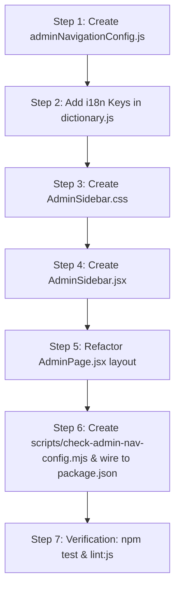

# Upgraded Sprint Plan: Admin View Reorganization & Themeable Preparation

**Sprint Goal**: Replace the horizontal tab navigation in `AdminPage.jsx` with a responsive vertical sidebar featuring collapsible groups, RBAC permission filtering, mobile Offcanvas drawer, and strict conformance to `THEMEABLE_SPRINT_PLAN.md` (semantic CSS classes, data attributes, and extracted stylesheet).

> **Context & Architecture Decision**:
> - Verified against the active codebase on 2026-10-05.
> - **Layout Option B**: Admin view remains inside global `<Layout>`, removing the redundant nested `<Container>` in `AdminPage.jsx` and organizing the view into a responsive two-column grid (`col-lg-3` sidebar / `col-lg-9` content) on desktop and an `<Offcanvas>` drawer on mobile.
> - **Themeable Spec Compliance**: Adheres to `THEMEABLE_SPRINT_PLAN.md` (Sprint 12 Admin specification) — all elements receive semantic kebab-case classes, state classes (`.is-active`, `.is-open`), `data-*` attributes, and styles are isolated in a dedicated `AdminSidebar.css` file instead of inline styles or bloating `index.css`.
> - **Zero Regression Risk for 2750-line Monolith**: The content render functions (`renderSettings`, `renderUsers`, etc.) remain in place to preserve variable closures; only the navigation bar and page wrapper are refactored into the new `AdminSidebar` component.

---

## 0. Target Files & Deliverables

| File | Action | Purpose |
|---|---|---|
| `src/navigation/adminNavigationConfig.js` | **NEW** | Declarative navigation tree with JSDoc typing & `filterNavByPermissions` |
| `src/components/admin/AdminSidebar.jsx` | **NEW** | Standalone sidebar component (desktop Nav + mobile Offcanvas + Accordion) |
| `src/components/admin/AdminSidebar.css` | **NEW** | Extracted stylesheet for sidebar & admin layout with themeable semantic classes |
| `src/i18n/dictionary.js` | **MODIFY** | Add group titles (`admin.nav.*`) in EN & RU; reuse existing `admin.tabs.*` for items |
| `src/pages/AdminPage.jsx` | **MODIFY** | Remove nested Container, replace `<Nav variant="tabs">` with `<AdminSidebar>` and layout grid |
| `scripts/check-admin-nav-config.mjs` | **NEW** | Automated verification script testing config integrity, RBAC filtering, i18n, and class contract |
| `package.json` | **MODIFY** | Add `"test:admin-nav"` and chain it into `npm test` |

---

## 1. Declarative Navigation Configuration (`src/navigation/adminNavigationConfig.js`)

### 1.1 Specification & Invariants
1. **Plain JS + JSDoc**: Repo does not use TypeScript (`package.json` has no `tsc`, no `typecheck` script).
2. **`anyOf: string[]`**: Tab access requires OR logic (e.g., Users tab is visible if user has `APPROVE_USERS || BAN_USERS || CHANGE_ROLES`). Single `permission: string` is insufficient.
3. **No Phantom Permissions**: `PERMISSIONS.MANAGE_USERS` does NOT exist in `src/constants/permissions.js`. All permissions used must strictly exist in `PERMISSIONS`.
4. **i18n Key Separation**:
   - Leaf items reuse existing `admin.tabs.<path>` keys (`settings`, `designs`, `users`, `roles`, `categories`, `audit`).
   - Group titles use new `admin.nav.<groupId>` keys (`userManagement`, `forumContent`, `systemConfig`).
5. **Dynamic Parent Visibility**: A group is visible **if and only if** at least one child item is visible after permission filtering (`children.length > 0`).

### 1.2 Implementation Code

```javascript
// @ts-check
import { PERMISSIONS } from '../constants/permissions.js';

/**
 * @typedef {Object} NavItem
 * @property {string} id               // Unique key / tab identifier
 * @property {string} title            // i18n key for display label
 * @property {string} path             // Tab key used in URL search params (?tab=path)
 * @property {string} icon             // Lucide icon component name
 * @property {string[]} [anyOf]        // Visible if user has ANY of these permissions
 */

/**
 * @typedef {Object} NavGroup
 * @property {string} id               // Unique group identifier
 * @property {string} title            // i18n key for group title
 * @property {string} icon             // Lucide icon name for group
 * @property {NavItem[]} children      // Child navigation items
 */

/** @type {NavGroup[]} */
export const ADMIN_NAV_GROUPS = [
  {
    id: 'userManagement',
    title: 'admin.nav.userManagement',
    icon: 'Users',
    children: [
      {
        id: 'users',
        path: 'users',
        title: 'admin.tabs.users',
        icon: 'User',
        anyOf: [
          PERMISSIONS.APPROVE_USERS,
          PERMISSIONS.BAN_USERS,
          PERMISSIONS.CHANGE_ROLES,
        ],
      },
      {
        id: 'roles',
        path: 'roles',
        title: 'admin.tabs.roles',
        icon: 'Shield',
        anyOf: [PERMISSIONS.MANAGE_ROLES],
      },
    ],
  },
  {
    id: 'forumContent',
    title: 'admin.nav.forumContent',
    icon: 'Layers',
    children: [
      {
        id: 'categories',
        path: 'categories',
        title: 'admin.tabs.categories',
        icon: 'FolderTree',
        anyOf: [PERMISSIONS.MANAGE_CATEGORIES],
      },
      {
        id: 'designs',
        path: 'designs',
        title: 'admin.tabs.designs',
        icon: 'Palette',
        anyOf: [PERMISSIONS.MANAGE_DESIGNS],
      },
    ],
  },
  {
    id: 'systemConfig',
    title: 'admin.nav.systemConfig',
    icon: 'Settings',
    children: [
      {
        id: 'settings',
        path: 'settings',
        title: 'admin.tabs.settings',
        icon: 'Sliders',
        anyOf: [PERMISSIONS.MANAGE_FORUM],
      },
      {
        id: 'audit',
        path: 'audit',
        title: 'admin.tabs.audit',
        icon: 'FileText',
        anyOf: [PERMISSIONS.VIEW_AUDIT_LOG],
      },
    ],
  },
];

/**
 * Filter navigation groups based on user permissions.
 * Groups with zero visible children are completely omitted.
 *
 * @param {NavGroup[]} groups
 * @param {(perm: string) => boolean} hasPerm
 * @returns {NavGroup[]}
 */
export const filterNavByPermissions = (groups, hasPerm) => {
  if (!Array.isArray(groups) || typeof hasPerm !== 'function') return [];

  return groups
    .map((group) => {
      const visibleChildren = (group.children || []).filter((child) => {
        if (!child.anyOf || child.anyOf.length === 0) return true;
        return child.anyOf.some((perm) => hasPerm(perm));
      });

      return {
        ...group,
        children: visibleChildren,
      };
    })
    .filter((group) => group.children.length > 0);
};

/**
 * Find group ID that contains the specified tab path.
 *
 * @param {NavGroup[]} groups
 * @param {string} path
 * @returns {string | null}
 */
export const findGroupForTab = (groups, path) => {
  for (const group of groups) {
    if (group.children?.some((child) => child.path === path)) {
      return group.id;
    }
  }
  return null;
};
```

---

## 2. Themeable CSS Architecture (`src/components/admin/AdminSidebar.css`)

### 2.1 Design Principles
1. **Isolated Stylesheet**: Placed alongside the component (`src/components/admin/AdminSidebar.css`), avoiding inline styles and not cluttering `index.css`.
2. **Themeable Semantic API**: Follows `THEMEABLE_SPRINT_PLAN.md`:
   - Class names: `.admin-page`, `.admin-header`, `.admin-layout`, `.admin-sidebar`, `.admin-sidebar-group`, `.admin-nav-item`, `.admin-nav-link`, `.admin-content`.
   - State classes: `.is-active`, `.is-open`, `.is-collapsed`.
   - Data attributes: `[data-tab="..."]`, `[data-group="..."]`.
3. **Coexistence with Bootstrap**: Uses CSS variables mapped to existing forum theme tokens (`var(--bs-primary)`, `var(--bs-body-bg)`, `var(--bs-border-color)`, `var(--aerun-panel-bg, ...)`).
4. **Mobile Responsiveness**: Clean offcanvas styling, smooth transitions, high contrast active indicators.

### 2.2 Stylesheet Implementation

```css
/* ==========================================================================
   Admin View & Sidebar Layout (Themeable API)
   Follows THEMEABLE_SPRINT_PLAN.md Sprint 12 specification
   ========================================================================== */

/* Page Container & Layout */
.admin-page {
  width: 100%;
}

.admin-header {
  display: flex;
  align-items: center;
  justify-content: space-between;
  flex-wrap: wrap;
  gap: 1rem;
}

.admin-page-title {
  margin-bottom: 0;
  font-size: 1.75rem;
  font-weight: 700;
}

.admin-layout {
  align-items: flex-start;
}

/* Sidebar Container */
.admin-sidebar {
  margin-bottom: 1.5rem;
}

.admin-sidebar-inner {
  background-color: var(--bs-body-bg, #1a1d20);
  border: 1px solid var(--bs-border-color, rgba(255, 255, 255, 0.1));
  border-radius: 0.5rem;
  padding: 0.75rem;
}

/* Accordion Group */
.admin-sidebar-group {
  margin-bottom: 0.5rem;
}

.admin-sidebar-group:last-child {
  margin-bottom: 0;
}

.admin-sidebar-group-header {
  width: 100%;
  display: flex;
  align-items: center;
  justify-content: space-between;
  padding: 0.5rem 0.75rem;
  background: transparent;
  border: none;
  border-radius: 0.375rem;
  color: var(--bs-secondary-color, #adb5bd);
  font-size: 0.825rem;
  font-weight: 700;
  text-transform: uppercase;
  letter-spacing: 0.05em;
  cursor: pointer;
  transition: color 0.15s ease, background-color 0.15s ease;
}

.admin-sidebar-group-header:hover {
  color: var(--bs-body-color, #fff);
  background-color: rgba(255, 255, 255, 0.05);
}

.admin-sidebar-group-title {
  display: flex;
  align-items: center;
  gap: 0.5rem;
}

.admin-sidebar-group-chevron {
  transition: transform 0.2s ease;
}

.admin-sidebar-group.is-collapsed .admin-sidebar-group-chevron {
  transform: rotate(-90deg);
}

/* Navigation List & Items */
.admin-sidebar-nav {
  list-style: none;
  padding: 0.25rem 0 0 0;
  margin: 0;
  display: flex;
  flex-direction: column;
  gap: 0.25rem;
}

.admin-sidebar-group.is-collapsed .admin-sidebar-nav {
  display: none;
}

.admin-nav-item {
  width: 100%;
}

.admin-nav-link {
  display: flex;
  align-items: center;
  gap: 0.65rem;
  padding: 0.55rem 0.75rem;
  border-radius: 0.375rem;
  color: var(--bs-body-color, #dee2e6);
  text-decoration: none;
  font-size: 0.925rem;
  font-weight: 500;
  border: 1px solid transparent;
  background: transparent;
  width: 100%;
  text-align: left;
  cursor: pointer;
  transition: all 0.15s ease;
}

.admin-nav-link:hover {
  color: var(--bs-body-color, #fff);
  background-color: rgba(255, 255, 255, 0.07);
}

.admin-nav-link.is-active {
  color: var(--bs-primary, #0d6efd);
  background-color: rgba(13, 110, 253, 0.15);
  border-color: rgba(13, 110, 253, 0.35);
  font-weight: 600;
}

.admin-nav-link-icon {
  flex-shrink: 0;
  opacity: 0.85;
}

.admin-nav-link.is-active .admin-nav-link-icon {
  opacity: 1;
}

/* Mobile Toggle & Offcanvas */
.admin-mobile-toggle {
  display: inline-flex;
  align-items: center;
  gap: 0.5rem;
}

.admin-offcanvas .offcanvas-body {
  padding: 1rem;
}

/* Content Area */
.admin-content {
  min-width: 0; /* Prevents overflow in flex children */
}
```

---

## 3. Sidebar Component (`src/components/admin/AdminSidebar.jsx`)

### 3.1 Responsibilities
1. Render vertical collapsible navigation groups for desktop (`col-lg-3`).
2. Render mobile toggle button & `<Offcanvas>` drawer for screens `< 992px`.
3. Support keyboard accessibility (`aria-expanded`, semantic `<button>`, semantic `<nav>`).
4. Highlight active tab with `.is-active` class and `data-tab` attribute.
5. Close mobile drawer automatically upon selecting an item.
6. Auto-expand the group holding the currently active tab on mount and tab switch.

### 3.2 Implementation Code

```jsx
import React, { useState, useEffect, useMemo } from 'react';
import PropTypes from 'prop-types';
import { Button, Offcanvas } from 'react-bootstrap';
import {
  Users,
  User,
  Shield,
  Layers,
  FolderTree,
  Palette,
  Settings,
  Sliders,
  FileText,
  ChevronDown,
  Menu,
} from 'lucide-react';
import { useI18n } from '../../contexts/I18nProvider';
import {
  ADMIN_NAV_GROUPS,
  filterNavByPermissions,
  findGroupForTab,
} from '../../navigation/adminNavigationConfig';
import './AdminSidebar.css';

// Lucide icon mapping dictionary
const ICON_MAP = {
  Users,
  User,
  Shield,
  Layers,
  FolderTree,
  Palette,
  Settings,
  Sliders,
  FileText,
};

/**
 * Render Lucide icon by string identifier safely.
 */
const NavIcon = ({ name, size = 18, className = '' }) => {
  const IconComponent = ICON_MAP[name];
  if (!IconComponent) return null;
  return <IconComponent size={size} className={className} />;
};

NavIcon.propTypes = {
  name: PropTypes.string.isRequired,
  size: PropTypes.number,
  className: PropTypes.string,
};

/**
 * Admin Sidebar Navigation Component.
 * Supports desktop sidebar and mobile offcanvas drawer.
 */
export const AdminSidebar = ({ activeTab, onSelect, hasPermission }) => {
  const { t } = useI18n();
  const [showMobileDrawer, setShowMobileDrawer] = useState(false);

  // Compute visible navigation groups based on active user permissions
  const visibleGroups = useMemo(() => {
    return filterNavByPermissions(ADMIN_NAV_GROUPS, hasPermission);
  }, [hasPermission]);

  // Track expanded groups; initially open the group containing activeTab
  const [collapsedGroups, setCollapsedGroups] = useState({});

  useEffect(() => {
    const activeGroupId = findGroupForTab(visibleGroups, activeTab);
    if (activeGroupId) {
      setCollapsedGroups((prev) => ({
        ...prev,
        [activeGroupId]: false, // false = expanded
      }));
    }
  }, [activeTab, visibleGroups]);

  const toggleGroup = (groupId) => {
    setCollapsedGroups((prev) => ({
      ...prev,
      [groupId]: !prev[groupId],
    }));
  };

  const handleSelectTab = (path) => {
    onSelect(path);
    setShowMobileDrawer(false);
  };

  const renderNavContent = () => (
    <nav className="admin-sidebar-inner" aria-label="Admin Navigation">
      {visibleGroups.map((group) => {
        const isCollapsed = !!collapsedGroups[group.id];
        return (
          <div
            key={group.id}
            data-group={group.id}
            className={`admin-sidebar-group ${isCollapsed ? 'is-collapsed' : 'is-open'}`}
          >
            <button
              type="button"
              className="admin-sidebar-group-header"
              onClick={() => toggleGroup(group.id)}
              aria-expanded={!isCollapsed}
            >
              <span className="admin-sidebar-group-title">
                <NavIcon name={group.icon} size={15} />
                <span>{t(group.title)}</span>
              </span>
              <ChevronDown size={14} className="admin-sidebar-group-chevron" />
            </button>

            <ul className="admin-sidebar-nav" role="list">
              {group.children.map((item) => {
                const isActive = activeTab === item.path;
                return (
                  <li key={item.id} className="admin-nav-item">
                    <button
                      type="button"
                      data-tab={item.path}
                      className={`admin-nav-link ${isActive ? 'is-active' : ''}`}
                      onClick={() => handleSelectTab(item.path)}
                      aria-current={isActive ? 'page' : undefined}
                    >
                      <NavIcon
                        name={item.icon}
                        size={17}
                        className="admin-nav-link-icon"
                      />
                      <span>{t(item.title)}</span>
                    </button>
                  </li>
                );
              })}
            </ul>
          </div>
        );
      })}
    </nav>
  );

  return (
    <>
      {/* Mobile Drawer Trigger (Rendered in header or beside title) */}
      <div className="d-lg-none mb-3">
        <Button
          variant="outline-secondary"
          size="sm"
          className="admin-mobile-toggle"
          onClick={() => setShowMobileDrawer(true)}
          aria-label={t('admin.nav.toggleMenu')}
        >
          <Menu size={18} />
          <span>{t('admin.nav.toggleMenu')}</span>
        </Button>
      </div>

      {/* Desktop Fixed Left Sidebar */}
      <aside
        id="admin-sidebar"
        className="col-lg-3 admin-sidebar d-none d-lg-block"
      >
        {renderNavContent()}
      </aside>

      {/* Mobile Offcanvas Drawer */}
      <Offcanvas
        show={showMobileDrawer}
        onHide={() => setShowMobileDrawer(false)}
        responsive="lg"
        className="admin-offcanvas"
      >
        <Offcanvas.Header closeButton>
          <Offcanvas.Title>{t('admin.title')}</Offcanvas.Title>
        </Offcanvas.Header>
        <Offcanvas.Body>{renderNavContent()}</Offcanvas.Body>
      </Offcanvas>
    </>
  );
};

AdminSidebar.propTypes = {
  activeTab: PropTypes.string.isRequired,
  onSelect: PropTypes.func.isRequired,
  hasPermission: PropTypes.func.isRequired,
};

export default AdminSidebar;
```

---

## 4. AdminPage Refactoring (`src/pages/AdminPage.jsx`)

### 4.1 Layout Transformation
- **Remove Nested Container**: Line 2107 had `<Container className="py-5">`. Since `Layout.jsx` already wraps the page in `<Container>`, this produced a duplicate container. We replace it with `<div id="admin-page" className="admin-page py-3">`.
- **Themeable IDs & Wrappers**:
  - Breadcrumbs wrapped in `<nav id="admin-breadcrumbs" className="admin-breadcrumbs mb-3">`.
  - Header wrapped in `<header id="admin-header" className="admin-header mb-4">`.
  - Main 2-column layout wrapped in `<div className="row admin-layout">`.
  - Content area wrapped in `<main id="admin-content" className="col-lg-9 admin-content">`.
- **URL Synchronization**:
  - `activeTab` continues to read from `useSearchParams()`.
  - `setActiveTab` is passed directly to `<AdminSidebar onSelect={setActiveTab} />`.
- **Untouched Content Panels**:
  - Lines 2146–2158 (`renderSettings()`, `DesignsTab`, `renderUsers()`, `renderRoles()`, `renderCategories()`, `renderAuditLog()`) remain functionally identical, ensuring no closures or state hooks are broken.

### 4.2 Exact Diff in `AdminPage.jsx`

#### Top Imports (around line 20):
```diff
+ import AdminSidebar from '../components/admin/AdminSidebar';
```

#### Render Return (lines 2106–2159):
```diff
-   return (
-     <Container className="py-5">
-       <ForumBreadcrumbs
-         items={[{ label: t('nav.admin'), active: true }]}
-       />
-       <h2 className="mb-4">{t('admin.dashboard')}</h2>
- 
-       <Nav variant="tabs" activeKey={activeTab} className="mb-4 border-0" onSelect={(k) => setActiveTab(k)}>
-         {hasPermission(PERMISSIONS.MANAGE_FORUM) && (
-           <Nav.Item>
-             <Nav.Link eventKey="settings" className="px-4 fw-bold border-0">{t('admin.tabs.settings')}</Nav.Link>
-           </Nav.Item>
-         )}
-         {hasPermission(PERMISSIONS.MANAGE_DESIGNS) && (
-           <Nav.Item>
-             <Nav.Link eventKey="designs" className="px-4 fw-bold border-0">{t('admin.tabs.designs')}</Nav.Link>
-           </Nav.Item>
-         )}
-         {(hasPermission(PERMISSIONS.APPROVE_USERS) || hasPermission(PERMISSIONS.BAN_USERS) || hasPermission(PERMISSIONS.CHANGE_ROLES)) && (
-           <Nav.Item>
-             <Nav.Link eventKey="users" className="px-4 fw-bold border-0">{t('admin.tabs.users')}</Nav.Link>
-           </Nav.Item>
-         )}
-         {hasPermission(PERMISSIONS.MANAGE_ROLES) && (
-           <Nav.Item>
-             <Nav.Link eventKey="roles" className="px-4 fw-bold border-0">{t('admin.tabs.roles')}</Nav.Link>
-           </Nav.Item>
-         )}
-         {hasPermission(PERMISSIONS.MANAGE_CATEGORIES) && (
-           <Nav.Item>
-             <Nav.Link eventKey="categories" className="px-4 fw-bold border-0">{t('admin.tabs.categories')}</Nav.Link>
-           </Nav.Item>
-         )}
-         {hasPermission(PERMISSIONS.VIEW_AUDIT_LOG) && (
-           <Nav.Item>
-             <Nav.Link eventKey="audit" className="px-4 fw-bold border-0">{t('admin.tabs.audit')}</Nav.Link>
-           </Nav.Item>
-         )}
-       </Nav>
- 
-       {activeTab === 'settings' && hasPermission(PERMISSIONS.MANAGE_FORUM) && renderSettings()}
-       {activeTab === 'designs' && hasPermission(PERMISSIONS.MANAGE_DESIGNS) && (
-         <DesignsTab 
-           designs={designs} 
-           settings={settings} 
-           updateSettings={(newSettings) => updateGlobalSettings(newSettings, user.uid)}
-           userId={user.uid}
-         />
-       )}
-       {activeTab === 'users' && (hasPermission(PERMISSIONS.APPROVE_USERS) || hasPermission(PERMISSIONS.BAN_USERS) || hasPermission(PERMISSIONS.CHANGE_ROLES)) && renderUsers()}
-       {activeTab === 'roles' && hasPermission(PERMISSIONS.MANAGE_ROLES) && renderRoles()}
-       {activeTab === 'categories' && hasPermission(PERMISSIONS.MANAGE_CATEGORIES) && renderCategories()}
-       {activeTab === 'audit' && hasPermission(PERMISSIONS.VIEW_AUDIT_LOG) && renderAuditLog()}
+   return (
+     <div id="admin-page" className="admin-page py-3">
+       <nav id="admin-breadcrumbs" className="admin-breadcrumbs mb-3">
+         <ForumBreadcrumbs
+           items={[{ label: t('nav.admin'), active: true }]}
+         />
+       </nav>
+       <header id="admin-header" className="admin-header mb-4">
+         <h2 className="admin-page-title">{t('admin.dashboard')}</h2>
+       </header>
+ 
+       <div className="row admin-layout">
+         <AdminSidebar
+           activeTab={activeTab}
+           onSelect={setActiveTab}
+           hasPermission={hasPermission}
+         />
+ 
+         <main id="admin-content" className="col-lg-9 admin-content">
+           {activeTab === 'settings' && hasPermission(PERMISSIONS.MANAGE_FORUM) && renderSettings()}
+           {activeTab === 'designs' && hasPermission(PERMISSIONS.MANAGE_DESIGNS) && (
+             <DesignsTab 
+               designs={designs} 
+               settings={settings} 
+               updateSettings={(newSettings) => updateGlobalSettings(newSettings, user.uid)}
+               userId={user.uid}
+             />
+           )}
+           {activeTab === 'users' && (hasPermission(PERMISSIONS.APPROVE_USERS) || hasPermission(PERMISSIONS.BAN_USERS) || hasPermission(PERMISSIONS.CHANGE_ROLES)) && renderUsers()}
+           {activeTab === 'roles' && hasPermission(PERMISSIONS.MANAGE_ROLES) && renderRoles()}
+           {activeTab === 'categories' && hasPermission(PERMISSIONS.MANAGE_CATEGORIES) && renderCategories()}
+           {activeTab === 'audit' && hasPermission(PERMISSIONS.VIEW_AUDIT_LOG) && renderAuditLog()}
+         </main>
+       </div>
```

---

## 5. Translations Update (`src/i18n/dictionary.js`)

In `src/i18n/dictionary.js`, add group labels under `admin.nav` for both English and Russian:

### English (`en` object, under `admin`):
```javascript
admin: {
  title: "Admin Panel",
  dashboard: "Admin Dashboard",
  nav: {
    userManagement: "User Management",
    forumContent: "Forum Content",
    systemConfig: "System Configuration",
    toggleMenu: "Admin Menu",
  },
  tabs: {
    settings: "Settings",
    designs: "Designs",
    users: "Users",
    roles: "Roles",
    categories: "Categories",
    audit: "Audit Log"
  },
  // ...
}
```

### Russian (`ru` object, under `admin`):
```javascript
admin: {
  title: "Панель управления",
  dashboard: "Панель управления",
  nav: {
    userManagement: "Пользователи и доступ",
    forumContent: "Контент форума",
    systemConfig: "Система",
    toggleMenu: "Меню админки",
  },
  tabs: {
    settings: "Настройки",
    designs: "Дизайны",
    users: "Пользователи",
    roles: "Роли",
    categories: "Категории",
    audit: "Журнал изменений"
  },
  // ...
}
```

---

## 6. Automated Regression & Contract Test (`scripts/check-admin-nav-config.mjs`)

Create a dedicated Node test script matching the project convention (`scripts/check-*.mjs`).

```javascript
// Verification test for Admin Navigation Configuration & Themeable Contract
// Run: node scripts/check-admin-nav-config.mjs

import assert from 'node:assert/strict';
import fs from 'node:fs';
import path from 'node:path';
import { fileURLToPath } from 'node:url';
import { ADMIN_NAV_GROUPS, filterNavByPermissions, findGroupForTab } from '../src/navigation/adminNavigationConfig.js';
import { PERMISSIONS } from '../src/constants/permissions.js';

const ROOT = path.resolve(path.dirname(fileURLToPath(import.meta.url)), '..');

console.log('--- Testing Admin Navigation Configuration ---');

// 1. All 6 known tabs must exist in configuration
const EXPECTED_TABS = ['settings', 'designs', 'users', 'roles', 'categories', 'audit'];
const configPaths = ADMIN_NAV_GROUPS.flatMap(g => g.children.map(c => c.path));

assert.equal(configPaths.length, EXPECTED_TABS.length, 'Exact number of tabs must match');
for (const tab of EXPECTED_TABS) {
  assert.ok(configPaths.includes(tab), `Tab "${tab}" must exist in ADMIN_NAV_GROUPS`);
}

// 2. All anyOf keys must be valid constants from PERMISSIONS
const validPerms = new Set(Object.values(PERMISSIONS));
for (const group of ADMIN_NAV_GROUPS) {
  for (const child of group.children) {
    if (child.anyOf) {
      for (const p of child.anyOf) {
        assert.ok(validPerms.has(p), `Permission "${p}" in item "${child.id}" must exist in PERMISSIONS`);
      }
    }
  }
}

// 3. RBAC Filtering tests
// 3a. Root admin (has all permissions) sees all groups and items
const rootVisible = filterNavByPermissions(ADMIN_NAV_GROUPS, () => true);
assert.equal(rootVisible.length, ADMIN_NAV_GROUPS.length, 'Root admin sees all groups');
assert.equal(rootVisible.flatMap(g => g.children).length, 6, 'Root admin sees all 6 tabs');

// 3b. User with only MANAGE_CATEGORIES sees ONLY forumContent group with 1 child
const catVisible = filterNavByPermissions(ADMIN_NAV_GROUPS, p => p === PERMISSIONS.MANAGE_CATEGORIES);
assert.equal(catVisible.length, 1, 'Only one group visible');
assert.equal(catVisible[0].id, 'forumContent');
assert.equal(catVisible[0].children.length, 1);
assert.equal(catVisible[0].children[0].path, 'categories');

// 3c. User with zero permissions sees empty array (no empty groups left behind)
const emptyVisible = filterNavByPermissions(ADMIN_NAV_GROUPS, () => false);
assert.equal(emptyVisible.length, 0, 'No groups visible for user with zero permissions');

// 3d. Users tab OR-logic check: user with only BAN_USERS must see users tab
const banVisible = filterNavByPermissions(ADMIN_NAV_GROUPS, p => p === PERMISSIONS.BAN_USERS);
assert.equal(banVisible.length, 1);
assert.equal(banVisible[0].children[0].path, 'users');

// 4. findGroupForTab helper
assert.equal(findGroupForTab(ADMIN_NAV_GROUPS, 'users'), 'userManagement');
assert.equal(findGroupForTab(ADMIN_NAV_GROUPS, 'categories'), 'forumContent');
assert.equal(findGroupForTab(ADMIN_NAV_GROUPS, 'settings'), 'systemConfig');
assert.equal(findGroupForTab(ADMIN_NAV_GROUPS, 'nonexistent'), null);

// 5. Dictionary check: all group titles must exist in EN & RU dictionary
const dictCode = fs.readFileSync(path.join(ROOT, 'src', 'i18n', 'dictionary.js'), 'utf8');
for (const group of ADMIN_NAV_GROUPS) {
  const key = group.title.replace('admin.nav.', '');
  assert.ok(dictCode.includes(key), `Dictionary must contain group key "${key}"`);
}

// 6. AST & Themeable Class Contract check on AdminSidebar.jsx
const sidebarCode = fs.readFileSync(path.join(ROOT, 'src', 'components', 'admin', 'AdminSidebar.jsx'), 'utf8');
assert.ok(sidebarCode.includes('admin-sidebar'), 'Must contain admin-sidebar class');
assert.ok(sidebarCode.includes('admin-sidebar-group'), 'Must contain admin-sidebar-group class');
assert.ok(sidebarCode.includes('admin-nav-item'), 'Must contain admin-nav-item class');
assert.ok(sidebarCode.includes('admin-nav-link'), 'Must contain admin-nav-link class');
assert.ok(sidebarCode.includes('data-tab='), 'Must include data-tab attribute');
assert.ok(sidebarCode.includes('data-group='), 'Must include data-group attribute');

console.log('✅ All Admin Navigation & Themeable Contract checks PASSED.');
```

Add to `package.json`:
```json
"test:admin-nav": "node scripts/check-admin-nav-config.mjs",
```
and append `npm run test:admin-nav` to the `"test"` script pipeline.

---

## 7. Step-by-Step Implementation Sequence



### Step 1: `src/navigation/adminNavigationConfig.js`
- Create file with `ADMIN_NAV_GROUPS`, `filterNavByPermissions`, `findGroupForTab`.
- Ensure JSDoc comments are complete.

### Step 2: `src/i18n/dictionary.js`
- Add `admin.nav.userManagement`, `admin.nav.forumContent`, `admin.nav.systemConfig`, `admin.nav.toggleMenu` to both `en` and `ru` sections.

### Step 3: `src/components/admin/AdminSidebar.css`
- Create CSS file with all semantic selectors, BEM/kebab-case classes, and theme variable mappings.

### Step 4: `src/components/admin/AdminSidebar.jsx`
- Implement desktop sidebar + mobile Offcanvas drawer.
- Wire icon mappings (`lucide-react`).
- Add accessible accordion toggle and tab selection.

### Step 5: `src/pages/AdminPage.jsx`
- Replace nested `<Container>` with `<div id="admin-page" className="admin-page">`.
- Wrap breadcrumbs and header with themeable IDs and classes.
- Replace `<Nav variant="tabs">` block with `<AdminSidebar>` inside `<div className="row admin-layout">`.
- Leave tab content render functions untouched.

### Step 6: `scripts/check-admin-nav-config.mjs` & `package.json`
- Create check script.
- Add `"test:admin-nav"` to `package.json` and chain into `"test"`.

### Step 7: Verification
- Run `node scripts/check-admin-nav-config.mjs`.
- Run `npm test` to ensure zero regressions across the test suite.
- Run `npm run lint:js` to verify ESLint cleanliness.

---

## 8. Acceptance Criteria & Definition of Done

- [ ] **RBAC Dynamic Filtering**: Admin navigation dynamically hides tabs user has no permission for; empty groups are completely hidden.
- [ ] **URL Tab Persistence**: Tab switching updates and respects `?tab=<path>` URL search parameters. Refreshing or bookmarking a tab opens directly to that section.
- [ ] **Desktop Sidebar Layout**: Desktop (`>= 992px`) renders a 2-column layout (`col-lg-3` sidebar / `col-lg-9` content area).
- [ ] **Mobile Offcanvas Drawer**: Mobile (`< 992px`) displays a toggle button that opens an accessible Offcanvas drawer; selecting any navigation link automatically closes the drawer.
- [ ] **Accordion Grouping**: Groups collapse/expand smoothly. The group holding the active tab expands automatically on initial load.
- [ ] **Themeable API Compliance**: Conforms to `THEMEABLE_SPRINT_PLAN.md` Sprint 12 spec (`#admin-page`, `#admin-sidebar`, `.admin-nav-link`, `.is-active`, `data-tab`, `data-group`).
- [ ] **Isolated Stylesheet**: Zero inline CSS styles; all layout and navigation styling lives in `src/components/admin/AdminSidebar.css`.
- [ ] **No Regression in Panels**: All 6 existing panels (`settings`, `designs`, `users`, `roles`, `categories`, `audit`) render their data and forms without broken state or closures.
- [ ] **Bilingual i18n**: English and Russian titles provided for all groups and controls.
- [ ] **Passing CI Checks**: `node scripts/check-admin-nav-config.mjs`, `npm test`, and `npm run lint:js` pass with zero errors.
