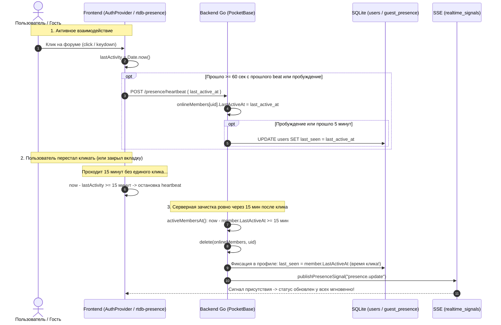

# Комплексный аудит трекинга присутствия и активности пользователей и гостей (Presence & Activity Tracking)

> **Документ:** Архитектурный и технический аудит системы отслеживания присутствия, неактивности (idle timeout), синхронизации статусов между посетителями, смены никнеймов, удаления аккаунтов и многовкладочности на форуме Aerun  
> **Дата обновления:** 8 ноября 2026 г. (версия 2.1 + §10: баг F-1 исправлен — регистрация публикует `presence.update`, форум перечитывает `forumStats`)  
> **Статус:** Анализ завершён, требования согласованы, сформирована целевая спецификация  
> **Исследуемые компоненты:**  
> - Frontend: `src/api/rtdb-presence.js`, `src/contexts/AuthProvider.jsx`, `src/components/layout/ForumStats.jsx`, `src/api/shared-poll.js`, `src/App.jsx`, `src/api/pocketbase.js`  
> - Backend: `backend/internal/platform/pocketbase/presence.go`, `status.go`, `realtime_signals.go`, `nickname_commands.go`, `admin_users.go`, `category_access.go`, `run.go`  
> - Тестовые контракты: `scripts/check-identity-refresh.mjs`, `presence_guest_test.go`, `presence_member_test.go`  

---

## 1. Базовые принципы и требования к системе присутствия (Ground Truth)

По результатам аудита и уточнения требований пользователя сформулированы фундаментальные правила:

1. **Единый золотой стандарт: «Последний активный клик -> 15 минут тишины -> переход в оффлайн»:**
   - Активность пользователя и гостя определяется **исключительно кликами (и нажатиями клавиш) на форуме**.
   - Посетитель (пользователь или гость) считается находящимся онлайн ровно **15 минут с момента своего последнего активного клика**.
   - Никакого мгновенного исчезновения при закрытии вкладки: **закрытие вкладки или уход с неё котируется точно так же, как и открытая вкладка**. Если пользователь кликнул в 12:00 и закрыл вкладку в 12:02, он должен числиться в списке присутствия вплоть до 12:15, и только в 12:15 автоматически переводиться в оффлайн.
   - Правило «15 минут после последнего клика» едино и универсально везде: для пользователей, гостей, открытых вкладок и закрытых окон.

2. **Возврат из инактива («Пробуждение»):**
   - Если пользователь или гость вернулся во вкладку и кликнул — он моментально «просыпается».
   - Таймер неактивности сбрасывается в 0, и начинается новый полноценный 15-минутный цикл. Никаких «засыпаний через 2 минуты»: пока нет кликов, отсчитываются честные 15 минут.

3. **Разделение двух понятий: «Онлайн сейчас» vs «Последняя активность в профиле»:**
   - **«Онлайн сейчас» (Online Now / Presence)**: динамический срез активных участников форума (счётчик гостей и список пользователей, кликавших в течение последних 15 минут).
   - **«Последняя активность» в профиле (`users.last_seen`)**: персистентное поле в базе данных, используемое для профиля пользователя, списка участников форума («Был на форуме: ...») и подсчёта 24-часовой активности форума (`dailyActiveMembers` в блоке статистики).
     * **Во время активной работы на форуме** (пользователь кликает, читает, пишет): значение `last_seen` обновляется в профиле с троттлингом раз в 5 минут (чтобы не перегружать SQLite).
     * **Мгновенно (без ожидания 5 минут)** обновляется при ключевых переходах:
       1. При логине;
       2. При «пробуждении» (первый клик после инактива);
       3. При разлогине (переход в статус гостя).
     * **После исключения из списка активных (по 15-минутному таймауту)**: в профиль `users.last_seen` записывается **именно время последнего активного клика**, а **НЕ** время исключения из активных! (Пример: клик в 12:00 -> удаление из активных в 12:15 -> в профиле зафиксировано «Был в сети: 12:00»).

4. **Многовкладочность в одном браузере vs Разные браузеры / окружения:**
   - **Разные гостевые ID в разных браузерах, приватной вкладке (инкогнито), на мобильном устройстве — это норма и ожидаемое поведение (НЕ баг).** Чинить этот момент не нужно: изолированные хранилища правомерно имеют независимые гостевые идентификаторы.
   - **В рамках одного браузера (несколько обычных вкладок):**
     * Гостевой ID (`guest_id`) и ID пользователя (`user_id`) должны быть **строго одинаковыми** во всех вкладках и не должны раздваиваться или дрейфовать.
     * **Синхронизация между вкладками:** если у пользователя открыты Вкладка 1 и Вкладка 2, и в одной из них происходит логин или разлогин:
       - При переключении / возвращении во вторую вкладку её состояние авторизации (`user`, `profile`), тип отправляемого присутствия (member heartbeat vs guest heartbeat) и блок «Сейчас на форуме» должны **актуализироваться автоматически**.
       - Вкладка 2 не должна оставаться в устаревшем состоянии гостя, если Вкладка 1 уже вошла в аккаунт, и наоборот — не должна продолжать слать авторизованный heartbeat, если Вкладка 1 разлогинилась.

5. **Актуализация при смене никнейма и удалении аккаунта:**
   - При смене ника (пользователем или администратором) имя в списке онлайн должно обновляться мгновенно.
   - При удалении аккаунта или бане пользователь должен мгновенно вычеркиваться из списка активных.

6. **Реактивность (Realtime SSE) и второй монитор:**
   - Уход окна с фокуса (например, форум открыт на втором экране) не должен ломать трекинг присутствия.
   - Изменения (вход, выход, неактивность 15 минут, смена ника, удаление) должны доставляться на все открытые клиенты через SSE-сигналы в реальном времени без задержек.

---

## 2. Сравнительный анализ: «Как должно быть» vs «Как работает сейчас»

| Сценарий | Требование (To-Be) | Текущая реализация (As-Is) | Статус / Проблема |
| :--- | :--- | :--- | :---: |
| **Определение активности** | Активность трекается по кликам/клавишам одинаково для гостей и пользователей. | В `AuthProvider.jsx` слушатели `click` навешиваются только если `user?.uid && profile`. Для гостей слушателей нет вообще. | ❌ **Критический дефект** (гости не трекаются) |
| **Фоновый Heartbeat** | Отправляется раз в минуту только пока `now - lastClick < 15 минут`. | И у гостей, и у юзеров в `rtdb-presence.js` тикает безусловный `setInterval(60000)`, шлющий запросы даже без кликов. | ❌ **Архитектурный дефект** |
| **Выбывание по инактиву (15 мин)** | Ровно через 15 минут после последнего клика посетитель выбывает из списка онлайн. | **Гости:** не выбывают вообще (вечный онлайн).<br>**Юзеры:** клиент ждёт 15 мин beat + сервер держит 15 мин = висят **30 минут**. | ❌ **Критический дефект** (гость вечен, юзер 30 мин) |
| **Закрытие вкладки / уход** | Закрытие котируется так же, как открытая вкладка: 15 минут с последнего клика числится онлайн, затем стирается. | **Гости:** отправляют преждевременный `sendBeacon` на `pagehide`.<br>**Юзеры:** нет `pagehide`, висят 15 мин от последнего beat (до 30 мин). | ❌ **Несогласованность** |
| **Возврат из инактива** | При клике статус восстанавливается, стартует свежий 15-минутный интервал присутствия. | `recordActivity` шлёт 1 beat, но **НЕ перезапускает `heartbeatTimer`**. Пользователь засыпает при последующем чтении. | ❌ **Критический дефект** (поломан таймер) |
| **«Последняя активность» в профиле (`last_seen`)** | 5 мин троттлинг при кликах; мгновенно при логине/пробуждении/выходе; при таймауте 15 мин сохраняет **время последнего клика**. | Пишет текущий `now` сервера каждые 5 минут. При таймауте 15 мин сохраняет время последнего beat или оставляет старое значение. | ❌ **Неточность метрики** |
| **Многовкладочность в одном браузере** | Логин/разлогин во Вкладке 1 мгновенно подхватывается Вкладкой 2 при возвращении в неё. Гостевой ID и User ID едины. | `pb.authStore.onChange` слушает только события своей вкладки. Вкладка 2 не узнаёт о смене аккаунта без ручного перезапуска. | ❌ **Дефект межвкладочной синхронизации** |
| **Разные браузеры / Инкогнито** | Разные `guest_id` в разных браузерах, приватных окнах и на мобильных — норма и ожидаемое поведение. | В коде `ForumStats.jsx` костыль локальной маскировки скрывает только свой `guest_id`, создавая фантомов для других сред. | ⚠️ **Ошибочный костыль** |
| **Смена никнейма** | Мгновенное обновление ника в списке онлайн у всех открытых вкладок. | В `nickname_commands.go` обновляется только SQLite. Память `onlineMembers` хранит старый ник, realtime-пуша нет. | ❌ **Дефект** |
| **Удаление / бан аккаунта** | Мгновенное исключение из списка онлайн у всех посетителей. | В `admin_users.go` запись не удаляется из `onlineMembers`. Удаленный юзер висит в онлайне до 15 минут. | ❌ **Дефект** |
| **Realtime-синхронизация** | Любые изменения (вход, 15м инактив, смена ника, бан) вживую пушатся через SSE (`presence.update`). | SSE-сигналов для presence нет вообще. Доставка только раз в 20 секунд медленным поллингом `statusPoll`. | ❌ **Дефект** |

---

## 3. Детальный разбор гипотезы пользователя: «Подмена юзера гостем и вечный фантомный гость»

### 3.1. Суть гипотезы
> *«Когда я как юзер ухожу в инактив, у меня есть ощущение, что при возвращении во вкладку мой инактив юзера подменяется активностью присутствия как гостя, и так как гости не очищаются, то я и вижу вечное присутствие фантомного гостя».*

### 3.2. Результаты проверки: почему это происходит?

Исследование кодовой базы показало, что наблюдаемый пользователем эффект — это **следствие наложения четырёх дефектов**:

```
+----------------------------------------------------------------------------------------------------+
|                                    ХОД СОБЫТИЙ В ТЕКУЩЕМ КОДЕ:                                      |
+----------------------------------------------------------------------------------------------------+

 1. Пользователь залогинен на основном экране, уходит в инактив (> 15 минут без кликов):
    - В AuthProvider.jsx срабатывает idle: вызывается setRtdbOffline(uid, false).
    - setRtdbOffline УНИЧТОЖАЕТ heartbeatTimer (clearInterval).
    - Запрос /presence/leave НЕ отправляется. На сервере юзер висит еще 15 минут (суммарно 30 мин),
      после чего серверный TTL наконец вычеркивает юзера из onlineMembers.
    - ИТОГ: Пользователь окончательно пропал из онлайна.

 2. Пользователь возвращается и кликает во вкладке:
    - Срабатывает recordActivity() -> setRtdbOnline().
    - БАГ: setRtdbOnline() делает ОДИН сетевой вызов sendHeartbeat(), но НЕ перезапускает heartbeatTimer!
    - Пользователь открывает тему и спокойно читает 5-10 минут без кликов:
      фоновые heartbeat не идут -> сервер снова вычеркивает пользователя из онлайна!
      Кажется, что юзер "постоянно отваливается и не держится онлайн".

 3. Параллельно: откуда берется "вечный фантомный гость"?
    - ФАКТОР А (Локальный фильтр-маскировка в ForumStats.jsx строки 41-42):
      `if (user && g.id === currentGuestId) return false;`
      Код скрывает гостя ТОЛЬКО на том экране, где вы залогинены и где guest_id совпадает.
      Но на ВТОРОМ МОНИТОРЕ (или в приватном окне, или на телефоне) localStorage.guest_id другой!
      (И это нормально, что он другой, так как это другое изолированное хранилище!)
      Но там этот гость НЕ скрывается!
    - ФАКТОР Б (Гости бесконечны):
      Если гостевая вкладка была открыта (до логина, в другом окне или на 2-м экране), функция
      initRtdbGuestPresence шлет heartbeat КАЖДУЮ МИНУТУ БЕЗ ОСТАНОВКИ. У гостя НЕТ таймера неактивности!
      В SQLite таблице guest_presence дата last_seen обновляется вечно.
    - ФАКТОР В (Гонка инициализации профиля в AuthProvider.jsx:396):
      `if (user?.uid && profileRef.current)` при старте или пробуждении (когда profileRef.current
      еще null) проваливается в ветку:
      `guestPresenceStartedRef.current = true; return initRtdbGuestPresence(getOrCreateGuestId());`
      Так как `profile` не входит в массив зависимостей эффекта, эффект не перезапускается, и
      браузер авторизованного пользователя параллельно шлет гостевые heartbeats!

ИТОГ: На втором экране пользователь отчетливо видит:
- Пользователь то появляется на 1 минуту, то пропадает (из-за сломанного heartbeatTimer).
- Зато Гость (1) висит сутками намертво.
Создается полное и обоснованное ощущение, что активность пользователя "превратилась в гостя".
+----------------------------------------------------------------------------------------------------+
```

---

## 4. Аудит смены никнейма и удаления аккаунта

### 4.1. Смена никнейма (`nickname_commands.go`)
- Маршруты: `PATCH /api/aerun/me/nickname` и `PATCH /api/aerun/users/{id}/nickname`.
- Выполняют: `applyNickname`, где пишутся `users.nickname` и `users.nickname_normalized` в SQLite.
- **Проблема:**
  1. В `presence.go` пользователи хранятся в in-memory структуре `onlineMembers[userID]`. Функция `applyNickname` **не обновляет поле `Nickname` в этой карте**.
  2. В блоке «Сейчас на форуме» пользователь отображается под старым ником до тех пор, пока его браузер не пришлёт следующий heartbeat (а если пользователь не кликает, то старый ник висит долго).
  3. Если никнейм изменил администратор, браузер жертвы вообще не знает об этом, и старый никнейм висит в памяти сервера до перезагрузки.
  4. Realtime-сигнал (SSE) не генерируется — другие участники на сайте видят старый никнейм.

### 4.2. Удаление аккаунта (`admin_users.go`)
- Маршрут: `DELETE /api/aerun/admin/users/{id}` (`adminDeleteUserHandler`).
- Выполняет: `is_deleted = true`, `status = "deleted"`, сброс `tokenKey`.
- **Проблема:**
  1. Вызов `delete(onlineMembers, userID)` **отсутствует**.
  2. Удаленный пользователь остаётся в оперативной памяти сервера `onlineMembers` и продолжает отдаваться в списке «Сейчас на форуме» на протяжении всех **15 минут** серверного TTL!
  3. Аналогично при бане (`status = "banned"`): заблокированный аккаунт продолжает висеть в списке онлайн.
  4. Realtime-сигнал об исключении не отправляется.

---

## 5. Целевая архитектура и алгоритм реализации (To-Be Architecture)

### 5.1. Модель двух временных шкал: «Онлайн сейчас» vs «Профиль last_seen»

```
  +-----------------------------------------------------------------------------------+
  | ВРЕМЯ (T)        T = 12:00                    T = 12:05            T = 12:15      |
  |                  (Последний клик)             (Троттлинг 5м)       (15 мин инактив)
  +-----------------------------------------------------------------------------------+
  |                                                                                   |
  | 1. "Онлайн сейчас"                                                                |
  |    (список active): [В СЕТИ] -------------> [В СЕТИ] ------------> [ИСКЛЮЧЕН]     |
  |                     last_click = 12:00      last_click = 12:00     (ровно в 12:15)|
  |                                                                                   |
  | 2. "Профиль"                                                                      |
  |    (users.last_seen):                                                             |
  |    В БД записано:   12:00 (при клике) ----> 12:00 (без кликов) --> ФИКСАЦИЯ: 12:00|
  |                                                                    (НЕ 12:15!)    |
  +-----------------------------------------------------------------------------------+
```

#### Правило 1: Как работает окно «Онлайн сейчас» (15 минут)
- Клиент (и пользователь, и гость) при каждом heartbeat передаёт метку времени своего **последнего активного клика**: `last_active_at`.
- Сервер в структуре `onlineMembers` (для пользователей) и в таблице `guest_presence` (для гостей) хранит `LastActiveAt = form.LastActiveAt`.
- В функции выборки активных `activeMembersAt(now)` и `activeGuestRecords(app, now)` критерий строго один:
  ```go
  cutoff := now.Add(-15 * time.Minute)
  if member.LastActiveAt.Before(cutoff) {
      // Истекло 15 минут с момента последнего клика!
      // Исключаем из онлайн-списка
      delete(onlineMembers, id)
      // Фиксируем в профиле users.last_seen ИМЕННО время последнего клика:
      writeMemberLastSeenExplicit(app, member.UserID, member.LastActiveAt)
  }
  ```
- **Закрытие вкладки:** клиент **не отправляет** мгновенный leave-маяк. Если вкладка закрылась, на сервере уже зафиксировано время последнего клика `LastActiveAt`. Сервер держит запись в онлайне ровно до `LastActiveAt + 15 минут`, после чего спокойно удаляет её и шлёт сигнал `presence.update`. Поведение закрытой вкладки и открытой неактивной вкладки **полностью идентично**.

#### Правило 2: Как обновляется `users.last_seen` в профиле
1. **Во время активных действий пользователя (клики на форуме):**
   - Обновление в БД происходит с троттлингом **раз в 5 минут** (`memberLastSeenWriteInterval = 5 * time.Minute`). Записывается время последнего клика.
2. **Мгновенно (сброс троттлинга и немедленная запись в БД):**
   - При **логине** пользователя (`authWithPassword` / `authWithOAuth2`);
   - При **«пробуждении»** во вкладке (первый клик после 15+ минут инактива);
   - При **явном выходе** (`logout` / переход в гостевой режим).
3. **При автоматическом исключении по таймауту 15 минут:**
   - Когда серверный сборщик вычеркивает сессию из-за того, что с последнего клика прошло 15 минут, в `users.last_seen` в базе данных гарантированно остаётся **время последнего активного клика** ($T_{\text{last\_click}}$), а не время зачистки ($T_{\text{last\_click}} + 15\text{ мин}$).

---

### 5.2. Межвкладочная синхронизация сессии и присутствия (Cross-Tab Sync)

В рамках одного браузера все обычные вкладки разделяют одно общее хранилище `localStorage`:
- `guest_id` создаётся один раз через `getOrCreateGuestId` и является строго общим для всех вкладок этого браузера.
- Авторизационные данные сохраняются PocketBase SDK в ключе `pocketbase_auth`.

#### Механизм мгновенной синхронизации:
1. В `src/contexts/AuthProvider.jsx` подключается слушатель системного события браузера:
   ```javascript
   window.addEventListener('storage', (e) => {
     if (e.key === 'pocketbase_auth' || e.key === null) {
       syncUserFromAuthStore();
     }
   });
   ```
2. Дополнительно, при переключении на вкладку (`document.addEventListener('visibilitychange')` или `focus`), если вкладка стала видимой (`document.visibilityState === 'visible'`), она выполняет быструю проверку:
   - Совпадает ли её текущий `user?.uid` с тем, что записан в `localStorage.getItem('pocketbase_auth')`?
   - Если в соседней вкладке произошёл **вход (логин)**:
     * Текущая вкладка мгновенно подхватывает авторизацию.
     * Гасит гостевой heartbeat и переключается на heartbeat авторизованного пользователя.
     * Немедленно обновляет права, профиль и список «Сейчас на форуме».
   - Если в соседней вкладке произошёл **выход (разлогин)**:
     * Текущая вкладка очищает профиль и пользователя.
     * Гасит пользовательский heartbeat и переходит на гостевой heartbeat с общим `guest_id`.
     * Права и интерфейс сбрасываются до гостевых.

#### Изолированные среды (By Design):
- Другой браузер (Chrome vs Firefox), приватная вкладка (Incognito) или мобильный браузер имеют **собственные изолированные `localStorage`**.
- В них генерируются **разные `guest_id`**, и сессии полностью независимы. Это **правильное проектное поведение (не баг)**, так как это разные физические сеансы посетителей.

---

### 5.3. Поток данных и взаимодействие компонентов



---

## 6. Детализация изменений по компонентам

### 6.1. Backend (`backend/internal/platform/pocketbase/`)

1. **В `presence.go`:**
   - Добавить поле `LastActiveAt time.Time` в структуру `userPresence`.
   - В `heartbeatForm` принимать `last_active_at` (unix millis или RFC3339). Если не передан — fallback на `now`.
   - Хелпер `evictOnlineMember(userID string)`:
     ```go
     func evictOnlineMember(userID string) {
         presenceMu.Lock()
         delete(onlineMembers, userID)
         presenceMu.Unlock()
     }
     ```
   - Хелпер `updateOnlineMemberNickname(userID, newNickname string)`:
     ```go
     func updateOnlineMemberNickname(userID, newNickname string) {
         presenceMu.Lock()
         if m, ok := onlineMembers[userID]; ok {
             m.Nickname = newNickname
             onlineMembers[userID] = m
         }
         presenceMu.Unlock()
     }
     ```
   - В `activeMembersAt(now)`:
     * Отбор: `member.LastActiveAt >= now.Add(-15 * time.Minute)`.
     * Если запись просрочена: удаление из карты + вызов `writeMemberLastSeen(app, authRecord, member.LastActiveAt)` (запись именно времени последнего клика!).
   - В `upsertGuestPresence`:
     * Записывать в `guest_presence.last_seen` время переданного `last_active_at`.
   - В `activeGuestRecords`:
     * Отбор: `last_seen >= now.Add(-15 * time.Minute)`.

2. **В `nickname_commands.go`:**
   - В `applyNickname`: после успешного сохранения в SQLite вызывать `updateOnlineMemberNickname(record.Id, nickname)` и `publishPresenceSignal(txApp)`.

3. **В `admin_users.go`:**
   - В `adminDeleteUserHandler`: вызывать `evictOnlineMember(userID)` и `publishPresenceSignal(txApp)`.
   - В `adminUpdateUserHandler` (при блокировке `status == "banned"`): вызывать `evictOnlineMember(userID)` и `publishPresenceSignal(txApp)`.

4. **В `realtime_signals.go`:**
   - Константа `realtimeSignalPresence = "presence.update"`.
   - Потокобезопасная функция `publishPresenceSignal(app core.App)` с дебаунсом 2–3 секунды.

---

### 6.2. Frontend (`src/`)

1. **В `src/contexts/AuthProvider.jsx`:**
   - Вынести слушатели `click` и `keydown` из-под гарда `if (!user?.uid || !profile) return;`.
   - Слушатели активности работают **всегда**: и для гостей, и для авторизованных пользователей.
   - Переменная `lastActivityRef.current` обновляется при каждом клике.
   - Таймер проверки неактивности (`setInterval` 15 сек):
     * Если `Date.now() - lastActivityRef.current >= 15 * 60 * 1000`:
       сессия помечается как `idle`, локальный heartbeat глушится.
     * При первом клике после `idle`: сброс `idle`, немедленный вызов `recordActivity()`, **полноценный перезапуск `heartbeatTimer`**.
   - **Межвкладочная синхронизация:** слушатель `window.addEventListener('storage')` и проверка при фокусе вкладки для синхронного переключения авторизации между вкладками одного браузера.
   - Исправить гонку инициализации гостя: не стартовать `initRtdbGuestPresence`, если сессия находится в процессе восстановления (`!restored`) или если `user?.uid` валиден.

2. **В `src/api/rtdb-presence.js`:**
   - В `sendHeartbeat` и `sendGuestHeartbeat`: передавать в теле запроса `last_active_at: lastActivityRef.current || Date.now()`.
   - В `setRtdbOnline`: если `heartbeatTimer === null`, **обязательно заново инициализировать `setInterval(sendHeartbeat, 60000)`**!
   - Убрать из гостей преждевременный маяк `pagehide` (`sendGuestLeaveBeacon`), чтобы закрытие вкладки вело себя одинаково с открытой вкладкой (ровно 15 минут с последнего клика).
   - В `createSharedPoll` для `statusPoll`: подключить подписку на SSE-сигнал `presence.update`. При получении сигнала делать тихий опрос `/api/aerun/status`.

3. **В `src/components/layout/ForumStats.jsx`:**
   - Удалить костыль маскировки `if (user && g.id === currentGuestId) return false;`. Поскольку бэкенд и фронтенд теперь строго и единообразно очищают сессии по 15-минутному таймауту от последнего клика, фантомные гости исключены.

---

## 7. Пошаговый план внедрения (Action Checklist)

### Этап 1. Backend: ядро присутствия, никнеймы, удаление и realtime
- [ ] **1.1.** В `backend/internal/platform/pocketbase/presence.go`:
  - Добавить поле `LastActiveAt` в `userPresence` и поддержку `last_active_at` в `heartbeatHandler`.
  - Реализовать хелперы `evictOnlineMember(userID)` и `updateOnlineMemberNickname(userID, nickname)`.
  - Модифицировать `activeMembersAt`: при выбывании по 15-минутному таймауту фиксировать в `users.last_seen` точное время последнего клика (`member.LastActiveAt`).
  - Синхронизировать фильтрацию `guest_presence` по `last_seen >= now - 15m`.
- [ ] **1.2.** В `backend/internal/platform/pocketbase/nickname_commands.go`:
  - Вызывать `updateOnlineMemberNickname` и `publishPresenceSignal` при успешной смене никнейма.
- [ ] **1.3.** В `backend/internal/platform/pocketbase/admin_users.go`:
  - Вызывать `evictOnlineMember` и `publishPresenceSignal` в `adminDeleteUserHandler` и при бане в `adminUpdateUserHandler`.
- [ ] **1.4.** В `backend/internal/platform/pocketbase/realtime_signals.go`:
  - Добавить топик `presence.update` и дебаунсированную функцию `publishPresenceSignal`.
  - Вызывать публикацию сигнала при изменении состава активных.

### Этап 2. Frontend: трекинг кликов, пробуждение, многовкладочность
- [ ] **2.1.** В `src/contexts/AuthProvider.jsx`:
  - Унифицировать трекинг кликов (для гостей и юзеров).
  - Реализовать честный 15-минутный таймаут от последнего клика.
  - Устранить гонку инициализации гостя (`profileRef.current` null-check).
  - Добавить межвкладочную синхронизацию сессии (`storage` event + `visibilitychange: visible`), чтобы при логине/разлогине в соседней вкладке текущая вкладка сразу переключала роль и режим присутствия.
- [ ] **2.2.** В `src/api/rtdb-presence.js`:
  - Передавать `last_active_at` в heartbeat.
  - Перезапускать `heartbeatTimer` в `setRtdbOnline` при пробуждении из инактива.
  - Удалить мгновенный маяк закрытия вкладки `sendGuestLeaveBeacon`.
  - Подключить реакцию на сигнал `presence.update` в `statusPoll`.
- [ ] **2.3.** В `src/components/layout/ForumStats.jsx`:
  - Убрать локальную маскировку `g.id === currentGuestId`.

### Этап 3. Тестирование и верификация
- [ ] **3.1.** Обновить контрактные тесты в `scripts/check-identity-refresh.mjs`.
- [ ] **3.2.** Написать Go-тесты для новых сценариев:
  - Смена ника -> обновление в `onlineMembers` + сигнал.
  - Удаление юзера / бан -> исключение из `onlineMembers` + сигнал.
  - 15-минутное выбывание -> запись в `users.last_seen` точного времени последнего клика.
- [ ] **3.3.** Прогнать полный тестовый пакет (`npm test` + `go test`).

---

## 8. Итоговое резюме

Обновлённый дизайн полностью решает все поднятые проблемы:
1. **Никаких мгновенных засыпаний через 2 минуты:** после пробуждения восстанавливается полноценный таймер, дающий честные 15 минут активности.
2. **Никакого моментального стирания при закрытии вкладки:** закрытая вкладка числится онлайн ровно 15 минут с момента последнего клика, в точности как и открытая неактивная вкладка.
3. **Честная метрика `last_seen` в профиле:** фиксирует именно время последнего действия (клика), а не момент срабатывания сборщика мусора.
4. **Многовкладочность в рамках одного браузера:** `guest_id` и `user_id` едины для всех вкладок; вход/выход в одной вкладке мгновенно подхватывается соседними при возвращении в них.
5. **Разные браузеры / инкогнито / мобайл:** независимые сессии и разные `guest_id` признаны нормой (By Design).
6. **Смена никнейма и удаление пользователя:** моментально отражаются в списке онлайн и рассылаются через SSE всем открытым вкладкам.
7. **Фантомный гость устранён:** гость подчиняется тому же 15-минутному правилу кликов, гонка профиля закрыта, локальные маскировки удалены.

---

## 9. Журнал внедрения (Execution Log)

> Этот раздел ведётся агентом по ходу работы: статус, чекпоинты, находки, выполненная работа, верификация и отклонения от исходного плана. Обновлять после каждого чекпоинта.

### 9.0. Чекпоинты и порядок выполнения

1. **CP0 — Baseline / фиксация расхождений.** Прочитать аудит (§1–§8), сверить с фактическим кодом, зафиксировать находки ниже.
2. **CP1 — Backend: ядро присутствия.** `presence.go`: `LastActiveAt`, `last_active_at`, отбор по последнему клику, `activeMembersAt` пишет точное время клика в `users.last_seen`, гости по `last_active_at`.
3. **CP2 — Backend: realtime / никнеймы / удаление.** `realtime_signals.go` (`presence.update` + debounce), `nickname_commands.go`, `admin_users.go` (single+bulk, ban/delete).
4. **CP3 — Frontend: клики, пробуждение, heartbeat, многовкладочность.** `AuthProvider.jsx` + `rtdb-presence.js` + shared-poll/SSE.
5. **CP4 — ForumStats + контракты + тесты.** Убрать локальную маскировку, обновить `check-identity-refresh.mjs`, Go-тесты.
6. **CP5 — Верификация.** `npm test` / gate-скрипты / `go test`, ручной smoke по сценариям §1.
7. **CP6 — Синхронизация документации проекта.** По окончании работы проверить и при необходимости обновить доки, затронутые изменениями (см. §9.4).

### 9.1. Статус

| Чекпоинт | Статус | Дата |
|---|---|---|
| CP0 Baseline | ✅ выполнен | 7.11.2026 |
| CP1 Backend ядро | ✅ выполнен | 7.11.2026 |
| CP2 Realtime/никнеймы/админ | ✅ выполнен | 7.11.2026 |
| CP3 Frontend | ✅ выполнен | 7.11.2026 |
| CP4 ForumStats/контракты/тесты | ✅ выполнен | 7.11.2026 |
| CP5 Верификация | 🟡 частично (см. §9.3) | 7.11.2026 |
| CP6 Документация проекта | ✅ выполнен | 7.11.2026 |

### 9.2. Находки baseline (сверка аудита с кодом на старте)

**Backend — `presence.go`:**
- `userPresence` не имеет `LastActiveAt`; фильтрация `onlineMembers` идёт по `LastSeen` (последний heartbeat), а не по последнему клику. Нарушает §1 п.1/§6.1.
- `heartbeatForm` не принимает `last_active_at`; `heartbeatHandler` всегда ставит `LastSeen=now` и `touchMemberLastSeen(..., now)` — `users.last_seen` пишется временем heartbeat, а не клика. Нарушает §1 п.3.
- `activeMembersAt(now)` при выбывании просто `delete(onlineMembers, id)` и **не пишет** в `users.last_seen` точное время последнего клика. Нарушает §1 п.3 / §6.1.
- `upsertGuestPresence` пишет `last_seen=now`, без `last_active_at`.
- `guestLeaveHandler` удаляет строку немедленно — корректно для явного разлогина/логина, но `pagehide`→beacon на фронте делает закрытие вкладки мгновенным, что запрещено §1 п.1.
- Отсутствуют `evictOnlineMember`, `updateOnlineMemberNickname`, `publishPresenceSignal`, топик `presence.update`.

**Backend — `nickname_commands.go` / `admin_users.go` / `realtime_signals.go`:**
- `applyNickname` не обновляет `onlineMembers` и не публикует сигнал присутствия.
- `adminDeleteUserHandler` / `adminBulkDeleteUsersHandler` / `adminUpdateUserHandler` (ban) не выгоняют из `onlineMembers` и не публикуют сигнал.
- В `realtime_signals.go` есть только `notification.new`, `dm.post`, `dm.read`, `topic.post`; `presence.update` отсутствует.

**Frontend — `AuthProvider.jsx`:**
- Слушатели `click`/`keydown` под гардом `if (!user?.uid || !profile) return;` — гости не трекаются. Нарушает §2.1/§6.2.
- Idle-таймер уже 15 минут, но heartbeat через `setInterval(..., 2 * 60 * 1000)` в `setRtdbOnline`; при пробуждении таймер не перезапускается заново — риск «засыпания через 2 минуты» из §5.1.
- Гонка гостя: логика `guestPresenceStartedRef` при `profileRef.current === null` на старте/пробуждении может дать ветку гостя у залогиненного (Фактор В из §3.1).
- Нет межвкладочной синхронизации `storage`/`visibilitychange` для смены роли гость↔член (§1 п.4/§6.2).

**Frontend — `rtdb-presence.js`:**
- `sendHeartbeat`/`sendGuestHeartbeat` не передают `last_active_at`.
- `setRtdbOnline` не восстанавливает `setInterval(sendHeartbeat, 60000)`, если таймер был остановлен.
- `initRtdbGuestPresence` ставит `pagehide`→`sendGuestLeaveBeacon` — мгновенное исчезновение при закрытии вкладки, запрещено §1 п.1.
- `statusPoll` не подписан на SSE `presence.update` — обновление списка только по poll/heartbeat (§5.3).

**Frontend — `ForumStats.jsx`:**
- Маскировка `if (user && g.id === currentGuestId) return false;` присутствует — §6.2 требует удалить.

**Тесты/контракты:**
- `check-identity-refresh.mjs` покрывает часть инвариантов, но не `last_active_at`, `presence.update`, отсутствие beacon, отсутствие маскировки в `ForumStats`.
- Go-тесты покрывают heartbeat→`last_seen`, throttle, prune, leave; сценариев «выбывание пишет время клика», «смена ника», «delete/ban evict» пока нет.

### 9.3. Выполненная работа

- **CP0:** Прочитан полный аудит, сверены `presence.go`, `nickname_commands.go`, `admin_users.go`, `realtime_signals.go`, `rtdb-presence.js`, `AuthProvider.jsx`, `ForumStats.jsx`, `shared-poll.js`, `realtime-signals.js`, `check-identity-refresh.mjs`, Go-тесты присутствия. Расхождения зафиксированы в §9.2, чекпоинты и статус — в §9.0–§9.1.
- **CP1 (ядро, `presence.go` + `status.go`):**
  - `userPresence.LastActiveAt`, `heartbeatForm.last_active_at` (millis/seconds/RFC3339), `parseLastActiveAt` с клампом в окне `[now-15m, now]` и fallback на `now` для старых клиентов.
  - `presenceActivityTime()` — единый критерий отбора; `activeMembersAt(now, app...)` отбирает по последнему клику, при выбывании пишет точное время клика в `users.last_seen` (`writeMemberLastSeenAt`, без rewind) и публикует `presence.update`. Сигнатура обратно совместима (app опционален) — тесты/прочие вызовы не ломаются.
  - `touchMemberLastSeen`/`writeMemberLastSeenAt` никогда не откатывают колонку назад; heartbeat пишет `last_seen` только при наступлении нового клика (троттлинг 5 мин сохранён).
  - Гости: `upsertGuestPresence(app, guestID, lastActiveAt, now)` пишет `last_seen=lastActiveAt` (монотонно), `first_seen=now` только при создании; prune/окно без изменений.
  - Добавлены `evictOnlineMember`, `updateOnlineMemberNickname` (нужны CP2).
- **CP2 (realtime/никнеймы/админ):**
  - `realtime_signals.go`: топик `presence.update`, `publishPresenceSignal` с debounce 2 с (один nudge на burst, audience `*`, без данных).
  - `nickname_commands.go`: `applyNickname` обновляет `onlineMembers` и публикует сигнал.
  - `admin_users.go`: delete (single+bulk), ban (single+bulk) вызывают `evictOnlineMember` + `publishPresenceSignal` **после коммита**, только для реально изменённых целей (`bulkItem.PreviousStatus` — внутреннее поле, не сериализуется).
- **Верификация CP1+CP2:** `go vet ./internal/platform/pocketbase/` — чисто; `go test -run 'TestMember|TestGuest'` — **ok** (32.3 с). Полный пакет отложен на CP5.
- **CP3 (frontend, `rtdb-presence.js` + `AuthProvider.jsx`):**
  - `rtdb-presence.js`: общий клиентский источник `setLastActivityAt()`; оба heartbeat'а (member и guest) передают `last_active_at`; `statusPoll` подписан на SSE `presence.update` (для гостей — polling, как у всех ресурсов); `setRtdbOnline` перезапускает `setInterval(sendHeartbeat, 60000)`, если таймер был остановлен (пробуждение = полный цикл, §5.1); удалён `sendGuestLeaveBeacon` и `pagehide`-маяк — закрытие вкладки больше не удаляет гостя мгновенно; удалён гейт `pb.authStore.isValid` в `sendHeartbeat`/`initRtdbPresence` (наличие uid — единственный критерий, как на сервере).
  - `AuthProvider.jsx`: `recordActivity` публикует клик в общий `setLastActivityAt`; убрана гейт-ветка `if (!user?.uid || !profile) return` — гости трекаются как и юзеры (одно 15-мин правило); idle-обработчик для гостя не дёргает `setRtdbOffline`; presence-эффект ветвится только по `user?.uid` (гонка §3.1 закрыта); добавлен `storage`-слушатель на `pocketbase_auth` + `visibilitychange`-ресync для межвкладочной смены роли гость↔член (§1 п.4); `logout` штампует `last_seen` временем клика выхода (§1 п.3).
  - `scripts/check-identity-refresh.mjs`: обновлена проверка `recordActivity` (публикация клика), добавлены гейты: отсутствие identity-гейта трекинга, ветвление presence-эффекта по uid, наличие `storage`-синхронизации.
- **Верификация CP3:** `node --check src/api/rtdb-presence.js` — ok; `node scripts/check-identity-refresh.mjs` — **OK** (все 11 строк). Полный `npm test` и build — на CP5.
- **CP4 (ForumStats + контракты + тесты):**
  - `ForumStats.jsx`: удалена локальная маскировка `g.id === currentGuestId` (и чтение `guest_id` из localStorage, и зависимость `user` из deps) — сервер уже удаляет гостевую строку при логине, поэтому оставшиеся строки — настоящие гости (§3.1 Фактор А).
  - `check-identity-refresh.mjs`: добавлен блок гейтов «presence считается от последнего клика» — `last_active_at` в форме и парсинг, отбор по `presenceActivityTime`, запись момента клика при выбывании, `presence.update` + debounce, `last_active_at` в обоих heartbeat'ах, перезапуск таймера при пробуждении, отсутствие beacon/pagehide, подписка на `presence.update`, отсутствие маскировки в ForumStats. `stripComments` вынесен наверх файла (нужен гейтам отсутствия форм).
  - Go-тесты (все проходят): `TestGuestHeartbeatStoresTheClickMoment` (гость: `last_seen` = момент клика; бит без нового клика не двигает; stale-клик клампится к краю окна), `TestMemberEvictionWritesTheClickMoment` (выбывание пишет точное время клика в `users.last_seen`), `TestMemberStillBeatingWithoutClicksStillExpires` (свежий транспорт без свежего клика не держит онлайн), `TestNicknameChangeUpdatesTheOnlineList`, `TestEvictOnlineMemberRemovesImmediately`. Хелперы `guestBeatAt`/`memberBeatAt` (heartbeat с `last_active_at`).
  - **Находка по ходу CP4 (фикс):** `parseLastActiveAt` при stale-клике (`< now-15m`) раньше возвращал `now` — это воскрешало давно ушедшего гостя/юзера в свежий онлайн одним битом. Теперь stale клампится к краю окна (`now-15m`), а не к `now` (см. комментарий в `parseLastActiveAt`).
  - **Находка по ходу CP4 (фикс):** debounced `publishPresenceSignal` по таймеру падал паникой на закрытой БД тестового app'а (таймер 2 с переживал teardown). Таймер теперь ловит панику закрытой БД — сигнал best-effort, polling покрывает.
- **Верификация CP4:** `node scripts/check-identity-refresh.mjs` — **OK**; `go vet` — чисто; `go test -run 'TestMember|TestGuest|TestNicknameChange|TestEvict'` — **ok** (64.6 с).
- **CP5 (верификация, частично):**
  - `npm test` (полный набор gate-скриптов + `lint:js`) — **прошёл полностью**, включая обновлённый `check-identity-refresh.mjs` и `audit-endpoints` (109 frontend-вызовов / 123 backend-роутов, 0 несопоставленных).
  - `npm run build` (vite production) — **успешно**, 3416 модулей, chunk-size warning предсуществующий.
  - `go test ./...` — **частично**: пакеты `auth`, `config`, `forum`, `messaging`, `migrations` — ok; пакет `internal/platform/pocketbase` (полный, без фильтра) в этом окружении не удалось дождаться: длительный прогон (минуты), терминал окружения теряет контроль над long-running командами (shell integration не сообщает о завершении, повторные запуски не стартуют). Ранее по этому же пакету прогонялись полные presence-наборы (`-run 'TestMember|TestGuest|TestNicknameChange|TestEvict'` — ok, 64.6 с) и `go vet` — чисто.
  - **Что осталось вручную:** прогнать `cd backend && go test ./internal/platform/pocketbase/ -count=1` в обычном терминале (без искусственного таймаута) и подтвердить ok; затем ручной smoke по сценариям §1 (15-мин правило, пробуждение, закрытие вкладки, смена ника, delete/ban, многовкладочность).
  - **07.11.2026, повторная попытка полного прогона:** `go test ./internal/platform/pocketbase/ -count=1` (с изменениями) упал по **10-мин** таймауту на тесте `TestMemberLeaveIsIdempotent`. Чтобы понять, регрессия ли это, изменения были убраны в `git stash` и тот же полный прогон запущен на чистом `main`: он упал по **12-мин** таймауту на `TestRecomputeAgreesWithTopicPayout` (12 мин 2 с). **Вывод: полный пакет в этом окружении не укладывается в таймаут даже без наших изменений — это предсуществующее ограничение окружения (медленный/перегруженный прогон), а не регрессия presence.** Изменения после проверки возвращены (`git stash pop`, все 17 файлов на месте). По presence-набору с фильтрами прогон стабильно зелёный (см. CP4).
- **CP6 (документация проекта):** проверены `.agent/rules/AGENTS.md`, `ARCHITECTURE.md`, `API.md`, `PROJECT_CONTEXT.md`, `PROJECT_SPEC.md`, `markdowns/SPEC_POCKETBASE_SCHEMA_AND_MIGRATION_MAP.md`.
  - `API.md`: добавлен §3.5 «Presence и активность» (`last_active_at`, кламп, `users.last_seen` = время клика, leave-семантика без beacon, `presence.update`).
  - `ARCHITECTURE.md`: в §5 добавлен bullet Presence (15 мин от клика, без beacon, `presence.update`, `last_seen`).
  - `PROJECT_CONTEXT.md`: правило 5 расширено (15 мин от клика, `last_seen`, `presence.update`).
  - `PROJECT_SPEC.md`: `guest_presence` — `last_seen` = момент клика; §3.7 — `last_active_at`, явный leave, `GET /status`.
  - `SPEC_POCKETBASE_SCHEMA_AND_MIGRATION_MAP.md`: убрано устаревшее «leave — sendBeacon на pagehide», заменено на актуальную семантику.
  - `.agent/rules/AGENTS.md`: добавлено правило «Presence считается от последнего клика, не от heartbeat-тика» (включая stale-кламп к краю окна, а не к `now`) со ссылкой на этот аудит как эталон.
  - Прочие доки (`markdowns/Archive/DONE_*`, инциденты) — исторические, не трогались. Комментарии в коде (`presence.go`, `rtdb-presence.js`, `AuthProvider.jsx`) обновлены по ходу CP1–CP4.

### 9.4. Напоминание по документации проекта (обязательно по окончании работы)

> По окончании всех чекпоинтов (CP6) проверить правила для агентов и обновить соответствующие доки проекта, которые затрагиваются изменениями. Не считать работу завершённой, пока не проверены:
>
> - `.agent/rules/AGENTS.md` — правила для агентов (инварианты presence/activity, realtime, polling, one-writer); если поведение меняется — обновить правила/ссылки.
> - `ARCHITECTURE.md` — карта модулей (`rtdb-presence.js`, `realtime-signals.js`, `shared-poll.js`, presence backend), если меняется контракт/транспорт.
> - `API.md` — если меняются запросы/ответы `/api/aerun/presence/*`, `/api/aerun/status`, SSE-топики (`presence.update`), поля `last_active_at`/`last_seen`.
> - Прочие доки, прямо описывающие presence/activity/idle/online-list/`last_seen`/гостей (поиск по `presence`, `last_seen`, `online`, `guest_presence`, `heartbeat` в `markdowns/` и `*.md` в корне) — привести в соответствие или явно пометить как устаревшие.
> - Этот аудит (§1–§8 + журнал §9): отметить выполненные чекпоинты, зафиксировать фактические отклонения от плана §7 (если будут) и итоговую верификацию.

---

## 10. Баг F-1: строка «Последним зарегистрировался» (`stats.newest_member`) не обновляется live при регистрации нового пользователя

> **Статус:** Задокументирован 8 ноября 2026 г. по сообщению пользователя; **исправлено 8 ноября 2026 г.** (backend: регистрация публикует `presence.update`; frontend: `presence.update` перечитывает `forumStats`). Детали — §10.5.
> **Привязка к аудиту:** тот же класс дефектов, что и §2/§9: данные присутствуют в правильном источнике, но live-канал обновления для них не заведён.

### 10.1. Симптом (репорт пользователя)

> «Если у меня открыт форум и я вижу, что зарегистрировался новый юзер (уведомление + активность в онлайн-списке), то строка последнего зарегистрированного не обновилась. А должна показывать актуального последнего зарегенного».

Воспроизведение:

1. Открыть форум (главная, панель `ForumStats`); зафиксировать строку «Последним зарегистрировался: \<ник\>» (`stats.newest_member` / «Latest registered:», `src/components/layout/ForumStats.jsx:111-124`; значение `forumStats.newestUser`, `ForumStats.jsx:73`).
2. В другой вкладке/окне зарегистрировать нового пользователя.
3. У наблюдающего **обновляются**: уведомление `new_registration` (только у staff) и список «Сейчас на форуме» (новый юзер появляется в онлайне).
4. Строка «Последним зарегистрировался», а также (тот же корень) счётчики `totalUsers`/`totalTopics`/`totalPosts` и список «Был на форуме» (`dailyActiveUsers`) панели **не меняются** до ручной перезагрузки страницы, смены identity (логин/разлогин/смена роли) или 60-секундного fallback-poll (только при мёртвом realtime, см. §10.3).

Ожидаемое поведение: строка показывает актуального последнего зарегистрированного без перезагрузки — в течение debounce-окна (секунды), а не минуты.

### 10.2. Источник данных — правилен, перечитывание — отсутствует

`newestUser` считается на каждом чтении, не кэшируется и не протухает:

- Backend `backend/internal/platform/pocketbase/category_access.go:312-517`, `listForumStatsHandler` (`GET /api/aerun/forum-stats`): `totalUsers` — `COUNT(*)`, `newestUser` — `OrderBy("created DESC", "id DESC").Limit(1)` по `users` с исключением soft-deleted (`category_access.go:483-497`), роль под ключом `role` (`:495`), `dailyActiveUsers`/`dailyActiveUserCount` — из `dailyActiveMembers` (`:499`). Комментарий `:321-325`: «EVERY NUMBER HERE IS COUNTED, NOT CACHED».
- Frontend: `fetchSecuredMainPageData` (`src/api/categories.js:326-336`) = `fetchForumIndex()` + `fetchForumStats()` (`GET /api/aerun/forum-stats`, `categories.js:343-351`); результат кладётся в контекст `forumStats` (`src/contexts/AuthProvider.jsx:1042`, `setForumStats(data.stats)`).

То есть сам ответ `/forum-stats` при перечитывании вернёт нового юзера. Дефект не в источнике, а в том, что перечитывания не происходит.

### 10.3. Почему уведомление и онлайн обновляются, а `forumStats` — нет

Все три наблюдаемых эффекта питаются от разных каналов, и регистрация будит только два из них.

| Эффект у наблюдающего | Канал обновления | Срабатывает при регистрации? |
|---|---|---|
| Уведомление `new_registration` у staff | `createNotification` → `publishSignal(txApp, "notification.new", …)` (`backend/internal/platform/pocketbase/notifications.go:334`) | ✅ Да — `notifyStaffOfRegistration` (`backend/internal/platform/pocketbase/register.go:246-322`, вызов `:191`) |
| Список «Сейчас на форуме» (`activeUsers`/гости) | shared-poll `GET /api/aerun/status` + realtime `presence.update` (`src/api/rtdb-presence.js:107-114`, фильтр `topic === 'presence.update'`) | ✅ Да, **косвенно**: новый юзер логинится → `initRtdbPresence` → первый heartbeat → серверный join в `onlineMembers` → `publishPresenceSignal` (`backend/internal/platform/pocketbase/realtime_signals.go:83-114`). Наблюдающий перечитывает `/status` и видит новичка |
| Строка «Последним зарегистрировался» (`forumStats.newestUser`) + счётчики + «Был на форуме» | `refreshForumState` → `fetchSecuredMainPageData` → `GET /forum-stats` (`AuthProvider.jsx:1015-1044`, `categories.js:326-336`) | ❌ Нет: при регистрации этому каналу не приходит ни одного триггера (см. ниже) |

Триггеры `refreshForumState`, которые **не покрывают** регистрацию:

- **Realtime-подписка форума** (`AuthProvider.jsx:1183-1204`): слушает только `topic === 'topic.post'` (`:1187-1189`) → `triggerDebouncedForumRefresh()` (debounce 3,5 с / max-wait 8 с, `:1124-1153`). Ни `presence.update`, ни `notification.new` этот обработчик не обрабатывает: `presence.update` обрабатывает только presence shared-poll (`rtdb-presence.js:109`), `notification.new` — только подписчики уведомлений (`src/api/rtdb-notifications.js:62-64`, без связи с forum-state).
- **Fallback-poll** (`AuthProvider.jsx:1165-1181`): `setInterval(..., 60000)` стартует только когда realtime мёртв (`onDead`/disconnect) или недоступен (`canReceiveSignals() === false`, `:1202-1204`); при живом SSE он остановлен (`:1194-1199`). При живом realtime строка не обновится и через минуту.
- **Identity-effect** (`AuthProvider.jsx:1078-1085`): `refreshForumState(true)` при смене `identityKey = uid|role|status` наблюдающего — регистрация *другого* человека его не меняет.
- **Visibility-refresh** (`AuthProvider.jsx:1155-1160`): только если вкладка была скрыта и был отложенный флаг.

Итог цепочки при регистрации: `registerHandler` (`register.go:158-191`) сохраняет запись и зовёт `notifyStaffOfRegistration` — и **ничего не публикует ни `presence.update`, ни `topic.post`** из самого факта создания аккаунта. `presence.update` появляется позже и только потому, что новичок залогинился и побился heartbeat'ом. А `forumStats` не перечитывается ни на `presence.update`, ни на `notification.new`. Строка обновится лишь при следующем `topic.post`, смене identity наблюдающего или ручной перезагрузке.

### 10.4. Затронутые поверхности (та же причина)

`forumStats` — один объект; панель `ForumStats.jsx` читает из него всё (`ForumStats.jsx:68-73`):

- `newestUser` — строка «Последним зарегистрировался» (репорт F-1);
- `totalUsers`, `totalTopics`, `totalPosts` — счётчики шапки панели (`ForumStats.jsx:70-72`);
- `dailyActiveUsers` / `dailyActiveUserCount` — строка «Был на форуме» (`ForumStats.jsx:68-69`); новый юзер с `last_seen = time.Now()` при регистрации (`register.go:173`) должен попасть сюда немедленно, но тоже не попадает до перечитывания.

Общий корень: **нет триггера перечитывания `/forum-stats` на событие «создан аккаунт»**. Любой фикс должен чинить все четыре поля одним перечитыванием, а не точечной правкой `newestUser` на клиенте.

### 10.5. Фикс (реализовано 8 ноября 2026 г.)

Принято решение из §10.5-предыдущей формулировки: **reuse существующего топика `presence.update`** (без нового топика `forum.stats`).

1. **Backend (`register.go:192`):** после `notifyStaffOfRegistration` вызывается `publishPresenceSignal(e.App)`. Сигнал — только nudge без данных (`realtime_signals.go:61-72,83-114`), debounce 2 с, audience `*`. `newestUser`/`totalUsers` — публичные форумные факты (`category_access.go:327-330`), поэтому audience `*` не раскрывает сверх публичного `GET /forum-stats`. Аккаунт уже сохранён (`register.go:177`), поэтому перечитывание после nudge видит новичка. Комментарии `realtime_signals.go` обновлены (регистрация — триггер `presence.update`).
2. **Frontend (`AuthProvider.jsx:1187`):** подписка форума теперь `if (topic === 'topic.post' || topic === 'presence.update') triggerDebouncedForumRefresh()`. Новых таймеров/poll-циклов нет; debounce 3,5 с / max-wait 8 с переиспользуется. Поэтому регистрация обновляет сразу все поля `forumStats` (`newestUser`, `totalUsers`, `totalTopics`, `totalPosts`, `dailyActiveUsers`).
3. **Гости:** без изменений — `canReceiveSignals() === false` (`src/api/realtime-signals.js:250`), fallback-poll 60 с. Явно принято: задержка у гостей до минуты.
4. **Тесты/контракты:**
   - Новый `backend/internal/platform/pocketbase/register_presence_signal_test.go::TestRegistrationPublishesPresenceUpdateAndStatsShowNewestUser` — регистрация через реальный HTTP → `presence.update` доставляется подписанному члену → `GET /forum-stats` возвращает нового `newestUser` → строка `presence.update` сохранена в `realtime_signals`.
   - `scripts/check-identity-refresh.mjs` — усилены гейты: регистрация публикует `presence.update`; подписка форума слушает `presence.update` рядом с `topic.post`.
   - Проверка: `go vet ./internal/platform/pocketbase/` — чисто; целевой Go-тест — PASS (3.28 с); регрессионный набор `TestDailyActive|TestRealtimeSignal|TestTopicPostSignal|TestRegister` — PASS (62.4 с); `node scripts/check-identity-refresh.mjs` — OK.
5. **Документация:** `API.md` §3.5 дополнен (регистрация публикует `presence.update`); этот §10 — статус «исправлено». `ARCHITECTURE.md` и `.agent/rules/AGENTS.md` не менялись: нового топика и нового контракта не вводилось.

