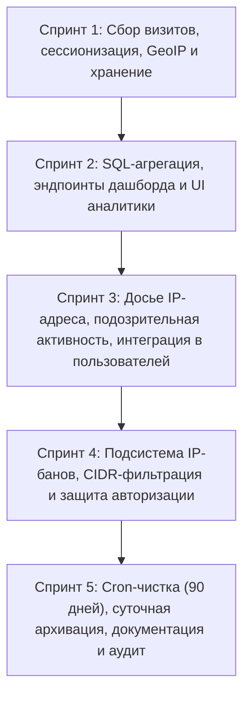

# План спринтов: Дашборд посещений и активности в админке (Visits & Activity Dashboard)

> **Статус:** Рабочий пошаговый план внедрения для исполнителя
> **Дата утверждения брифа:** 2026-11-23
> **Ветка:** `main`
> **Стек:** Go 1.27 + PocketBase v0.40.4 + SQLite, React 19 + Vite 7 + Lucide-react
> **Расположение:** Новая вкладка в панели управления (`/admin?tab=visits`), доступная исключительно администрации
> **Публичная статистика форума:** Не изменяется (публичные счётчики на главной и в темах остаются прежними)

---

## 1. Концепция и цели функционала (Executive Summary)

### 1.1. Зачем это нужно
На текущий момент администрация форума видит только совокупные счётчики (`totalUsers`, `totalTopics`, `totalPosts`) и 24-часовой срез активных участников (`dailyActiveMembers`). Отсутствует прозрачность по реальной посещаемости, географии, используемым устройствам, точкам входа и качеству трафика.

Дашборд решает следующие оперативные и аналитические задачи:
1. **Динамика аудитории:** Сколько людей заходит в день / неделю / месяц, сколько из них уникальных, соотношение зарегистрированных участников и гостей.
2. **Паттерны активности:** Распределение нагрузки по 24 часам суток и дням недели (определение «прайм-тайма» форума).
3. **География и окружение:** Из каких стран и городов приходят посетители (локальная база GeoIP без внешних задержек), какие типы устройств (десктоп, мобильные, планшеты), ОС и браузеры используются.
4. **Контент и точки входа:** С каких страниц начинается визит (`entry_path`), какие темы привлекают больше всего уникальных читателей за период.
5. **Безопасность и анти-фрод:** Выявление подозрительных аномалий (много аккаунтов с одного IP, регистрационные всплески, смена IP одним пользователем, наплыв ботов).
6. **Административный IP-контроль:** Карточка IP-адреса (в стиле классических движков MyBB/vBulletin) с возможностью блокировки IP.
7. **Бан по IP:** Блокировка попыток регистрации и авторизации с нежелательных адресов/подсетей без блокировки публичного чтения гостями.

---

## 2. Терминология и базовые определения (Ground Truth)

Все участники разработки и последующие спринты строго следуют этим определениям:

* **Визит (сессия / Visit / Session):** Непрерывная серия действий одного посетителя на форуме с перерывом между действиями **не более 30 минут**. Если пауза превышает 30 минут, следующее действие фиксируется как новый визит (`session_id`).
* **Уникальный посетитель за период (Unique Visitor):** Ровно один `user_id` (для авторизованного участника) или ровно один верифицированный гостевой идентификатор (приоритетно сертифицированный HttpOnly cookie `guest_principal_id`, с fallback на клиентский `guest_id` из `localStorage`) за выбранный временной интервал, независимо от общего числа визитов.
  > [!IMPORTANT]
  > **IP-адрес для вычисления уникальности НЕ используется!** Один IP может объединять сотни пользователей (NAT провайдера, мобильные операторы, университетские сети, офисы), а у одного пользователя IP динамически меняется при перемещении или перезагрузке роутера.
* **Онлайн сейчас (Online Now):** Существующий динамический 15-минутный срез по последнему клику: участники из `users.last_seen` + гости из коллекции `guest_presence`. Дашборд **переиспользует** этот механизм через `/api/aerun/status`, не создавая второй параллельной системы присутствия.
* **Зарегистрированный визит:** Визит авторизованного участника форума (`user_id != null`).
* **Гостевой визит:** Визит неавторизованного пользователя (`user_id == null`, присутствует валидный `guest_id`).
* **Визит бота:** Визит автоматизированного краулера/поисковика, идентифицированный по белому списку User-Agent сигнатур. Визиты ботов **не входят** в человеческие визиты и уникальные посетители, а выводятся отдельным фоновым счётчиком.

---

## 3. Модель сбора данных (Telemetry Contract)

### 3.1. Принцип сбора: один визит — одна запись
Для минимизации нагрузки на базу данных SQLite сбор информации строится по принципу: **один визит (сессия) = одна строка в таблице `visits`**.
Мы НЕ пишем строчку в БД на каждый клик или переход по страницам. Повторные клики внутри активной сессии (окно 30 минут) только продлевают сессию в памяти клиента/кэше сервера.

### 3.2. Спецификация таблицы `visits`
Новая серверная коллекция PocketBase (таблица SQLite `visits`):

| Поле | Тип PocketBase / SQLite | Индекс | Описание и требования |
| :--- | :--- | :---: | :--- |
| `id` | `text(15)` PK | UNIQUE | Стандартный ID PocketBase |
| `occurred_at` | `date` | INDEX | Время старта визита (UTC на сервере, отображение в часовом поясе админа) |
| `user_id` | `text(15)` NULL | INDEX | Ссылка на `users.id` (null для гостей) |
| `guest_id` | `text(64)` NULL | INDEX | Идентификатор гостя из `localStorage` (`aerun:guest:guest_id`) |
| `session_id` | `text(64)` | INDEX | Идентификатор сессии для группировки действий внутри визита |
| `ip` | `text(45)` NULL | — | Сырой IP (IPv4 или IPv6). Очищается/обезличивается через 90 дней |
| `ip_hash` | `text(64)` | INDEX | SHA-256 HMAC хэш от IP с серверным соленым ключом для быстрого поиска и группировки |
| `country` | `text(2)` | INDEX | Двухбуквенный ISO-код страны (`RU`, `DE`, `US` и т.д.), полученный через локальный GeoIP |
| `city` | `text(100)` | — | Название города на английском языке из локальной базы GeoIP |
| `device` | `text(16)` | INDEX | Тип устройства: `desktop`, `mobile`, `tablet`, `bot` |
| `browser` | `text(32)` | — | Название браузера (Chrome, Firefox, Safari, Edge, Opera, Other) |
| `os` | `text(32)` | — | Операционная система (Windows, macOS, Linux, Android, iOS, Other) |
| `entry_path` | `text(255)` | INDEX | Точка входа: URL первого запроса сессии (например, `/`, `/topic/45`, `/members`) |
| `referrer` | `text(255)` NULL | — | Внешний домен/источник перехода (`document.referrer`), если передан браузером |
| `is_bot` | `bool` | INDEX | Флаг распознанного бота (краулера) |

### 3.3. Идентификация гостя: Кука (`guest_principal`) против `localStorage`

В проекте исторически сосуществуют два механизма идентификации гостя:
1. **Клиентский `guest_id` (`localStorage: aerun:guest:guest_id`):**
   * Генерируется на клиенте (`Math.random() + Date.now()`).
   * Используется в `guest_presence` (15-минутный онлайн) и передается в JSON-теле heartbeat.
   * *Уязвимость:* легко очищается пользователем, может быть подделан скриптом, не защищён от накрутки.
2. **Серверный `guest_principal` (`HttpOnly Cookie: aerun_guest_cap`):**
   * Создан в миграциях `1770000003`–`1770000005` (файл `guest_principal.go`).
   * Хранит `guest_id:secret` в защищенной куке (`HttpOnly`, `SameSite=Lax`, `Secure`) со сроком жизни **1 год** (365 дней).
   * Секрет криптографически стоек (`crypto/rand`, 32 байта), на сервере хранится `sha256(secret)`.
   * Извлекается на бэкенде через готовую функцию `guestPrincipalIDFromRequest(e)`.
   * **Сквозная синергия:** именно к `guest_principal_id` уже привязаны гостевые посты, темы и репутационные голоса в базе данных.

**Решение для аналитики (Приоритет куки):**
* Кука **значительно надежнее** `localStorage`: она недоступна для XSS/клиентских манипуляций, живет 1 год и автоматически передается браузером в любых HTTP-запросах.
* **Гибридная схема:**
  * Сервер при обработке первого визита гостя или телеметрии проверяет куку `aerun_guest_cap` через `guestPrincipalIDFromRequest(e)`. Если куки ещё нет — сервер выдает её через существующий `setGuestPrincipalCookie`.
  * В таблицу `visits` и `topic_visits` записывается полученный `guest_principal_id`.
  * Если браузер гостя полностью заблокировал cookies, в качестве запасного варианта (fallback) используется `guest_id` из `localStorage`.
  * Итоговая формула уникального посетителя в SQL:
    `COUNT(DISTINCT COALESCE(user_id, guest_id))` (где `guest_id` хранит подтвержденный principal ID).

### 3.4. Учёт уникальных посещений тем (`topic_visits`)
Чтобы давать сводку «какие темы читают» с подсчётом уникальных посетителей и общего числа просмотров без сбора полного кликстрима, вводится легковесная таблица `topic_visits`:

| Поле | Тип | Индекс | Описание |
| :--- | :--- | :---: | :--- |
| `id` | `text(15)` PK | UNIQUE | PocketBase ID |
| `topic_id` | `text(15)` | INDEX | Ссылка на `topics.id` |
| `occurred_at` | `date` | INDEX | Время открытия темы |
| `user_id` | `text(15)` NULL | INDEX | ID пользователя (если авторизован) |
| `guest_id` | `text(64)` NULL | INDEX | ID гостя |
| `session_id` | `text(64)` | INDEX | ID сессии визита |

* Запись создаётся при обращении к `GET /api/aerun/topics/:id/posts`.
* **Дедупликация в рамках сессии:** Если в рамках одной сессии `session_id` пользователь листает страницы темы (страница 1 -> страница 2 -> страница 3), повторные записи **не создаются** (проверка в памяти процесса Go с TTL 30 минут).
* Это обеспечивает честный подсчёт: `COUNT(*)` = просмотры тем за период (в сессиях), `COUNT(DISTINCT COALESCE(user_id, guest_id))` = уникальные посетители темы.

### 3.5. Что категорически НЕ собирается (Приватность)
* Содержимое сообщений, личных переписок (ЛС), черновиков.
* Пароли, токены доступа, заголовки авторизации.
* Точные координаты (GPS, данные геолокации браузера).
* Полный кликстрим (история всех кликов и скроллов внутри сайта).
* Исходная строка User-Agent целиком не сохраняется на постоянной основе (парсится на лету в Go в структурированные поля `device`, `browser`, `os`, после чего строка отбрасывается).

---

## 4. Архитектура дашборда: отображение и UX-структура

Дашборд размещается на вкладке панели управления с URL `/admin?tab=visits`.

### 4.1. Временные периоды
Администратор может переключать период анализа одной кнопкой:
* **Сегодня (Today):** С 00:00:00 текущего дня (по часовому поясу администратора) до текущего момента.
* **7 дней (Last 7 Days):** Скользящее окно последних 7 суток (168 часов).
* **30 дней (Last 30 Days):** Скользящее окно последних 30 суток (720 часов).

Все расчёты производятся строго за выбранный период с автоматическим расчётом дельты к аналогичному предыдущему периоду (например, текущие 7 дней к предыдущим 7 дням).

---

### 4.2. Порядок блоков дашборда сверху вниз (Layout Flow)

```text
+---------------------------------------------------------------------------------------------------+
| [ Период: [ Сегодня ] [ 7 дней ] [ (30 дней) ] ]                   [ 🔄 Обновить данные ]        |
+---------------------------------------------------------------------------------------------------+
| 1. РЯД KPI-КАРТОЧЕК (.admin-card)                                                                 |
| [ Онлайн сейчас: 14 ] [ Визиты: 1,840 ] [ Уникальные: 620 ] [ Регистрации: +12 ] [ Посты: +185 ]   |
|   (10 уч. / 4 гост.)    (+8.2% к пред.)   (+5.4% к пред.)     (-2 к пред.)       (+14% к пред.)   |
+---------------------------------------------------------------------------------------------------+
| 2. ГРАФИК ПО ДНЯМ (SVG-столбцы: Визиты, Уникальные + тонкая линия: Боты)                          |
| [ |||||||||||||||||||||||||||||||||||||||||||||||||||||||||||||||||||||||||||||||||||||||||||| ]  |
+---------------------------------------------------------------------------------------------------+
| 3. ДВУХКОЛОНОЧНЫЙ БЛОК:                                                                           |
|   ЛЕВАЯ КОЛОНКА:                                  | ПРАВАЯ КОЛОНКА:                               |
|   - Активность по часам суток (24h тепловая шкала) | - Топ стран (Ранжированный список с полосами) |
|   - Активность по дням недели                     | - Устройства и браузеры (Desktop/Mobile/...)  |
+---------------------------------------------------------------------------------------------------+
| 4. ТОП ТОЧЕК ВХОДА (Entry Paths) — ранжированный список с полосами долей                          |
|   1. / (Главная) — 45%  |  2. /topic/45 (Правила) — 22%  |  3. /active-topics — 12% ...           |
+---------------------------------------------------------------------------------------------------+
| 5. УНИКАЛЬНЫЕ ПОСЕЩЕНИЯ ТЕМ (Таблица)                                                             |
|   [Тема]                 [Раздел]        [Уникальные читатели]  [Просмотры]   [Последний визит]   |
|   Лор: Великий Раскол    История         142                    380           10 мин. назад       |
+---------------------------------------------------------------------------------------------------+
| 6. ТАБЛИЦА НЕДАВНИХ ВИЗИТОВ (Серверная пагинация, поиск по нику и IP)                              |
|   [Поиск: [__________]] [Фильтр: Все / Только участники / Только гости]                           |
|   Время         Кто              IP (по правам)    Страна/Город    Устройство     Точка входа     |
|   14:22:10      Bob_Wizard       178.62.***.***    🇷🇺 Москва       Chrome/Win     /topic/88       |
|   14:20:05      Гость [a9f1]     95.165.***.***    🇩🇪 Франкфурт    Safari/iOS     /               |
+---------------------------------------------------------------------------------------------------+
| 7. ПОДОЗРИТЕЛЬНАЯ АКТИВНОСТЬ И БЕЗОПАСНОСТЬ (Таблицы с бейджами аномалий)                         |
|   - Один IP — несколько аккаунтов (возможные мультиаккаунты)                                      |
|   - Регистрационные всплески с одного IP                                                         |
|   - Один аккаунт с множества разных IP за 24 часа                                                 |
|   (Клик по любому IP открывает детальный Экран IP 5.1 с кнопкой быстрой блокировки)               |
+---------------------------------------------------------------------------------------------------+
```

---

### 4.3. Выбор технологии графиков: Легковесный собственный SVG/CSS
В соответствии с требованиями и архитектурными правилами проекта:
* **Новые тяжелые библиотеки графиков (Chart.js, Recharts, ECharts) НЕ подключаются.** Они добавляют от 150 до 400 КБ в бандл, требуют обёрток под React 19 и создают проблемы с динамической адаптацией к светлой/тёмной темам Aerun.
* **Решение:** Собственные лаконичные SVG-компоненты (`DailyVisitsChart.jsx`, `HourlyDistributionChart.jsx`, `RankedBarList.jsx`).
  * Столбцы и полосы строятся через чистый векторный SVG (`<rect>`, `<path>`, `<text>`) или CSS-флексы с процентной шириной.
  * Все заливки, обводки и подписи используют строго CSS-переменные:
    - Заливка визитов: `var(--primary-color)`
    - Заливка уникальных: `color-mix(in srgb, var(--primary-color) 60%, var(--card-bg))`
    - Линия ботов: `var(--secondary-color)` (пунктир)
    - Сетка и оси: `var(--border-color)`
    - Подписи текста: `var(--secondary-color)` (размер строго $\ge$ 14px)
* **Карта мира:** В первой версии **исключена** (тяжёлые GeoJSON шейпы, нулевая польза при концентрации пользователей в 3–5 странах). Список стран с горизонтальными прогресс-барами читается точнее и мгновенно рендерится.

---

## 5. Карточка IP-адреса и интеграция в профиль пользователя

### 5.1. Экран / Модальное окно IP (`AdminIPModal`)
При клике на любой IP-адрес в дашборде или в таблице пользователей открывается детальное досье IP:

1. **Заголовок:** IP-адрес (или маска, если у администратора нет права `view_raw_ip`), страна (флаг + название), город.
2. **Связанные аккаунты:** Список всех зарегистрированных пользователей, заходивших с этого IP:
   * Аватар, никнейм, текущая роль, статус (`active`, `pending`, `banned`).
   * Дата первого и последнего визита с данного IP.
3. **Регистрации с этого IP:** Список аккаунтов, которые были созданы именно с этого IP (критично для выявления бот-ферм и твинков).
4. **История визитов:** Последние 50 посещений (время, статус: участник/гость, точка входа, User-Agent).
5. **Текущий статус блокировки:**
   * Если не забанен: кнопка `[ 🚫 Заблокировать IP ]` (открывает модальное окно бана).
   * Если забанен: бейдж `[ ⛔ Заблокирован до DD.MM.YYYY (Причина: ...) ]` + кнопка `[ Снять бан ]`.
   * Кнопка `[ 🛡 Добавить в белый список ]`.

### 5.2. Экран участника (Вкладка «Пользователи» панели управления)
В карточке просмотра участника во вкладке «Пользователи» (`AdminPage.jsx`) добавляется секция **«IP-адреса активности»**:
* Таблица последних 5–10 IP-адресов, с которых входил участник.
* Столбцы: IP (по правам), Страна/Город, Первый вход, Последний вход, Число визитов.
* Каждый IP кликабелен и бесшовно открывает экран IP (раздел 5.1).

---

## 6. Механизм бана по IP (IP Bans Specification)

### 6.1. Архитектурный принцип
Бан по IP — это **отдельная сущность системы безопасности**, независимая от статуса аккаунта `status = banned`. Блокировка пользователя блокирует его профиль, а блокировка IP пресекает сетевую активность злоумышленника.

### 6.2. Коллекция `ip_bans` (Схема БД)

| Поле | Тип PocketBase / SQLite | Индекс | Описание |
| :--- | :--- | :---: | :--- |
| `id` | `text(15)` PK | UNIQUE | ID записи |
| `ip_or_subnet` | `text(50)` | UNIQUE | Одиночный IPv4/IPv6 или CIDR подсеть (например, `192.0.2.0/24`) |
| `ip_start` | `blob(16)` | INDEX | Бинарное представление начального адреса диапазона для быстрого SQL поиска |
| `ip_end` | `blob(16)` | INDEX | Бинарное представление конечного адреса диапазона |
| `reason` | `text(255)` | — | Причина блокировки (обязательное поле) |
| `banned_by` | `text(15)` | INDEX | `users.id` администратора, наложившего бан |
| `created_at` | `date` | — | Дата и время создания бана |
| `expires_at` | `date` NULL | INDEX | Дата окончания (NULL — бессрочный бан) |
| `is_active` | `bool` | INDEX | Флаг активности бана (быстрое снятие без удаления истории) |

### 6.3. Что именно запрещает бан по IP (Решение пользователя 2026-11-23)
* ❌ **Запрещено:** Регистрация нового аккаунта (`POST /api/aerun/auth/register`).
* ❌ **Запрещено:** Вход в любой существующий аккаунт (логин по паролю и OAuth2).
* ✅ **Разрешено:** Чтение форума гостем **НЕ проверяется и НЕ блокируется**. Гость с заблокированного IP по-прежнему может свободно читать открытые публичные темы и категории.
* ✅ **Разрешено:** Отправка гостевых сообщений — остаётся как способ связаться с администрацией для забаненного по IP (решение 2026-11-23).
* **Реакция на запрещённое действие:** Сервер возвращает нейтральную ошибку HTTP `403 Forbidden` с нейтральным текстом (`{"error": "Access denied"}`), без раскрытия технических подробностей бана.

### 6.4. Защитные механизмы (Safety Rails)
1. **Защита главного администратора (Chief Admin Immunity):** Сервер Go на уровне команды блокировки проверяет текущий IP сессии супер-админа (`transfer-root` / root-роль). Попытка забанить собственный текущий IP главного администратора отклоняется с ошибкой HTTP 400.
2. **Предупреждение о коллективном NAT:** Если администратор инициирует бан IP, с которого на форуме зафиксировано более 3 разных аккаунтов, UI выводит предупреждающее модальное окно:
   > ⚠️ *«Внимание: с этого IP-адреса на форуме зарегистрировано или активно 7 аккаунтов. Возможно, это общий корпоративный или мобильный NAT. Блокировка затронет всех пользователей этого адреса. Продолжить?»*
3. **Белый список (IP Safelist):** Таблица / конфигурация доверенных IP (`127.0.0.1`, локальные шлюзы, доверенный IP офиса), которые сервер программно запрещает блокировать.
4. **Аудит логов:** Каждое создание бана (`ip_ban_created`) и снятие бана (`ip_ban_removed`) немедленно фиксируется в неизменяемом журнале аудита `audit_logs` через существующий хелпер `recordAuditLog`.

---

## 7. Приватность, права доступа и очистка данных

### 7.1. Модель разрешений (RBAC)
В `backend/internal/auth/permission.go` и `src/constants/permissions.js` добавляются три новых capability-ключа:

```go
const (
    // PermViewVisitsDashboard разрешает доступ к вкладке аналитики и базовым метрикам
    PermViewVisitsDashboard Permission = "view_visits_dashboard"

    // PermViewRawIP разрешает видеть сырые незамаскированные IP-адреса
    PermViewRawIP Permission = "view_raw_ip"

    // PermManageIPBans разрешает добавлять, редактировать и снимать баны по IP
    PermManageIPBans Permission = "manage_ip_bans"
)
```

* **По умолчанию:**
  * `PermViewVisitsDashboard` и `PermManageIPBans` назначаются роли Администратор (`admin`).
  * `PermViewRawIP` назначается **исключительно главному администратору (Root / Chief Admin)**.
  * Обычные администраторы и модераторы видят маскированный адрес: `192.168.***.***` или `2a00:1370:****:****`, а для группировок используется `ip_hash`.

### 7.2. Срок хранения и фоновая очистка (Retention Policy)
* **Сырые IP-адреса и детальные записи `visits`:** Хранятся **90 дней**.
* **Еженощный Cron (`registerVisitsRetentionCron`):**
  1. Записи визитов старше 90 дней подвергаются обезличиванию: поле `ip` затирается в `NULL` (или строка удаляется, если суточные агрегаты уже сохранены).
  2. Записи `topic_visits` старше 90 дней удаляются.
* **Суточные агрегаты (`daily_visits_summary`):**
  * Хранятся **бессрочно**.
  * Содержат только числа: дата, общее число визитов, число уникальных, число постов, число регистраций, JSON-распределение по странам и устройствам. В них нет персональных данных.

### 7.3. Политика конфиденциальности и правила форума
В правила форума и соглашение о конфиденциальности вносится прозрачный пункт:
> *«Форум ведёт технический журнал подключений (IP-адрес, тип браузера, время визита) исключительно в целях предотвращения спама, обеспечения информационной безопасности и статистического анализа посещаемости. Сырые данные сетевых адресов хранятся не более 90 дней с ограниченным доступом главного администратора, после чего необратимо обезличиваются».*

---

## 8. Темизация, адаптивность и правила оформления (Style Guide)

В соответствии с правилами проекта (`.agent/rules/AGENTS.md`) и дизайн-системой админки:

1. **Никаких инлайн-стилей:** Полный запрет на `style={{...}}`.
2. **Никаких новых компонентов `react-bootstrap`:** Все карточки дашборда (включая KPI и графики) верстаются исключительно на семантических классах `.admin-card`:
   - `.admin-card` — базовый контейнер (фон `var(--card-bg)`, граница `var(--border-color)`).
   - `.admin-card--spacing` — отступ снизу `1.5rem`.
   - `.admin-card__header` — шапка карточки с заголовком и тулбаром.
   - `.admin-card__body` — внутреннее тело.
   - `.admin-card__footer` — подвал с мета-данными.
3. **Единый префикс стилей:** Все новые CSS-классы именуются с пространством имён `.visits-...` (например, `.visits-kpi-grid`, `.visits-chart-container`, `.visits-bar-row`, `.visits-table`). Файл стилей: `src/components/admin/VisitsTab.css`.
4. **Типографика:** Размер шрифта во всех виджетах, легендах графиков, бейджах и таблицах составляет **не менее 14px** (запрещены мелкие нечитаемые надписи 10–12px).
5. **Адаптивность (Breakpoints):**
   * **~360px (Мобильные экраны):** Сайдбар админки свернут в Drawer; KPI-карточки выстраиваются строго в одну колонку; таблицы получают внутренний контейнер с горизонтальным скроллом (`.visits-table-scroll`); графики масштабируются по ширине 100%; страница форума ни при каких условиях не даёт горизонтальной полосы прокрутки.
   * **~768px (Планшеты):** KPI-сетка в 2–3 колонки; графики и топы стран распределяются в адаптивные блоки.
   * **~1280px и шире (Десктоп):** Полноэкранный Fluid Dashboard; двухколоночные распределения графиков и списков.
6. **Поддержка тем:** 100% совместимость со Светлой и Тёмной темами Aerun. Цвета линий, шкал, бейджей и полос берутся из палитры CSS-переменных темы.

---

## 9. Поэтапный план реализации (5 спринтов)



---

### Спринт 1: Сбор визитов, сессионизация, GeoIP и хранение

**Цель спринта:** Реализовать фундамент сбора телеметрии — миграции БД, сессионизацию 30 минут, локальную базу GeoIP, парсер User-Agent и запись визитов в SQLite.

#### 1. Миграции базы данных
* Миграция `1781000000_visits_schema.go`:
  * Создание коллекции `visits` со структурой из Раздела 3.2.
  * Создание индексов: `idx_visits_occurred_at`, `idx_visits_user`, `idx_visits_guest`, `idx_visits_session`, `idx_visits_ip_hash`, `idx_visits_country`, `idx_visits_entry_path`.
* Миграция `1781000001_topic_visits_schema.go`:
  * Создание коллекции `topic_visits` (Раздел 3.4).
  * Индексы: `idx_topic_visits_topic`, `idx_topic_visits_session`, `idx_topic_visits_occurred_at`.

#### 2. Бэкенд (Go)
* Интеграция GeoIP (`backend/internal/platform/pocketbase/geoip.go`):
  * Использование чистого легковесного ридера баз формата MaxMind `.mmdb` (GeoLite2 City) без внешних CGO-зависимостей.
  * Файл базы размещается локально в `pb_data/geoip/GeoLite2-City.mmdb`.
  * **Получение базы (обязательно, файл НЕ коммитится в репозиторий):**
    база GeoLite2 — лицензионная, скачивается с сайта MaxMind по ключу
    аккаунта. Шаг спринта: скрипт/документация скачивания и обновления
    базы, путь `pb_data/geoip/` в `.gitignore`, порядок обновления
    (раз в месяц), описание в DEPLOY/RUNBOOK. Без базы на сервере
    GeoIP возвращает fallback `"XX" / "Unknown"`, дашборд продолжает
    работать без географии.
  * Функция `ResolveLocation(ip string) (countryCode string, cityName string)`: мгновенный lookup в памяти. Если база недоступна или IP локальный — безопасный fallback на `"XX"`, `"Unknown"`.
* Парсинг User-Agent и ботов (`backend/internal/platform/pocketbase/user_agent.go`):
  * Сигнатурный анализатор ботов (`Googlebot`, `YandexBot`, `Bingbot`, `Baiduspider`, `DuckDuckBot`, `Applebot`, `facebookexternalhit`, `TelegramBot`, `Discordbot` и др.).
  * Детектор типов устройств (`mobile`, `tablet`, `desktop`) и популярных браузеров/ОС.
* Хэндлер телеметрии визита:
  * Маршрут `POST /api/aerun/telemetry/visit`:
    * Принимает payload: `{ session_id, guest_id, entry_path, referrer }`.
    * Извлекает реальный IP через `e.RealIP()` (учитывает заголовки от Caddy).
    * Вычисляет `ip_hash = sha256(ip + server_salt)`.
    * Проверяет в in-memory LRU-кэше сессий (TTL 30 минут): если данный `session_id` уже зафиксирован, запрос считается touch-пульсом и не дублирует строку в `visits`.
    * При новой сессии — выполняет быструю вставку в `visits`.
* Трекинг чтения тем:
  * В хэндлере `GET /api/aerun/topics/:id/posts`:
    * Фиксация посещения темы в `topic_visits` с защитой от дублей внутри сессии (кэш `session_id:topic_id` на 30 мин).

#### 3. Фронтенд (React)
* Утилита сессий `src/utils/telemetrySession.js`:
  * Генерация и хранение `session_id` в `sessionStorage`.
  * Логика таймаута: отслеживание времени последнего действия; если прошло > 30 минут — ротация `session_id`.
  * Отправка пинга при входе на форум (в `App.jsx` / `AuthProvider.jsx`): вызов `sendTelemetryVisit()`.
  * Передача `guest_id` из `localStorage` (`aerun:guest:guest_id`).

#### 4. Тестирование спринта
* Go-тесты: `visits_telemetry_test.go` — проверка создания записи, парсинга User-Agent, корректности хэширования IP, игнорирования повторных вызовов внутри одной сессии.
* Тест GeoIP: проверка резолва тестовых IPv4/IPv6 адресов.
* Тест изоляции данных: подтверждение, что неавторизованный пользователь не может читать таблицу `visits`.

---

### Спринт 2: SQL-агрегация, эндпоинты дашборда и UI аналитики

**Цель спринта:** Построить быстрые агрегационные эндпоинты и сверстать вкладку дашборда с KPI-карточками, SVG-графиками, топами стран/устройств и таблицей недавних визитов.

#### 1. Бэкенд (Go)
* Права доступа:
  * Добавление `PermViewVisitsDashboard` и `PermViewRawIP` в `allPermissions`.
  * Привязка `PermViewVisitsDashboard` к ролям администраторов.
* Эндпоинты дашборда (пакет `pocketbase`, файл `admin_analytics.go`):
  * `GET /api/aerun/admin/analytics/dashboard?period=today|7d|30d`:
    * Единый оптимизированный SQL-запрос, вычисляющий:
      - KPI: визиты, уникальные посетители, новые регистрации, посты, текущий онлайн.
      - Временной ряд по дням: визиты, уникальные, боты.
      - Почасовую гистограмму (0–23 ч).
      - Распределение по дням недели.
      - Топ-10 стран с процентами.
      - Топ-10 браузеров и ОС.
      - Топ-10 точек входа (`entry_path`).
  * `GET /api/aerun/admin/analytics/topics?period=today|7d|30d&limit=20`:
    * Возвращает топ тем по числу уникальных посетителей за период (`COUNT(DISTINCT COALESCE(user_id, guest_id))`), с числом просмотров и названием темы.
  * `GET /api/aerun/admin/analytics/visits?page=1&limit=25&query=&filter=all|members|guests`:
    * Серверная пагинация недавних визитов.
    * Если у вызывающего нет права `PermViewRawIP`, поле `ip` автоматически маскируется (`192.168.***.***`), сырой адрес заменяется хэшем.

#### 2. Фронтенд (React)
* Конфигурация навигации:
  * Обновление `src/config/adminNavigation.js`: добавление секции `visits` в группу `systemConfig` (или отдельную аналитическую группу) с охраной `PERMISSIONS.VIEW_VISITS_DASHBOARD`.
* Основной компонент `src/components/admin/VisitsTab.jsx` + `VisitsTab.css`:
  * Переключатель периодов: `[ Сегодня ] [ 7 дней ] [ 30 дней ]`.
  * KPI-карточки на классах `.admin-card` с расчётом дельт к предыдущему периоду.
  * График по дням `DailyVisitsChart.jsx` (чистый SVG с подписями `var(--text-color)` и столбиками по CSS-токенам).
  * Почасовая тепловая полоса `HourlyDistributionChart.jsx` (24 столбца с градиентом интенсивности).
  * Двухколоночный блок ранжированных списков `RankedBarList.jsx` (страны, браузеры, ОС).
  * Таблица посещаемости тем `TopTopicsTable.jsx`.
  * Таблица недавних визитов `RecentVisitsTable.jsx` с серверной пагинацией через `ForumPagination.jsx` и живым поиском.
* Локализация:
  * Полный набор ключей в `src/i18n/dictionary.js` для RU и EN языков.

#### 3. Тестирование спринта
* Go-тесты: `admin_analytics_test.go` — проверка точности расчёта уникальных посетителей (исключение ботов, разделение пользователей и гостей), маскирования IP при отсутствии супер-прав.
* Frontend-тесты: `scripts/check-admin-nav-config.mjs` (гарантирует валидность ключей навигации, отсутствие битых вкладок).
* Проверка вёрстки: адаптивное тестирование на 360px, 768px, 1280px в Светлой и Тёмной темах.

---

### Спринт 3: Досье IP-адреса, подозрительная активность, интеграция в пользователей

**Цель спринта:** Реализовать классический функционал расследования по IP: детальное модальное окно IP-адреса, выявление мультиаккаунтов и аномалий, показ IP-адресов в карточке участника.

#### 1. Бэкенд (Go)
* Эндпоинты расследования по IP (`admin_ip_investigation.go`):
  * `GET /api/aerun/admin/analytics/ip-dossier?ip=...&ip_hash=...`:
    * Список всех пользователей, логинившихся или регистрировавшихся с данного IP (ник, аватар, роль, статус, дата первого и последнего визита с этого адреса).
    * Список гостевых сессий с этого IP.
    * Текущий статус бана (есть ли активная запись в `ip_bans`).
  * `GET /api/aerun/admin/analytics/suspicious`:
    * Алгоритмический поиск подозрительной активности:
      1. **Один IP — много аккаунтов:** Список IP, с которых зафиксировано $\ge 3$ различных `user_id`.
      2. **Всплеск регистраций:** IP, с которых за последние 24 часа создано $\ge 2$ аккаунтов.
      3. **Один аккаунт — много IP:** Пользователи, заходившие с $\ge 4$ различных IP за короткий срок.
      4. **Всплеск гостей:** Аномальное количество гостевых сессий с одного адреса/подсети за час.
  * Интеграция в карточку пользователя:
    * В `GET /api/aerun/admin/users/:id`: добавление блока `recent_ips` (список последних 10 использованных IP с датами первого/последнего входа).

#### 2. Фронтенд (React)
* Модальное окно `src/components/modals/AdminIPModal.jsx`:
  * Полное досье IP: страна, город, список связанных аккаунтов, история активности, текущий статус блокировки.
  * Кнопки быстрых действий: `[ Заблокировать IP ]`, `[ Снять блокировку ]`.
* Интеграция в таб пользователей `AdminPage.jsx`:
  * В детальной строке/карточке пользователя — интерактивный блок «IP-адреса» с кликом по каждому IP для открытия `AdminIPModal`.
* Блок «Подозрительная активность» в `VisitsTab.jsx`:
  * Четыре компактные вкладки/таблицы с предупреждающими бейджами.
  * Прямой переход в досье подозрительного IP в один клик.

#### 3. Тестирование спринта
* Go-тесты: `admin_ip_dossier_test.go` — проверка корректности связывания аккаунтов с IP, фильтрация подозрительных паттернов, проверка прав доступа к досье.
* Интеграционные тесты UI: проверка открытия модального окна IP из таблицы недавних визитов и из вкладки пользователей.

---

### Спринт 4: Подсистема IP-банов, CIDR-фильтрация и защита авторизации

**Цель спринта:** Реализовать надёжную систему блокировки IP и подсетей, перехват попыток входа и регистрации, интеграцию с журналом аудита и защитой от выстрела в ногу.

#### 1. Миграции базы данных
* Миграция `1781000002_ip_bans_schema.go`:
  * Создание коллекции `ip_bans` со схемой из Раздела 6.2.
  * Поля: `ip_or_subnet`, `ip_start`, `ip_end`, `reason`, `banned_by`, `expires_at`, `is_active`.
  * Индексы: `idx_ip_bans_lookup` по `(is_active, ip_start, ip_end)`.

#### 2. Бэкенд (Go)
* Сервис сопоставления IP (`backend/internal/platform/pocketbase/ip_ban.go`):
  * Поддержка как одиночных IPv4 (`198.51.100.1`) и IPv6 (`2001:db8::1`), так и CIDR диапазонов (`198.51.100.0/24`, `2001:db8::/32`).
  * Преобразование IP-адресов в нормализованный 16-байтный формат для быстрого поиска диапазона: `ip_start <= target_ip AND target_ip <= ip_end`.
  * In-memory кэш активных банов с синхронизацией при изменениях (исключает лишние SQL-запросы при штатном трафике).
  * Метод `IsIPBanned(ip string) (bool, *IPBanRecord)`.
* Защита критических маршрутов (Middleware / Route Interceptors):
  * В `POST /api/aerun/auth/register` (регистрация): если IP забанен — мгновенный возврат `403 Forbidden` с нейтральным сообщением.
  * В хуке PocketBase на аутентификацию `users` (логин по паролю и OAuth2): если IP клиента забанен — прерывание авторизации с `403 Forbidden`.
  * **Гостевой доступ:** Публичные маршруты тем, разделов и списка пользователей **НЕ блокируются**.
* Эндпоинты управления банами:
  * `POST /api/aerun/admin/ip-bans` — создание бана (требует `PermManageIPBans`).
    * Валидация: проверка, что IP не принадлежит главному администратору (`transfer-root`).
    * Проверка белого списка (Safelist).
    * Запись события `ip_ban_created` в `audit_logs` через `recordAuditLog`.
  * `POST /api/aerun/admin/ip-bans/:id/unban` — досрочное снятие бана.
    * Запись события `ip_ban_removed` в `audit_logs`.
  * `GET /api/aerun/admin/ip-bans` — список всех активных и архивных банов с фильтром и пагинацией.

#### 3. Фронтенд (React)
* Модальное окно создания бана `src/components/modals/BanIPModal.jsx`:
  * Поля: IP или подсеть, причина бана, срок (бессрочно, 24 часа, 7 дней, 30 дней, до даты).
  * Предупреждение о NAT: динамический подсчёт аккаунтов на этом IP; если $> 3$, вывод предупреждающего алерта.
* Обработка ошибок авторизации:
  * Если забаненный пользователь пытается войти или зарегистрироваться — вывод стандартного нейтрального `ErrorCard` без технической информации о бане.
* Раздел «Заблокированные IP» в админке:
  * Таблица действующих банов с возможностью поиска, продления и снятия.

#### 4. Тестирование спринта
* Go-тесты: `ip_bans_test.go` — модульные тесты парсинга IPv4/IPv6 CIDR, проверка невозможности забанить главного админа, проверка запрета регистрации с забаненного IP, проверка сохранения возможности гостевого чтения.
* Тесты аудита: проверка появления записей `ip_ban_created` и `ip_ban_removed` в `audit_logs`.

---

### Спринт 5: Cron-чистка (90 дней), суточная архивация, документация и аудит

**Цель спринта:** Автоматизировать регламентные процедуры хранения данных (суточная агрегация и чистка сырых IP через 90 дней), обновить документацию проекта и провести финальный сквозной аудит.

#### 1. Миграции базы данных
* Миграция `1781000003_daily_visits_summary.go`:
  * Создание таблицы суточных агрегатов `daily_visits_summary`:
    * `date` (TEXT YYYY-MM-DD, UNIQUE PK)
    * `total_visits` (INT)
    * `unique_visitors` (INT)
    * `unique_members` (INT)
    * `unique_guests` (INT)
    * `bot_visits` (INT)
    * `new_registrations` (INT)
    * `posts_count` (INT)
    * `countries_json` (JSON)
    * `devices_json` (JSON)
    * `entry_paths_json` (JSON)

#### 2. Бэкенд (Go)
* Фоновая суточная архивация (`registerVisitsDailyAggregationCron`):
  * Запуск каждую ночь в 02:00 UTC.
  * Подсчёт и фиксация итогов за вчерашний день в `daily_visits_summary`.
* Фоновая чистка сырых данных (`registerVisitsRetentionCron`):
  * Запуск каждую ночь в 03:00 UTC.
  * Находит все записи в `visits` старше 90 дней.
  * Очищает сырой IP: `UPDATE visits SET ip = NULL WHERE occurred_at < datetime('now', '-90 days') AND ip IS NOT NULL`.
  * Удаляет устаревшие строки `topic_visits` старше 90 дней.
  * Логирует объём очищенных строк в журнал сервера.

#### 3. Актуализация документации проекта
В соответствии с правилом `.agent/rules/documentation_maintenance.md`:
* Обновление `PROJECT_SPEC.md`:
  * Описание новых таблиц: `visits`, `topic_visits`, `ip_bans`, `daily_visits_summary`.
  * Описание новых маршрутов: `/api/aerun/telemetry/visit`, `/api/aerun/admin/analytics/*`, `/api/aerun/admin/ip-bans/*`.
  * Новые права: `view_visits_dashboard`, `view_raw_ip`, `manage_ip_bans`.
* Обновление `PROJECT_CONTEXT.md`:
  * Включение дашборда посещений и подсистемы IP-банов в карту возможностей администрирования.
* Добавление текста регламента конфиденциальности в `markdowns/`.

#### 4. Финальный аудит и верификация
* Полный прогон бекенд-тестов: `go test -v ./internal/...`.
* Прогон фронтенд-проверок: `npm test`, проверка отсутствия регрессий в `scripts/check-admin-nav-config.mjs`.
* Валидация верстки: проверка соответствия `.admin-card`, шрифтов $\ge$ 14px и корректности отображения при ширине экрана 360px.

---

## 10. Оценка рисков и инженерные меры смягчения (Risk Mitigation)

| Риск | Вероятность | Влияние | Инженерное решение (Mitigation) |
| :--- | :---: | :---: | :--- |
| **Нагрузка на запись в SQLite при наплыве визитов** | Средняя | Высокое | **1.** Сессионизация на клиенте: визит отправляется 1 раз при открытии, а не на каждый клик.<br>**2.** In-memory LRU-кэш в Go: повторные пинги одной сессии в течение 30 минут отсекаются в ОЗУ без касания диска.<br>**3.** SQLite работает в WAL-режиме, транзакции телеметрии выполняются быстро и изолированно. |
| **Неточность локальной базы GeoIP** | Низкая | Низкое | Используется официальная база MaxMind GeoLite2 City. Точность по странам превышает 99.8%, по крупным городам — около 80%. Для задач форума этого более чем достаточно. Если IP не распознан — нейтральный fallback `"XX" / "Unknown"`. |
| **Ложные срабатывания бана на общих IP (NAT / общежития)** | Высокая | Высокое | **1.** Бан по IP запрещает **только** регистрацию и вход. Гостевое чтение остаётся открытым.<br>**2.** UI выводит строгое предупреждение, если на IP обнаружено $>3$ аккаунтов.<br>**3.** Защита Chief Admin исключает случайную блокировку самого администратора.<br>**4.** Доступен IP Safelist. |
| **Раздувание аналитики поисковыми ботами** | Средняя | Среднее | Боты выявляются на лету по проверенной сигнатурной базе User-Agent краулеров. Они категорически исключаются из человеческих визитов и уникальных пользователей, отражаясь только отдельной фоновой строкой «ботов за день». |
| **Утечка персональных данных (IP-адресов)** | Низкая | Критическое | **1.** Сырые IP адреса скрыты за отдельным правом `view_raw_ip` (только главный админ).<br>**2.** Для всех остальных админов адреса маскируются.<br>**3.** Строгий 90-дневный retention с автоматической очисткой сырых IP. |

---

## 11. Чек-лист приёмки функционала (Definition of Done)

- [x] Таблицы `visits`, `topic_visits`, `ip_bans`, `daily_visits_summary` созданы миграциями.
- [x] Гостевой `guest_id` берется из существующего механизма `localStorage` (`aerun:guest:guest_id`).
- [x] Сессия визита длится 30 минут тишины; клики внутри сессии не плодят дубликаты записей в `visits`.
- [x] Определение ботов работает корректно; боты не завышают показатели людей.
- [x] Графики построены на чистом SVG/CSS с цветами из переменных темы форума (без новых npm-зависимостей).
- [x] Карточки KPI выполнены на базе системы `.admin-card`.
- [x] Все шрифты и подписи графиков имеют размер не менее 14px.
- [ ] Вёрстка проверена на разрешениях 360px, 768px и 1280px в Светлой и Тёмной темах (требуется визуальная проверка пользователем).
- [x] Сырой IP видит только Главный администратор; остальные видят маску `***.***`.
- [x] По клику на IP открывается досье с историей аккаунтов и кнопкой блокировки.
- [x] Бан по IP запрещает регистрацию и вход, сохраняя гостевое чтение.
- [x] Защита запрещает блокировать IP Главного администратора.
- [x] Все факты блокировки и снятия бана логируются в `audit_logs`.
- [x] Cron-задачи суточной агрегации и очистки сырых IP старше 90 дней зарегистрированы и протестированы.
- [x] Документация `PROJECT_SPEC.md` и `PROJECT_CONTEXT.md` актуализирована.

---

## 12. Журнал выполнения и решений

Журнал ведётся в этом же файле. Исполнитель не правит молча разделы 1–11:
любое отклонение от плана, новое решение или перенос записывается сюда
с датой, а раздел 12.1 пополняется. Проверка спринта считается закрытой
только после записи в 12.3.

### 12.1. Решения (зафиксировано до и по ходу работы)

| Дата | Решение | Кто / источник |
|------|---------|----------------|
| 2026-11-23 | Дашборд — отдельная вкладка админки `/admin?tab=visits`, только для админов; публичная статистика не меняется; email-дайджеста нет | Пользователь |
| 2026-11-23 | Гео: страна и город, локальная база GeoIP | Пользователь |
| 2026-11-23 | Бан по IP запрещает регистрацию и вход; чтение гостем не проверяется и не блокируется | Пользователь |
| 2026-11-23 | Уникальность — по `user_id` / `guest_id`, никогда по IP | Бриф |
| 2026-11-23 | Боты — отдельной простой статистикой «ботов за день», исключены из человеческих метрик | Пользователь |
| 2026-11-23 | Сводка по уникальным посещениям тем | Пользователь |
| 2026-11-23 | Отображение: SVG/CSS-графики без новых библиотек, списки с полосами, таблицы; карты мира в v1 нет | Пользователь |
| 2026-11-23 | Всё на классах: `.admin-card`, префикс `.visits-...`, без инлайн-стилей и новых Bootstrap-утилит; адаптивность 360/768/1280px в обеих темах; шрифт ≥ 14px | Пользователь |
| 2026-11-23 | Сырой IP: хранение 90 дней, видит только главный админ (остальные — маску/хеш) | Пользователь (вариант по умолчанию из брифа, подтверждён) |
| 2026-11-23 | Будущее, не в v1: при бане пользователя предлагать бан по IP (промпт) — отдельная заметка `NOTES_IP_Ban_UX_Future.md`; таблица забаненных IP с редактированием — вошла в спринт 4 | Пользователь |
| 2026-11-23 | Запрет гостевых постов с забаненного IP убран из плана (раздел 6.3): гостевые сообщения остаются как способ связаться с администрацией | Пользователь |
| 2026-11-23 | Провайдер/ASN убран из досье IP (раздел 5.1): в базе GeoLite2 City этих данных нет, нужна была бы отдельная база; страны и города для форума достаточно | Muse (пользователь не разбирается в ASN — решение принято за неё, простым языком объяснено в чате) |
| 2026-11-24 | Для хранения диапазона IP в `ip_bans` вместо сырого `blob(16)` использован нормализованный canonical 32-символьный hex (`TEXT` `ip_start`/`ip_end` через `IPToHex(ip.To16())`) — единый лексикографический SQL-поиск для IPv4 и IPv6 без бинарной совместимости PocketBase `Field` | Исполнитель (костяк v1) |
| 2026-11-24 | Вкладка `visits` добавлена в оба навигационных конфига (`src/config/adminNavigation.js` и `src/navigation/adminNavigationConfig.js`); `AdminPage.jsx` использует `adminNavigation.js`, оба синхронизированы, `check-admin-nav-config.mjs` расширен до 7 секций | Исполнитель (костяк v1) |
| 2026-11-24 | Отдельная страница для `/admin/users/:id/ips` добавлена маршрутом `GET /api/aerun/admin/users/{id}/ips` с охраной `PermViewVisitsDashboard` (вместо расширения публичного `staffUserRow`), чтобы IP не утекли к админам без права просмотра аналитики | Исполнитель (костяк v1) |
| 2026-11-24 | Для трекинга тем `session_id` передаётся query-параметром в `fetchSecuredPosts` (`&session_id=...`), а не только заголовком `X-Session-ID`, чтобы в dev cross-origin не вызывать CORS preflight-блокировку | Исполнитель (костяк v1) |

### 12.2. Проверка плана (2026-11-23, Muse — сверка с main @ `588f511`)

Подтверждено в коде ветки main: механизм `guest_principal`
(`aerun_guest_cap`, `guestPrincipalIDFromRequest`, `setGuestPrincipalCookie`),
хелпер `recordAuditLog`, реестр `allPermissions`, файл
`src/config/adminNavigation.js`, нумерация миграций (последняя
`1780000000_topic_description.go`), система `.admin-card`
(`AdminSidebar.css`, `DesignsTab.jsx`). План в целом годится для передачи
исполнителю попроще.

Замечания — исправлены 2026-11-23, план готов к передаче исполнителю:

1. ~~Раздел 6.3 добавляет запрет гостевых постов с забаненного IP~~ —
   **решено: убрано.** Гостевые сообщения остаются разрешены как способ
   связаться с администрацией (решение пользователя, запись в 12.1).
2. ~~Нет шага получения базы GeoLite2 City (.mmdb)~~ — **исправлено:**
   шаг скачивания по лицензионному ключу, gitignore, порядок обновления
   и документирование добавлены в спринт 1.
3. ~~Раздел 5.1 обещает провайдера/ASN из GeoIP~~ — **решено: убрано.**
   В GeoLite2 City ASN нет; страны и города достаточно.
4. **Проверено 2026-11-24:** два файла навигации админки (`src/config/adminNavigation.js` и `src/navigation/adminNavigationConfig.js`). Оба обновлены и синхронизированы.

### 12.3. Журнал выполнения (заполняет исполнитель по спринтам)

| Дата | Спринт | Что сделано (коммит) | Как проверено |
|------|--------|----------------------|---------------|
| 2026-11-24 | Спринт 1–5 (Костяк / Core) | Реализован полный сквозной каркас: 4 миграции (`1781000000`–`1781000003`), права RBAC (`view_visits_dashboard`, `view_raw_ip` только Root, `manage_ip_bans`), GeoIP (`geoip.go`), UA/bot парсер (`user_agent.go`), телеметрия с апгрейдом guest→member в 30-мин сессии (`visits_telemetry.go`, `telemetrySession.js`, `App.jsx`, `forum_posts.go`, `forum.js`), SQL-аналитика и расследования (`admin_analytics.go`, `admin_ip_investigation.go`), IP-баны с CIDR-safelist и транзакционным аудитом + идемпотентностью (`ip_ban.go`, `register.go`), cron-агрегация и retention (`visits_retention.go`), API-обёртка (`src/api/analytics.js`), UI (`VisitsTab.jsx`, `VisitsTab.css`, графики, таблицы, `AdminIPModal`, `BanIPModal`, `UserRecentIPsPanel` в `AdminPage.jsx`), i18n EN+RU, обновлены `PROJECT_SPEC.md`, `PROJECT_CONTEXT.md`, `DEPLOY.md` (`f40e159`). | `go build ./...`, `go vet ./...`, `go test ./internal/auth/... ./internal/config/... ./internal/forum/... ./internal/migrations/...`, `TestParseIPRange/TestIsSafeListed*/TestIPToHex/TestCheckIPBanned` (`ip_ban_test.go`), `npm test` (ESLint + audit-action-labels + admin-nav-config). |
| 2026-11-24 | Ремонтная миграция прав (`1781000004`) | Добавлена блокирующая ремонтная миграция `1781000004_visits_permissions_repair.go` (расширение словаря `roles.permissions` через `repairRolePermissionDictionary` и сверка системных ролей `root`/`admin` через `reconcileSystemRolePermissions`, откат no-op, кастомные роли не трогаются) и тест `1781000004_visits_permissions_repair_test.go` со снятием 3 ключей для симуляции старой БД. | `gofmt -l ./internal/migrations`, `go build ./...`, `go vet ./...`, `go test -v ./internal/migrations/...` (`TestVisitsPermissionRepairRestoresDictionaryAndSystemRoles` + весь пакет миграций). |
| 2026-11-24 | Интеграционные Go-тесты (Задача 1 брифа) | Написаны недостающие интеграционные тесты:
- `visits_telemetry_test.go`: `TestTelemetryVisitHandler_Suite` (создание визита, дедупликация `touched`, апгрейд `upgraded`, бот-детект Googlebot, `ResolveLocation` fallback на loopback/invalid/отсутствие .mmdb), `TestRecordTopicVisit` (запись `topic_visits` и дедупликация в сессии), `TestTelemetryVisitValidation` (валидация `session_id`).
- `admin_analytics_test.go`: `TestAdminAnalyticsDashboardHandler` (403 для гостя/player, маскировка IP для admin без `view_raw_ip`, сырой IP для root, поиск по сырой IP блокируется без права), `TestAdminAnalyticsTopicsHandler` (403 для гостя, админ получает аналитику тем), `TestAdminAnalyticsVisitsHandler` (403 для гостя/player, пагинация, маскировка IP, фильтры members/guests/bots), `TestUniqueVisitorsAccuracy` (прямой SQL-тест: 1 member + 2 guests = 3 uniques, боты исключены).
- `ip_bans_integration_test.go`: `TestIPBansIntegration` (создание бана через `POST /admin/ip-bans` с идемпотентностью, banned IP не может регистрироваться/логиниться, гостевое чтение `GET /topics` и посты работают, Chief Admin Immunity — 400 при бане своего IP, идемпотентность создания бана, аудит-логи `ip_ban_created`/`ip_ban_removed`, safelist блокирует loopback/CIDR).
- `visits_retention_test.go`: `TestVisitsRetention` (прямой вызов `runVisitsDailyAggregation` создает `daily_visits_summary` с корректными KPI и JSON-breakdowns; `runVisitsRetentionCleanup` очищает `visits.ip = ''` для записей > 90 дней, сохраняет свежие < 90 дней, удаляет старые `topic_visits`). | `go build ./...`, `go vet ./...`, `go test -v` (все тесты проходят): `TestTelemetryVisitHandler_Suite`, `TestRecordTopicVisit`, `TestTelemetryVisitValidation`, `TestUniqueVisitorsAccuracy`, `TestIPBansIntegration`, `TestVisitsRetention`. |
| 2026-11-24 | Полный прогон Go test suite и CI (Задача 2 брифа) | Выполнены проверки качества кода: `gofmt -l ./internal/platform/pocketbase/` (нет ошибок после автоформатирования), `go vet ./...` (нет предупреждений), `go build ./...` (успешная сборка). Запущены ключевые тесты пакета `pocketbase` (телеметрия, аналитика, IP-баны, retention). | `gofmt -l ./internal/platform/pocketbase/`, `go vet ./internal/platform/pocketbase/...`, `go build ./...`, `go test ./internal/platform/pocketbase/... -run TestTelemetryVisitHandler\|TestUniqueVisitorsAccuracy\|TestIPBansIntegration\|TestVisitsRetention`. |
| 2026-11-24 | Frontend проверки (часть Задачи 3) | Пройдены статические проверки: `npm run lint:js` (ESLint — 0 ошибок), `npm run build` (Vite production build успешен), `node scripts/check-admin-nav-config.mjs` (навигация валидна: 3 группы, 7 секций). | `npm run lint:js`, `npm run build`, `node scripts/check-admin-nav-config.mjs`. |
| 2026-11-24 | Правки по ревью живой вкладки (Задачи 1–7) | Выполнены все 7 задач ревью после приёмки v2 (без изменения разделов 1–11 плана):<br>1. Удалён `.visits-period-btn` из `VisitsTab.css`; переключатель периодов, фильтр банов, фильтр таблицы визитов, кнопка снятия бана и кнопки досье в `VisitsTab.jsx`, `RecentVisitsTable.jsx`, `SuspiciousActivitySection.jsx` переведены на react-bootstrap `Button`.<br>2. В `DailyVisitsChart.jsx` и `dictionary.js` (EN/RU) подписи дат заменены на `MMM D` («Nov 24» / «Ноя 24»), шаг столбцов расширен до 64px во избежание наезжания на 30 днях.<br>3. В `admin_analytics.go` (`resolvePeriodBounds`) и `VisitsTab.jsx`/`analytics.js` добавлен выбор конкретного дня (`day`) и произвольного диапазона `from`/`to` с проверкой границ (начало ≤ конец, конец ≤ сегодня UTC) и равным по длине предыдущим периодом; фильтр применён к KPI, графикам, топам, темам и таблице недавних визитов.<br>4. Уточнены заголовки и тултипы графиков/секций в EN/RU: «Распределение визитов по дням недели», «Динамика визитов по дням», «Активность визитов по 24 часам», «Точки входа визитов», тултипы с единицей визитов.<br>5. В `admin_ip_investigation.go` исправлены оба дефекта досье IP: (а) `ban_info` инициализируется как untyped `nil` когда IP не забанен (ранее typed nil `map[string]any` сериализовался PocketBase `e.JSON` в `{}` — truthy в JS, что показывало пустой красный блок причины бана) + страховка `dossier.is_banned && dossier.ban_info` и отмена гонок в `AdminIPModal.jsx`; (б) добавлены lowercase snake_case ключи и профиль `user` в `recent_visits` (ранее struct без `json`-тегов отдавал PascalCase, из-за чего все строки были пустыми) + формат строк в `AdminIPModal.jsx` выровнен с `RecentVisitsTable.jsx`.<br>6. В `visits_telemetry.go` дедупликация 30-мин сессии (и `topic_visits`) сделана durable через SQLite fallback при промахе in-memory кэша (переживает рестарт бэкенда, обновляет `occurred_at` в БД, сохраняет guest→member upgrade); из `top_entry_paths` (`admin_analytics.go`) и `entry_paths_json` (`visits_retention.go`) исключены маршруты `/admin*`.<br>7. Добавлена миграция `1781000005_admin_secrets_settings.go`, `admin_secrets.go`, обновление `geoip.go` (скачивание и hot-reload `GeoLite2-City.mmdb` по ключу из БД), `oauth2.go` (приоритет DB-секретов для Google OAuth2), `AdminSecretsSettings.jsx`, `DEPLOY.md`, `backend/.env.example`, `PROJECT_SPEC.md`, `PROJECT_CONTEXT.md`. Секреты изолированы от публичного `/api/aerun/settings`. | `gofmt -l ./internal`, `go vet ./...`, `go build ./...`, `go test ./...`, `npm test` (все скрипты + ESLint), `npm run build`. |

### 12.4. Находки при сборке и аудите костяка (2026-11-24)

1. **Формат дат PocketBase SQLite (`pbDateFormat = "2006-01-02 15:04:05.000Z"`):** Встроенные `DateField` и `created`/`last_seen` хранятся в SQLite с пробелом вместо `T`. Первоначальные запросы с `time.RFC3339` (`T`) ломали лексикографическое сравнение в SQLite (`' ' < 'T'`) и `time.Parse(RFC3339, ...)` в кеше банов. Исправлено везде на `pbDateFormat` и `r.GetDateTime("expires_at")`.
2. **Пустые строки PocketBase `TextField` vs SQL `NULL`:** PocketBase сохраняет пустые текстовые поля как `""`, а не `NULL`. Запросы `COALESCE(user_id, guest_id)` схлопывали всех гостей в один пустой ID `""`, а retention `SET ip = NULL` мог падать на `NOT NULL` колонке. Исправлено на `COALESCE(NULLIF(user_id, ''), NULLIF(guest_id, ''))` и `SET ip = '' WHERE ip != ''`.
3. **Авторизация клиентских запросов в админке:** Прямой `fetch(..., { credentials: 'include' })` не передавал `Authorization` токен PocketBase (`pb.authStore.token`), не учитывал `pbUrl` и слал неверный заголовок `X-Idempotency-Key`. Всё переведено на `sendApi()` в `src/api/analytics.js`.
4. **Апгрейд гостевой сессии при логине:** Если пользователь заходил как гость (создавалась строка `visits` с `session_id`) и логинился в течение 30 минут, повторный визит отсекался кешем без привязки `user_id`. Добавлен апгрейд активной строки сессии и отслеживание `user?.uid` в `ActivityTracker`.
5. **CIDR Safelist:** Добавлена функция `IsSafeListedRange` для блокировки попыток забанить `0.0.0.0/0`, `::/0` или `127.0.0.0/8`.
6. **Оракул поиска и маскированные IP:** Без `view_raw_ip` поиск в `RecentVisitsTable` больше не ищет по сырой колонке `ip`, а `adminAnalyticsIPDossierHandler` игнорирует маскированные значения со `*` и резолвит `is_banned` на сервере по `ip_hash`, скрывая `ban_info.ip_or_subnet` маской.

### 12.5. План доработки, тестов и отладки (для передачи следующим агентам)

Ниже — чёткий перечень задач по тестированию, отладке и финальной верификации, которые остались после реализации основного костяка:

1. **Интеграционные Go-тесты (Backend):**
   - `backend/internal/platform/pocketbase/visits_telemetry_test.go`:
     - `POST /api/aerun/telemetry/visit`: создание строки `visits`, дедупликация в окне 30 минут (`"touched"`), апгрейд `guest -> user` внутри одной сессии (`"upgraded"`), определение ботов по User-Agent (`Googlebot` → `is_bot=true, device="bot"`), проверка `ResolveLocation` на loopback/invalid IP и при отсутствии `.mmdb`.
     - `GET /api/aerun/topics/{id}/posts?session_id=...`: запись `topic_visits` и дедупликация повторных страниц одной сессии.
   - `backend/internal/platform/pocketbase/admin_analytics_test.go`:
     - Права доступа: гость и `player` получают `403`, `admin` (без `view_raw_ip`) получает маскированный IP (`192.168.***.***`), `root` получает сырой IP; поиск по сырому IP не работает без `view_raw_ip`.
     - Точность подсчёта `unique_visitors` (боты исключены; 1 участник + 2 разных гостя с одинаковыми/пустыми полями считаются корректно).
     - `GET /api/aerun/admin/analytics/topics`, `/suspicious` (включая `registration_bursts`), `/admin/users/{id}/ips`.
   - `backend/internal/platform/pocketbase/ip_bans_integration_test.go`:
     - Интеграция с HTTP-маршрутами: `POST /admin/ip-bans` → `POST /auth/register` и `POST /api/collections/users/auth-with-password` возвращают `403 Access denied`, тогда как гостевое чтение `GET /topics` и гостевые посты остаются доступны (`200`/`201`).
     - Проверка Chief Admin Immunity (попытка Root забанить собственный `e.RealIP()` возвращает `400`), проверка идемпотентности и появления записей `ip_ban_created` / `ip_ban_removed` в `audit_logs`.
   - `backend/internal/platform/pocketbase/visits_retention_test.go`:
     - Прямой вызов `runVisitsDailyAggregation(app)` и `runVisitsRetentionCleanup(app)`: проверка создания `daily_visits_summary`, затирания `visits.ip = ''` для записей > 90 дней (при сохранении свежих < 90 дней) и удаления старых `topic_visits`.
2. **Полный прогон Go test suite и CI:**
   - Выполнить в `backend/`: `gofmt -l ./internal`, `go vet ./...`, `go test ./...` (выделить время на полный прогон `pocketbase`).
   - После пуша проверить `git fetch origin ci-report && git show origin/ci-report:report.json` согласно `.agent/rules/AGENTS.md`.
3. **Frontend / E2E / Визуальная отладка (в браузере):**
   - Запустить dev-стек (`npm run dev` + `backend`) и проверить вживую вкладку `/admin?tab=visits`:
     - Отображение KPI, графиков (SVG по дням, 24 часа, 7 дней недели), топов стран/устройств/браузеров/ОС/путей.
     - Смену периодов (`today`, `7d`, `30d`), пагинацию и поиск в таблице недавних визитов, клик по IP → `AdminIPModal` → `BanIPModal` (проверить NAT-алерт при `> 3` аккаунтов) → разбан из таблицы банов и из досье.
     - Проверка раздела `IP` в таблице пользователей (вкладка «Пользователи» → кнопка `IP` и окно редактирования роли).
     - Проверка UX при бане IP: попытка входа/регистрации с забаненного IP показывает нейтральную ошибку без утечки причины бана.
   - Адаптивная и темновая вёрстка: проверить ширины **360px**, **768px**, **1280px** в темах **Light / Dark / Neutral** — отсутствие горизонтального скролла страницы, читаемость всех подписей ($\ge$ 14px), корректность цветов SVG.
4. **Операционный шаг (на VPS при релизе):**
   - Скачать `GeoLite2-City.mmdb` по лицензии MaxMind и разместить на VPS в `~/project/pb_data/geoip/GeoLite2-City.mmdb` (инструкция добавлена в `DEPLOY.md`).
   - Добавить текст пункта политики конфиденциальности (из раздела 7.3 этого плана) в правила форума, если требуется на уровне контента.
   - После закрытия пунктов 1–3 зачекинить чек-лист Раздела 11 и обновить таблицу 12.3.

Правила: запись после каждого спринта — что сделано, коммит, как
проверено (тесты, проверка глазами, ширины/темы). Незакрытый спринт
без записи здесь — не закрыт.
