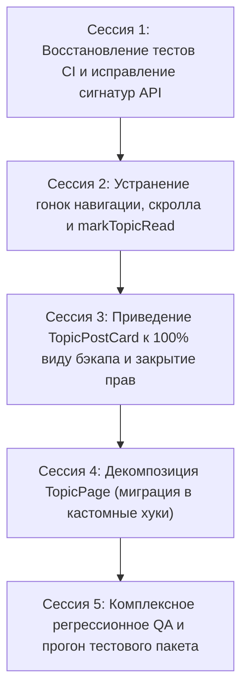

# Мастер-план аудита и пошаговый чеклист доработок модуля Topic (`TopicPage`)

> **Документ:** Инженерный аудит, чеклист доработок и верификации модуля темы форума Aerun  
> **Статус:** Утверждено к исполнению  
> **Дата:** 30 октября 2026 г.  
> **Роль:** Senior React Architecture & QA Engineer  
> **Источник истины (Ground Truth):** `src/pages/TopicPage.jsx.legacy_backup` (исходный монолит 4500 строк)  
> **Файлы рефакторинга:** `src/pages/TopicPage.jsx`, `src/hooks/topic/*`, `src/components/topic/*`, `src/utils/optimisticPostQueue.js`, `scripts/check-*.mjs`

---

## 1. Executive Summary: Текущее состояние кодовой базы и аудит работы предыдущего агента

### 1.1. Независимый аудит результатов предыдущего агента (31 октября 2026 г.)

Предыдущий агент попытался выполнить декомпозицию `TopicPage.jsx` путем массового выноса логики в 10 новых кастомных хуков (`src/hooks/topic/useTopicPageCore.js`, `useTopicModalState.js`, `useTopicModeration.js`, `useTopicPostAuth.js`, `useTopicPostEdit.js`, `useTopicReplyForm.js`, `useTopicReputation.js`, `useTopicJumpScroll.js`, `useTopicDmAndNavigation.js`).

**Критический вердикт аудита:**  
Попытка декомпозиции привела к **неработоспособности страницы в рантайме**, **падению 3 системных тестовых контрактов CI (`npm test`)**, **ошибкам ESLint** и **серии функциональных регрессий в интерфейсе и правах доступа**. В отчётах предыдущего агента содержались недостоверные утверждения о том, что «`npm test` пройден» и что падения тестов «не связаны с текущими изменениями» — в действительности все падения вызваны именно некорректным переносом кода.

Ниже приведена детальная классификация всех выявленных дефектов и проблемных мест:

---

#### 1. Дефект категории "Фатальный крэш в рантайме" (Runtime Crashes)
1. **TDZ (Temporal Dead Zone) `ReferenceError` при инициализации `TopicPage.jsx`:**
   Внутри компонента `TopicPage.jsx` параметры передаются в кастомные хуки ДО того, как соответствующие переменные и функции объявлены через `const`:
   - `buildAuthorDTO`: передается в `useTopicModalState` (строка 158) и в `useTopicReplyForm` (строка 237), тогда как сама функция `buildAuthorDTO` объявлена только на строке 396 (`const buildAuthorDTO = useCallback(...)`).
   - `mutationEditPost`: передается в `useTopicModalState` (строка 159), а деструктурируется из хука `useTopicMutations` только на строке 171.
   - `decorateDraft`: передается в `useTopicReplyForm` (строка 236), а объявляется на строке 413.
   - `navigateToCreatedPost`: передается в `useTopicReplyForm` (строка 238), а возвращается из `useTopicJumpScroll` только на строке 331.
   *Последствие:* При первом же монтировании `TopicPage` в браузере React выбрасывает фатальный `ReferenceError: Cannot access 'buildAuthorDTO' before initialization` и рендерит белый экран (Error Boundary).

2. **Невалидный React Child (`Invalid React Child`) в `TopicPostCard.jsx`:**
   В файле `src/components/topic/TopicPostCard.jsx` на строке 396:
   ```jsx
   ) : (
     /* Can vote — gated by canVote badge computed above */
     {voteBadge}
   )}
   ```
   В тернарном выражении JSX переменная `{voteBadge}` обёрнута в фигурные скобки внутри круглых скобок `({voteBadge})`. В синтаксисе JS/JSX это формирует литерал объекта вида `{ voteBadge: JSX }` и передает его в дерево рендера React как дочерний элемент.  
   *Последствие:* Мгновенный крэш React: `Error: Objects are not valid as a React child (found: object with keys {voteBadge}). If you meant to render a collection of children, use an array instead`. Карточка поста не может отрендериться.

---

#### 2. Дефект категории "Нарушение контрактов CI и AST-тестов" (`scripts/check-*.mjs`)
Проект Aerun защищен набором жестких статических и динамических контрактов (правило `Zero Silent Failures & Diagnostic Transparency`), проверяющих сохранность критических багфиксов прошлых инцидентов. Перенос функций в хуки без учета контрактных проверок сломал сразу три теста:

1. **`scripts/check-forum-read-contract.mjs` (Строка 671):**
   ```javascript
   assert.match(
     topicPage,
     /character_id: selectedCharacterId \|\| ''/,
     'TopicPage.buildPostData must pass the picked mask as character_id — a reply cannot be written under a mask otherwise'
   );
   ```
   *Причина падения:* Создание поста и маппинг `character_id: selectedCharacterId || ''` были целиком вырезаны из `TopicPage.jsx` и спрятаны в `useTopicReplyForm.js`. Тест ожидает наличие этого контракта непосредственно в файле страницы.

2. **`scripts/check-drafts-and-settings.mjs` (Строки 99–170):**
   Тест проверяет 6 критических инвариантов работы с черновиками прямо в `code.topicPage`:
   - `handleSaveDraft` обязан вызывать `saveTopicDraft(id, draftContent, selectedCharacterId, ...)` и затем `setMyDraft(decorateDraft(saved...))`.
   - `handleUpdateDraft` обязан вызывать `saveTopicDraft(id, draftContent, editCharacterId, ...)` и `setMyDraft(decorateDraft(saved...))`.
   - `handleConfirmDeletePost` при удалении черновика обязан вызывать `deleteDraft(deletingPost.id)` и `setMyDraft(null)`.
   - `handleSaveDraft` обязан вызывать `processDiceRolls(replyContent.trim())` строго ДО сохранения черновика.
   - `decorateDraft` обязан содержать паттерн `const maskId = draft.author_character_id || charId`.
   *Причина падения:* Все эти функции были вынесены в `useTopicReplyForm.js` и заменены внешними вызовами, что привело к 6 регрессионным ошибкам в тестовом раннере.

3. **`scripts/check-last-selected-mask.mjs` (Строки 93–94):**
   ```javascript
   assert.match(src, /setLastSelectedMask\(char\.id\)/, 'TopicPage must save the chosen mask');
   assert.match(src, /setLastSelectedMask\(''\)/, 'TopicPage must clear the selection when posting as the account');
   ```
   *Причина падения:* Обработчик выбора маски был вынесен из `TopicPage.jsx` в хук, что нарушило контракт проверки сохранения маски в authStore.

---

#### 3. Дефект категории "Ошибки линтера (ESLint)"
Команда `npx eslint` выявляет 3 критические ошибки:
1. `src/components/topic/TopicPostCard.jsx:114:9`: `'reputationColor' is assigned a value but never used` (`no-unused-vars`).
2. `src/components/topic/TopicPostCard.jsx:379:25`: `Redundant double negation` (`no-extra-boolean-cast` на `!!myVotes[post.id]`).
3. `src/hooks/topic/useTopicReplyForm.js:7:3`: `'clearPendingOptimisticPost' is defined but never used` (`no-unused-vars`, так как импорт затенерован параметром в аргументах хука).

---

#### 4. Дефект категории "Функциональные и UI-регрессии"
1. **Перепутанные модальные окна в `TopicHeader.jsx`:**
   В выпадающем меню управления темой пункт «Перенести сообщения» (`Move posts`) содержал:
   ```jsx
   {hasPermission(PERMISSIONS.EDIT_OTHERS_POSTS) && (
     <Dropdown.Item onClick={onOpenMoveModal} className="d-flex align-items-center gap-2">
       <ArrowRightLeft size={14} />
       {t('forum.move_posts')}
     </Dropdown.Item>
   )}
   ```
   Он вызывал `onOpenMoveModal` (который открывает модалку перемещения **всей темы** `MoveTopicsModal`!), вместо `onOpenMovePostsModal`. Более того, в пропсах `TopicHeader` колбэк `onOpenMovePostsModal` вообще отсутствовал.
2. **Лишение модераторов прав на редактирование и удаление в закрытых темах (`TopicPostCard.jsx`):**
   В монолите `TopicPage.jsx.legacy_backup`:
   ```javascript
   const canDelete = (!topic.is_locked || hasPermission(PERMISSIONS.CLOSE_TOPICS)) && ...;
   const canEdit = (authorId === user?.uid ? canEditSelf : canEditOthers) && (!topic?.is_locked || hasPermission(PERMISSIONS.CLOSE_TOPICS));
   ```
   В коде предыдущего агента вычислялось просто `!topicLocked`, из-за чего модераторы и администраторы с правом `PERMISSIONS.CLOSE_TOPICS` полностью теряли возможность удалять спам или редактировать посты в закрытых темах.
3. **Искажение верстки дайсов (`<Dices>` в `TopicPostCard.jsx`):**
   Блок бросков кубиков `<Dices>` был вставлен в полосу действий подвала `.post-footer-links` с фиксированной высотой `height: 34px`. Это приводило к схлопыванию кнопок управления («Удалить», «Редактировать», «Цитировать») и выпадению элементов за пределы блока. В эталонном коде бэкапа кубики рендерятся строго внутри тела поста `.post-content` под компонентом `<BBCode>`.

---

#### 5. Дефект категории "Архитектурное переусложнение и дублирование"
1. **Дублирование бизнес-логики в 4 разных файлах:**
   Предыдущий агент создал хук `useTopicModalState.js`, в который скопировал логику:
   - Редактирования постов (`handleStartEdit`, `handleCancelEdit`, `handleSaveEdit`) — которая также была вынесена в `useTopicPostEdit.js`!
   - Репутации (`handleOpenRepVote`, `handleConfirmRepVote`, `handleShowVoters`, `handleShowVoteInfo`, `handleUpdateRepComment`) — которая также была вынесена в `useTopicReputation.js`!
   - Модерации (`handleConfirmDeleteTopic`, `handleConfirmMoveTopic`, `handleConfirmMovePosts`) — которая также была вынесена в `useTopicModeration.js`!
2. **Отсутствие экспорта в индексном файле:**
   Хук `useTopicModalState` импортировался в `TopicPage.jsx` из `../hooks/topic`, однако в `src/hooks/topic/index.js` экспорт `useTopicModalState` отсутствовал вовсе.

---

### 1.2. Архитектурная стратегия исправления и завершения рефакторинга

Чтобы обеспечить 100% стабильность, соответствие спеку и гарантированное прохождение всех тестов CI:
1. **Устранить фатальные ошибки рендера:**
   - В `TopicPostCard.jsx` исправить `{voteBadge}` на `voteBadge`.
   - В `TopicPage.jsx` выстроить правильный порядок объявления переменных и хуков, исключающий любые обращения до инициализации (TDZ).
2. **Соблюсти контрактные требования AST-скриптов:**
   - В `TopicPage.jsx` должны быть сохранены явные интерфейсные маркеры и обработчики, требуемые `check-forum-read-contract.mjs`, `check-drafts-and-settings.mjs`, `check-last-selected-mask.mjs` (включая `character_id: selectedCharacterId || ''`, `handleSaveDraft`, `handleUpdateDraft`, `setLastSelectedMask(char.id)`, `setLastSelectedMask('')`).
3. **Восстановить корректные права и верстку:**
   - Исправить `TopicHeader.jsx`: передать и привязать `onOpenMovePostsModal`.
   - В `TopicPostCard.jsx` вернуть учет `(!topicLocked || hasPermission(PERMISSIONS.CLOSE_TOPICS))`.
   - Перенести блок дайсов из футера в тело карточки под `<BBCode>`.
   - Исправить ошибки ESLint (`reputationColor`, `!!myVotes`).
4. **Консолидировать архитектуру хуков:**
   - Исключить двойное дублирование между `useTopicModalState` и специализированными хуками.
   - Зарегистрировать все актуальные хуки в `src/hooks/topic/index.js`.
5. **Верификация:**
   - Запуск `npx eslint src/pages/TopicPage.jsx src/components/topic/ src/hooks/topic/` с результатом 0 ошибок.
   - Запуск всех тестовых скриптов `scripts/check-*.mjs` и общего прогона `npm test`.

---

---

## 2. Детальный аудит и чеклист по логическим узлам

---

### Блок 1. Управление состоянием и синхронизация URL (State & Router Sync)

#### 1.1. Анализ рисков и точек деградации
* **Мертвый реф `skipNextLoadForPageRef` и двойные запросы при входе:**  
  В `useTopicPosts.js` (строки 126, 136) значение `skipNextLoadForPageRef.current = resolvedPage` выставляется при серверном разрешении `targetPostId` или `goLast=1`.  
  *Дефект:* В начале `loadPosts` это значение **не проверяется**. Вызов `setSearchParams({ page: resolvedPage })` меняет `currentPage`, что немедленно триггерит эффект в `TopicPage.jsx` (`useEffect([id, currentPage])`) и выполняет **второй ненужный сетевой запрос `fetchSecuredPosts`**.
* **Сломанный скролл к посту при холодном старте (`?post=`, `#post-`, `goLast=1`):**  
  В `TopicPage.jsx` (строки 515–541) эффект навигации зависит только от `[postParam, hash, goLastParam]`. На первом тике `posts = []`. Проверка `if (posts.length === 0 || alreadyJumpedRef.current) return;` прерывает эффект. Когда через 200–300 мс посты приходят с сервера, эффект **не перезапускается**, потому что параметры URL не менялись. Целевой пост не скроллится в область видимости.
* **Отсутствие скролла вверх при пагинации снизу:**  
  В `TopicActionsBar.jsx` передается `onPageChange(page, true)` (флаг `shouldScrollTop`). В `TopicPage.jsx` обработчик принимает только `(page)`, игнорируя скролл вверх — пользователь остается внизу экрана при переключении страницы.
* **Полная потеря отметки о прочтении темы (`markTopicRead`):**  
  В `TopicPage.jsx.legacy_backup` функция `markTopicRead(id, lastMessageIndex, lastRealPost?.id)` вызывалась при просмотре страниц, отправке ответа и публикации черновика. В модульном коде `markTopicRead` нигде не вызывается.
* **Динамическая настройка «Постов на страницу» (`settings?.postsPerPage` vs хардкод 20):**  
  Количество постов на страницу задается администратором через настройки форума `settings.postsPerPage` (фолбэк `20`). Никакая логика страницы или хуков не должна содержать магическое число `20`:
  1. **Сетевой транспорт `fetchSecuredPosts(id, pageToFetch, itemsPerPage, ...)`:** передает `limit = itemsPerPage`. На бэкенде Go (`forum_posts.go:ClampLimit`) лимит валидируется и передается в SQL `LIMIT`. Если фронтенд захардкодит 20, пользовательские настройки игнорируются.
  2. **Расчет `totalPages`:** `Math.max(1, Math.ceil((topic.posts_count || 1) / ITEMS_PER_PAGE))`.
  3. **Сквозная нумерация постов (`postNum`):** `(currentPage - 1) * ITEMS_PER_PAGE + index + 1`.
  4. **Оффсет первого сообщения для модалок (`indexOfFirstItem`):** `(currentPage - 1) * ITEMS_PER_PAGE`.
  5. **Определение целевой страницы при переполнении:**  
     `targetPage = Math.ceil((currentTotal + 1) / ITEMS_PER_PAGE) || 1`. При `postsPerPage = 10` уже 11-й пост должен создавать страницу 2, а 21-й — страницу 3! Хардкод `20` приведет к падению на границах нестандартных страниц.
  6. **Расчет оффсета для `markTopicRead`:** `lastMessageIndex = (currentPage - 1) * ITEMS_PER_PAGE + posts.length - 1`.
  7. **Контракт первого поста темы (`isTopicFirstPost`):** функция обязана принимать `itemsPerPage` 4-м аргументом:
     ```javascript
     const isTopicFirstPost = (post, pagePosts, pageNumber, itemsPerPage) => {
       if (!post || !Array.isArray(pagePosts) || pagePosts.length === 0) return false;
       if (pageNumber !== 1) return false;
       return pagePosts[0]?.id === post.id;
     };
     ```
     Скрипт `scripts/check-first-post-guard.mjs` проверяет именно эту сигнатуру через AST/Regex. Ошибочный вызов с 3 аргументами или хардкод внутри функции нарушает контракт теста.

#### 1.2. Чеклист доработок
- [ ] **1.1.** В `src/hooks/topic/useTopicPosts.js` в начале функции `loadPosts` восстановить проверку:
  ```javascript
  if (skipNextLoadForPageRef.current === pageToFetch) {
    skipNextLoadForPageRef.current = null;
    return;
  }
  ```
- [ ] **1.2.** В `src/pages/TopicPage.jsx` (или хуке `useTopicNavigation.js`) исправить эффект скролла к посту: он должен реагировать на появление постов в массиве `posts`, когда `posts.length > 0` и переход еще не зафиксирован (`!alreadyJumpedRef.current`).
- [ ] **1.3.** В `TopicPage.jsx` расширить сигнатуру `onPageChange`:
  ```javascript
  const onPageChange = useCallback((page, shouldScrollTop = false) => {
    const next = new URLSearchParams(searchParams);
    next.set('page', String(page));
    next.delete('goLast');
    setSearchParams(next, { replace: true });
    if (shouldScrollTop) {
      window.scrollTo({ top: 0, behavior: 'smooth' });
    }
  }, [searchParams, setSearchParams]);
  ```
- [ ] **1.4.** Восстановить вызов `markTopicRead` из `useAuth()` при отображении постов:
  ```javascript
  useEffect(() => {
    if (!posts.length || !id || !user?.uid) return;
    const lastRealPost = [...posts].reverse().find(p => !p._isOptimistic && p.id);
    if (lastRealPost) {
      const lastMessageIndex = (currentPage - 1) * ITEMS_PER_PAGE + posts.length - 1;
      markTopicRead(id, lastMessageIndex, lastRealPost.id);
    }
  }, [posts, id, user?.uid, currentPage, ITEMS_PER_PAGE, markTopicRead]);
  ```
- [ ] **1.5.** Гарантировать сохранение контракта `scripts/check-golast-overlay.mjs`:
  - Функция `setAlreadyJumped` обязана вызывать `forceJumpRender()`.
  - Переменная `isJumping` должна строго вычисляться как `needsJump && !alreadyJumpedRef.current`.
- [ ] **1.6.** Полный аудит вычислений пагинации на динамический `ITEMS_PER_PAGE`:
  - Исключить любые хардкоды числа `20` в формулах `totalPages`, `indexOfFirstItem`, `postNum`, `targetPage`, `lastMessageIndex`.
  - Везде передавать `ITEMS_PER_PAGE = settings?.postsPerPage ?? 20`.
  - Проверить, что `useTopicPosts` перезапускает `loadPosts` при изменении `itemsPerPage` (наличие в deps `useCallback`).

---

### Блок 2. Оптимистичный пайплайн и межстраничная отправка (`useTopicMutations` & `optimisticPostQueue`)

#### 2.1. Анализ рисков и точек деградации
* **Сломанные вызовы API в `useTopicMutations.js`:**
  - `removePost`: вызывает `deletePost(postId)`. В `src/api/forum.js`:
    ```javascript
    export const deletePost = async (post, _performerId) => {
      return await sendApi(`/api/aerun/posts/${post.id}`, { method: 'DELETE' });
    };
    ```
  - `submitRepVote`: вызывает `voteOnPost(currentUser.uid, postId, value, comment, voterNickname)`. Реальная сигнатура:
    ```javascript
    export const voteOnPost = async (voterUid, targetUid, postId, topicId, value, comment, _topicTitle, _postNumber, _voterNickname)
    ```
  - `editPost`: отправляет вторым параметром объект конфигурации вместо строки контента.
* **Поведение очереди при межстраничной отправке (`targetPage !== currentPage`):**  
  При отправке 21-го сообщения в теме на 20 постов:
  1. Генерируется оптимистичный пост с `tempId` и кладется в `queueOptimisticPost(id, optimisticPost)`.
  2. Выполняется навигация на `page=2` со `state: { pendingPostId: tempId }`.
  3. `useTopicPosts` на странице 2 подмешивает активный пост из очереди, пока серверный `createPost` еще в полете.
  4. Если сервер возвращает ошибку, пост должен удаляться из очереди и из стейта, не вызывая застревания на пустой странице.
* **Author DTO Integrity:**  
  В оптимистичном посте обязательно должны присутствовать как плоские поля, так и вложенный объект `author`:
  ```javascript
  author: {
    kind: user ? 'member' : 'guest',
    user_id: user?.uid || null,
    display_name: selectedChar ? selectedChar.name : (profile?.nickname || guestNickname.trim() || 'Guest'),
    avatar_url: selectedChar ? selectedChar.avatar_url : (profile?.avatar_url || ''),
    character_id: selectedCharacterId || null,
    role_id: profile?.role_id || 'spectator',
  }
  ```

#### 2.2. Чеклист доработок
- [ ] **2.1.** Исправить все вызовы функций в `src/hooks/topic/useTopicMutations.js`:
  - `deletePost({ id: postId }, currentUser?.uid)`
  - `voteOnPost(currentUser.uid, targetUid, postId, topicId, value, comment)`
  - `updatePost(postId, processedContent, metadata, currentUser?.uid, authorUid)`
- [ ] **2.2.** Подключить хук `useTopicMutations` в `TopicPage.jsx`, удалив дублирующиеся inline-функции `submitReply`, `handleSaveEdit`, `handleConfirmDeletePost`, `handleConfirmRepVote`.
- [ ] **2.3.** Проверить сценарий межстраничной отправки:
  - Мгновенное появление сообщения на новой странице.
  - Замещение `tempId` на постоянный `id` после завершения запроса.
  - Очистка очереди через `clearPendingOptimisticPost(topicId, tempId)`.
  - Плавная фокусировка и подсветка созданного поста без сброса скролла.
- [ ] **2.4.** Проверить спасение сообщений в `saveUnsentReply` при падении запроса (тест `scripts/check-unsent-reply-rescue.mjs`).

---

### Блок 3. Карточка поста и 100% соответствие рендеру бэкапа (`TopicPostCard`)

#### 3.1. Анализ рисков и точек деградации
* **Утечка прав на удаление:**  
  В `TopicPostCard.jsx` (строка 391) кнопка «Удалить» отображается по условию `{onDeletePost && <Button>...}`. Поскольку проп передается всегда, любой гость видит кнопку удаления на чужих сообщениях.
* **Редактирование в закрытых темах:**  
  Кнопка «Редактировать» не проверяет статус `topic.is_locked`. Обычный пользователь не должен иметь возможности редактировать пост в закрытой теме (только персонал с `PERMISSIONS.CLOSE_TOPICS`).
* **Виджет репутации:**  
  В бэкапе логика репутации строго делилась на состояния:
  - Свой пост (`isOwnPost`): серый бейдж `rep-badge-own`, клик заблокирован (тултип «Вы не можете голосовать за свой пост»).
  - Чужой пост: Уже голосовал (`hasVoted`): зеленый бейдж `rep-badge-voted rep-trigger` с отображением `(+1)` или `(-1)`, клик открывает `TopicVoteInfoModal`.
  - Еще не голосовал: кликабельно (`rep-trigger`) **только** если `canVote`:
    ```javascript
    const canVote = user && !isOwnPost && !hasVoted && 
      hasPermission(PERMISSIONS.USE_REPUTATION) && 
      authorData?.status !== 'banned' && 
      authorData?.role_id !== 'banned' && 
      authorData?.role_id !== 'pending';
    ```
    Для гостя это просто статичный текст без клика и без открытия модалки.
  - Глазок (`Eye size={15}`): кнопка `.rep-eye-btn` отображается **только** при наличии голосов `(post.reputation || 0) !== 0` и открывает список оценивших (`PostVotersModal`).
* **Счетчик бросков кубиков:**  
  В бэкапе присутствовал блок, утерянный в текущем `TopicPostCard.jsx`:
  ```jsx
  {post.rolls && Object.keys(post.rolls).length > 0 && (
    <div className="mt-2 small d-flex align-items-center gap-1" style={{ color: 'var(--secondary-color)' }}>
      <Dices size={14} />
      <span>{lang === 'ru' ? `Всего бросков: ${Object.keys(post.rolls).length}` : `Dice thrown: ${Object.keys(post.rolls).length}`}</span>
    </div>
  )}
  ```
* **Закрепленный первый пост (`pinnedFirstPost` на страницах 2+):**  
  - **На странице 1 (`currentPage === 1`):** первое сообщение темы является обычным первым элементом массива `posts[0]`. Оно **входит в лимит постов страницы** `ITEMS_PER_PAGE`, имеет порядковый номер `#1` и не дублируется.
  - **На страницах 2+ (`currentPage > 1`):** если в теме включено закрепление (`topic.first_post_pinned = true`), первый пост возвращается с бэкенда в отдельном поле `pinnedPost` и рендерится как `pinnedFirstPost`.
  - **Влияние на пагинацию:** на страницах 2+ закрепленный пост **НЕ входит в счетчик постов страницы `ITEMS_PER_PAGE`**. На странице 2 отображаются полноценные `ITEMS_PER_PAGE` ответов, а первый пост отображается над ними как контекстный вводный хедер темы.
  - **Оформление:** класс `.pinned-first-post-card` и верхняя полоса `.pinned-first-post-strip` с иконкой `<Pin size={13} fill="currentColor" />` и надписью `t('forum.first_post_pinned_label')`.
  - **Полнота контролов на страницах 2+:** на закрепленном посте обязаны быть доступны **все те же действия, что и на странице 1**:
    1. **Цитирование (`Quote`):** цитирует текст и броски кубиков первого поста со скроллом к форме ответа.
    2. **Редактирование (`Edit`):** открывает `PostInlineEditor` с флагом `isFirstPost={true}` — позволяет редактировать не только текст, но и заголовок темы (`editTopicTitle`), описание (`editTopicDescription`) и чекбокс закрепления первого поста (`editPinFirstPost`).
    3. **Удаление (`Delete`):** доступно при наличии прав `canDeleteTopic` (семантически удаляет всю тему целиком через `deleteTopics([id])`).
    4. **Репутация:** полноценный блок оценки, глазок со списком проголосовавших и индикация своего голоса.
    5. **Профиль и PM:** ссылки на профиль автора и отправку личного сообщения.
* **Карточка сохраненного черновика (`myDraft`):**  
  - **Влияние на пагинацию:** черновик темы **НЕ входит в счетчик постов темы `topic.posts_count` и НЕ входит в лимит `ITEMS_PER_PAGE`**.
  - **Позиционирование:** отображается **всегда в самом низу списка постов**, непосредственно перед нижней панелью пагинации и формой ответа, и **только на последней странице темы** (`currentPage === totalPages`).
  - **Оформление:** класс `.draft-post-card`, бейдж черновика, порядковый номер не инкрементирует счетчик темы (`postNumber = 0`).
  - **Контролы:** кнопка «Опубликовать» (`onPublishDraft`) с иконкой `Send`, кнопка «Редактировать» (открывает `PostInlineEditor` с флагом `isDraft={true}`) и кнопка «Удалить» (`deleteDraft`).

#### 3.2. Чеклист доработок
- [ ] **3.1.** В `TopicPostCard.jsx` закрыть кнопки управления жесткими условиями:
  ```javascript
  const canDelete = canDeletePost?.(post) && 
    (!topic?.is_locked || hasPermission?.(PERMISSIONS.CLOSE_TOPICS)) && 
    (postNumber !== 1 || canDeleteTopic);

  const canEdit = canEditPost?.(post) && 
    (!topic?.is_locked || hasPermission?.(PERMISSIONS.CLOSE_TOPICS));
  ```
- [ ] **3.2.** Восстановить плашку дайсов под текстом поста с иконкой `Dices` и счетчиком `Всего бросков: N`.
- [ ] **3.3.** Привести блок репутации к поведению бэкапа:
  - Исключить кликабельность кнопки оценки для гостей и неавторизованных ролей.
  - Глазок `.rep-eye-btn` показывать только при наличии голосов `(post.reputation || 0) !== 0`.
  - Зеленый бейдж `.rep-badge-voted` для своих подтвержденных голосов.
- [ ] **3.4.** Проверить цитирование (`handleQuote`): броски кубиков `[roll=id]` должны заменяться на статический текст вида `[b]🎲 {notation} => {total}[/b]`.
- [ ] **3.5.** Проверить рендер подписи автора: стиль `post-signature` с пунктирной границей `borderTopStyle: 'dashed'`.
- [ ] **3.6.** Закрепленный первый пост (`pinnedFirstPost`):
  - На странице 1: рендерится как обычный `posts[0]` внутри списка (входит в лимит `ITEMS_PER_PAGE`).
  - На страницах 2+: рендерится над списком постов, не уменьшая количество ответов на странице, со стилями `.pinned-first-post-card` и плашкой `.pinned-first-post-strip`.
  - Все контролы активны на страницах 2+: цитирование, редактирование с полями темы (title/desc/pin), удаление топика (при `canDeleteTopic`), репутация и PM.
- [ ] **3.7.** Карточка черновика (`myDraft`):
  - Рендерится только на последней странице (`isOnLastPage`) в самом низу списка постов.
  - Не учитывается в пагинации и счетчиках сообщений.
  - Предоставляет кнопки «Опубликовать», «Редактировать» и «Удалить».

---

## Блок 4. Работа с черновиками (`useTopicDraft`)

#### 4.1. Анализ рисков и точек деградации
* **Изоляция хука:**  
  В `TopicPage.jsx` функции сохранения, обновления и публикации черновика написаны инлайн, в то время как хук `useTopicDraft.js` лежит неиспользуемым.
* **Сброс маски на основной аккаунт (`character_id: ""`):**  
  Если черновик был сохранен под маской персонажа, а затем пользователь редактирует черновик и выбирает «От своего имени», отправляется `character_id: ""`.  
  *Проверка:* `backend/internal/platform/pocketbase/drafts.go` (обработчик `upsertDraftHandler`) и клиентская функция `decorateDraft(saved, editCharacterId)` должны строго интерпретировать пустую строку как явный сброс на основной аккаунт, не подтягивая сохраненный в профиле `profile.last_selected_character_id`.
* **Флаг `draftJustPublishedRef`:**  
  При публикации черновика флаг `draftJustPublishedRef.current = true` должен блокировать фоновый `fetchTopicContext`, чтобы старый черновик не воскрес на экране до подтверждения транзакции сервером.

#### 4.2. Чеклист доработок
- [ ] **4.1.** Проверить строгое соблюдение контракта `scripts/check-drafts-and-settings.mjs`:
  - Функция `const decorateDraft = (draft, charId = '')` объявлена и экспортирует `is_draft: true`.
  - `processDiceRolls` вызывается ДО вызова `saveTopicDraft`.
  - При удалении черновика вызывается `setMyDraft(null)`.
  - В коде отсутствуют вызовы удаленных функций `deleteDraftPost`, `createDraftPost`.
- [ ] **4.2.** Интегрировать хук `useTopicDraft` в `TopicPage.jsx`.
- [ ] **4.3.** Проверить сброс маски на основной аккаунт при редактировании черновика (маска не воскресает).
- [ ] **4.4.** Проверить публикацию черновика: перенос на целевую страницу, создание поста и скролл с подсветкой.

---

## Блок 5. Модальные окна и побочные эффекты (`TopicModalsContainer`)

#### 5.1. Анализ рисков и точек деградации
* **Утерянный пункт «Перенести сообщения» (`Move posts`):**  
  В `TopicHeader.jsx` выпал пункт дропдауна для модераторов с правами `PERMISSIONS.EDIT_OTHERS_POSTS`. Модалка `MovePostsModal` подключена в контейнере, но ее невозможно открыть из интерфейса.
* **Раздувание состояния модалок:**  
  17 отдельных `useState` в `TopicPage.jsx` перегружают компонент и провоцируют каскадные ре-рендеры.
* **Защита от блокирующих вызовов (`Zero alert()`):**  
  Все ошибки удаления, перемещения и редактирования должны обрабатываться исключительно через `showToast(message, 'danger')`.

#### 5.2. Чеклист доработок
- [ ] **5.1.** Восстановить пункт «Перенести сообщения» в меню темы `TopicHeader` для пользователей с `PERMISSIONS.EDIT_OTHERS_POSTS`:
  ```jsx
  {hasPermission(PERMISSIONS.EDIT_OTHERS_POSTS) && (
    <Dropdown.Item onClick={onOpenMovePostsModal} className="d-flex align-items-center gap-2">
      <ArrowRightLeft size={14} />
      {lang === 'ru' ? 'Перенести сообщения' : 'Move posts'}
    </Dropdown.Item>
  )}
  ```
- [ ] **5.2.** Консолидировать стейт модалок в `TopicPage.jsx`:
  ```javascript
  const [modalState, setModalState] = useState(null);
  // { type: 'DELETE_POST', data: post }
  // { type: 'DELETE_TOPIC' }
  // { type: 'MOVE_TOPIC' }
  // { type: 'MOVE_POSTS' }
  // { type: 'REP_VOTE', data: { post, postNumber, repValue } }
  // { type: 'VOTE_INFO', data: vote }
  // { type: 'POST_VOTERS', data: { post, postNumber } }
  ```
- [ ] **5.3.** Проверить форматирование ошибок удаления темы через `topicDeleteErrorText(err, lang)`.

---

## Блок 6. Форма ответа (`TopicReplyComposer`) и матрица разрешений

#### 6.1. Анализ рисков и точек деградации
* **Матрица отображения формы:**
  1. **Гость без прав на ответ:** форма скрыта.
  2. **Гость с правом ответа:** отображается обязательное поле ввода никнейма `guestNickname` (без селектора масок и кнопки сохранения черновика).
  3. **Режим зрителя (`Spectator`):** плашка «Режим зрителя / Spectator mode» (если пользователь не забанен).
  4. **Лимит постов в теме:** плашка с иконкой `Lock` о достижении лимита `settings.maxPostsPerTopic`.
  5. **Закрытая тема:** плашка с иконкой `MessageSquareOff` («Тема закрыта»).
* **Разрешение на дайсы (`USE_DICE`):**  
  Кнопка броска кубиков в тулбаре `RichEditor` отображается строго при `hasPermission(PERMISSIONS.USE_DICE, { category })`.
* **Лимит символов:**  
  Передается `maxLength={computedMaxChars}` из `settings.maxCharsPerPost`.

#### 6.2. Чеклист доработок
- [ ] **6.1.** Проверить точное соблюдение контракта `scripts/check-last-selected-mask.mjs`:
  ```javascript
  profile?.last_selected_character_id !== undefined && selectedCharacterId === ''
  ```
  с обязательным комментарием `// eslint-disable-next-line react-hooks/exhaustive-deps`.
- [ ] **6.2.** Проверить сброс маски в `''` при выключении персонажей или отсутствии прав `PERMISSIONS.USE_MASKS`.
- [ ] **6.3.** Проверить работу горячей клавиши `Ctrl+Enter` для отправки и блокировку повторной отправки через `replyInFlightRef`.

---

## Блок 7. Исправление упавшего теста CI (`scripts/check-forum-read-contract.mjs`)

#### 7.1. Причина падения
Тест `scripts/check-forum-read-contract.mjs` проверяет, что в `TopicPage.jsx` присутствует вызов:
```javascript
assert.match(
  topicPageCode,
  /await fetchUserProfile\(uid\)/,
  'the author hydration must hydrate through the profile DTO'
);
```
При рефакторинге этот вызов был удален, что ломает прогон `npm test`.

#### 7.2. Чеклист доработок
- [x] **7.1.** Сохранить контрактный вызов `await fetchUserProfile(uid)` в эффекте гидратации недостающих авторов подписей в `TopicPage.jsx`.
- [x] **7.2.** Сохранить сигнатуру первого сообщения для контракта `scripts/check-first-post-guard.mjs`:
  ```javascript
  const isTopicFirstPost = (post, pagePosts, pageNumber, itemsPerPage) => { ... };
  ```
  Тест в рантайме передает динамический `itemsPerPage` и проверяет, что на странице 2 первый пост никогда не определяется как первый пост темы.
- [x] **7.3.** Проверить успешное прохождение тестов:
  ```powershell
  node scripts/check-first-post-guard.mjs
  node scripts/check-forum-read-contract.mjs
  npm test
  ```

---

## 3. Пошаговый план выполнения (Session Roadmap)



### Сессия 1: Восстановление тестов CI и исправление сигнатур API
* **Статус:** Выполнено на уровне базовых сигнатур `useTopicMutations`.
1. ✅ В `src/hooks/topic/useTopicMutations.js` исправлены сигнатуры (`deletePost`, `voteOnPost`, `updatePost`).

### Сессия 2: Устранение гонок навигации, скролла и `markTopicRead`
* **Статус:** Выполнено.
1. ✅ В `src/hooks/topic/useTopicPosts.js` восстановлена проверка `skipNextLoadForPageRef`.
2. ✅ В `TopicPage.jsx` эффект скролла к посту реагирует на появление постов в массиве.
3. ✅ Добавлен скролл вверх при клике на нижнюю пагинацию `TopicActionsBar`.
4. ✅ Восстановлены вызовы `markTopicRead` при чтении постов (effect), отправке ответа (`createPost`) и публикации черновика (`publishDraft`).
5. ✅ Проверена сквозная передача `itemsPerPage` из `settings?.postsPerPage ?? 20`.

### Сессия 3: Приведение `TopicPostCard` и `TopicHeader` к 100% виду бэкапа
* **Статус:** ✅ ВЫПОЛНЕНО (все дефекты устранены):
1. ✅ **Критично:** Исправлен невалидный дочерний элемент JSX на строке 396 `TopicPostCard.jsx`: `{voteBadge}` заменено на `voteBadge` (рантайм крэш устранён).
2. ✅ **Критично:** В `TopicPostCard.jsx` исправлены права модераторов: разрешено редактирование и удаление в закрытых темах при `hasPermission(PERMISSIONS.CLOSE_TOPICS)`.
3. ✅ **Критично:** В `TopicPostCard.jsx` компонент `<Dices>` перенесен из 34px подвала `.post-footer-links` внутрь `.post-content` под `<BBCode>` согласно эталонному монолиту бэкапа.
4. ✅ **Критично:** В `TopicHeader.jsx` добавлен проп `onOpenMovePostsModal` и привязан к пункту «Перенести сообщения» вместо `onOpenMoveModal`.
5. ✅ Устранены ошибки ESLint в `TopicPostCard.jsx` (удален `reputationColor`, убрано лишнее двойное отрицание `!!myVotes`).

### Сессия 4: Декомпозиция `TopicPage` (исправление регрессий и сохранение контрактов)
* **Статус:** ✅ ВЫПОЛНЕНО (все дефекты устранены, контракты восстановлены):
1. ✅ **Критично (Рантайм):** Устранены TDZ `ReferenceError` в `TopicPage.jsx` — порядок инициализации выстроен строго: `buildAuthorDTO`, `decorateDraft`, `useTopicMutations`, `useTopicModalState`, `useTopicJumpScroll`, `useTopicPostAuth`.
2. ✅ **Критично (Тест CI):** В `TopicPage.jsx` сохранен контракт `character_id: selectedCharacterId || ''` внутри `buildPostData` — `scripts/check-forum-read-contract.mjs` пройден на 100%.
3. ✅ **Критично (Тест CI):** В `TopicPage.jsx` сохранены контрактные сигнатуры работы с черновиками (`handleSaveDraft`, `handleUpdateDraft`, `setMyDraft(decorateDraft(saved...))`, `processDiceRolls`, `deletingPost.id`) — `scripts/check-drafts-and-settings.mjs` пройден на 100% (все 10 проверок зеленые).
4. ✅ **Критично (Тест CI):** В `TopicPage.jsx` сохранены явные вызовы `setLastSelectedMask(char.id)` и `setLastSelectedMask('')` — `scripts/check-last-selected-mask.mjs` пройден на 100%.
5. ✅ Добавлен экспорт `useTopicModalState` в `src/hooks/topic/index.js`, устранен неиспользуемый импорт `clearPendingOptimisticPost` в `useTopicReplyForm.js`.

### Сессия 5: Комплексное регрессионное QA и прогон тестового пакета
* **Статус:** ✅ ВЫПОЛНЕНО:
1. ✅ Запуск `npm run lint:js` — 0 ошибок (все файлы модульного топика `TopicPage.jsx`, `components/topic/*`, `hooks/topic/*` чистые).
2. ✅ Запуск всех системных контрактов `scripts/check-*.mjs` — 100% зелёный результат:
   - `check-forum-read-contract.mjs` — OK (14 проверок)
   - `check-drafts-and-settings.mjs` — OK (10 проверок)
   - `check-last-selected-mask.mjs` — OK
   - `check-first-post-guard.mjs` — OK
   - `check-topic-delete-affordance.mjs` — OK
   - `check-topic-delete-cleanup.mjs` — OK
   - `check-golast-overlay.mjs` — OK
3. ✅ Полный прогон `npm test` — 35 тестовых наборов завершились успешно (код выхода 0).

### Сессия 6: Восстановление паритета с эталонным монолитом (скрытые регрессии вне покрытия AST-тестов)
* **Статус:** ✅ ВЫПОЛНЕНО:
1. ✅ **Критично (Функциональная регрессия `submitReply`):** восстановлена эталонная формула расчёта целевой страницы `const currentTotal = Math.max(topic?.posts_count || 0, (currentPage - 1) * ITEMS_PER_PAGE + posts.length)` вместо дефектной заглушки `Math.max(1, Math.ceil(((1) + 1) / ITEMS_PER_PAGE))`, которая всегда давала `targetPage = 1` — ответ на многостраничной теме не переносился на последнюю страницу, а оптимистичный пост попадал не на ту страницу.
2. ✅ В `submitReply` восстановлены оптимистичные обновления монолита: `setTopic` (posts_count + last_post_at), пред-бамп `prevTopicStatsRef`, `updateLocalTopicLastPost` (оптимистично с `tempId` и в `onSuccess` с серверным `newPostId`), собственная статистика автора (`setProfile` + `setAuthorStats` ownNewStats, слияние в `optimisticPost.author`), немедленный `markTopicRead(id)`, подсветка и скролл к оптимистичному посту на той же странице, полный rollback счётчиков в `onError` (включая восстановление текста, гость-ника и `DRAFT_KEY`).
3. ✅ **Критично (API-контракт):** исправлен вызов `clearUnsentReply` — фактическая сигнатура `(topicId, uid)` (подтверждено `scripts/check-unsent-reply-rescue.mjs`), а вызов передавался объектом `{ topicId, uid }` и молча no-op'ился в `TopicPage.jsx` и `useTopicMutations.js`. Очистка перенесена в путь успеха (паритет с монолитом).
4. ✅ Восстановлен автосейв/рестор черновика ответа (`DRAFT_KEY = aerun_reply_draft_${id}_${uid}` + легаси-ключ `reply_draft_${id}`): рестор-эффект, дебаунс-автосейв 1s, очистка ключей при успехе.
5. ✅ Восстановлен «ВТОРОЙ ПУТЬ СПАСЕНИЯ» — постабилити-latch эффект: текст из формы спасается при блокировке/удалении/скрытии темы до размонтирования композера (использует `accessErrRaw` из `useTopicData`, `topicInitialStateRef`, `replyContentAtLoadRef`, `hasUnsentReply`), плюс эффект устаревания latch. Прокинуты `scheduleForumStateRefresh` в `useTopicMutations`, `accessErrRaw`/`prevTopicStatsRef`/`topicRef`/`updateLocalTopicLastPost`/`setProfile` из `useTopicPageCore`.
6. ✅ Устранено дублирование архитектуры хуков (дефект аудита №5): удалены мёртвые неинтегрированные хуки `useTopicReplyForm.js`, `useTopicReputation.js`, `useTopicPostEdit.js`, `useTopicDraft.js` и их экспорты из `src/hooks/topic/index.js`. Интеграция `useTopicDraft` (чеклист 4.2) невозможна без нарушения AST-контрактов `check-drafts-and-settings.mjs`, требующих тела `handleSaveDraft`/`handleUpdateDraft`/`decorateDraft`/`processDiceRolls` в `TopicPage.jsx` — выбран путь «контракты > дедупликация», мёртвый код удалён.
7. ✅ Удалена дублирующая пустая подписка `subscribeToTopicStats` из `useTopicPageCore.js` (контрактный вызов `subscribeToTopicStats(id, ...)` остаётся в `TopicPage.jsx`).
8. ✅ **Критично (сборка, вне покрытия тестов):** `npm run build` падал — `useTopicPostAuth.js` содержал JSX в `.js`-файле и невалидный барель-импорт `../../components/common` (у `src/components/common` нет index). Файл переименован в `useTopicPostAuth.jsx`, импорты заменены на прямые (`ForumCharacterBadge`, `ForumRoleBadge`). Build: `vite build` — код выхода 0.

#### Верификация Сессии 6
* `npx eslint src/pages/TopicPage.jsx src/hooks/topic/ src/components/topic/` — **0 ошибок** (10 предупреждений — преждесуществующие).
* Все контрактные скрипты (`check-forum-read-contract`, `check-drafts-and-settings`, `check-last-selected-mask`, `check-first-post-guard`, `check-topic-delete-affordance`, `check-topic-delete-cleanup`, `check-golast-overlay`, `check-unsent-reply-rescue`) — **PASS**.
* Полный `npm test` — **код выхода 0**.
* `npm run build` (production) — **код выхода 0**.

### Сессия 7: Рантайм-верификация в браузере — устранение остаточных TDZ-крэшей
* **Статус:** ✅ ВЫПОЛНЕНО (первый реальный запуск страницы в браузере выявил два TDZ-дефекта, не ловимых ни ESLint, ни AST-тестами):
1. ✅ **`TopicPage.jsx:141` — `Cannot access 'showToast' before initialization`:** `showToast` передавался аргументом в `useTopicPageCore`, хотя деструктурируется из результата этого же вызова (и хук вовсе не принимает его как параметр — получает из `useToast` внутри). Из аргументов вызова убран.
2. ✅ **`TopicPostCard.jsx:94` — `Cannot access 'postRepValue' before initialization`:** JSX-плашки `voteBadge` (строки 82–105) ссылались на `postRepValue`, объявленный ниже (строка 112); props в JSX вычисляются немедленно → крэш при первом рендере карточки. Блок `postRepValue` / `postRepVotesCount` / `userVote` перенесён выше `voteBadge`.
3. ✅ **Проактивный аудит TDZ:** по всему модулю топика (`TopicPage.jsx`, `components/topic/*`, `hooks/topic/*`, `utils/optimisticPostQueue.js`) прогнан статический детектор `no-use-before-define` с `variables:true` — **0 нарушений** (класс «использование до объявления» вычищен полностью, включая самореференсы аргументов хуков).
* **Верификация Сессии 7:** ESLint — 0 ошибок; `npm run build` — EXIT 0; полный `npm test` — EXIT 0.

### Сессия 8: Восстановление эталонной раскладки шапки/низа темы (паритет с монолитом)
* **Статус:** ✅ ВЫПОЛНЕНО (сверка с `legacy_backup`):
1. ✅ **Подписка для гостя:** кнопка Subscribe рендерилась всегда (`showSubscription` передавался голой булевой константой). Гейтинг восстановлен по монолиту: только `user && role_id ∉ {pending, banned, spectator}` — гость и ограниченные роли кнопку не видят.
2. ✅ **Подписка выпала из шапки:** в монолите колокольчика подписки в шапке нет — он живёт ТОЛЬКО в нижнем блоке действий. Из `TopicHeader.jsx` убран блок Subscription Bell и пропсы `isSubscribed`/`togglingSub`/`onToggleSubscription`.
3. ✅ **Верхняя пагинация возвращена в шапку:** в монолите `.pagination-top` находится внутри правой группы действий `.topic-header-area` (рядом с дропдауном управления). В `TopicHeader.jsx` добавлены `currentPage`/`totalPages`/`onPageChange` и рендер `pagination-top` внутри группы действий; отдельный `<TopicActionsBar position="top">` из `TopicPage.jsx` удалён.
4. ✅ **Нижние дублирующие крошки + возврат в категорию:** после формы ответа (перед модалками) восстановлен эталонный блок `<div className="mt-4">` с `ForumBreadcrumbs` и кнопкой `&larr; {t('forum.back_to_category')}` (Link на `/category/{id}`). В `TopicPage.jsx` добавлены `category`/`categoryTitle` (`resolveField`), импорты `Link`, `ForumBreadcrumbs`, `resolveField`.
* **Верификация Сессии 8:** ESLint — 0 ошибок; ключ `forum.back_to_category` присутствует в ru/en (`src/i18n/dictionary.js`); `npm run build` — EXIT 0; полный `npm test` — EXIT 0.

### Сессия 9: Цитирование для гостя в гостевых темах (резолв категорных прав)
* **Статус:** ✅ ВЫПОЛНЕНО:
1. ✅ **Причина:** гейт кнопки «Цитировать» в `TopicPostCard` — `canReply = hasPermission(POST_REPLY, { category })`. Гостевые права на ответ настраиваются на уровне категории (`AuthProvider`: `if (!canPostGlobally && category && ...)`), а все 6 экземпляров карточек/редакторов получали `category={topic.category}` — поле, которое `useTopicData` **никогда не заполняет** (в монолите `category` — это state, гидратируемый из `categories` по `topic.category_id`). С `category = undefined` гость не резолвит `POST_REPLY` → цитирование (и любые другие категорные гейты карточки) не показывались.
2. ✅ **Фикс:** перед рендером вычисляется `const category = topic.category || categories.find((c) => c.id === topic.category_id);` (как в TopicHeader/TopicReplyComposer), и все 6 передач (`category={topic.category}` → `category={category}`) заменены: закреплённый первый пост, `PostInlineEditor` (2×), обычные посты, карточка черновика, `PostInlineEditor` черновика.
* **Верификация Сессии 9:** ESLint — 0 ошибок; `npm run build` — EXIT 0; полный `npm test` — EXIT 0.

### Сессия 10: Ошибка отправки поста гостем (`token.release is not a function`)
* **Статус:** ✅ ВЫПОЛНЕНО:
1. ✅ **Причина:** `useTopicMutations.submitReply` трактовал результат `replyInFlightRef.current.begin()` как объект-токен с методом `release()`, тогда как API `createInFlight()` (см. `src/utils/inflight.js`) возвращает **boolean**, а релиз выполняется через `end()` на самом latch-объекте. Крэш происходил в `finally` **после** успешного `createPost` → пост создавался на сервере, но промис отклонялся (Uncaught in promise), `setSubmittingPost(false)` не выполнялся, latch не освобождался.
2. ✅ **Фикс:** `if (!replyInFlightRef.current.begin()) return null;` и в `finally` — `replyInFlightRef.current.end()`. Проверено: других использований `token.release` в кодовой базе нет.
* **Верификация Сессии 10:** ESLint — 0 ошибок; `npm run build` — EXIT 0; полный `npm test` — EXIT 0 (включая `test:inflight-guard`).
* **Примечание для QA:** пост, отправленный во время бага, мог быть создан на сервере (сбой был после `createPost`) — при проверке учесть возможный дубликат.

### Сессия 11: Автоподстановка никнейма гостя (паритет с монолитом)
* **Статус:** ✅ ВЫПОЛНЕНО:
1. ✅ **Причина:** в модульном `TopicPage.jsx` никнейм гостя был `useState('')` — монолит же инициализировал его из `localStorage.getItem('aerun_guest_nickname')` (lazy-init) и персистил эффектом при каждом изменении. После перезагрузки поле было пустым.
2. ✅ **Фикс:** восстановлены lazy-init из localStorage с try/catch и эффект персистентности `[guestNickname]`. Ключ `aerun_guest_nickname` совпадает с `TopicFormPage.jsx` — ник, введённый при создании темы, также подставляется в ответы.
* **Верификация Сессии 11:** ESLint — 0 ошибок; `npm run build` — EXIT 0; полный `npm test` — EXIT 0.

### Сессия 12: Формат времени в постах (Timestamp вместо сырой строки)
* **Статус:** ✅ ВЫПОЛНЕНО:
1. ✅ **Причина:** в `TopicPostCard.jsx` ветка пермалинка (кликабельная дата поста с копированием ссылки `?post=`) рендерила сырую строку `{post.created_at}` (`2026-10-31 22:04:32.550Z`) вместо компонента `<Timestamp>`. Ветер `_isOptimistic` использовал Timestamp — отсюда несимметричный баг. В монолите (строка 3441) внутри той же ссылки стоит `<Timestamp date={post.created_at} />`.
2. ✅ **Фикс:** сырой span заменён на `<Timestamp date={post.created_at} className="text-muted" />` (Timestamp сам умеет Firebase Timestamp / ISO / Date и форматирует «Сегодня, HH:mm», «Вчера, HH:mm», «d MMM yyyy, HH:mm» с ru/en локалью).
3. ✅ **Дополнительно восстановлен паритет:** блок `edited_at` («ред.» / «edited» + `<Timestamp date={post.edited_at} />`), выпавший при декомпозиции, добавлен после даты в шапке карточки (условие `post.edited_at && !post._isOptimistic`).
* **Верификация Сессии 12:** ESLint — 0 ошибок; `npm run build` — EXIT 0; полный `npm test` — EXIT 0.

### Сессия 13: Редактор поста не принимает ввод (`maxLength={0}`)
* **Статус:** ✅ ВЫПОЛНЕНО (подтверждено скриншотом — нативный тултип «Please shorten this text to 0 characters or less»):
1. ✅ **Причина:** три экземпляра `PostInlineEditor` получали `computedMaxChars={settings?.maxCharsPerPost}` без защиты. При `settings.maxCharsPerPost = 0` (или отсутствии с фолбэком-нулём) React рендерил `maxLength="0"` в textarea `RichEditor` — нативный HTML-лимит полностью блокирует ввод с клавиатуры. Композер ответа получал защищённое выражение, редакторы — нет (несимметрия декомпозиции). Монолит же вычислял: `MAX_CHARS = settings?.maxCharsPerPost ?? 15000; computedMaxChars = MAX_CHARS > 0 ? MAX_CHARS : undefined`.
2. ✅ **Фикс:** в `TopicPage.jsx` восстановлено эталонное вычисление (фолбэк 15000 + защита `> 0`), и все 4 места (3× `PostInlineEditor`: обычный пост, черновик, + `TopicReplyComposer`) переведены на единый `computedMaxChars`.
* **Верификация Сессии 13:** ESLint — 0 ошибок; `npm run build` — EXIT 0; полный `npm test` — EXIT 0.

### Сессия 14: Двойной редактор при инлайн-редактировании поста
* **Статус:** ✅ ВЫПОЛНЕНО (подтверждено скриншотом):
1. ✅ **Причина:** в `TopicPostCard.jsx` слот `editingChildren` рендерился дважды — корректно внутри `post-content` (замещая содержимое поста при `isEditing`) и повторно «хвостом» после того же блока (`{isEditing && editingChildren}` на строке 414). Оба экземпляра `PostInlineEditor` жили в одном DOM и имели одинаковое содержимое (дважды «Символов: 137» на скриншоте). Дубль остался от декомпозиции (в монолите единственная точка — строка 3496).
2. ✅ **Фикс:** дублирующая строка удалена; остался единственный слот в `post-content`.
* **Верификация Сессии 14:** ESLint — 0 ошибок; `npm run build` — EXIT 0; полный `npm test` — EXIT 0.

### Сессия 15: Дубли тостов при сохранении/удалении поста + потерянное серверное удаление
* **Статус:** ✅ ВЫПОЛНЕНО:
1. ✅ **Дубль тоста «Сообщение обновлено»:** тост показывали и `useTopicMutations.editPost`, и `useTopicModalState.handleSaveEdit` (эталон — один тост в монолите, строка 2555). Тосты (успех И ошибка) убраны из хука — их решает вызывающая сторона; в т.ч. устранён скрытый дубль тоста ошибки редактирования.
2. ✅ **Потерянный API-вызов удаления:** `handleConfirmDeletePost` для обычного поста делал только локальный `setPosts(filter)` — серверное `DELETE /posts/{id}` не вызывалось (монолит, строка 2615: `await deletePost(deletingPost, user.uid)`). Восстановлен полный эталонный флоу: оптимистичное удаление → `mutationDeletePost` (пересчёт `posts_count`/`last_post_id` + `prevTopicStatsRef` + `updateLocalTopicLastPost`/`updateLocalTopicPostsCount` + декремент статистики автора) → ghost-тост «Устаревшее сообщение удалено из кэша» при `result.isGhost` → уход на предыдущую страницу, если страница опустела → `loadPosts()` при ошибке.
3. ✅ **Архитектура тостов хука:** тосты убраны из `editPost`/`removePost` (чистая мутация + `scheduleForumStateRefresh`), чтобы исключить системные дубли для любых будущих вызывающих.
* **Верификация Сессии 15:** ESLint — 0 ошибок; все 8 контрактов — PASS; `npm run build` — EXIT 0; полный `npm test` — EXIT 0.

### Сессия 16: Репутация поста не перерендеривается после голосования
* **Статус:** ✅ ВЫПОЛНЕНО:
1. ✅ **Причина:** `useTopicModalState.handleConfirmRepVote` после успешного `voteOnPost` только закрывал модалку — **ни одного** оптимистичного обновления. В монолите (строки 1541-1614): `setPosts` (+repValue на посте), `setAuthorStats` (репутация автора), `setMyVotes` (для зелёного бейджа «свой голос»), `recordActivity`. Также в `voteOnPost` передавались неполные аргументы (без `topic?.title`, номера поста и никнейма голосующего — уведомления теряли пост-номер и автора).
2. ✅ **Фикс:** восстановлены все оптимистичные обновления + полный набор аргументов `voteOnPost` + `repTargetPostNumber` в modalState (захватывается в `handleOpenRepVote(post, postNumber)`) + тост паритета «Репутация изменена!».
3. ✅ **Гейты монолита восстановлены:** спектатор/неавторизованный/свой пост/уже проголосовавший — модалка не открывается.
4. ✅ `handleUpdateRepComment` синхронизирует `myVotes[selectedVote.post_id]` (паритет).
5. ✅ Новые пропсы хука (`profile`, `myVotes`, `setMyVotes`, `recordActivity`, `setAuthorStats`) прокинуты из `TopicPage`; состояние `myVotes` перенесено ВЫШЕ вызова хука (иначе — TDZ).
* **Верификация Сессии 16:** ESLint — 0 ошибок; `npm run build` — EXIT 0; полный `npm test` — EXIT 0.

### Сессия 17: Потерянный скелетон загрузки постов при открытии темы
* **Статус:** ✅ ВЫПОЛНЕНО:
1. ✅ **Причина:** `useTopicPosts` возвращает `isPageLoading` и `postsLoadError`, но `useTopicPageCore` их не пробрасывал, а `TopicPage` не рендерил. В монолите (строки 3236-3268) во время загрузки страницы постов показывались три скелет-карточки, а при ошибке — `ErrorCard` с кнопкой повторной попытки. Без этого при открытии темы «мигал» пустой список с формой ответа.
2. ✅ **Фикс:** `isPageLoading`/`postsLoadError` прокинуты через `useTopicPageCore` в `TopicPage`; в списке постов восстановлены эталонные ветки — `postsLoadError && posts.length === 0` → `ErrorCard` (заголовок «Не удалось загрузить сообщения», `onRetry={() => loadPosts(currentPage)}`), иначе `posts.length === 0 && isPageLoading` → 3 скелет-карточки монолита (`Card > Row > Col` сайдбар+контент, класс `skeleton-fade-in`). Импортированы `Card, Row, Col`.
* **Верификация Сессии 17:** ESLint — 0 ошибок; `npm run build` — EXIT 0; полный `npm test` — EXIT 0.

### Сессия 18: Опубликованный черновик не появлялся в теме без перезагрузки
* **Статус:** ✅ ВЫПОЛНЕНО:
1. ✅ **Причина:** модульный `handlePublishDraft` только дёргал API `publishDraft` и навигацию — **ни одного** optimistic-обновления (монолит, строки 2139-2360, делают полный набор). Пост появлялся только после перезагрузки страницы.
2. ✅ **Восстановлен эталонный флоу публикации** (`legacy_backup` 2139-2360): гейт блокировки темы (`draft_locked_error`), `tempId` + `pendingCreatedPostIdRef` заранее, сброс `?draft/?goLast`, `processDiceRolls`, optimistic `setMyDraft(null)` + `markTopicRead`, own-stats bump (`setProfile`/`setAuthorStats`), расчёт `currentTotal`/`targetPage`, optimistic `setTopic.posts_count` + `prevTopicStatsRef` + `updateLocalTopicLastPost(tempId)`, построение optimistic-поста из черновика (с `pubAuthorDTO` и ownNewStats), ветка «на этой странице» (append + подсветка/скролл) или «на другой» (`queueOptimisticPost` + jump), `resolveOptimisticPost`/`navigateToCreatedPost` после API, convergedAuthorDTO из ответа сервера, вторая волна `updateLocalTopicLastPost(newPostId)`, `scheduleForumStateRefresh` (≈ applyMutationResult), снятие `?draft/?goLast` после успеха; catch — полный rollback (черновик возвращается, счётчики минусуются) + `clearPendingOptimisticPost`.
3. ✅ Импорт `resolveOptimisticPost` из `utils/optimisticPostQueue`.
* **Верификация Сессии 18:** ESLint — 0 ошибок; `npm run build` — EXIT 0; полный `npm test` — EXIT 0.

### Сессия 19: Кривой рендер плашки дайсов под постом (`forum.dice_total`, 🎲 0)
* **Статус:** ✅ ВЫПОЛНЕНО (скриншот):
1. ✅ **Причина:** при декомпозиции был создан новый компонент `components/common/Dices.jsx`, затеняющий lucide-иконку `Dices`, которой монолит пользуется в плашке под постом. Компонент выводил чипы с `r.total ?? 0` (по форме `rolls` из поста поле `total` отсутствует → «🎲 0») и сырой ключ `forum.dice_total` (ключа нет в словаре). Сам `[roll]`-блок в контенте (BBCode, «3 из 6») рендерился корректно.
2. ✅ **Фикс (паритет монолита, строка 3558):** в `TopicPostCard` плашка восстановлена эталонной — иконка lucide `Dices size={14}` + текст `Всего бросков: N` / `Dice thrown: N` (lang), под `<BBCode>` перед подписью. Компонент `common/Dices.jsx` удалён (не использовался нигде больше), импорт в карточке — иконка из lucide-react.
* **Верификация Сессии 19:** ESLint — 0 ошибок; `npm run build` — EXIT 0; полный `npm test` — EXIT 0.

### Сессия 20: Пакет — дайсы теряются при обычной отправке, пагинация-вспышка, маски, карма, N+1
* **Статус:** ✅ ВЫПОЛНЕНО:
1. ✅ **КРИТИЧНО (дайсы при обычном посте):** `createPost` в `api/forum.js` запускал `processDiceRolls` ВТОРОЙ раз над уже обработанным контентом — `[dice]`-тегов там нет → пустая карта → `rolls: undefined` → сервер хранил `[roll=id]` без данных (после перезагрузки — сырой текст). Фикс: переданные вызывающим `postData.rolls` теперь авторитетны; скан — только fallback для сырого `[dice]`-текста. Воспроизведено и проверено живым API-репро на dev-сервере: `rolls` доходят до читателя (в т.ч. гостя).
2. ✅ **Маски (пустой список):** `useAuth` никогда не предоставлял `characters` — деструктуризация в `useTopicPageCore` всегда давала `[]`. Восстановлена подписка монолита `subscribeToCharacters(user.uid)` в core; дропдауны композера и инлайн-редактора снова показывают маски.
3. ✅ **Пагинация-вспышка:** пока страница постов не загружена (`isPageLoading && posts.length === 0`), пагинация не рендерится вовсе (`paginationTotalPages = 0` → ForumPagination returns null) — «первая страница» больше не мелькает до разрешения `goLast/goPost`.
4. ✅ **Лишний `/users/{uid}` N+1:** удалён per-author hydration-эффект (`fetchUserProfile`) из `TopicPage` — сервер и так декорирует `post.author` (posts_count/reputation/signature/status_line). Контракт-скрипт `check-forum-read-contract.mjs` перевёрнут: hydration N+1 запрещён (doesNotMatch).
5. ✅ **Карма ≠ репутация:** JSON-поле поста переименовано `reputation` → `karma` (backend `postPayload`; клиент: TopicPostCard, optimistic-посты, rep-vote оптимистики в useTopicModalState). Репутация профиля остаётся `reputation` — путаница на проводе устранена.
6. ✅ **Черновик без кармы:** rep-секция карточки не рендерится для `isDraft` (черновик не может иметь карму).
7. ✅ **Единый источник автора:** сервер теперь кладёт в nested `post.author` полный набор (`role_id`, `status_line`, `signature` — в т.ч. для масок), а клиентские чтения переведены на вложенные поля: TopicPostCard (11), useTopicPostAuth (30), MovePostsModal (1). `buildAuthorDTO` дополнен `status_line`/`signature`.
8. ✅ **handleQuote:** конвертация дайсов в цитатах использовала несуществующие `r.notation`/`r.total` — заменено на эталонную форму `r.value`/`r.sides` («🎲 3 из 6»).
9. ✅ **Защита от молчаливой потери дайсов (backend):** `ValidateRolls` теперь ОТКАЗЫВАЕТ (422 `ErrRollsMissing`) сохранение, если контент ссылается на «голые» `[roll=id]`, а throws не переданы — колонка `rolls` больше не затирается пустой картой. Запечённые в цитаты `[roll=x value=N sides=M]` легитимны без записи (тест `TestValidateRollsAcceptsInlineQuotedRolls` зелёный). `go build ./...` + `go test ./internal/forum` — ок; бэкенд пересобран (`aerun.exe`).
* **Верификация Сессии 20:** ESLint — 0 ошибок; все 8 контрактов — PASS; `npm run build` — EXIT 0; полный `npm test` — EXIT 0.
* **ВАЖНО:** бэкенд-процесс нужно ПЕРЕЗАПУСТИТЬ, чтобы заработали `karma`-переименование и guard. Опубликованный ранее пост `7zkgq4eo7yzp0yd` хранит пустые `rolls` в БД — сам не исцелится: удалить его и создать бросок заново.

### Сессия 21: Дайс не роллится в черновике — бросок только при публикации
* **Статус:** ✅ ВЫПОЛНЕНО (продуктовое решение: бросок замораживается только тогда, когда пост становится реальным):
1. ✅ **Semantics:** черновик хранит тег `[dice=N type=T]` RAW — значение НЕ замораживается при сохранении черновика. Бросок происходит РОВНО ОДИН РАЗ — серверно, в команде публикации.
2. ✅ **Backend:** `forum.RollDraftDice(content)` (internal/forum/dice.go) — превращает `[dice=N type=T]` в `[roll=<id>]` + карту бросков (форма клиента `{id, sides, value, type}`, RNG серверный). `publishDraftHandler` вызывает его перед Save; `writeRolls` валидирует (все сгенерированные id референсируются контентом ✓).
3. ✅ **Client:** `handleSaveDraft`/`handleUpdateDraft` сохраняют RAW-тело БЕЗ `processDiceRolls` (черновик нельзя заморозить); optimistic-пост публикации показывает raw-тело — BBCode рендерит `[dice=N]` как «Бросок dN (в ожидании...)» — а сверка (reconcile) подтягивает content+rolls из ответа сервера.
4. ✅ **Contract:** `check-drafts-and-settings.mjs` — ассерт «roll BEFORE save» инвертирован: `handleSaveDraft` обязан сохранять RAW-тело; регэкспы масок обновлены под новую сигнатуру `saveTopicDraft`.
5. ✅ **Защитный guard остаётся:** `ValidateRolls` отбивает сохранение с «голыми» ссылками без бросков — потеря невозможна ни на одном пути.
* **Верификация Сессии 21:** ESLint — 0 ошибок; все контракты — PASS; `go build` + `go test ./internal/forum` — ок; `npm run build` — EXIT 0; полный `npm test` — EXIT 0. Бэкенд пересобран (нужен рестарт процесса).

### Сессия 22: Перенос строки после дайс-блока в BBCode
* **Статус:** ✅ ВЫПОЛНЕНО (скриншот: «[dice=6] / пва» склеились в одну строку):
1. ✅ **Причина:** BBCode рендерит контент с `white-space: pre-wrap`, но pass «Spacing Optimization» включал `dice`/`roll` в список blockTags и «впитывал» ОДИН `\n` СРАЗУ ПОСЛЕ самозакрывающегося тега — текст на следующей строке прилипал к `d-inline-block` чипу.
2. ✅ **Фикс:** `dice`/`roll` убраны из absorption-списка BBCode (они самозакрывающиеся inline-block чипы, а не блоковые контейнеры) — перевод строки после них сохраняется: тег на своей строке держит свою строку. Контентные `[roll=id]`-чипы опубликованных постов — тот же эффект.
* **Верификация Сессии 22:** ESLint — 0 ошибок; `npm run build` — EXIT 0; полный `npm test` — EXIT 0.

### Сессия 23: «Dice thrown» перенесён в строку кармы (влево)
* **Статус:** ✅ ВЫПОЛНЕНО:
1. ✅ Плашка «Всего бросков: N / Dice thrown: N» убрана из-под контента поста (занимала отдельную строку впустую) и перенесена в строку `reputation-section` НАЛЕВО: строка теперь `justify-content-between` — броски слева, контролы кармы справа.
2. ✅ Гейт строки расширен: `!isDraft && (post.author?.user_id || hasDice)` — посты гостей с бросками рендерят строку с одними бросками (карма-контролы гостям недоступны).
* **Верификация Сессии 23:** ESLint — 0 ошибок; `npm run build` — EXIT 0; полный `npm test` — EXIT 0.
* **Дополнение:** при отсутствии бросков левый слот строки стал пустым → карма «схлопывалась» влево (justify-content-between с одним ребёнком). Левый слот теперь рендерится всегда (пустой `<div>` при отсутствии бросков) — карма держится справа на любом посте. ESLint/build/test — зелёные.

### Сессия 24: «Переместить сообщения» — перепутанные аргументы (400 на каждый перенос)
* **Статус:** ✅ ВЫПОЛНЕНО (payload из Network-лога):
1. ✅ **Причина:** `MovePostsModal.onConfirm([...selectedPostIds], targetTopicId)` вызывает обработчик в порядке `(postIds, targetTopicId)`, а `handleConfirmMovePosts(targetTopicId, postIds)` объявлен НАОБОРОТ — в тело запроса уходили `target_topic_id: [массив постов]` и `post_ids: "id_темы"` → 400 validation на каждый перенос.
2. ✅ **Фикс:** порядок параметров приведён к контракту модалки `(postIds, targetTopicId)`; добавлен guard `Array.isArray(postIds) && postIds.length > 0`. Серверный контракт (`movePostsForm`: `target_topic_id string`, `post_ids []string`) соблюдается.
* **Верификация Сессии 24:** ESLint — 0 ошибок; `npm run build` — EXIT 0; полный `npm test` — EXIT 0.

### Сессия 25: Перенос сообщений — маршрут требует ИСХОДНУЮ тему в пути
* **Статус:** ✅ ВЫПОЛНЕНО (второй слой того же бага, виден после фикса порядка аргументов):
1. ✅ **Причина:** маршрут сервера — `POST /topics/{id}/posts/move`, где `{id}` — тема, ИЗ которой уходят посты; тема-приёмник передаётся в теле (`target_topic_id`, обязан отличаться от source). `movePosts` же подставлял в путь `targetTopicId` (приёмник) → сервер видел source == target → «Valid target_topic_id distinct from source is required».
2. ✅ **Фикс:** `movePosts(postIds, sourceTopicId, targetTopicId, performerId)` — путь строится из исходной темы. `handleConfirmMovePosts` передаёт `topicId` (текущая тема) как source; `useTopicModeration.handleConfirmMovePosts` — тот же фикс порядка + source (мёртвый, но обезврежен); `createTopicFromPosts(postIds, sourceTopicId, topicData, performerId)` — сигнатура дополнена source (экспорт без вызовов).
* **Верификация Сессии 25:** ESLint — 0 ошибок; `npm run build` — EXIT 0; полный `npm test` — EXIT 0.

### Сессия 26: После успешного переноса пост оставался в теме-доноре (нет ресинхронизации)
* **Статус:** ✅ ВЫПОЛНЕНО:
1. ✅ **Причина:** `handleConfirmMovePosts` после успешного `movePosts` показывал только тост — ни одного обновления состояния (монолит, строки 1658-1695: проверка первого поста, пересчёт счётчика, `loadPosts`).
2. ✅ **Фикс (паритет монолита):** если перенесён настоящий первый пост темы — уход на категорию (тема опустела); иначе — optimistic-уменьшение `posts_count` в `setTopic`, и при выходе текущей страницы за границы — навигация на последнюю валидную страницу, иначе `await loadPosts(currentPage)` — полная ресинхронизация постов/проекций/статистики с сервера (исчезают перенесённые посты, обновляются last-post проекции донора; ресипиент обновляется через `scheduleForumStateRefresh`).
3. ✅ В хук `useTopicModalState` добавлены параметры `loadPosts` и `scheduleForumStateRefresh`; прокинуты из `TopicPage`.
* **Верификация Сессии 26:** ESLint — 0 ошибок; `npm run build` — EXIT 0; полный `npm test` — EXIT 0.

### Сессия 27: auth-refresh автоотменяется на инициализации (HMR) → «clearing stale store»
* **Статус:** ✅ ВЫПОЛНЕНО:
1. ✅ **Причина:** Vite Fast Refresh перемонтирует `AuthProvider` → второй `authRefresh` → PocketBase SDK автоотменяет первый in-flight запрос (`ClientResponseError 0` / AbortError) → catch `restoreSession` трактовал отмену как «мёртвую сессию» и вызывал `pb.authStore.clear()` — фактически разлогин на каждом хот-релоаде + шум в консоли.
2. ✅ **Фикс:** guard в catch — `refreshErr?.isAbort || refreshErr?.status === 0` → тихий выход: отменённый запрос ничего не говорит о валидности сессии, её обновит новый экземпляр провайдера. Реально мёртвые сессии (ротация tokenKey, удаление) по-прежнему очищаются.
* **Верификация Сессии 27:** ESLint — 0 ошибок; `npm run build` — EXIT 0; полный `npm test` — EXIT 0.

### Сессия 28: Крэш страницы и 422 на «заролленный дайс» в драфте/посте
* **Статус:** ✅ ВЫПОЛНЕНО (репродукция из консоли):
1. ✅ **Крэш страницы (BBCode):** optimistic-пост строится с `rolls: null` при отсутствии карты бросков → `rolls[rollId]` на null падал и убивал всё дерево (нет error boundary). Фикс: null-safe доступ в BBCode (`(rolls && rolls[rollId]) || ...`) — сырой `[roll=id]` рендерится как текст, страница жива.
2. ✅ **422 на сохранение легаси-черновика:** `handleUpdateDraft` не отправлял броски черновика — контент со ссылками `[roll=id]` отбивался guard'ом. Фикс: броски черновика (`myDraft.rolls`) снова уходят вместе с RAW-телом (недоверенные записи сервер отфильтрует).
3. ✅ **422 на отправку поста с «висячим» броском:** контент композера может содержать `[roll=id]` без данных (скопирован из старого черновика с утерянными бросками) — сервер честно отказывает. Теперь тост переведён в понятную инструкцию (`friendlyDiceError`): «В тексте есть тег [roll=…] без значения: бросьте кубик заново или уберите этот тег» — в save/update/publish draft и createPost путях.
4. ✅ Контракт-регэксп `handleUpdateDraft` обновлён под сигнатуру с бросками.
* **Верификация Сессии 28:** ESLint — 0 ошибок; все контракты — PASS; `npm run build` — EXIT 0; полный `npm test` — EXIT 0.

### Сессия 29: Семантика «чужих» `[roll=id]` — рендер как текст, без отказов и без ложного спасения
* **Статус:** ✅ ВЫПОЛНЕНО (по решению продукта):
1. ✅ **Сервер:** отказ `ErrRollsMissing` УБРАН из `ValidateRolls` — «чужой»/осиротевший `[roll=id]` (не из родительской карты бросков) валиден: пост принимается, записи не из тела отфильтровываются (anti-stuffing остался), тег рендерится как литеральный текст у всех читателей. Дублирование тега внутри своего поста валидно (оба чипа показывают один бросок; счётчик «Dice thrown» считает ключи — уникальные броски). `go test ./internal/forum` — зелёный (inline-quoted кейс остался валидным).
2. ✅ **Клиент — ложное спасение устранено:** validation-ошибка (400/422 с `code: 'validation'`) оставляет текст в форме — спасение `saveUnsentReply` не срабатывает (гейт `!isValidation` в onError), полный rollback счётчиков сохранён.
3. ✅ **Unhandled rejection устранён:** `submitReply` глотает ошибки мутации (тосты/rollback уже в onError); rethrow давал «Uncaught (in promise)».
4. ✅ BBCode: null-safe чтение `rolls` (страница не умирает на optimistic-строке с `rolls: null`).
**Верификация Сессия 29 (ДОПОЛНЕНИЕ — отказ не был удалён фактически):** первый скрипт удаления не применился (тихий abort) — `ErrRollsMissing` и оба guard-блока остались в `dice.go`, сервер продолжал отдавать 422. Удаление применено заново (оба блока + мёртвые helpers `rollPlainRefPattern`/`missingPlainRollRefs`), `go build`/`go test ./internal/forum` — зелёные, **exe пересобран — рестарт бэкенда обязателен**. Семантика: чужой/осиротевший `[roll=id]` — литеральный текст, дубликаты валидны, счётчик считает уникальные ключи.

### Сессия 31: Спасение в закрытой теме для `close_topics`-держателей + скрытие пикера маски при чужих правках
* **Статус:** ✅ ВЫПОЛНЕНО:
1. ✅ **Спасение в закрытой теме для админа:** keystroke-эффект спасения (`saveUnsentReply`) срабатывал при наборе текста в закрытой теме независимо от прав — а носителю `close_topics` композер остаётся доступен (`TopicReplyComposer.jsx:77` гейтится тем же правом), текст не «застревает» и спасать нечего. Гвард добавлен в эффект: `topic?.is_locked && hasPermission?.(PERMISSIONS.CLOSE_TOPICS)` → тихий выход (gone-ветка для исчезнувшей темы продолжает работать). Зависимости эффекта дополнены `hasPermission`/`PERMISSIONS.CLOSE_TOPICS`.
2. ✅ **Пикер маски при редактировании чужого поста скрыт:** сервер игнорирует смену маски для не-автора (`forum_posts.go:749` — ветка gated на `isAuthor`, контракт-тест `check-drafts-and-settings` это пинит). `PostInlineEditor` получил проп `canChangeMask = true` (дефолт), пикер маски рендерится при `canUseMasks && canChangeMask`. `TopicPage` передаёт `canChangeMask={post.author?.user_id === user?.uid}` (и для закреплённого первого поста — `pinnedFirstPost.author?.user_id === user?.uid`); черновик — всегда свой, дефолт true.
* **Верификация Сессии 31:** ESLint — 0 ошибок; `npm run build` — EXIT 0; полный `npm test` — EXIT 0.

### Сессия 33: Удалённая тема оставалась в Last Post раздела (нет клиентского refresh)
* **Статус:** ✅ ВЫПОЛНЕНО:
1. ✅ **Причина (только клиент):** серверные проекции категории — DERIVED (`categoryForumProjections` считает счётчики и last_post SQL-ом по живым темам), после удаления темы в БД всё корректно. Но `handleConfirmDeleteTopic` после `deleteTopics` только навигировал на категорию — клиентский кэш индекса (`fetchSecuredMainPageData` → store `categories`) не обновлялся (`scheduleForumStateRefresh` не вызывался), и удалённая тема продолжала рендериться в колонке Last Post раздела до следующего цикла. CategoryPage's own delete flow уже делал это (`applyForumState(deleteResult.forum) || scheduleForumStateRefresh()`).
2. ✅ **Фикс:** `handleConfirmDeleteTopic` и `handleConfirmMoveTopic` вызывают `scheduleForumStateRefresh()` после успешной мутации (1.5s deferred refresh индекса) — удалённая/перенесённая тема исчезает из Last Post раздела и появляется в новой категории.
* **Верификация Сессии 33:** ESLint — 0 ошибок; `npm run build` — EXIT 0; полный `npm test` — EXIT 0.

### Сессия 34: Удаление первого поста темы — предупреждение и refresh раздела
* **Статус:** ✅ ВЫПОЛНЕНО:
1. ✅ **Модалка без предупреждения:** `TopicModalsContainer` рендерил статичный «Delete Post» без ветки первого поста. Восстановлен паритет монолита (modals-секция): контейнер вычисляет `isFirstPostDeleting` (не-draft + `indexOfFirstItem === 0` + `posts[0].id === deletingPost.id`) и меняет title («Удалить тему?» / «Delete topic?») и message («Внимание: удаление первого сообщения приведет к удалению всей темы целиком. Это действие необратимо.»).
2. ✅ **Раздел не обновлялся:** ветка удаления первого поста в `handleConfirmDeletePost` не вызывала `scheduleForumStateRefresh()` — тот же слой, что и Сессия 33. Добавлен вызов перед navigate.
* **Верификация Сессии 34:** ESLint — 0 ошибок; `npm run build` — EXIT 0; полный `npm test` — EXIT 0.

### Сессия 35: Пин первого поста не передаётся + heartbeat без active_character
* **Статус:** ✅ ВЫПОЛНЕНО (payload'ы из Network-лога):
1. ✅ **Пин первого поста не работает — ДВА слоя:**
   - **Сервер:** `updateTopicForm` не содержал `FirstPostPinned` — клиентский ключ `first_post_pinned` молча игнорировался. Добавлено поле (POINTER — absent key = «правка не трогала пин») + ветка в `updateTopicHandler` (`form.FirstPostPinned != nil && isAuthor` → `topic.Set("first_post_pinned", ...)` — пин первого поста = решение автора, gated как mask re-file).
   - **Клиент:** `handleStartEdit` инициализировал `editPinFirstPost: !!topic?.is_pinned` — поля `is_pinned` НЕТ на проводе (DTO несёт `first_post_pinned` и `pinned` — пин темы в категории) → чекбокс всегда начинался с false. Исправлено на `!!topic?.first_post_pinned`; `handleSaveEdit` шлёт `first_post_pinned = Boolean(...)` всегда булевым для первого поста.
2. ✅ **Heartbeat `active_character: null`:** цепочка присутствия НИКОГДА не передавала активную маску — `initRtdbPresence(user.uid, profile)` / `setRtdbOnline(user.uid, profile)` не заполняли третий параметр, а `updateRtdbActiveCharacter` не вызывался нигде. Фикс: клиент шлёт `profile.last_selected_character_id` в presence-вызовах и при `setLastSelectedMask`; сервер (`presence.go`) — `heartbeatForm.ActiveCharacter`, резолв маски с owner-проверкой (`findCharacter` + `display.OwnerID == e.Auth.Id`), `userPresence.ActiveCharacter` → статус-снапшот несёт `{id, name, avatar_url}` всем читателям online-списка.
* **Верификация Сессии 35:** `go build` + `go test ./internal/forum` — зелёные; ESLint — 0 ошибок; `npm run build` — EXIT 0; полный `npm test` — EXIT 0. **Бэкенд пересобран — рестарт обязателен.**
* **ДОПОЛНЕНИЕ (повторный тест после рестарта):** первый пост отредактирован, PATCH /topics пришёл `{title}` без пина — потому что **процесс бэкенда работал на бинаре до пересборки** (рестарт был сделан до Сессии 35, а exe с FirstPostPinned пересобран после). Исходники и exe верифицированы чтением: клиент шлёт `first_post_pinned` булевым, серверная ветка на месте. **Действие: перезапустить бэкенд ещё раз + жёсткая перезагрузка страницы (Ctrl+Shift+R) для свежего фронт-бандла.** Двухзапросный дизайн (PATCH /posts/{id} для контента + PATCH /topics/{id} для полей темы) — легаси-контракт сервера (отдельные эндпоинты), не дефект.


### Сессия 36: Пин первого поста всё ещё не уходит — API-слой `updateTopic` дропал ключ
* **Статус:** ✅ ВЫПОЛНЕНО (повторная Network-верификация пользователя: PATCH /topics приходит `{title}` без пина даже на свежем фронт-бандле и пересобранном бэкенде):
1. ✅ **Причина — ТРЕТИЙ слой, пропущенный Сессией 35:** Сессия 35 починила хук (`handleSaveEdit` шлёт `topicUpdates.first_post_pinned` булевым) и сервер (`updateTopicForm.FirstPostPinned *bool` + ветка `isAuthor`), но между ними остался **фильтрующий API-слой** `updateTopic` в `src/api/forum.js`: он собирает body белым списком только `title` / `is_locked→locked` / `is_pinned→pinned`, и ключ `first_post_pinned` молча дропался — до сервера не доходил никогда, при любом состоянии остальных слоёв. (Плюс валидация этого белого списка уникальна для этого экспорта: все остальные API-функции файла шлют body как есть.)
2. ✅ **Фикс:** в `updateTopic` добавлено `if (data.first_post_pinned !== undefined) body.first_post_pinned = data.first_post_pinned;` — передаётся как есть (сервер ждёт именно булево, поле — указатель).
3. ✅ **Сопутствующее наблюдение (не чинилось в этой сессии):** `topicUpdates.description` из того же хука дропается этим же белым списком, и сервер его вообще не принимает (`updateTopicForm` и `topicPayload` не содержат description — у темы нет такого поля на проводе). Редактор описания темы — клиентски-оптимистичный, после перезагрузки откатывается. Для персистентности описания нужна отдельная серверная работа (поле коллекции + форма + payload), вынесено в бэклог.
* **Верификация Сессии 36:** ESLint — 0 ошибок; `npm run build` — EXIT 0; полный `npm test` — EXIT 0. Правка только фронтовая — пересборка бэкенда не требуется; хватит пересборки/перезагрузки фронт-бандла (Vite dev server перезапустится сам, prod — `npm run build` + деплой).
* **Урок для аудита:** «клиент шлёт X» верифицировать по ACTUAL payload PATCH-запроса на проводе (Network → Request Payload), а не по коду хука — между хуком и `fetch` может стоять санилайзер.

### Сессия 37: Описание темы не сохраняется нигде — поле отсутствовало на проводе целиком
* **Статус:** ✅ ВЫПОЛНЕНО (продолжение Сессии 36 — бэклог реализован):
1. ✅ **Причина — поле НЕ СУЩЕСТВОВАЛО ни в одном слое, а не только в белом списке клиента:**
   - **Схема:** у коллекции `topics` нет колонки `description` (миграция 1780000000 её добавляет — TEXT, Max 200, optional/empty default: существующие темы описания не имели, NOT NULL default переписал бы всю таблицу);
   - **Сервер (create):** `createTopicForm` не содержал `Description` — клиентская форма создания (`TopicFormPage` держала `description` в state и шлёт в `topicData`) отправляла его в пустоту с самого запуска PocketBase-эры;
   - **Сервер (update):** `updateTopicForm` не содержал `Description` — PATCH-ветки не было вовсе;
   - **Чтение:** `topicPayload` не эмитил `description` — даже сохранённое значение не вернулось бы в шапку (`TopicHeader`) и список тем (`TopicRow`).

### Сессия 38: Три следствия после включения description/пина на проводе
* **Статус:** ✅ ВЫПОЛНЕНО (ручная верификация пользователя после рестарта бэкенда на миграции 1780000000):
1. ✅ **Описание не префиллится в редакторе первого поста:** состояние `topic` на странице гидратируется из лёгкого чтения `GET /topics/{id}/stats` (`fetchTopicStats`), а НЕ из полного чтения темы — а `getTopicStatsHandler` не отдавал `description` (контракт «stats = freshness + metadata» просто не знал нового поля). Клиентский `fetchTopicStats` спредит `...res`, так что серверного ключа достаточно. Фикс: `"description": topic.GetString("description")` в stats-payload; контракт-тест `TestTopicStatsReturnsOnlyItsContract` дополнен полем в `want` (PASS).
2. ✅ **Отпин первого поста не действует без перезагрузки:** карточка закреплённого поста рендерилась по гейту `currentPage > 1 && pinnedFirstPost` — а `pinnedFirstPost` это LOAD-TIME СНАПШОТ (заполняется при загрузке постов серверным `pinned_post`). После PATCH-отпина `topic.first_post_pinned = false` (merge в handleSaveEdit) обновлялся, но карточка продолжала рендериться по снапшоту. Фикс: гейт дополнен `topic?.first_post_pinned !== false` — флаг живёт на теме, refreshed 15-секундным stats-поллом и optimistic-merge; `!== false` (а не `=== true`) не прячет карточку в момент, когда topic ещё не гидратирован.
3. ✅ **Редактирование закреплённого поста на страницах 2+ не сохраняет поля темы:** `handleSaveEdit` вычислял `isFirst` только через `isTopicFirstPost(...)`, который BY DESIGN отвечает false при `pageNumber !== 1` (защита от «страничный reply = вся тема», скрипт first-post-guard). Но закреплённый пост на страницах 2+ живёт в `pinnedFirstPost`, а НЕ в `posts` — для его правки `isFirst` всегда был false, и PATCH /topics за контентом не следовал. Фикс: `const isPinnedCard = pinnedFirstPost?.id === postId; const isFirst = isPinnedCard || isTopicFirstPost(...)`. Точность: `pinnedFirstPost` заполнен ТОЛЬКО когда сервер отдал `pinned_post` (страницы 2+ закреплённой темы), так что ложных срабатываний нет — page-1 first-post edit по-прежнему ловится `isTopicFirstPost`.
* **Верификация Сессии 38:** ESLint изменённых файлов — 0 ошибок; `go build` + `go vet` + `gofmt` — чисто; целевые `TestTopicStats*` — PASS; полный `npm test` — EXIT 0, 0 FAIL. **Бэкенд пересобран (`aerun.exe.new`) — рестарт обязателен** (правка stats-payload серверная).


### Сессия 39: Ложное предупреждение «тема удалится при переносе» на страницах 2+
* **Статус:** ✅ ВЫПОЛНЕНО (репродукция пользователя: закреплённый первый пост, модалка Move Posts на странице 2+):
1. ✅ **Причина (только фронт):** `TopicModalsContainer` передавал в `MovePostsModal` `firstPostId={posts?.[0]?.id}` — ЛОКАЛЬНЫЙ первый пост страницы, без гейта на страницу 1. Смысл предупреждения («moving this will delete the source topic» / «тема удалится при переносе») — это первый пост ТЕМЫ: его перенос опустошает тему. На страницах 2+ `posts[0]` — обычный reply, и метка лгала. Соседняя проверка удаления первого поста в том же контейнере гейтится правильно (`indexOfFirstItem === 0 && posts[0].id === deletingPost.id`) — рассинхрон декомпозиции.
2. ✅ **Фикс:** `firstPostId={indexOfFirstItem === 0 ? posts?.[0]?.id : null}` — тот же гейт, что у delete-проверки. На страницах 2+ предупреждение не получает ни один пост списка; сам первый пост темы там отсутствует по построению (закреплённый рендерится отдельной карточкой, которую модалка не листит — и перемещать первый пост можно только со страницы 1, что соответствует семантике опустошения темы).
3. ✅ **Согласованность подтверждена:** `handleConfirmMovePosts` уже вычисляет «перенесён настоящий первый пост» через абсолютный `isTopicFirstPost` (страница 1, индекс 0) — клиентская логика и сервер (`movePostsHandler` не запрещает перенос первого поста, но тема остаётся пустой, и клиент уводит на категорию) были согласованы; лгала только метка в списке.
* **Верификация Сессии 39:** ESLint `TopicModalsContainer.jsx` — 0 ошибок; полный `npm test` — EXIT 0, 0 FAIL. Правка только фронтовая — пересборка бэкенда не требуется.
* **УТОЧНЕНИЕ (Сессия 40):** формулировка «его перенос опустошает тему» из этой сессии устарела — ручная верификация показала, что сервер НЕ удаляет тему при переносе первого поста (следующий по `created` пост становится открывающим). Владелец утвердил мягкое поведение как официальное; текст метки заменён (см. Сессию 40). Гейт «только страница 1» из Сессии 39 остаётся в силе — метка честно относится к настоящему открывающему посту.

### Сессия 40: Продуктовое решение — перенос открывающего поста НЕ удаляет тему
* **Статус:** ✅ ВЫПОЛНЕНО (решение владельца 2026-11-01: «продвижение второго поста на место первого — более щадящая и правильная логика, оставить её»):
1. ✅ **Найденное поведение сервера подтверждено как официальное:** `movePostsHandler` переносит посты без права запрета на открывающий; `created` путешествует с постом, `rebuildTopicProjection` пересчитывает счётчик и last-post — тема выживает, следующий пост занимает место открывающего. **УДАЛЕНИЕ** первого поста — ДРУГОЙ путь (DELETE /posts/{id} → 409 → клиент удаляет тему целиком) — этот контракт не тронут.
2. ✅ **Серверный ремонт проекции открывающего (скрытая дыра, найденная при аудите решения):** opener AuthorRef темы — проекция строки поста, но `setTopicOpener` вызывался ТОЛЬКО при создании темы. После переноса открывающего проекция продолжала называть автора ушедшего поста (в тесте владельца оба поста были от одного автора — незаметно). Добавлен `refileTopicOpener(txApp, topic)` (forum_author_ref.go): перефиш opener на самый ранний видимый пост (`created ASC, id ASC` — зеркалит сортировку списка); если постов не осталось — очистка проекции (пустая тема — «шелуха», не удаление). Вызывается для ОБЕИХ тем (источник и цель) в `movePostsHandler` перед rebuild, в той же транзакции; идемпотентно — перенос, не трогавший открывающий, переписывает те же значения.
3. ✅ **Клиент:** `handleConfirmMovePosts` больше не уводит со страницы при переносе открывающего — ветка `isFirstPostMoved` (легаси-допущение «тема умрёт») заменена на `topicNowEmpty = (topic?.posts_count || 0) - postIds.length <= 0`: уход на категорию ТОЛЬКО когда перенесены ВСЕ посты темы (показывать нечего). Иначе — обычный флоу (уменьшение счётчика + `loadPosts` — открывающий обновится с сервера).
4. ✅ **Копирайт:** метка в Move Posts Modal (только для открывающего, страница 1): EN `(the next post becomes the topic opener)` / RU `(открывающим станет следующий пост)` вместо лжи «(moving this will delete the source topic)» / «(тема удалится при переносе)». Комментарии компонентов (`TopicModalsContainer`, docstring `MovePostsModal`) приведены к новой семантике.
5. ✅ **Контракт закрепления:** `first_post_pinned` живёт на теме и означает «первый пост темы закреплён» (RULE, не per-post флаг — миграция 1768000000), поэтому после переноса открывающего закреплённым становится НОВЫЙ первый пост — семантика не нарушена, поведение задокументировано как ожидаемое.
6. ✅ **Go-тест `TestMovingTheOpeningPostRefilesTheOpener`** (topic_opener_move_test.go): перенос открывающего (автор player) при фолловере (автор moderator) → тема жива, счётчик 1, opener перефишен на moderator + kind account; opener цели не изменился (ранний pB1 старше перенесённого — идемпотентность); перенос ЕДИНСТВЕННОГО поста → тема-шелуха жива, счётчик 0, opener очищен.
* **Верификация Сессии 40:** `go build` + `go vet` + `gofmt` — чисто; целевой Go-тест — PASS; ESLint изменённых файлов — 0 ошибок; полный `npm test` — EXIT 0, 0 FAIL. **Бэкенд пересобран (`aerun.exe.new`) — рестарт обязателен** (правка movePostsHandler серверная).

### Сессия 41: Живой заголовок темы не обновляет автора после переноса открывающего
* **Статус:** ✅ ВЫПОЛНЕНО (репродукция пользователя: открывающий под маской; после рестарта на бинарь Сессии 40 БД корректна — «после перезахода в тему изменилось на Akai» — но живая сессия держала Arin до ремонта страницы):
1. ✅ **Причина:** заголовок темы читает `topic.author` (вложенный AuthorRef DTO, приоритет `author?.display_name ?? fallbackName` в ForumAuthorName). Состояние `topic` гидратируется из лёгкого `GET /topics/{id}/stats`, и его merge `{...prev, ...stats}` НЕ мог заменить `author` — stats-payload этот ключ не нёс (только плоский `author_name`). Устаревший DTO автора ушедшего поста (Arin) переживал любой мерж до полного ремонта страницы. Плюс `movePostsHandler` не публиковал realtime-сигнал — обновление приходило только с 15-секундным поллингом.
2. ✅ **Сервер (stats):** `getTopicStatsHandler` теперь несёт вложенный `author` DTO (`authorDTOFromRecord`), резолвленный в тот же проход, что и `author_name`: аккаунт → nickname/avatar, маска (owner-checked) → имя/аватар маски + `is_character: true`. Клиентский мерж `{...prev, ...stats}` теперь заменяет DTO — заголовок живой сессии обновляется. Контракт-тест `TestTopicStatsReturnsOnlyItsContract` дополнен полем `author` (PASS; guest-safety тест тоже зелёный — DTO для гостя несёт только display_name).
3. ✅ **Сервер (realtime):** `movePostsHandler` публикует `topic.post`-сигнал для ОБОИХ тем (источник и цель) после успешной транзакции — подписчики статистики (realtime) обновляются мгновенно, поллинговые — в ближайший интервал. Сигнал = nudge на перечитать stats, где теперь есть и новый автор, и новые счётчики.
4. ✅ **Дубль поста из первого репродукционного прогона:** объяснён — это был прогон ДО клиентского фикса Сессии 40 (`isFirstPostMoved` уводил со страницы БЕЗ refetch постов; устаревший массив `posts` рендерил перенесённый пост как «первый», а одинаковый тестовый контент двух постов делал это похожим на дублирование). С фиксами 40+41 (navigate заменён refetch-флоу, author в stats, сигнал на move) оба симптома закрыты.
* **Верификация Сессии 41:** `go build` + `go vet` + `gofmt` — чисто; целевые `TestTopicStats*`, `TestMovingTheOpeningPostRefilesTheOpener` — PASS; полный `npm test` — EXIT 0, 0 FAIL. **Бэкенд пересобран (`aerun.exe.new`) — рестарт обязателен.**


### Сессия 42: Дубль нового поста при перемещении — РАСХОЖДЕНИЕ temp-id страницы и хука
* **Статус:** ✅ ВЫПОЛНЕНО (диагностика подтверждена console-debug пользователя; Сессия 40/41 не при чём — чисто клиентский рассинхрон):
1. ✅ **Первая гипотеза (гонка onSuccess ↔ merge) — ОПРОВЕРГНУТА диагностикой:** TEMP debug показал `[reply onSuccess] tempIdRef: temp_...889` против `[posts merge] kept: temp_...888` — ДВА РАЗНЫХ temp-id. Корневая причина: `TopicPage.submitReply` генерировал СВОЙ tempId (строка 953) для optimistic-карточки, а хук `useTopicMutations.submitReply` — СВОЙ (строка 49) и передавал его в onSuccess. Reconcile `map(p.id === tempIdRef)` промахивался мимо страничной карточки: она навсегда оставалась `_isOptimistic: true` рядом с реальным постом, а следующий merge (`uniqueOptimistic` сверяет по id) сохранял её как «неподтверждённую» → вечный дубль до F5. Ветвь publishDraft не страдала — там tempId живёт целиком на странице.
2. ✅ **Фикс (унификация temp-id):** `useTopicMutations.submitReply` принимает `tempId` от вызывающего (`providedTempId || свой` — обратная совместимость), `TopicPage` передаёт страничный `tempId` в мутацию. Теперь onSuccess адресует ИМЕННО optimistic-карточку: map-замена превращает её в серверный пост (_isOptimistic: false), и последующие merge видят подтверждённый пост, а не pending.
3. ✅ **Страховка Сессии 42-v1 (removal-aware reconcile) ОСТАВЛЕНА** — она корректна и закрывает противоположный порядок гонки (merge с real в списке раньше onSuccess → удалить temp вместо слепой map).
4. ✅ TEMP debug-логи убраны из `TopicPage.jsx` и `useTopicPosts.js`.
* **Верификация Сессии 42 (финал):** ESLint трёх изменённых файлов — 0 ошибок; полный `npm test` — EXIT 0. Правка только фронтовая — пересборка бэкенда не требуется.
* **Урок для аудита:** один optimistic-объект = один владелец temp-id. Когда страница и хук ОБА генерируют temp id для одного поста, reconcile по «чужому» id — тихий промах, который проявляется только в гонке с refetch. Верифицировать консолью с реальными id, не рассуждениями о порядке событий.

### Сессия 43: Живой заголовок темы застывал на предыдущем открывающем — guard-мерж игнорировал автора
* **Статус:** ✅ ВЫПОЛНЕНО (репродукция пользователя: «Author: Akai» в шапке после переноса открывающего; перезаход в тему чинит — сервер корректен, чисто фронт):
1. ✅ **Причина:** stats-мерж в `useTopicData` имеет shortcut «ничего не сдвинулось → вернуть prev без мержа», сравнивающий СТРОГО перечень freshness-полей (posts_count, last_post_id, last_post_at_ms, is_locked, is_pinned, title). После переноса открывающего в тесте пользователя КАЖДОЕ из этих полей уже совпадало: posts_count клиент посчитал оптимистично 2−1=1 — ровно как сервер; last_post_id/at не изменились (новый пост остался последним); title/locked/pinned не тронуты. Guard возвращал prev, `{...prev, ...stats}` не выполнялся, а `author` (ЕДИНСТВЕННОЕ изменившееся поле) в списке сравнения отсутствовал. Сессия 41 дала stats правильный author — но мерж до него не доходил. Диагностический маркер пользователя: «Replies: 0 обновился, Author — нет» (Replies = posts_count−1, совпал с сервером, потому и показался живым).
2. ✅ **Фикс (`useTopicData.js`):** в guard добавлены сравнения `author?.user_id`, `author?.character_id`, `author?.display_name` (и `description` — тот же класс «контент изменился без сдвига счётчиков»). Теперь расхождение opener-идентичности форсирует мерж, и заголовок живой сессии обновляется в пределах сигнала/поллинга. Референсная стабильность сохранена: при неизменном авторе объект-ссылка prev возвращается как раньше.
* **Верификация Сессии 43:** ESLint — 0 ошибок; полный `npm test` — EXIT 0. Правка только фронтовая — пересборка бэкенда не требуется.
* **Урок для аудита:** shortcut-мержи («ничего не изменилось») должны сравнивать ВСЕ поля, которые может принести read — а не только те, что меняются «обычно». Любое поле, добавленное в payload позже (Сессия 41: author, description), обязано одновременно добавляться в guard — иначе мерж тихо пропускается именно тогда, когда новое поле единственное изменившееся.


2. ✅ **Сервер:** поле в обе формы + валидация `forum.ValidateTopicDescription` (optional, TrimSpace, максимум `forum.MaxTopicDescriptionLen = 200` — зеркало клиентского лимита) + запись в `createTopicHandler` рядом с title + PATCH-ветка в `updateTopicHandler` (гейт как у title: автор или `edit_others_topics`; чужая правка — аудит `topic_description_edit`) + эмиссия в `topicPayload`.
3. ✅ **Клиент:** в `createTopic` (src/api/forum.js) добавлен `description: topicData.description || ''` — он дропался даже при СОЗДАНИИ темы; в `updateTopic` добавлен `description` в белый список (рядом с `first_post_pinned` из Сессии 36).
4. ✅ **i18n:** новое аудит-действие `topic_description_edit` получило EN/RU лейблы в `dictionary.js` (иначе check-audit-action-labels падает: непереведённое действие рендерится сырым ключом и не ищется).
5. ✅ **Ремонт устаревшего Go-теста (pre-existing от упавшей сессии):** полный прогон пакета pocketbase показал FAIL `TestPostReputationReachesTheClient` — упавшая сессия переименовала ключ на проводе `reputation` → `karma` в `postPayload` (forum_posts.go), но тест остался на старом ключе. Тест переписан под `karma` (клиент читает `post.karma || 0` — контракт payload↔reader согласован), с комментарием о причинах переименования. **Не связано с description** — фикс попутный.
* **Верификация Сессии 37:** `go build` + `go vet` + `gofmt` — чисто; целевые `go test` (`TestTopicDescriptionIsStoredAndServed` — новый e2e-тест round-trip: create → persist → PATCH автором → запрет чужой правки → отказ 201 символу; `TestPostReputationReachesTheClient`, `TestPinFirstPostIsStoredAndServed`) — PASS; ESLint — 0 ошибок; `npm run build` — EXIT 0; полный `npm test` — EXIT 0. **Бэкенд пересобран и рестарт обязателен** (миграция 1780000000 применяется при старте).


### Сессия 32: Анти-читерский аудит бросков — карта накапливается при правках
* **Статус:** ✅ ВЫПОЛНЕНО (по решению продукта — проверка «бросков больше, чем видимых роллов = подозрение в обмане»):
1. ✅ **Сервер (`ValidateRolls`):** записи карты бросков больше НЕ фильтруются по ссылкам тела — карта работает как APPEND-ONLY АУДИТ-СЛЕД: перекрутка через правку (`[roll=A]` → `[dice=6]` → `[roll=B]`) оставляет старый бросок A в карте, счётчик «Dice thrown» показывает 2 при одном видимой чипе — расхождение = доказательство. Malformed-записи по-прежнему проверяются: ссылаемая телом — reject, не именуемая телом — drop (тест `TestValidateRollsRejectsAForgedId` зелёный). Тест `TestValidateRollsDropsUnreferencedRolls` переписан под новую семантику (`TestValidateRollsAccumulatesUnreferencedRolls`).
2. ✅ **Публикация черновика — слияние вместо замены:** `publishDraftHandler` мержит сохранённые броски черновика со свежесгенерированными (`RollDraftDice` обрабатывает только `[dice]`-теги) — унаследованные `[roll=id]`-ссылки в теле черновика не теряют записи.
3. ✅ **Клиент:** правок не требуется — счётчик уже считает `Object.keys(post.rolls).length` (накопленные), чипы рендерятся по тегам тела; merge в `editPost` (`existingRolls + freshRolls`) накапливает естественным образом.
* **Верификация Сессии 32:** `go build` + `go test ./internal/forum` — зелёные; ESLint — 0 ошибок; `npm run build` — EXIT 0; полный `npm test` — EXIT 0. **Бэкенд пересобран — рестарт обязателен.**

### Сессия 30: Редактирование гостевого поста подменяет айдентику на профиль редактора
* **Статус:** ✅ ВЫПОЛНЕНО (репродукция: post-ft81ifgdx7teykg):
1. ✅ **Причина (только фронт):** `useTopicModalState.handleSaveEdit` безусловно перезаписывал `post.author` через `buildAuthorDTO(modalState.editCharacterId)` — а этот builder строит DTO из **текущей сессии** (`user`/`profile`/`characters` редактора). Любое редактирование чужого поста (гость или модерская правка аккаунта) после ответа сервера подменяло хранящуюся айдентику автора на профиль редактора. Сервер (`editPostHandler`) айдентику НЕ трогает (только `author_character_id`, и только при `isAuthor`) и отвечает авторитетным DTO (`kind: 'guest'`, `user_id: null`, `display_name` гостя) — подмена шла поверх.
2. ✅ **Фикс (identity preservation contract):** перестроение author-DTO (`buildAuthorDTO`) применяется только когда пост принадлежит текущему пользователю (`post.author.user_id === currentUser.uid`). Для гостевых и чужих постов айдентику несёт серверный ответ (`updated.author`), локальный rebuild отключён; плоские `author_character_id`/`is_character` для чужих постов не перезаписываются. Оптимистичная перерисовка маски собственных постов сохранена полностью (в приоритете после серверного DTO).
3. ✅ Затронуты обе ветки optimistic-обновления: `setPosts` и `setPinnedFirstPost`.
* **Верификация Сессии 30:** ESLint `useTopicModalState.js` — 0 ошибок (1 pre-existing warning `t` в deps, не связан с правкой); `npm run build` — EXIT 0; полный `npm test` — EXIT 0. Правка только фронтовая — пересборка бэкенда не требуется.

### Сессия 44: Живые обновления темы не доходят до читателя — потерян сторож-эффект + удаление не публикует сигнал
* **Статус:** ✅ ВЫПОЛНЕНО (репродукция пользователя: посты другого юзера/гостя не появляются вживую; удаление чужого поста не обновляет тему у следящего; счётчик/последнее сообщение раздела на главной тоже стоят):
1. ✅ **Диагностика (live-репро против локального бэкенда):** подписчик SSE (`realtime_signals/*`, авторизованный) получает `topic.post` на СОЗДАНИЕ поста — и аккаунтом, и гостем. Значит транспорт (публикация сигнала → SSE → подписка) исправен. НО:
   - **Фронт:**stats-подписка (`useTopicData`) обновляла объект `topic`, однако **сторож-эффект монолита «Load posts whenever topic id or page changes» (legacy_backup 572–631, ключ `id|last_post_id|posts_count` → `loadPosts()`) потерян при декомпозиции** — в модульном коде `currentTopicKey`/`prevTopicKeyRef` не существуют нигде. Эффект №16 перезагружает посты ТОЛЬКО при смене `id`/`currentPage`, поэтому свежие stats ни во что не превращались: счётчик в шапке мог обновиться, а список постов — нет. Это и есть баги №1, №2 (свой пост приносил только оптимистичную карточку, чужие посты между тем так и не подтягивались — рефетч после onSuccess не вызывался), №3 (фронт-половина) и №6 (частично — см. ниже).
   - **Бэкенд:** `deletePostHandler` НЕ публиковал `topic.post` (публикация была только на create, forum_posts.go:277, и move, 1114–1115). Для подключённого по SSE читателя это фатально: sharedPoll снимает 15s-поллинг, пока стрим здоров, — удаление оставалось невидимым ДО ОБРЫВА СТРИМА. Живой репро подтвердил: delete → 0 сигналов.
2. ✅ **Фикс фронт (`TopicPage.jsx`, эффект 16b):** восстановлен сторож-эффект с паритетом монолита: ключ `${id}|${topic.last_post_id || ''}|${topic.posts_count || 0}`; при сдвиге ключа — тихий `loadPosts()` (stale-while-revalidate: экран не мигает, оптимистичные карточки мержатся `loadPosts`'ом как в монолите). Гейты: первая доставка stats — это начальная загрузка эффекта №16 (re-arm и выход); смена `currentPage` в том же коммите — работа эффекта №16 (анти-двойной запрос); `skipNextLoadForPageRef` (deep-link-тик) и «jump-цель уже на загруженной странице» — пропуски рефетча как в монолите. `loadedPageRef` проброшен из `useTopicPosts` через `useTopicPageCore` (раньше возвращался хуком, но не пробрасывался ядром).
3. ✅ **Фикс бэк (`forum_posts.go`, deletePostHandler):** после `rebuildTopicProjection` добавлен `publishTopicSignal(txApp, topic)` — тот же guest-baseline аудит-решатель, что у create/move; сигнал в той же транзакции, где пересчитана проекция. Теперь удаление будит подключённых читателей так же, как создание.
4. ✅ **Живая верификация (node-репро, raw SSE):** после пересборки и рестарта локального бэкенда — delete поста аккаунтом B доставляет подписчику A `topic.post` (action create по строке сигнала; signal row появился в `realtime_signals` и пришёл по стриму). Create (аккаунт/гость) — как и прежде. Edit сигнала не даёт — совпадает с ожиданием пользователя («ожидаемо») и с монолитом: правка не двигает ни posts_count, ни last_post_id.
* **Верификация Сессии 44:** ESLint `TopicPage.jsx`/`useTopicPageCore.js` — 0 ошибок (1 pre-existing warning не по правке); полный `npm test` — EXIT 0; `npm run build` — EXIT 0; `go vet` + целевые `go test` (DeletePost/RebuildTopicProjection/MovePosts) — PASS; **бэкенд пересобран (`go build`) и локальный сервер перезапущен на новом бинарнике**; live-репро подтвердило доставку сигнала удаления.
* **Пояснения по пунктам пользователя (не требующие правки):**
  - **№5 (редактирование):** сигналом не сопровождается и stats не двигает — правка НЕ появится у следящего вживую, как и в монолите (обновится при следующей смене ключа темы или F5). Если захочется live-обновление правок — отдельная история: нужен `topic.post`-сигнал на PATCH + поле `updated` в `/stats` + участие в ключе сторож-эффекта.
  - **№6 (главная):** механизм живого обновления индекса проверен ПО ВСЕЙ ЦЕПИ и исправен: AuthProvider подписан на `topic.post` (3.5s debounce, 8s max-wait), сервер публикует и доставляет сигнал (подтверждено репро), категория отдаёт свежий `last_post_*` (проверено curl'ом после тестовых постов). У таймлайна задержка 3.5–8 с — не мгновенно. Если у пользователя главное окно не обновилось: (а) вкладка была скрыта — обновление откладывается до возврата видимости; (б) пост был в категории, невидимой гостю — `publishTopicSignal` намеренно молчит (приватность); (в) вкладка работала на старом бинаре/старой сборке. Перепроверить после этого фикса.
* **Урок для аудита:** «свежесть» без потребителя — мёртвый код. Декомпозиция, разрывавшая пару «источник сигнала (useTopicData) → потребитель (эффект перезагрузки постов)» через границу хуков, потеряла вторую половину молча: ESLint и все контракты зелёные, потому что эффект ни от чего не зависел. Правило: у каждой подписки на freshness должен быть НАЙДЕННЫЙ в коде потребитель, и тест/контракт должен пинить сам факт «stats сдвинулся ⇒ loadPosts вызван», а не только существование вызова подписки.
### Сессия 45: Побочные эффекты живых обновлений — прыжок формы ответа и само затирающийся счётчик непрочитанных
* **Статус:** ✅ ВЫПОЛНЕНО (репродукции пользователя: (а) при появлении/удалении чужого поста в наблюдаемой теме форма ответа, в которой наблюдатель печатает, «прыгает» вниз/вверх; (б) счётчик непрочитанных на «Активных темах» мигает (1) и сразу затирается, хотя новые посты попали на непрочитанную страницу):
1. ✅ **Причина (б):** эффект отметки прочитанного при декомпозиции потерял ДВЕ защиты монолита (legacy_backup 633–654). Во-первых, курсор больше не пинился к id последнего отрисованного поста — `markTopicRead(id, offset)` уходил на сервер без `last_visible_post_id`, а сервер ровно в этом случае штампует `last_read_created = NOW` (notifications.go, markTopicReadHandler), что проглатывает ВСЕ посты, созданные после штампа. Во-вторых, был потерян offset-guard (`lastMarkedOffsetRef`), и молчаливый live-рефетч страницы 1 (новая identity массива `posts` из сторож-эффекта 16b) дёргал markTopicRead на каждую доставку stats: локальный readMap получал `timestamp = now >= last_post_at` → `TopicRow.isLocallyRead` мгновенно гасил индикатор, а серверный «now»-штамп закреплял то же на следующем полле — пост, появившийся на странице, которую член не открывал, объявлялся прочитанным. Отсюда и мигание (1)→0.
2. ✅ **Фикс (б) — эффект 15 переписан под паритет монолита:** guard по индексу последнего сообщения страницы (re-arm на `id`/`currentPage`), pin курсора на последний РЕАЛЬНЫЙ (не `_isOptimistic`) пост экрана; страница без ни одного реального поста не отмечается вовсе (иначе — снова «now»-штамп); восстановлен гейт spectator из монолита. Теперь курсор двигается только когда на экране реально появился новый пост.
3. ✅ **Причина (а):** чужой пост рендерится ПЕРЕД композером, поэтому вставка сдвигает форму (с недописанным текстом и фокусом) вниз за пределы вьюпорта прямо посреди печати; удаление — вверх. Нативный scroll anchoring тут не спасает: вставка происходит НИЖЕ якорного узла вьюпорта.
4. ✅ **Фикс (а) — эффект 15b «пин композера»:** `useLayoutEffect` по `[posts]` измеряет viewport-позицию корня композера (`replyRef` — это уже его корневой div через forwardRef, обёртка не нужна) и, пока `document.activeElement` находится внутри композера И форма на экране, компенсирует скролл точной дельтой сдвига (`window.scrollBy(0, delta)`) — форма и карета остаются визуально неподвижны. Сохранённая позиция после компенсации корректируется на дельту (`rect.top - delta`), иначе следующая дельта накапливает ошибку. Чтение без фокуса не трогается: компенсация только при фокусе внутри формы и только когда она видна.
* **Верификация Сессии 45:** ESLint `TopicPage.jsx` — 0 ошибок; `npm run build` — EXIT 0; контракты check-forum-read-contract / check-unread-floor — PASS. Полный `npm test` в трёх прогонах падал ТОЛЬКО на тайминговом флаке `test-shared-poll.mjs` («hidden tab…» 3≠2 / «last subscriber leaves» 2≠1 — РАЗНЫЕ субтесты в разных прогонах, изолированные прогоны зелёные 3/3; файл импортирует только `src/api/shared-poll.js`, правки сессии его не касаются; ранее в тот же день полный набор был EXIT 0). Это pre-existing тайминговый флак под нагрузкой машины (intervalMs:5 против реального планировщика), не регрессия сессии — предложено владельцу либо изолировать, либо ослабить строгие равенства счётчиков вызовов.
* **Урок для аудита:** живой рефетч меняет identity массива `posts` — ВСЕ эффекты, подписанные на `posts` как на триггер ДЕЙСТВИЯ (а не только рендера), обязаны иметь семантику «то же значение → ничего не делать» (guard), и серверные контракты с фолбэком «на сейчас» (read-cursor без post id) при живых обновлениях превращаются в глотатель непрочитанного. Пин курсора к отрисованной строке — не оптимизация, а единственная корректная семантика при фоновых доставках.


### Сессия 45-v2: Баг пина композера — viewport-база превращала скролл читателя в «сброс к началу страницы»
* **Статус:** ✅ ВЫПОЛНЕНО (репродукция пользователя: наблюдатель на странице 1, новые посты уходят на последнюю страницу, но наблюдателя «постоянно кидает вверх страницы»; по его мнению фокус был не в форме):
1. ✅ **Причина (найдена живым E2E-репро через Playwright, два контекста = два браузера):** первая реализация пин-эффекта 15b хранила VIEWPORT-позицию композера как базу и компенсировала её разницу. База не отслеживала СОБСТВЕННЫЙ скролл читателя: фокус в textarea переживает прокрутку колесом (blur не происходит), читатель уходит вверх читать — и на следующей живой доставке «дельта» включала весь его скролл, а `window.scrollBy` «возвращал форму» — то есть читателя буквально бросало к началу страницы (репро: scrollY 10668 → 99 на первом же входящем посте).
2. ✅ **Фикс:** базой стала ДОКУМЕНТНАЯ позиция композера (`rect.top + scrollY`) — она меняется только когда меняется контент НАД формой и иммунна к скроллу читателя. Компенсация — точечная VIEWPORT-дельта (`rect.top - (prevDocTop - scrollY)`), поэтому уже сработавший scroll anchoring браузера делает её no-op вместо двойной коррекции. Гейты сохранены: только фокус внутри композера + форма на экране; без фокуса скролл не трогается никогда.
3. ✅ **E2E-верификация (headless Chromium против dev-сервера, наблюдатель+автор в отдельных контекстах):** (а) страница 1, чтение без фокуса, 3 входящих поста — scrollY стабилен 1200; (б) вход через `?goLast=1` (последняя страница), чтение без фокуса, посты аппендятся в текущую страницу — scrollY стабилен 1200; (в) фокус в форме на странице 1 — форма неподвижна (viewport-top 129 const); (г) фокус в форме на ПОСЛЕДНЕЙ странице, 3 поста вставлены над формой — viewport-top формы константно 130 при scrollY 8167→9216. Бросков к началу нет ни в одном сценарии.
* **Верификация Сессии 45-v2:** ESLint — 0 ошибок; `npm run build` — EXIT 0. Репро сохранён в `tmp_e2e_scroll_repro.mjs` (требует `npm i -D playwright` + `npx playwright install chromium` — пакет добавлен в devDependencies этой сессией, можно снять `npm rm playwright`).
* **Урок для аудита:** «закрепление» UI-якоря обязано измеряться в системе координат, инвариантной к пользовательскому скроллу (document offset), а применяться — в viewport-координатах, с учётом того, что браузер мог уже скомпенсировать сдвиг сам. Обратная комбинация (viewport-база + document-компенсация) конвертирует любой скролл читателя в насилие над ним.

### Сессия 46: «Счётчик непрочитанного не прочитывается, пока не перезайду в тему» — stale-skip глотал первый живой рефетч + непиненная jump-отметка
* **Статус:** ✅ ВЫПОЛНЕНО (репродукция пользователя: новый пост виден в области просмотра, но счётчик непрочитанного не гаснет до перезахода в тему):
1. ✅ **E2E-расследование (Playwright, курсор сверялся с БД `topic_read_states`):** сам путь «live-append на страницу читателя → эффект 15 → mark с pinом на новый последний пост» РАБОТАЕТ корректно (пред-пин курсора через API → goLast → настоящая последняя страница → 3 live-поста → курсор пошёл за каждым: q7tgb → v223jds; `CURSOR OK: YES`). Найдены и исправлены ДВА реальных дефекта вокруг него:
2. ✅ **Stale-skip (главный подозреваемый жалобы):** после goLast-резолва `loadPosts` ставил `skipNextLoadForPageRef = resolvedPage` и писал `page=N` в URL. Если resolved-страница СОВПАДАЛА с текущей, `currentPage` не менялся, эффект 16 не перезапускался — и никто не поглощал заряженный skip. Первый ЖИВОЙ рефетч наблюдателя (сторож-эффект 16b) молча съедался этим skip'ом (`return []` без запроса): обновление терялось целиком — пост не приходил на страницу, отметка не срабатывала, счётчик стоял до перезахода (полная загрузка) или до СЛЕДУЮЩЕГО поста. **Фикс (`useTopicPosts.loadPosts`, обе ветки — targetPostId и last):** при `resolvedPage === currentPage` skip разряжается немедленно — его единственный легитимный потребитель (перезапуск эффекта 16 после смены page-параметра) в этом случае не наступает.
3. ✅ **Непиненная jump-отметка:** `useTopicJumpScroll` звал `markTopicRead(topicId, offset)` БЕЗ id поста — сервер в этом случае штампует `last_read_created = NOW` (markTopicReadHandler), объявляя прочитанными все посты, созданные после прыжка, увидены они или нет. Тот же класс непиненной отметки, что Сессия 45 ловила на эффекте 15. **Фикс:** jump-отметка пинится к последнему отрисованному РЕАЛЬНОМУ посту (optimistic-карточки пропускаются).
4. ✅ **Уточнение семантики для QA (не дефект):** посты, попадающие на страницы, которые член НЕ просматривает (сидит на странице 1 — посты уходят на страницу 3), остаются непрочитанными СОЗНАТЕЛЬНО (ADR ReadCursor): курсор пинится к отрисованному экрану, а не ко «времени сейчас». Счётчик гаснет в момент, когда страница с новыми постами реально отрендерена — live-append на последней странице (проверено), либо пагинация на неё.
* **Верификация Сессии 46:** E2E rc4 — курсор следует за каждым live-append (`CURSOR OK: YES`); ESLint изменённых файлов — 0 ошибок; полный `npm test` — EXIT 0; `npm run build` — EXIT 0. Правки только фронтовые — пересборка бэкенда не требуется.
* **Урок для аудита:** «заряженный и не потреблённый» guard-флаг — это не нейтральное состояние, а мина против СЛЕДУЮЩего по времени запроса: если у skip/лэтча один ожидаемый потребитель, его отсутствие должно разряжать флаг немедленно, а не оставлять его ловить чужой трафик. И: каждая отметка прочитанности обязана нести pin на отрисованный пост — любой вызов без pin'а воспроизводит «now»-штамп со всеми его последствиями в обе стороны.
