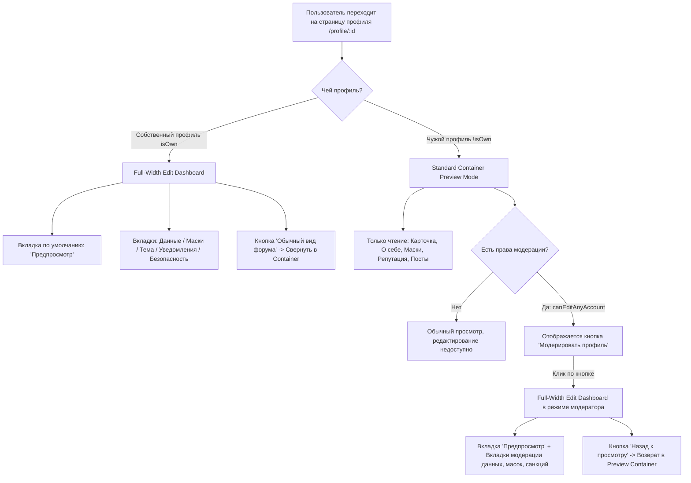
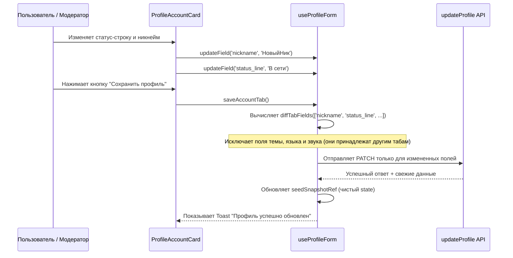

# Архитектурная спецификация страницы профиля: Двухрежимная система (Предпросмотр и Широкоформатный Дашборд)

> **Статус документа**: Согласовано к реализации  
> **Целевой модуль**: `src/pages/ProfilePage.jsx` (~2,228 строк) → Модульная архитектура с разделением на режимы "Предпросмотр" и "Широкоформатный Дашборд Редактирования"  
> **Связанные спецификации**:  
> - [`SPEC_ADMIN_PAGE_ARCHITECTURE_AND_REFACTOR.md`](file:///c:/Users/Alina/source/repos/SiJunma/aerun/markdowns/SPEC_ADMIN_PAGE_ARCHITECTURE_AND_REFACTOR.md) (Единый паттерн полноширинного layout)  
> - [`SPEC_TOPIC_ARCHITECTURE_AND_RACE_CONDITIONS.md`](file:///c:/Users/Alina/source/repos/SiJunma/aerun/markdowns/SPEC_TOPIC_ARCHITECTURE_AND_RACE_CONDITIONS.md) (Кастомные хуки и устранение race conditions)  
> - [`TODO_SPRINT_PLAN_admin_reorg.md`](file:///c:/Users/Alina/source/repos/SiJunma/aerun/markdowns/TODO_SPRINT_PLAN_admin_reorg.md) (Темизация и дизайн-система сайдбаров)

---

## 1. Концепция и Видение (Dual-State Architecture)

Текущая страница профиля (`src/pages/ProfilePage.jsx`) страдает от смешения двух противоположных сценариев использования:
1. **Публичный просмотр профиля** (карточка пользователя, биографические данные, витрина персонажей/масок, история репутации, список публикаций).
2. **Административно-настроечный пульт** (редактирование никнейма, загрузка аватара, управление масками, настройки темы/языка, звуковые эффекты, email-уведомления, безопасность сессий и модераторские санкции).

В результате профиль перегружен: обычный посетитель видит заблокированные поля или неактуальные табы, а владелец профиля или модератор вынужден редактировать данные в узком контейнере форума (`1080px`).

### Ключевые принципы новой архитектуры:

1. **Режим 1: "Предпросмотр" (`Preview Mode`) — Публичный вид**:
   - Открывается внутри стандартного форума (`Container`, макс. 1080px).
   - **100% Read-Only**: Никаких полей ввода, иконок блокировки (`<Lock />`), переключателей или сырых форм.
   - Чистая презентационная карточка: Аватар, никнейм, статус, роль, счетчик постов, репутация (с кнопками голосования для допущенных участников), кнопка "Написать сообщение" (ЛС).
   - Контентные вкладки только для чтения: **"О себе"**, **"Персонажи / Маски"**, **"Репутация"**, **"Публикации"**.
   - **Точка входа для модерации**: Если профиль просматривает модератор/администратор с правами редактирования чужих профилей, в шапке карточки выводится акцентная кнопка **"Модерировать профиль"** (или **"Редактировать"**).

2. **Режим 2: "Редактирование" (`Edit Dashboard Mode`) — Полноширинный пульт**:
   - Открывается **на всю ширину экрана** (Edge-to-Edge, как современный админ-дашборд).
   - Левый сворачиваемый сайдбар со списком логических разделов настроек.
   - Правая рабочая область с атомарными карточками редактирования, индивидуальными кнопками сохранения, отслеживанием "грязных" полей (`dirty tracking`) и мгновенной валидацией.
   - **Первая вкладка сайдбара — "Предпросмотр" (`preview`)**: Отображает публичный вид профиля "глазами других участников" непосредственно внутри дашборда!
   - **Разделение прав между Хозяином и Модерацией**:
     - *Хозяин профиля*: Видит вкладки "Предпросмотр", "Данные аккаунта", "Управление масками", "Интерфейс форума", "Уведомления и Звук", "Безопасность".
     - *Модератор (чужой профиль)*: Видит вкладки "Предпросмотр", "Модерация данных", "Управление масками", "Модерация репутации", "Роли и Санкции". Личные настройки пользователя (пароли, звуки, email-рассылки, темы оформления) модераторам **недоступны и скрыты**.

3. **Маршрутизация и Поведение по умолчанию**:
   - **Собственный профиль (`/profile/me` или `/profile/:myUid`)**: По умолчанию открывается в **Полноширинном формате (Дашборд)**, при этом активной является первая вкладка — **"Предпросмотр"**. Пользователь сразу видит, как выглядит его профиль со стороны, и может в один клик переключиться на нужную категорию настроек в сайдбаре.
   - **Чужой профиль (`/profile/:otherUid`)**: По умолчанию открывается в стандартном **"Предпросмотре"** (в обычном контейнере форума). Обычные пользователи не видят никаких инструментов редактирования. Модераторам доступна кнопка перехода в режим модерации (`?mode=edit`).



---

## 2. Безопасная интеграция в Layout без регрессий

Для того чтобы режим редактирования профиля мог растягиваться на 100% ширины экрана, не ломая при этом центрированный контейнер публичных страниц форума (`max-width: 1080px`), используется расширение `Layout.jsx`, синхронизированное со спецификацией админки:

### Контракт `src/components/layout/Layout.jsx`:

```jsx
// src/components/layout/Layout.jsx
import React, { useMemo } from 'react';
import { useLocation } from 'react-router-dom';
import { Container } from 'react-bootstrap';
import { useAuth } from '../../contexts/AuthProvider';

const Layout = ({ children }) => {
  const location = useLocation();
  const { profile } = useAuth();

  // Определение полноширинного режима:
  // 1. Все маршруты админки (/admin/**)
  // 2. Страница профиля в режиме редактирования:
  //    - Явный параметр ?mode=edit
  //    - Либо собственный профиль (если не запрошен принудительный контейнер ?mode=preview)
  const isProfileEditDashboard = useMemo(() => {
    if (!location.pathname.startsWith('/profile/')) return false;
    const uidFromPath = location.pathname.split('/')[2];
    const isOwn = profile && (uidFromPath === profile.uid || uidFromPath === 'me');
    const searchParams = new URLSearchParams(location.search);
    const mode = searchParams.get('mode');

    if (mode === 'preview') return false;
    if (mode === 'edit') return true;
    return isOwn; // По умолчанию для своего профиля — дашборд
  }, [location.pathname, location.search, profile]);

  const isFullWidthRoute = location.pathname.startsWith('/admin') || isProfileEditDashboard;

  return (
    <>
      <ForumBackground />
      <div className="app-wrapper">
        <ConnectionStatusBanner />
        <Navigation />
        <EmailVerificationBanner />

        <main className={isFullWidthRoute ? "app-main-fullwidth" : "py-2"}>
          {isFullWidthRoute ? (
            <div className="app-viewport-wrapper">
              {children}
            </div>
          ) : (
            <Container>
              {children}
            </Container>
          )}
        </main>
      </div>

      {!isFullWidthRoute && <Footer />}
      <ScrollButtons />
    </>
  );
};
```

### CSS-основа для полноширинного дашборда (`src/index.css`):

```css
/* Полноширинный контейнер для админки и дашборда профиля */
.app-main-fullwidth {
  width: 100%;
  padding: 0;
  margin: 0;
  display: flex;
  flex-direction: column;
  flex: 1 1 auto;
}

.app-viewport-wrapper {
  width: 100%;
  min-height: calc(100vh - 56px); /* Высота за вычетом навбара */
  display: flex;
  flex-direction: column;
}

/* Двухколоночный дашборд профиля */
.profile-dashboard-layout {
  display: flex;
  width: 100%;
  flex: 1 1 auto;
  min-height: 0;
}

.profile-dashboard-sidebar {
  width: 280px;
  flex-shrink: 0;
  background: var(--card-bg, #1e222b);
  border-right: 1px solid var(--border-color, rgba(255, 255, 255, 0.08));
  display: flex;
  flex-direction: column;
  transition: width 0.25s cubic-bezier(0.4, 0, 0.2, 1);
}

.profile-dashboard-sidebar.collapsed {
  width: 72px;
}

.profile-dashboard-content {
  flex: 1 1 auto;
  min-width: 0;
  padding: 1.5rem 2rem;
  overflow-y: auto;
  background: var(--bg-color, #13161c);
}

@media (max-width: 991.98px) {
  .profile-dashboard-layout {
    flex-direction: column;
  }
  .profile-dashboard-sidebar {
    width: 100%;
    border-right: none;
    border-bottom: 1px solid var(--border-color);
  }
  .profile-dashboard-content {
    padding: 1rem;
  }
}
```

---

## 3. Матрица разграничения доступа (RBAC Matrix)

| Раздел / Поле | Хозяин профиля (`isOwn`) | Модератор / Администратор (`!isOwn`) | Обычный пользователь (`!isOwn`) | Требуемое системное право |
| :--- | :---: | :---: | :---: | :--- |
| **Публичный предпросмотр** | Полный доступ | Полный доступ | Полный доступ | Любой (включая гостей) |
| **Смена никнейма** | Доступно | Доступно | Скрыто | `EDIT_SELF_NICKNAME` / `EDIT_OTHERS_NICKNAMES` |
| **Смена аватара** | Доступно | Доступно | Скрыто | `EDIT_SELF_AVATAR` / `EDIT_OTHERS_AVATARS` |
| **Смена статус-строки** | Доступно | Доступно | Скрыто | `EDIT_SELF_STATUS` / `EDIT_OTHERS_STATUSES` |
| **Смена подписи** | Доступно | Доступно | Скрыто | `EDIT_SELF_SIGNATURE` / `EDIT_OTHERS_SIGNATURES` |
| **Смена Bio, контактов, инфо** | Доступно | Доступно (модерация) | Скрыто | `EDIT_SELF_PROFILE` / `EDIT_OTHERS_PROFILE` |
| **Создание / Правка масок** | Доступно | Доступно (для пользователя) | Скрыто | `CREATE_SELF_MASK` / `CREATE_OTHERS_MASK`, `EDIT_OTHERS_MASK` |
| **Удаление масок** | Доступно | Доступно | Скрыто | `DELETE_SELF_MASK` / `DELETE_OTHERS_MASK` |
| **Модерация репутации** | Удаление своих записей | Удаление любых записей | Скрыто | `DELETE_SELF_REPUTATION` / `DELETE_OTHERS_REPUTATION` |
| **Выдача роли / Санкции** | Скрыто | Доступно | Скрыто | `CHANGE_ROLES`, `BAN_USERS` |
| **Язык и Тема оформления** | Доступно (личные) | **Скрыто** (приватные данные) | Скрыто | Только владелец аккаунта |
| **Звуки и уведомления** | Доступно (личные) | **Скрыто** (приватные данные) | Скрыто | Только владелец аккаунта |
| **Email-рассылки (Brevo)** | Доступно (личные) | **Скрыто** (приватные данные) | Скрыто | Только владелец аккаунта |
| **Смена пароля и сессии** | Доступно (в SecurityTab)| **Скрыто** (приватные данные) | Скрыто | Только владелец аккаунта |

---

## 4. Декомпозиция модулей и Архитектура компонентов

Вместо монолита в 2,228 строк создается модульная файловая структура:

```
src/
├── pages/
│   └── ProfilePage.jsx                     # Диспетчер режимов (~120 строк)
│
├── components/profile/
│   ├── preview/                            # РЕЖИМ ПРЕДПРОСМОТРА (Только чтение)
│   │   ├── ProfilePreviewLayout.jsx        # Композиция публичного просмотра
│   │   ├── ProfileUserCard.jsx             # Левая колонка: Аватар, инфо, роль, статы, ЛС
│   │   ├── ProfileHeaderActions.jsx        # Панель действий ("Модерировать", "ЛС", "Голос")
│   │   ├── tabs/
│   │   │   ├── ProfileAboutTab.jsx         # Биография, локация, контакты
│   │   │   ├── ProfileCharactersTab.jsx    # Витрина публичных масок
│   │   │   ├── ProfileReputationTab.jsx    # Таблица репутации с пагинацией и диплинками
│   │   │   └── ProfilePostsTab.jsx         # Публикации с фильтром по маскам
│   │
│   ├── dashboard/                          # ПОЛНОШИРИННЫЙ ДАШБОРД РЕДАКТИРОВАНИЯ
│   │   ├── ProfileDashboardLayout.jsx      # Каркас с левым сайдбаром и рабочей областью
│   │   ├── ProfileEditSidebar.jsx          # Сворачиваемый сайдбар со списком разделов
│   │   ├── ProfileDashboardHeader.jsx      # Шапка дашборда, хлебные крошки, переключатель режимов
│   │   ├── tabs/
│   │   │   ├── ProfilePreviewTabContent.jsx# Вкладка 1: встроенный публичный предпросмотр
│   │   │   ├── ProfileAccountCard.jsx      # Никнейм, аватар, статус, подпись, Bio, контакты
│   │   │   ├── ProfileCharactersManager.jsx# Полный менеджер масок (список, создание, квоты)
│   │   │   ├── ProfilePreferencesCard.jsx  # Язык, тема, приватность репутации (только owner)
│   │   │   ├── ProfileNotificationsCard.jsx# In-app, Email (Brevo), Звуки (только owner)
│   │   │   ├── ProfileSecurityCard.jsx     # Пароли и активные сессии (только owner)
│   │   │   └── ProfileModerationCard.jsx   # Смена роли, бан/разбан, статус (только staff)
│   │
│   ├── hooks/                              # ИЗОЛИРОВАННАЯ БИЗНЕС-ЛОГИКА (CUSTOM HOOKS)
│   │   ├── useProfileData.js               # Подписка на пользователя, активность, статус
│   │   ├── useProfileForm.js               # Форма аккаунта, сид, diff-патчи, scoped save
│   │   ├── useProfileCharacters.js         # Подписка, добавление/правка масок, слот аватара
│   │   ├── useProfileReputation.js         # Логи репутации, пагинация, ?log= deep seek, удаление
│   │   └── useProfilePosts.js              # Посты пользователя, пагинация, фильтрация по маскам
│   │
│   └── modals/                             # МОДАЛЬНЫЕ ОКНА
│       ├── CharacterEditModal.jsx          # Создание/редактирование маски (с изоляцией слота)
│       └── ReputationVoteModal.jsx         # Окно голосования за профиль (с защитой от URL)
```

---

## 5. Детализация компонентов и их обязанности

### 5.1. Главный диспетчер (`src/pages/ProfilePage.jsx`)
Оркестратор верхнего уровня. Отвечает только за:
- Извлечение `uid` из URL-параметров (поддержка `/profile/me`).
- Определение режима: `isEditMode` на основе прав, авторства и query-параметра `?mode=edit`.
- Загрузку базовых данных через `useProfileData(targetUid)`.
- Рендеринг либо `ProfileDashboardLayout`, либо `ProfilePreviewLayout`.

```jsx
// src/pages/ProfilePage.jsx (Концептуальный код)
import React, { useMemo } from 'react';
import { useParams, useSearchParams } from 'react-router-dom';
import { useAuth } from '../contexts/AuthProvider';
import { useProfileData } from '../components/profile/hooks/useProfileData';
import ProfilePreviewLayout from '../components/profile/preview/ProfilePreviewLayout';
import ProfileDashboardLayout from '../components/profile/dashboard/ProfileDashboardLayout';
import LoadingState from '../components/common/LoadingState';

const ProfilePage = () => {
  const { uid: rawUid } = useParams();
  const [searchParams, setSearchParams] = useSearchParams();
  const { profile: myProfile, hasPermission, PERMISSIONS } = useAuth();

  const targetUid = rawUid === 'me' ? myProfile?.uid : rawUid;
  const isOwn = myProfile?.uid === targetUid;

  const {
    viewedProfile,
    loading,
    error,
    canEditNickname,
    canEditAvatar,
    canEditStatus,
    canEditSignature,
    canEditAnyAccount
  } = useProfileData(targetUid);

  // Режим: по умолчанию свой профиль открывается в дашборде; чужой — в предпросмотре.
  // Модератор может переключить чужой профиль в режим edit (?mode=edit).
  const modeParam = searchParams.get('mode');
  const isEditMode = useMemo(() => {
    if (modeParam === 'preview') return false;
    if (modeParam === 'edit') return isOwn || canEditAnyAccount;
    return isOwn; // Для своего профиля по умолчанию дашборд
  }, [modeParam, isOwn, canEditAnyAccount]);

  const handleToggleMode = (nextMode) => {
    setSearchParams(prev => {
      const next = new URLSearchParams(prev);
      next.set('mode', nextMode);
      return next;
    }, { replace: true });
  };

  if (loading) return <LoadingState />;

  return isEditMode ? (
    <ProfileDashboardLayout
      targetUid={targetUid}
      viewedProfile={viewedProfile}
      isOwn={isOwn}
      canEditAnyAccount={canEditAnyAccount}
      onExitEditMode={() => handleToggleMode('preview')}
    />
  ) : (
    <ProfilePreviewLayout
      targetUid={targetUid}
      viewedProfile={viewedProfile}
      isOwn={isOwn}
      canEditAnyAccount={canEditAnyAccount}
      onEnterEditMode={() => handleToggleMode('edit')}
    />
  );
};

export default ProfilePage;
```

---

### 5.2. Сайдбар дашборда редактирования (`ProfileEditSidebar.jsx`)

Сайдбар организует доступные разделы в зависимости от прав доступа:

#### Для Хозяина профиля (`isOwn`):
1. **"Предпросмотр"** (`icon: Eye`, `id: preview`) — *Первая вкладка по умолчанию*.
2. **"Данные аккаунта"** (`icon: User`, `id: account`) — Никнейм, статус, аватар, подпись, Bio, контакты.
3. **"Персонажи и Маски"** (`icon: Users`, `id: characters`) — Список масок, добавление, квоты.
4. **"Оформление и Язык"** (`icon: Palette`, `id: preferences`) — Выбор темы, языка, приватность репутации.
5. **"Уведомления и Звук"** (`icon: Bell`, `id: notifications`) — In-app и Email уведомления, слайдер звука.
6. **"Безопасность"** (`icon: ShieldCheck`, `id: security`) — Смена пароля, активные сессии.

#### Для Модератора / Администратора (`!isOwn`):
1. **"Предпросмотр"** (`icon: Eye`, `id: preview`) — Просмотр профиля в реальном времени.
2. **"Модерация данных"** (`icon: UserCheck`, `id: account`) — Правка только тех полей, на которые есть разрешение (`EDIT_OTHERS_NICKNAMES`, `EDIT_OTHERS_AVATARS`, etc.).
3. **"Управление масками"** (`icon: Users`, `id: characters`) — Модерация масок пользователя (`CREATE_OTHERS_MASK`, `DELETE_OTHERS_MASK`).
4. **"Модерация репутации"** (`icon: TrendingUp`, `id: reputation`) — Удаление нарушающих правила комментариев или накруток.
5. **"Роль и Санкции"** (`icon: ShieldAlert`, `id: moderation`) — Назначение роли (`CHANGE_ROLES`), блокировка аккаунта (`BAN_USERS`).

---

### 5.3. Атомарное сохранение и изоляция данных (`useProfileForm.js`)

Одной из главных проблем текущего `ProfilePage.jsx` было перетирание данных при параллельном сохранении. В новой архитектуре сохранение строго атомарно и изолировано:



#### Защитные правила хука `useProfileForm`:
1. **Snapshot Seed Matching**: Форма сидируется только при реальном изменении внешних данных (`JSON.stringify(next) !== lastKey`), что исключает сброс введенного пользователем текста фоновым `last_seen` или heartbeat.
2. **Tab-Scoped Saves**: 
   - `saveAccountTab()` отправляет только ключи аккаунта.
   - `savePreferencesTab()` отправляет только тему, язык и приватность репутации.
   - `saveNotificationsTab()` отправляет только уведомления и настройки звука.
3. **Изоляция аватара**: Загрузка аватара аккаунта идет напрямую через бинарный эндпоинт `PUT /me/avatar` (`uploadMyAvatar`), исключая попадание тяжелых строк или временных blob-ссылок в JSON профиля.
4. **Изоляция слотов масок (`avatarSlot`)**: Каждый персонаж получает собственный изолированный слот пути (`maskAvatarPath`), чтобы замена аватара одной маски не затирала аватары других масок аккаунта.

---

## 6. Проектирование UI/UX обоих режимов

### 6.1. Режим "Предпросмотр" (Clean Public Showcase)

```
┌──────────────────────────────────────────────────────────────────────────────┐
│  Форум > Пользователи > Alina                                                │
├──────────────────────────────────────────────────────────────────────────────┤
│ ┌──────────────────────┐  ┌────────────────────────────────────────────────┐ │
│ │  [Аватар 72px]       │  │ [ О себе ] [ Персонажи (3) ] [ Репутация ] ... │ │
│ │  Alina [Администратор│  ├────────────────────────────────────────────────┤ │
│ │  "Разработка Aerun"  │  │ Биография:                                     │ │
│ │                      │  │ Ведущий разработчик платформы Aerun.           │ │
│ │  [✉ Написать (ЛС)]   │  │                                                │ │
│ │                      │  │ Информация:                                    │ │
│ │  Постов: 412         │  │ 📍 Город: Санкт-Петербург                      │ │
│ │  Репутация: +85 [+][-]│  │ 🎂 Дата рождения: 15 мая                       │ │
│ │                      │  │ 💼 Занятость: Full-stack Архитектор            │ │
│ │  [⚙ Модерировать]*   │  │                                                │ │
│ └──────────────────────┘  └────────────────────────────────────────────────┘ │
└──────────────────────────────────────────────────────────────────────────────┘
* Кнопка "Модерировать" видна только сотрудникам с правами редактирования чужих профилей
```

### 6.2. Режим "Редактирование / Дашборд" (Full-Width Dashboard)

```
┌───────────────────────────────────────────────────────────────────────────────────────────┐
│ [⬅ Назад к форуму]   Личный кабинет: Alina                    [Свернуть в предпросмотр 👁] │
├──────────────────────────┬────────────────────────────────────────────────────────────────┤
│ Сайдбар настроек         │ Рабочая область раздела (Атомарная карточка)                   │
├──────────────────────────┼────────────────────────────────────────────────────────────────┤
│ 👁 1. Предпросмотр      │ Карточка "Основные данные профиля"                             │
│ 👤 2. Данные профиля   * │ ────────────────────────────────────────────────────────────── │
│ 🎭 3. Маски и персонажи  │ Никнейм:                                                       │
│ 🎨 4. Тема и оформление  │ [ Alina                                                      ] │
│ 🔔 5. Уведомления        │                                                                │
│ 🛡️ 6. Безопасность       │ Статус-строка:                                                 │
│                          │ [ Разработка Aerun                                   ] 16/30   │
│                          │                                                                │
│                          │ Аватар профиля:                                                │
│                          │ [ Загрузить новое фото ] (Поддерживаются GIF и PNG до 2МБ)     │
│                          │                                                                │
│                          │ [ Сохранить изменения профиля ]                                │
└──────────────────────────┴────────────────────────────────────────────────────────────────┘
```

---

## 7. Пошаговый план внедрения (Sprint Roadmap)

### Фаза 1: Извлечение Custom Hooks (Изоляция бизнес-логики)
- [ ] **Шаг 1.1**: Создать [`src/components/profile/hooks/useProfileData.js`](file:///c:/Users/Alina/source/repos/SiJunma/aerun/src/components/profile/hooks/useProfileData.js) (подписка на пользователя, определение прав `canEdit*`, расчет `isLimitedProfile`, `isPendingProfile`).
- [ ] **Шаг 1.2**: Создать [`src/components/profile/hooks/useProfileForm.js`](file:///c:/Users/Alina/source/repos/SiJunma/aerun/src/components/profile/hooks/useProfileForm.js) (сидирование формы, предотвращение затирания несохраненных данных, расчет таб-ориентированных diff, валидация никнейма).
- [ ] **Шаг 1.3**: Создать [`src/components/profile/hooks/useProfileCharacters.js`](file:///c:/Users/Alina/source/repos/SiJunma/aerun/src/components/profile/hooks/useProfileCharacters.js) (подписка на персонажей, квоты, изоляция слотов `newAvatarSlot()`, добавление/правка/удаление).
- [ ] **Шаг 1.4**: Создать [`src/components/profile/hooks/useProfileReputation.js`](file:///c:/Users/Alina/source/repos/SiJunma/aerun/src/components/profile/hooks/useProfileReputation.js) и [`useProfilePosts.js`](file:///c:/Users/Alina/source/repos/SiJunma/aerun/src/components/profile/hooks/useProfilePosts.js) (пагинация, seek deep link `?log=`, фильтрация постов).

### Фаза 2: Модули режима "Предпросмотр" (Preview View)
- [ ] **Шаг 2.1**: Создать [`ProfileUserCard.jsx`](file:///c:/Users/Alina/source/repos/SiJunma/aerun/src/components/profile/preview/ProfileUserCard.jsx) — левая визитка с аватаром, ролью, счетчиками и кнопкой перехода в ЛС.
- [ ] **Шаг 2.2**: Вынести вкладки предпросмотра в отдельные презентационные компоненты: [`ProfileAboutTab.jsx`](file:///c:/Users/Alina/source/repos/SiJunma/aerun/src/components/profile/preview/tabs/ProfileAboutTab.jsx), [`ProfileCharactersTab.jsx`](file:///c:/Users/Alina/source/repos/SiJunma/aerun/src/components/profile/preview/tabs/ProfileCharactersTab.jsx), [`ProfileReputationTab.jsx`](file:///c:/Users/Alina/source/repos/SiJunma/aerun/src/components/profile/preview/tabs/ProfileReputationTab.jsx), [`ProfilePostsTab.jsx`](file:///c:/Users/Alina/source/repos/SiJunma/aerun/src/components/profile/preview/tabs/ProfilePostsTab.jsx).
- [ ] **Шаг 2.3**: Собрать [`ProfilePreviewLayout.jsx`](file:///c:/Users/Alina/source/repos/SiJunma/aerun/src/components/profile/preview/ProfilePreviewLayout.jsx) со стандартным контейнером и кнопкой входа в режим редактирования для модераторов.

### Фаза 3: Интеграция в Layout и Полноширинный Дашборд
- [ ] **Шаг 3.1**: Обновить [`src/components/layout/Layout.jsx`](file:///c:/Users/Alina/source/repos/SiJunma/aerun/src/components/layout/Layout.jsx) для поддержки класса `.app-main-fullwidth` на маршрутах профиля в режиме дашборда.
- [ ] **Шаг 3.2**: Создать компонент сайдбара [`ProfileEditSidebar.jsx`](file:///c:/Users/Alina/source/repos/SiJunma/aerun/src/components/profile/dashboard/ProfileEditSidebar.jsx) с поддержкой сворачивания и разделением структуры вкладок для Owner vs Staff.
- [ ] **Шаг 3.3**: Реализовать атомарные карточки настроек:
  - [`ProfileAccountCard.jsx`](file:///c:/Users/Alina/source/repos/SiJunma/aerun/src/components/profile/dashboard/tabs/ProfileAccountCard.jsx)
  - [`ProfileCharactersManager.jsx`](file:///c:/Users/Alina/source/repos/SiJunma/aerun/src/components/profile/dashboard/tabs/ProfileCharactersManager.jsx)
  - [`ProfilePreferencesCard.jsx`](file:///c:/Users/Alina/source/repos/SiJunma/aerun/src/components/profile/dashboard/tabs/ProfilePreferencesCard.jsx)
  - [`ProfileNotificationsCard.jsx`](file:///c:/Users/Alina/source/repos/SiJunma/aerun/src/components/profile/dashboard/tabs/ProfileNotificationsCard.jsx)
  - [`ProfileModerationCard.jsx`](file:///c:/Users/Alina/source/repos/SiJunma/aerun/src/components/profile/dashboard/tabs/ProfileModerationCard.jsx) (Роли, бан, статус).
- [ ] **Шаг 3.4**: Реализовать вкладку "Предпросмотр" внутри дашборда ([`ProfilePreviewTabContent.jsx`](file:///c:/Users/Alina/source/repos/SiJunma/aerun/src/components/profile/dashboard/tabs/ProfilePreviewTabContent.jsx)), чтобы пользователь мог оценивать вид профиля не выходя из панели.

### Фаза 4: Диспетчеризация, тестирование и полировка
- [ ] **Шаг 4.1**: Переписать корень [`src/pages/ProfilePage.jsx`](file:///c:/Users/Alina/source/repos/SiJunma/aerun/src/pages/ProfilePage.jsx) на компактный диспетчер режимов (~120 строк).
- [ ] **Шаг 4.2**: Проверить адаптивность на экранах телефонов (плавный переход сайдбара в мобильное меню).
- [ ] **Шаг 4.3**: Проверить соответствие правилам проекта (`AGENTS.md`) и запустить CI verification (`origin/ci-report`).

---

## 8. Итоги и Ожидаемый результат

1. **Разгрузка кодовой базы**: Монолитный файл в 2,228 строк заменяется компактными компонентами с четкой зоной ответственности (<200 строк каждый).
2. **Идеальный UX**:
   - Обычные пользователи видят чистый, эстетичный профиль без лишних кнопок и заблокированных инпутов.
   - Владельцы профиля получают профессиональный, полноширинный дашборд с мгновенным доступом к предпросмотру и всем настройкам.
   - Модерация получает специализированный пульт без риска задеть чужие приватные настройки (пароли, звуки, email).
3. **Безопасность данных**: Полная изоляция сохранений табов (исключены перезаписи темы при редактировании Bio), защита от гонок состояний и коллизий файлов аватаров.
