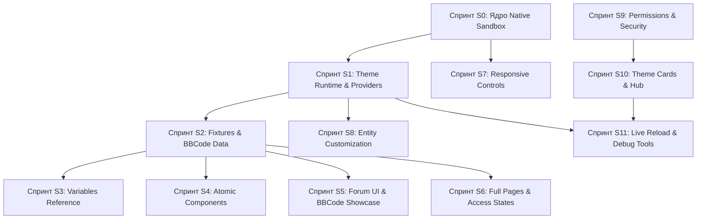

# Native Theme Sandbox — план спринтов для агентов

> **ПРЕРЕКВИЗИТ:** Этот план выполняется ПОСЛЕ полного завершения [THEMEABLE_SPRINT_PLAN.md](./THEMEABLE_SPRINT_PLAN.md) (спринты 0–15).
> Все семантические `id`, `class`, `data-*` атрибуты и `useThemeable()` хук должны быть внедрены и протестированы.
> 
> **НАЗНАЧЕНИЕ ФИЧИ: ПЕСОЧНИЦА ДЛЯ ОТЛАДКИ (Debugging Sandbox)**
> Theme Sandbox — это **внутренний инструмент разработчика и дизайнера** для удобной отладки кастомных тем. Здесь нет формальных бюрократических QA-чеклистов: цель песочницы — предоставить живую среду, где можно мгновенно переключать состояния, проверять отображение всех компонентов, BB-кодов, специальных экранов и адаптивности в реальном времени.
> 
> **АРХИТЕКТУРНЫЙ ПРИНЦИП (Раздел 21 спеки):** Theme Sandbox является **собственной нативной разработкой форума** (Zero External Storybook Dependencies). Мы не устанавливаем пакеты `@storybook/*`, не поднимаем отдельный dev-сервер на порту 6006 и не привязываемся к сторонним экосистемам. Мы заимствуем концепцию изолированных историй (компонент + mock-данные + viewport), но реализуем её внутри собственного движка форума под маршрутом `/sandbox/:themeId`.

---

## Оглавление

1. [Контекст, цели и концепция среды отладки](#1-контекст-цели-и-концепция-среды-отладки)
2. [Архитектура собственного Native Sandbox](#2-архитектура-собственного-native-sandbox)
3. [Что уже есть в проекте](#3-что-уже-есть-в-проекте)
4. [Граница ответственности: Live Preview vs Theme Sandbox](#4-граница-ответственности-live-preview-vs-theme-sandbox)
5. [Спринт S0 — Ядро и интерфейс Native Sandbox (Shell & Canvas)](#спринт-s0--ядро-и-интерфейс-native-sandbox-shell--canvas)
6. [Спринт S1 — Изолированный Theme Runtime и Mock Providers](#спринт-s1--изолированный-theme-runtime-и-mock-providers)
7. [Спринт S2 — Fixtures: централизованные тестовые данные и витрина BB-кодов](#спринт-s2--fixtures-централизованные-тестовые-данные-и-витрина-bb-кодов)
8. [Спринт S3 — Variables Reference & Design Tokens Inspector](#спринт-s3--variables-reference--design-tokens-inspector)
9. [Спринт S4 — Каталог Atomic Components Stories](#спринт-s4--каталог-atomic-components-stories)
10. [Спринт S5 — Forum UI: Composite Stories & полная витрина BB-кодов](#спринт-s5--forum-ui-composite-stories--полная-витрина-bb-кодов)
11. [Спринт S6 — Full Pages Stories: страницы форума, закрытый режим, техобслуживание, бан, премодерация](#спринт-s6--full-pages-stories-страницы-форума-закрытый-режим-техобслуживание-бан-премодерация)
12. [Спринт S7 — Responsive Viewport Switcher & Device Controls](#спринт-s7--responsive-viewport-switcher--device-controls)
13. [Спринт S8 — Entity-Specific Customization Scenarios](#спринт-s8--entity-specific-customization-scenarios)
14. [Спринт S9 — Permissions & Security: theme_sandbox, theme_edit, theme_activate](#спринт-s9--permissions--security-theme_sandbox-theme_edit-theme_activate)
15. [Спринт S10 — Theme Cards UI & Designer Hub (Без доступа в Admin)](#спринт-s10--theme-cards-ui--designer-hub-без-доступа-в-admin)
16. [Спринт S11 — Live Reload и инструменты интерактивной отладки](#спринт-s11--live-reload-и-инструменты-интерактивной-отладки)
17. [Матрица зависимостей между спринтами](#матрица-зависимостей-между-спринтами)
18. [Правила и соглашения для агентов](#правила-и-соглашения-для-агентов)

---

# 1. Контекст, цели и концепция среды отладки

Из спецификации `theme-sandbox-storybook-spec.md`:

> **Theme Sandbox — встроенная в forum engine среда для полного ручного тестирования и отладки конкретной кастомной темы на реальных компонентах, состояниях, страницах, тестовых данных и responsive layouts без её активации.**

### Почему мы делаем собственный Native Sandbox вместо `@storybook/*`?

| Критерий | Официальный Storybook (`@storybook/*`) | Native Theme Sandbox (Наш выбор) |
|---|---|---|
| **Зависимости** | 500+ npm-пакетов, тяжелый dev-сервер | **0 новых внешних зависимостей** |
| **Доступность** | Только локально в dev-режиме (порт 6006) | **Внутри приложения** (`/sandbox/:themeId`), доступен на staging/prod |
| **UX форума** | Чужеродный интерфейс со своей терминологией | **Единый стиль UI форума**, нативная страница системы |
| **Темизация** | Требуются сложные Webpack/Vite addons | Прямая работа с `DesignProvider` и Firestore `designs` |
| **Права доступа** | Нет встроенного RBAC | **Интеграция с ролями форума** (`theme_sandbox`) |
| **Изоляция CSS** | Iframe с кастомным менеджером | **Scoping + Iframe Canvas** (CSS темы не ломает панель управления) |

### Ключевые принципы работы
1. **Sandbox работает с draft-темой, но не активирует её** для обычных посетителей форума.
2. **Тема выбирается ДО открытия Sandbox** (из карточки темы `/themes` или админки). Внутри Sandbox нет общего селектора тем — среда открыта под конкретный `themeId`.
3. **Используются реальные production React-компоненты форума** — никаких дубликатов вроде `SandboxTopicRow`.
4. **Дизайнер работает без доступа к Admin Area** — доступ выдается гранулярно через право `theme_sandbox`.
5. **Live Reload без перезагрузки** — дизайнер правит CSS/JS в редакторе темы, а Sandbox мгновенно обновляет стили.
6. **Песочница для отладки** — фокус на удобстве визуальной инспекции, быстрой проверке всех BB-кодов, состояний доступа (гость, закрытый форум, бан, техобслуживание, премодерация) и медиа-брейкпоинтов.

---

# 2. Архитектура собственного Native Sandbox

## 2.1. Высокоуровневая диаграмма архитектуры

```
Forum Engine (React 19 + Vite)
│
├── App Routing (src/App.jsx)
│     ├── /                     ← Forum Index
│     ├── /themes               ← Designer Hub (Theme Cards)
│     └── /sandbox/:themeId     ← Native Theme Sandbox (Lazy-loaded)
│
├── Theme Runtime
│     ├── DesignProvider.jsx    ← Инжекция CSS/JS
│     ├── ThemeProvider.jsx     ← data-theme="themeable", data-theme-engine="custom"
│     └── useThemeable()        ← Хук готовности темы
│
└── Native Sandbox Engine (src/features/sandbox/)
      ├── SandboxPage.jsx       ← Корневой контейнер страницы
      ├── SandboxHeader.jsx     ← Тулбар: Viewport, Zoom, Theme Info, Live Status, Role Switcher
      ├── SandboxSidebar.jsx    ← Дерево навигации по stories (поиск + группы)
      ├── SandboxCanvas.jsx     ← Холст предпросмотра (Iframe или Scoped Container)
      ├── SandboxControls.jsx   ← Панель переключения props/state для выбранной story
      │
      ├── registry/             ← Реестр stories (Variables, Atoms, Forum UI, BBCode, Pages, System)
      ├── fixtures/             ← Централизованные mock-данные (пользователи, темы, посты, BBCode)
      └── providers/            ← Mock Auth, Mock Router, Mock I18n для stories
```

## 2.2. Архитектурная изоляция CSS (Preview Canvas)

Критически важная деталь: **кастомный CSS темы не должен ломать интерфейс самого Sandbox** (тулбар, сайдбар, кнопки).

Решение:
1. Оболочка Sandbox (сайдбар, меню, кнопки, шапка) стилизуется с уникальным префиксом классов `.asb-*` (*Aerun Sandbox*), либо через CSS Modules: `src/features/sandbox/styles/sandbox.module.css`.
2. Предпросмотр истории (`SandboxCanvas`) рендерится внутри изолированного `<iframe>` (через React Portal в `iframe.contentDocument.body` или внутренний route `/sandbox/preview`).
3. Внутри Canvas монтируются стили:
   - `bootstrap.min.css`
   - `index.css`
   - `themeable.css`
   - `<style id="custom-design-css">{theme.css}</style>`
   - `<script id="custom-design-js">{theme.js}</script>`
4. На контейнер Canvas выставляются:
   - `data-theme="themeable"`
   - `data-theme-engine="custom"`
   - `data-theme-id="{themeId}"`

---

# 3. Что уже есть в проекте

## 3.1. Инфраструктура тем
| Компонент / Файл | Текущее назначение | Статус для Sandbox |
|---|---|---|
| `src/contexts/ThemeProvider.jsx` | Управление `data-theme` (dark/light/neutral) | Будет поддержан `themeable` режим |
| `src/contexts/DesignProvider.jsx` | Инжекция кастомного CSS/JS из Firestore | База для `SandboxDesignProvider` |
| `src/hooks/useThemeable.js` | Хук `{ isThemeable: boolean }` | Используется всеми компонентами |
| `src/styles/themeable.css` | Специфичные классы для темизации | Обязателен в Canvas Sandbox |
| `src/index.css` | Базовые CSS-переменные форума | Базовый слой стилей |

## 3.2. Парсер BBCode форума
| Компонент / Файл | Назначение |
|---|---|
| `src/components/common/BBCode.jsx` | Полноценный парсер стека тегов (30+ тегов): форматирование, цитаты, код, спойлеры, колонки, скрытый текст, кубики RPG, медиа |
| `src/index.css` | Классы оформления BB-кодов: `.bbcode-quote`, `.bbcode-code`, `.bbcode-spoiler`, `.bbcode-columns`, `.bbcode-hide-placeholder`, `.bbcode-dice`, `.bbcode-smile` |

## 3.3. Системные страницы и режимы доступа
| Страница / Компонент | Назначение |
|---|---|
| `src/pages/PendingPage.jsx` | Страница пользователя на премодерации (ожидание подтверждения) |
| `src/pages/BannedPage.jsx` | Экран заблокированного пользователя |
| `src/components/common/ProtectedRoute.jsx` | Логика `whitelistMode` (белая стена: гости видят только `/login`), режимы ролей `spectator`, `pending`, `banned` |
| `src/components/modals/MaintenanceLogoutModal.jsx` | Модальное окно принудительного разлогина при старте техработ |
| `src/components/common/ErrorCard.jsx` | Карточка сетевой устойчивости и ошибок с повтором действия |

---

# 4. Граница ответственности: Live Preview vs Theme Sandbox

| Характеристика | Существующий Live Preview (`?preview_design=...`) | Native Theme Sandbox (`/sandbox/:themeId`) |
|---|---|---|
| **Назначение** | Проверка темы «на живую» на конкретной реальной странице | Систематический аудит и отладка ВСЕХ компонентов, BB-кодов и экранов |
| **Данные** | Реальная база данных форума (Firestore) | Детерминированные mock-фикстуры (Fixtures) |
| **Состояния UI** | Только те, что есть в текущей БД | Все edge-cases, длинные имена, бан, премодерация, закрытый форум, ошибки |
| **BBCode** | Только те, что случайно попались в постах | Полная тестовая витрина со ВСЕМИ поддерживаемыми BB-кодами форума |
| **Адаптивность** | Ручной ресайз окна браузера | Встроенные пресеты (Mobile, Tablet, Desktop) с зумом и поворотом |
| **Справочник токенов** | Отсутствует | Инспектор всех CSS-переменных темы (Variables Reference) |
| **Права** | Требует права администратора | Доступен дизайнерам (`theme_sandbox`) без входа в админку |

---

# Спринт S0 — Ядро и интерфейс Native Sandbox (Shell & Canvas)

## Цель
Создать инфраструктуру и каркас страницы Native Sandbox: роутинг, лейаут из трех панелей (Header Toolbar, Story Navigator Sidebar, Canvas), базовые стили с префиксом `.asb-*` и изолированный Canvas с поддержкой ресайза.

## Файлы спринта

### [НОВЫЙ] `src/features/sandbox/styles/sandbox.css`
Стили интерфейса песочницы:
- Цветовая палитра Neutral/Dark для интерфейса редактора
- Стили тулбара, сайдбара, дерева навигации, поля поиска
- Обертка Canvas с центрированием и тенями мобильных фреймов
- Полная изоляция от стилей форума через класс `.asb-root`

### [НОВЫЙ] `src/features/sandbox/SandboxPage.jsx`
Главная страница песочницы:
- Читает `:themeId` из URL-параметров маршрута (`useParams()`)
- Проверяет права доступа (`hasPermission(PERMISSIONS.THEME_SANDBOX)`)
- Содержит состояние:
  - `activeStoryId` (ID выбранного компонента/состояния)
  - `viewport` (`{ width, height, label }`)
  - `zoom` (0.75, 1, 1.25)
  - `mockRole` (быстрое переключение роли: admin / mod / player / spectator / guest / banned / pending)
  - `storyProps` (управляемые параметры для активной story)
- Рендерит: `<SandboxHeader />`, `<SandboxSidebar />`, `<SandboxCanvas />`, `<SandboxControls />`

### [НОВЫЙ] `src/features/sandbox/components/SandboxHeader.jsx`
Верхняя панель инструментов:
- Заголовок: Название темы + бейдж `[Draft]` или `[Active]`
- Индикатор синхронизации (Live sync: 🟢)
- Быстрый селектор роли для проверки доступа (🎭 Mock Role: Admin / Player / Guest / Spectator / Pending / Banned)
- Кнопки пресетов Viewport:
  - 🖥️ Desktop (1440×900, 1080×800)
  - 📱 Tablet (768×1024)
  - 📱 Mobile (375×667, 390×844)
  - ↔️ Fluid (100%)
- Поворот ориентации (Portrait / Landscape)
- Кнопка перехода к редактору темы (`/themes/:themeId/edit`)
- Кнопка выхода в форум

### [НОВЫЙ] `src/features/sandbox/components/SandboxSidebar.jsx`
Левая панель навигации:
- Поле быстрого поиска по историям (`input` с фильтрацией на лету)
- Иерархическое дерево:
  - 📋 **Variables Reference** (CSS токены и переменные)
  - 🧩 **Atomic Components** (Базовые кнопки, бейджи, инпуты, скелетоны)
  - 💬 **Forum UI Blocks** (Карточки категорий, строк тем, сообщений треда)
  - 📝 **BBCode Showcase** (Полная витрина тегов форматирования, цитат, спойлеров, кубиков)
  - 📄 **Full Pages** (Главная, категории, тема, профиль, участники, уведомления)
  - 🚪 **Access & System States** (Закрытый форум для гостей, техработы, премодерация, бан, ошибка сети)
  - 🎭 **Entity Scenarios** (Многоуровневые переопределения стилей)
- Подсветка активной истории, счетчик доступных историй
- Кнопка свернуть/развернуть сайдбар

### [НОВЫЙ] `src/features/sandbox/components/SandboxCanvas.jsx`
Холст отображения:
- Контейнер с размерами согласно выбранному viewport
- Рендер через `<iframe>` со специальным монтированием React Portal или изолированный `<div className="asb-preview-frame">`
- Подключение стилей форума (`index.css`, `themeable.css`, кастомный CSS темы)
- Рендер активной story внутри `SandboxProviders`

### [ИЗМЕНИТЬ] `src/App.jsx`
Добавление ленивого маршрута:
```jsx
const SandboxPage = React.lazy(() => import('./features/sandbox/SandboxPage'));

// В блоке <Routes>:
<Route 
  path="/sandbox/:themeId" 
  element={
    <ProtectedRoute requirePermission={PERMISSIONS.THEME_SANDBOX}>
      <React.Suspense fallback={<LoadingSpinner />}>
        <SandboxPage />
      </React.Suspense>
    </ProtectedRoute>
  } 
/>
```

---

# Спринт S1 — Изолированный Theme Runtime и Mock Providers

## Цель
Обеспечить окружение, в котором реальные компоненты форума рендерятся в Sandbox без ошибок, получая тему из Firestore и необходимые контексты (`Auth`, `I18n`, `Router`, `Design`).

## Файлы спринта

### [НОВЫЙ] `src/features/sandbox/providers/SandboxProviders.jsx`
Композитный провайдер для изоляции историй:
```jsx
export function SandboxProviders({ children, theme, mockUser, mockSettings, language = 'ru' }) {
  return (
    <MemoryRouter>
      <SandboxI18nProvider language={language}>
        <SandboxAuthProvider mockUser={mockUser} mockSettings={mockSettings}>
          <SandboxDesignProvider theme={theme}>
            <div data-theme="themeable" data-theme-engine="custom" className="forum-root">
              {children}
            </div>
          </SandboxDesignProvider>
        </SandboxAuthProvider>
      </SandboxI18nProvider>
    </MemoryRouter>
  );
}
```

### [НОВЫЙ] `src/features/sandbox/providers/SandboxDesignProvider.jsx`
Инжектит CSS/JS конкретной темы в preview canvas:
- Создает `<style id="aerun-sandbox-theme-css">` внутри документа canvas
- Инжектит JS темы в безопасном скоупе
- Не трогает глобальный `document.head` основного окна, если используется iframe

### [НОВЫЙ] `src/features/sandbox/providers/SandboxAuthProvider.jsx`
Предоставляет детерминированный `useAuth()`:
- `currentUser`: настраиваемый пользователь (admin, moderator, player, spectator, guest, banned, pending)
- `profile`: mock профиль с ролью, правами, репутацией и настройками
- `settings`: настройки форума (`whitelistMode`, `maintenanceMode`, `enableDice` и др.)
- `hasPermission: (perm) => ...` (вычисляется на основе текущей `mockRole`)
- Методы login/logout/updateProfile превращены в безопасные noop-логгеры

### [НОВЫЙ] `src/features/sandbox/providers/SandboxI18nProvider.jsx`
Использует реальные словари переводов из `src/locales/` (`ru.json`, `en.json`), позволяя переключать язык отображения историй через тулбар.

### [НОВЫЙ] `src/features/sandbox/hooks/useSandboxDesign.js`
Хук загрузки данных темы:
- Загружает тему по `themeId` из Firestore
- Если `themeId === 'demo'` — возвращает встроенный тестовый набор стилей
- Поддерживает подписку `onSnapshot` для мгновенного Live Reload (Спринт S11)

---

# Спринт S2 — Fixtures: централизованные тестовые данные и витрина BB-кодов

## Цель
Создать структурированные, детерминированные тестовые данные, покрывающие обычные сценарии, экстремальные edge-cases и **все поддерживаемые форумом BB-коды**.

## Файлы спринта

### [НОВЫЙ] `src/features/sandbox/fixtures/index.js`
Единая точка экспорта фикстур:
```js
export * as userFixtures from './users';
export * as categoryFixtures from './categories';
export * as topicFixtures from './topics';
export * as postFixtures from './posts';
export * as bbcodeFixtures from './bbcode';
export * as notificationFixtures from './notifications';
export * as statsFixtures from './stats';
```

### [НОВЫЙ] `src/features/sandbox/fixtures/bbcode.js`
Централизованный набор тестового контента для проверки всех 30+ BB-кодов из `BBCode.jsx`:
- **`typographyBBCode`**:
  ```text
  [b]Жирный текст[/b], [i]курсив[/i], [u]подчеркнутый[/u], [s]зачеркнутый[/s], 
  [strike]strike[/strike], [del]del[/del], [sup]верхний индекс[/sup], [sub]нижний индекс[/sub].
  [color=#e63946]Красный акцентный текст[/color], [size=22]Крупный текст[/size].
  [abbr="Подсказка при наведении"]Аббревиатура с тултипом[/abbr].
  [hr]
  ```
- **`alignmentBBCode`**:
  ```text
  [left]Текст по левому краю[/left]
  [center]Текст по центру[/center]
  [right]Текст по правому краю[/right]
  [justify]Текст с выравниванием по ширине страницы с длинным абзацем...[/justify]
  ```
- **`quotesAndCodeBBCode`**:
  - Одиночная цитата: `[quote]Текст цитаты[/quote]`
  - Цитата с автором: `[quote=MasterAdmin]Важное системное сообщение[/quote]`
  - Цитата с автором и ссылкой на пост: `[quote="PlayerOne" post=42]Ответ на предыдущую реплику[/quote]`
  - Вложенные цитаты: `[quote=UserA][quote=UserB]Вложенный диалог[/quote]Ответ на диалог[/quote]`
  - Блоки кода: `[code]const aerunTheme = { engine: "themeable", version: 2 };[/code]`
- **`spoilersBBCode`**:
  - `[spoiler]Скрытый текст по умолчанию[/spoiler]`
  - `[spoiler="Сюжетная тайна: Акт III"]Развернутый текст с описанием квеста и картинкой[/spoiler]`
- **`hideBBCode`**:
  - Скрытый от гостей: `[hide]Контент доступен только зарегистрированным пользователям[/hide]`
  - Скрытый по числу постов: `[hide=posts:25]Требуется минимум 25 сообщений[/hide]`
  - Скрытый по репутации: `[hide=rep:10]Требуется репутация 10+[/hide]`
  - Скрытый для роли: `[hide=role:admin]Секретная информация для администрации[/hide]`
  - Секретный блок: `[hide_secured]Зашифрованный блок[/hide_secured]`
- **`columnsBBCode`**:
  - Многоколоночный макет:
    ```text
    [columns]
      [col]Первая колонка с описанием персонажа и характеристиками[/col]
      [col]Вторая колонка со снаряжением и инвентарем[/col]
    [/columns]
    ```
- **`listsAndSeparatorsBBCode`**:
  - Маркированные списки `[list][*]Пункт 1[*]Пункт 2[*]Пункт 3[/list]`
  - Нумерованные списки
- **`mediaBBCode`**:
  - Ссылки: `[url]https://aerun.org[/url]`, `[url=https://aerun.org]Ссылка с текстом[/url]`
  - Изображения: `[img]https://picsum.photos/600/300[/img]`, масштабирование в `.bbcode-media-wrapper`
  - Видео: `[video]`, `[youtube]`, `[media]`
  - Смайлики: шорткоды и явные теги `[smile]:) [/smile]`, смайлы из `ALL_SMILES_MAP`
- **`interactiveDiceBBCode`**:
  - Интерактивный бросок кубиков: `[dice]2d20+5[/dice]`, `[roll]1d100[/roll]` в паре с объектом `rolls: { ... }`
- **`allInOneMegaBBCode`**:
  - Комплексный пост-стресстест, объединяющий ВСЕ типы BB-кодов в одном сообщении для выявления конфликтов стилей, отступов и схлопывания строк

### [НОВЫЙ] `src/features/sandbox/fixtures/users.js`
- `adminUser`, `modUser`, `playerUser`, `spectatorUser`, `bannedUser`, `pendingUser`
- `longNameUser` (80 символов), `noAvatarUser` (fallback-инициалы), `specialCharsUser` (эмодзи и кавычки)

### [НОВЫЙ] `src/features/sandbox/fixtures/categories.js` & `topics.js`
- Обычные, пустые, закрепленные (`.is-pinned`), закрытые (`.is-locked`), с непрочитанными темами (`.has-unread`)

### [НОВЫЙ] `src/features/sandbox/fixtures/posts.js`
- `firstPost` (`.is-first`), `standardPost`, `editedPost` (`.is-edited`), `deletedPost` (`.is-deleted`), `signaturePost`, `bbcodeShowcasePost`

---

# Спринт S3 — Variables Reference & Design Tokens Inspector

## Цель
Реализовать встроенную страницу-инспектор переменных темы (`Variables Reference`), позволяющую дизайнеру наглядно видеть все CSS-токены, их текущие вычисленные значения, цветовые плашки и типографику.

## Файлы спринта

### [НОВЫЙ] `src/features/sandbox/stories/VariablesReference.jsx`
Компонент инспектора токенов:
1. Автоматически извлекает вычисленные стили из холста предпросмотра: `getComputedStyle(canvasElement)`
2. Группирует переменные по категориям (Цвета, Типографика, Отступы, Радиусы, Сетки, Тени)
3. Отображает интерактивные карточки:
   - Цветовые свотчи (Color Swatches) с hex/rgb значениями
   - Предпросмотр шрифтов и размеров (`font-family`, `font-size`, `line-height`)
   - Радиусы скругления (`border-radius`)
   - Специфичные семантические классы `.aerun-*` из `THEMEABLE_SPRINT_PLAN.md`

### [НОВЫЙ] `src/features/sandbox/registry/variablesMap.js`
Декларативное описание токенов темы форума (Base Colors, Role Colors, UI States).

---

# Спринт S4 — Каталог Atomic Components Stories

## Цель
Подключить реальные базовые компоненты форума к реестру историй песочницы с возможностью переключения состояний (default, hover, active, disabled, loading, error).

## Файлы спринта

### [НОВЫЙ] `src/features/sandbox/registry/atomicStories.js`
Реестр атомарных компонентов:
- **Buttons**: основные кнопки форума, outline-варианты, размеры (sm/md/lg), кнопки с иконками, состояние `loading` со спиннером
- **ForumBreadcrumbs**: хлебные крошки (1 уровень, 3 уровня, 5 уровней вложенности, длинные названия разделов)
- **ForumPagination**: пагинатор (3 страницы, 50 страниц, первая/средняя/последняя активная страница)
- **ForumRoleBadge**: все роли (`admin`, `moderator`, `player`, `spectator`, `banned`, `pending`)
- **ForumAuthorAvatar**: аватарка автора (с фото, fallback-инициалы, онлайн/оффлайн индикатор)
- **ForumAuthorName**: отображение ника (с маской персонажа, длинный никнейм)
- **LastPostInfo**: плашка последнего сообщения (с непрочитанным индикатором, без него, пустая)
- **Timestamp**: временная метка (только что, 5 минут назад, вчера, год назад)
- **Skeleton**: скелетоны загрузки (текстовый, круглый для аватара, табличный)
- **ErrorCard**: карточка ошибки сети/прав доступа с кнопкой «Повторить» (в соответствии с правилами проекта о Network Resilience)
- **Modals**: подтверждение действия (`ConfirmModal`), модальные окна создания тем/переноса

---

# Спринт S5 — Forum UI: Composite Stories & полная витрина BB-кодов

## Цель
Создать истории для составных блоков форума, а также **полную визуальную витрину всех поддерживаемых BB-кодов**, чтобы дизайнер мог выверить отображение текста, блоков, цитат, спойлеров и виджетов в кастомной теме.

## Файлы спринта

### [НОВЫЙ] `src/features/sandbox/registry/compositeStories.js`
Составные блоки форума:
1. **CategoryCard (`.forum-item`)**: нормальная, пустая, с непрочитанным, с длинным описанием
2. **CategoryGroup (`.forum-category`)**: группа с аккордеоном
3. **TopicRow (`.topic-item`)**: нормальная, `.is-pinned`, `.is-locked`, pinned+locked, `.has-unread`, длинный заголовок
4. **MemberCard (`.member-item`)**: табличный вид и карточки, онлайн/оффлайн
5. **ForumNavbar (`.forum-navbar`)**: меню авторизованного пользователя, меню гостя, бейдж техработ
6. **ForumStats (`.forum-stats`)**: блок статистики форума
7. **QuickReplyForm (`.quick-reply`)**: форма быстрого ответа с селектором маски персонажа

### [НОВЫЙ] `src/features/sandbox/registry/bbcodeStories.js`
Специализированные истории для отладки всех BB-кодов в сообщениях (`PostCard` / `BBCode`):

1. **BBCode: Типографика и выравнивание**:
   - Жирный, курсив, подчеркнутый, зачеркнутый, индексы `sup`/`sub`
   - Цветной текст разных оттенков и размеры шрифта
   - Аббревиатуры с подсказками `[abbr]`
   - Блоки выравнивания: `[left]`, `[center]`, `[right]`, `[justify]` с разделителями `[hr]`
2. **BBCode: Цитаты и код**:
   - Одиночная цитата без автора
   - Цитата с именем автора и ссылкой на сообщение
   - Глубокие вложенные цитаты (3 уровня вложенности)
   - Моноширинный блок кода `[code]` с подсветкой синтаксиса и отступами
3. **BBCode: Спойлеры и аккордеоны**:
   - Спойлер по умолчанию
   - Кастомный спойлер с заголовком: интерактивное раскрытие по клику, анимация стрелки `ChevronDown`/`ChevronRight`, проверка фона содержимого спойлера
4. **BBCode: Колонки (Responsive Columns)**:
   - Макет из 2 и 3 колонок `[columns][col]...[/col][/columns]`
   - Проверка поведения на мобильных устройствах: адаптивное складывание в стек `.bbcode-columns.stacked-forced`
5. **BBCode: Скрытый текст (Hide & Permissions)**:
   - **Вид для пользователя с доступом**: содержимое отображается в рамке скрытого блока `.bbcode-hide-content`
   - **Вид для неавторизованного пользователя / гостя**: плашка-заглушка `.bbcode-hide-placeholder` с иконкой замка, пояснением условия («Требуется регистрация» / «Требуется 20 сообщений»)
6. **BBCode: Интерактивный кубик RPG (Dice Roll)**:
   - Блок выпавших результатов броска кубиков `.bbcode-dice` с иконкой `Dices`
   - Проверка контрастности шрифтов и фона в светлой/темной/кастомной теме
7. **BBCode: Медиа и смайлы**:
   - Встроенные изображения с адаптивным контейнером `.bbcode-media-wrapper`
   - Смайлики: проверка выравнивания смайлов по базовой линии текста `.bbcode-smile`
8. **BBCode: Полная витрина (Mega Showcase)**:
   - Одно длинное сообщение, в котором скомбинированы все теги сразу. Идеально для быстрой проверки темы на наличие сломанных отступов или конфликтов стилей.

---

# Спринт S6 — Full Pages Stories: страницы форума, закрытый режим, техобслуживание, бан, премодерация

## Цель
Реализовать истории для полноценных страниц форума и всех специальных режимов доступа (`pending`, `maintenance`, `closed forum`, `banned`, `spectator`, сетевые сбои), позволяя дизайнеру увидеть форум глазами любого пользователя в любой ситуации.

## Файлы спринта

### [НОВЫЙ] `src/features/sandbox/registry/pageStories.js`
Истории страниц и системных экранов:

1. **HomePageStory (Главная страница форума)**:
   - Группы категорий, статистика, баннер приветствия (Welcome Message)
   - Состояние скелетона загрузки

2. **CategoryPageStory (Список тем категории)**:
   - Шапка категории, закрепленные и обычные темы, пагинация, модераторский режим

3. **TopicPageStory (Просмотр темы / Тред)**:
   - Стартовый пост темы + ответы разных ролей с BB-кодами, цитатами и кубиками
   - Форма быстрого ответа внизу
   - Закрытая тема: форма ответа заблокирована с уведомлением

4. **ProfilePageStory (Профиль пользователя)**:
   - Баннер профиля, аватар, вкладки «О себе», «Персонажи», «Активность», «История репутации»

5. **MembersPageStory (Список участников)**:
   - Поиск по никнейму, фильтр по ролям, табличный вид и вид карточек

6. **NotificationsPageStory (Центр уведомлений)**:
   - Вкладки непрочитанных и всех уведомлений, кнопка «Отметить все как прочитанные»

---

### Специальные экраны доступа и системные состояния

7. **ClosedForumGuestStory (Закрытый форум от лица гостя)**:
   - Режим `whitelistMode === true`: форум полностью закрыт для публичного просмотра
   - Гость заходит на форум и видит экран входа с уведомлением о закрытом сообществе («Вход только для участников клуба»)
   - Проверка категорий с ограниченным доступом (приватные разделы, скрытые от гостей)

8. **PendingUserStory (Пользователь на премодерации)**:
   - **Экран `/pending`**: `PendingPage.jsx` — сообщение о том, что аккаунт успешно зарегистрирован и ожидает одобрения администратором/модератором
   - **Режим чтения при премодерации**: когда `whitelistMode === false`, pending-пользователь может читать форум как зритель, но вверху отображается плашка премодерации, а создание тем и ответов заблокировано

9. **MaintenanceModeStory (Режим технических работ)**:
   - **Интерфейс форума ничего не скрывает**: во время техработ форум ведёт себя как обычно, войти и остаться могут только администраторы
   - **Белая стена + техработы**: при включённой `whitelistMode` гости видят только страницу `/login` (`LoginPage.jsx`) с формой входа и, при чекбоксе `showMaintenanceMessage`, сервисное сообщение в выделенном блоке
   - **Форум во время техработ глазами администратора**: липкий красный баннер `<Alert className="maintenance-status-banner">` под навбаром и бейдж `ТЕХРАБОТЫ` в шапке
   - **Модалка разлогина**: `MaintenanceLogoutModal` — модальное окно, информирующее игрока о завершении сессии из-за начала технических работ

10. **BannedUserStory (Заблокированный пользователь)**:
    - **Экран `/banned`**: `BannedPage.jsx` — карточка блокировки с причиной, датой окончания бана и контактами для апелляции

11. **SpectatorReadOnlyStory (Режим зрителя)**:
    - Пользователь с ролью `spectator` или гость в открытом форуме: просмотр тем доступен, но форма ответа заменена плашкой «У вас нет прав для публикации сообщений в этой теме», а кнопка «Новая тема» скрыта

12. **ResilienceErrorStory (Отказоустойчивость сети и ошибки)**:
    - Карточка `ErrorCard` при обрыве соединения с базой Firestore (по правилам проекта `AGENTS.md`): кнопка «Повторить попытку», копируемый код ошибки, без белых экранов и вечных лоадеров

---

# Спринт S7 — Responsive Viewport Switcher & Device Controls

## Цель
Встроить в панель Sandbox инструменты для удобного тестирования адаптивности на всех ключевых контрольных точках форума.

## Действия и файлы

### [ИЗМЕНИТЬ] `src/features/sandbox/components/SandboxHeader.jsx`
Пресеты разрешений экрана:
- **Mobile Compact**: `375px × 667px` (iPhone SE)
- **Mobile Standard**: `390px × 844px` (iPhone 13/14)
- **Tablet**: `768px × 1024px` (iPad Portrait, Bootstrap `md`)
- **Desktop Standard**: `1080px × 800px` (Контейнер форума `max-width: 1080px`)
- **Desktop Wide**: `1440px × 900px`
- **Fluid**: `100%`

### [ИЗМЕНИТЬ] `src/features/sandbox/components/SandboxCanvas.jsx`
- Визуальная рамка устройства с размерами в пикселях
- Контрол масштабирования (Zoom: 50%, 75%, 100%, 125%)
- Кнопка поворота экрана (Rotate: сменяет ширину и высоту местами)

---

# Спринт S8 — Entity-Specific Customization Scenarios

## Цель
Создать истории для проверки многоуровневой кастомизации (глобальная тема + переопределения для конкретной категории + переопределения для отдельной темы + роли пользователей).

## Файлы спринта

### [НОВЫЙ] `src/features/sandbox/registry/entityScenarios.js`
1. **Категория с персональным акцентом**: селектор `[data-category-id="rpg-arena"]`
2. **Топик с уникальным баннером**: селектор `[data-topic-id="announcements"]`
3. **Сообщения привилегированных ролей**: оформление постов администратора (`[data-user-role="admin"]`), модератора и игрока в одном треде
4. **Стресс-тест верстки**: экстремально длинные слова без дефисов, гигантские картинки, цитаты 4 уровней вложенности

---

# Спринт S9 — Permissions & Security: theme_sandbox, theme_edit, theme_activate

## Цель
Внедрить гранулярные права для работы с темами. Дизайнер должен иметь возможность редактировать CSS/JS и открывать Sandbox, **НЕ имея права активировать тему на весь форум и НЕ имея доступа в Admin Area**.

## Изменения в коде

### [ИЗМЕНИТЬ] `src/constants/permissions.js`
```js
export const PERMISSIONS = {
  // ...
  THEME_VIEW: 'theme_view',           // Просмотр списка тем в хабе дизайнеров
  THEME_EDIT: 'theme_edit',           // Редактирование CSS/JS тем
  THEME_SANDBOX: 'theme_sandbox',     // Доступ к Native Theme Sandbox
  THEME_ACTIVATE: 'theme_activate',   // Активация темы для всех пользователей
};
```

- Роль `designer`: права `theme_view`, `theme_edit`, `theme_sandbox` (БЕЗ `admin_access` и БЕЗ `theme_activate`)
- Firestore Security Rules: запрет изменения `isActive` без права `theme_activate`

---

# Спринт S10 — Theme Cards UI & Designer Hub (Без доступа в Admin)

## Цель
Создать отдельную страницу `/themes` (Designer Hub) вне админки, где дизайнеры могут видеть карточки доступных тем, редактировать их CSS/JS и запускать Theme Sandbox в один клик.

## Файлы спринта

### [НОВЫЙ] `src/pages/ThemeCardsPage.jsx`
Страница `/themes` для дизайнеров с карточками тем (`ThemeCard`).

### [НОВЫЙ] `src/components/themes/ThemeCard.jsx`
Карточка темы:
- Превью, название, статус: `[Активна]` / `[Черновик]`
- Кнопки: 👁️ **Preview**, 🎨 **Sandbox**, ✏️ **Edit CSS/JS**, 🚀 **Activate** (только при наличии `theme_activate`)

### [НОВЫЙ] `src/components/themes/ThemeCodeEditorModal.jsx`
Модальный редактор CSS и JS кода темы.

---

# Спринт S11 — Live Reload и инструменты интерактивной отладки

## Цель
Сделать Theme Sandbox максимально удобным и быстрым инструментом повседневной отладки: мгновенный Live Reload при сохранении стилей в редакторе, быстрое переключение ролей прямо в тулбаре и горячие клавиши.

## Действия и инструменты

### 1. Реализация Live Reload в `useSandboxDesign.js`
```jsx
useEffect(() => {
  if (!themeId) return;
  // Подписка на изменение документа конкретной темы в Firestore
  const unsub = onSnapshot(doc(db, 'designs', themeId), (docSnap) => {
    if (docSnap.exists()) {
      const data = { id: docSnap.id, ...docSnap.data() };
      setThemeData(data);
      // Мгновенное обновление содержимого тега <style id="aerun-sandbox-theme-css">
      applyThemeCss(data.css);
      setLastSyncedAt(new Date());
    }
  });
  return () => unsub();
}, [themeId]);
```

### 2. Инструменты отладки в панели Sandbox
- **Быстрый селектор роли (Mock Role Switcher)**:
  Прямо в шапке Sandbox переключатель: `Admin` | `Moderator` | `Player` | `Spectator` | `Guest` | `Pending` | `Banned`. Холст мгновенно перерендеривается под выбранную роль без перезагрузки страницы.
- **Инспектор границ элементов (Outline Debug Mode)**:
  Тумблер включения тонких контуров (`outline: 1px dashed rgba(...)`) вокруг ключевых семантических контейнеров (`#forum-wrapper`, `.forum-item`, `.topic-post`, `.bbcode-quote`), чтобы дизайнер видел границы блоков.
- **Индикатор синхронизации**:
  В шапке отображается статус: `🟢 Синхронизировано: 16:42:10` (мигает при получении свежего CSS).

### 3. Горячие клавиши (Keyboard Shortcuts)
- `1`, `2`, `3`, `4` — быстрое переключение viewport (Mobile / Tablet / Desktop / Fluid)
- `[` / `]` — переход к предыдущей / следующей истории в сайдбаре
- `f` — режим фокуса (скрыть / показать сайдбар)
- `r` — принудительный сброс и перезагрузка холста

### 4. Шпаргалка сценариев для отладки темы (Developer Matrix)
Справочная таблица состояний для быстрой проверки перед сдачей темы:

| Область | Что проверить в песочнице |
|---|---|
| **Переменные** | Контрастность текста и фона в `Variables Reference` |
| **BB-коды** | Цитаты (вложенные), блоки кода, спойлеры (открытые/закрытые), колонки, кубики |
| **Скрытый текст** | Вид скрытого блока для гостя (заглушка с замком) vs для авторизованного |
| **Тред** | Сообщения администратора, модератора, автора темы (`.is-first`), удаленный пост |
| **Системные экраны** | Страница бана (`/banned`), экран премодерации (`/pending`), техработы (`/maintenance`) |
| **Закрытый форум** | Поведение гостя при `whitelistMode === true` |
| **Адаптивность** | Схлопывание колонок BBCode и шапки темы на мобильном пресете (375px) |

---

# Матрица зависимостей между спринтами



**Возможности параллельной работы:**
- Спринты S3, S4, S5 (BB-коды), S6 (системные экраны) могут разрабатываться параллельно разными агентами после завершения S1 и S2.
- Спринт S9 (Permissions) независим от интерфейса песочницы и может выполняться параллельно в любой момент.

---

# Правила и соглашения для агентов

1. **Строго ZERO dependencies от `@storybook/*`**:
   - Не запускать команды установки storybook (`npx storybook init`).
   - Не создавать папки `.storybook/`.
   - Вся функциональность создается как нативные React-компоненты внутри `src/features/sandbox/`.
2. **Использовать только реальные компоненты**:
   - `import TopicRow from '@/components/common/TopicRow'`. Запрещено создавать отдельные копии компонентов для песочницы.
3. **Использовать централизованные фикстуры**:
   - Все моковые данные импортируются из `src/features/sandbox/fixtures/`. Никаких локальных случайных объектов в файлах историй.
4. **Изоляция CSS песочницы**:
   - Стили интерфейса самого Sandbox должны использовать классы `.asb-*` (Aerun Sandbox) и не зависеть от классов форума.
5. **Соблюдать правила проекта (AGENTS.md)**:
   - Не выполнять команды сборки и деплоя (`npm run build`, `firebase deploy`).
   - При ошибках рендеринга отображать карточку `ErrorCard` с кнопкой повтора и описанием проблемы.
   - Синхронизировать документацию при изменении схемы данных тем или прав доступа.
